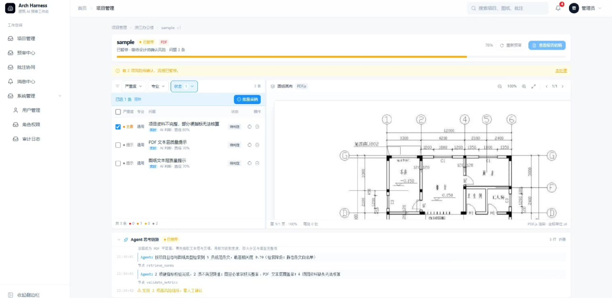
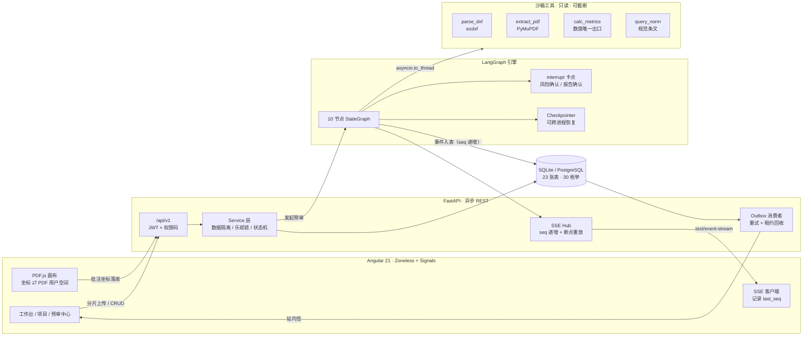

<div align="center">

# Arch-Harness

**建筑 AI 方案预审与图纸资料协同多 Agent 工作台**

把每一次审图，做成可追溯的对话。

[](https://angular.dev)
[](https://fastapi.tiangolo.com)
[](https://www.python.org)
[](https://www.sqlalchemy.org)
[](https://langchain-ai.github.io/langgraph/)
[](https://tailwindcss.com)
[](https://mozilla.github.io/pdf.js/)
[](#)

</div>

---

<!-- 演示视频：GitHub 会过滤 <video> 标签，这里用封面图链接到视频文件 -->
<div align="center">

<a href="演示视频.mp4"></a>

**▶ [观看 90 秒演示视频](演示视频.mp4)**

</div>

> 🎬 **核心演示链路**：发起预审 → 思考链路流式追加 → 风险中断暂停 → 人工确认 → 原地续跑。

---

## ✦ 项目简介

传统设计院的方案审图是典型的人力密集环节：一次方案报审要跑建筑、结构、机电、消防多个专业，人工逐张查"错、漏、碰、缺"，一轮下来按天计；问题发现率高度依赖审图人的经验，而且**发现问题之后也没有留痕**——为什么放行、依据哪条规范、谁确认的，往往只存在于聊天记录里。

Arch-Harness 把这件事拆成一条可追溯的流：图纸进系统 → 多 Agent 协同预审 → 遇到高风险指标**真的暂停**等人判断 → 人确认后从断点续跑 → 问题转成锚定在图面上的批注 → 指派、修改、复核、关闭，全程有审计和消息。

它面向三类使用者：**设计院审图专员**（把重复劳动交给 AI，把判断留给自己）、**方案设计师**（收到带坐标的批注，而不是一段模糊的文字描述）、**项目管理者**（看到问题压在谁手上、这周拦下了多少）。

> 设计原则只有一条：**AI 不做最终裁决，只做可被质疑的初稿**。所以系统里有两个 HITL 卡点、一个专门驳掉误报的"采纳"步骤、以及一个把每次判断都写进审计的状态机。

---

## ✦ 核心特性

- 🤖 **多 Agent 协同预审（LangGraph）**
  10 节点 StateGraph DAG：`load_context → plan → parse_drawings → retrieve_norms → validate_metrics → detect_issues → risk_check → generate_report → report_confirm → package_assets`，覆盖规范审查、碰撞检测、图面一致性三路检查。Mock 引擎与真实引擎接口完全一致（`REVIEW_ENGINE=mock|real`），线上出问题改一行配置即可回退，不用改代码。

- 📡 **SSE 实时推送 Agent 思考链路**
  预审不是"一次 HTTP 等 30 秒"，而是一条 `seq` 递增的事件流（`node_started / tool_call / tool_result / issue_found / risk_interrupt`），实测每轮 68 帧。前端记 `last_seq`，断线重连用 `Last-Event-ID` 从断点续传，**不重复、不丢帧**；进度条单调递增，不会从 80% 退回 40%。

- ⏸️ **Human-in-the-Loop：真挂起，不是弹个提示**
  两处 `interrupt()` 卡点：高风险指标（如防火分区面积不足）与报告定稿。流程挂起到 Checkpointer，**杀掉进程再唤醒也能接着跑**；确认接口超时返回 422，放行/豁免的每一条判断都落库留痕。

- 📦 **分片上传 + 魔数校验**
  会话 → 分片（`PUT`，可并发、可断点）→ 合并三段式；合并时做增量 SHA256、文件魔数、MD5、大小四重校验，缺片拒绝合并、重复合并返回 409、失败不留垃圾。`.exe` 改名成 `.pdf` 会在魔数这一步被拦下。

- 🔍 **真实解析 + 坐标级定位（不是假数据）**
  沙箱内集成 `ezdxf`（DXF 白名单图层、图签识别、`$INSUNITS` 单位归一）与 `PyMuPDF`（文本层、页幅、实体量），所有同步库跑在 `asyncio.to_thread` 里并由 `asyncio.wait_for` 兜超时，**事件循环不会被一张 50MB 的图纸钉死**。解析出的位置统一落到 PDF 用户空间（`bbox + page_size + origin`）而不是屏幕像素——16 组旋转（0/90/180/270）× 缩放（0.5/1/2/4）组合下，`toLocation → toScreen` 往返误差 **0.0000px**，换缩放、换设备、换图纸版本，框都还在原地。每个数字都必须能溯源到一次工具调用（`fact_ref`），`calc_metrics` 缺输入时返回 `INSUFFICIENT_INPUT`——**绝不猜一个数字**。

---

## ✦ 系统架构



四条工程约束贯穿整张图：

1. **沙箱只读、无状态、输出可截断**——工具不碰数据库、不缓存任务数据，实体量与文本块都有硬上限，`truncated` 标记必须透出；
2. **权限双防线**——功能权限码（`require(perm)`）管"能不能做这类操作"，Service 层数据权限管"能不能动这一条"，前端只负责菜单/按钮显隐和 403 路由；
3. **写库与留痕同事务**——状态变更、审计日志、领域事件在同一次提交里落库，再由 Outbox 异步投递，杜绝"业务成功但没留痕"；
4. **工具实现只有一份**——V1.0 主路径是进程内注册表 + `asyncio.to_thread`，同时保留一条 FastMCP 桥（`python -m app.sandbox.mcp_server`，装 `fastmcp` 即可用）把注册表原样暴露成 MCP 工具。V1.5 要拆独立沙箱进程/容器时直接复用同一份实现，不会出现"进程内和 MCP 两条路径慢慢跑偏"。

---

## ✦ 快速开始

**环境要求**：Python 3.12+、Node.js ≥ 20.19（或 22.12 / 24.x）、npm ≥ 10。

### 1. 后端

```bash
cd mybackend

# 1) 虚拟环境
python -m venv .venv
source .venv/Scripts/activate      # Windows (Git Bash)
# source .venv/bin/activate        # macOS / Linux
# .venv\Scripts\activate.bat       # Windows CMD

# 2) 依赖
pip install -r requirements.txt

# 3) 配置
cp .env.example .env               # 默认 SQLite + mock 引擎，可直接跑

# 4) 初始化数据库（23 张表）
alembic upgrade head
# 无迁移环境（纯本地快速验证）也可用：python -m app.seed --create-tables

# 5) 灌入演示数据（幂等，可重复执行）
python -m app.seed --demo

# 6) 启动
python -m uvicorn app.main:app --reload --port 8000
```

验收点：`http://localhost:8000/health` 返回 `{"status":"ok","version":"1.0.0"}`；接口文档 `http://localhost:8000/docs`（已预置 Bearer 鉴权，可直接 Authorize 调试）。

`--demo` 会写入：3 个账号、3 个项目（含 1 个空项目用于演示空态）、4 张图纸（PDF + DXF）、覆盖 4 种状态的批注、以及一条已跑完的预审任务，供工作台"确认数 / 环比 / 拦截率"有数可看。

### 2. 前端

```bash
cd mydemo
npm install
npm start
```

打开 `http://localhost:3000`。`proxy.conf.json` 已把 `/api` 代理到 `http://127.0.0.1:8000`，前后端各起一个进程即可，不需要改任何地址。

### 3. 演示账号

| 账号 | 密码 | 角色 | 能看到什么 |
| :--- | :--- | :--- | :--- |
| `admin@arch.com` | `Passw0rd123` | ADMIN（管理员） | 全部菜单，含系统管理（用户 / 角色权限 / 审计日志） |
| `reviewer@arch.com` | `Passw0rd123` | REVIEWER（审图专员 · 张工） | 可上传、可发起预审、可下发批注 |
| `designer@arch.com` | `Passw0rd123` | DESIGNER（设计师 · 李工） | 只有项目管理 / 预审中心 / 批注协同 / 消息中心，**看不到系统管理** |

> 建议用 `admin` 与 `designer` 各登录一次做对比：菜单与按钮是后端按权限码下发的，不是前端硬编码的显隐。

---

## ✦ 核心流程演示

完整脚本（含每一步的预期画面与讲解要点）在 [`docs/demo-script.md`](docs/demo-script.md)，走完约 12~15 分钟。以下是最短可感知路径：

**① 上传图纸 → ② 发起预审 → ③ 风险确认 → ④ 报告定稿 → ⑤ 批注下发**

1. **上传（1 分钟）**
   进项目 → 拖入 PDF → 分片进度到 100%。你会看到状态从「已上传 / 解析中」变为「解析完成」，并带出页数与大小。
   *看点：断网重试不会产生半张图纸；文件名非法字符在前端先清洗，避免后端 500。*

2. **发起预审（2 分钟，核心画面）**
   图纸行点「预审」→ 停在预审中心页，什么都不点。顶部阶段文案会依次走过"正在解析图纸 → 正在核对规范 → 正在归纳问题"，左侧思考链路按 `agent_thought / tool_call / tool_result / issue_found` 流式追加，问题卡片带严重度、规范条文号、置信度。
   *看点：把 WiFi 关掉几秒再打开，顶部会出现「实时连接已断开 · 重新连接」，点一下从 `last_seq` 续传——不重复、不丢事件。*

3. **风险确认（1 分钟，卡点一）**
   进度条转琥珀色并暂停，自动弹出风险确认弹窗：每条风险给出「检测值 vs 阈值」与条文号，逐条选择「确认是图纸问题」或「标记为特殊豁免」，提交后**从断点原地续跑**。
   *看点：这一步流程是真的挂起了（Checkpointer 落盘），不是弹个 toast 继续跑。*

4. **报告定稿（1 分钟，卡点二）**
   「查看报告初稿」→ 整页报告（摘要 / 问题清单 / 风险处置）→ 点「确认生成」才生成正式文档。「退回修改」强制填不少于 10 个字的原因，退回后流程带着这条意见重新分析。

5. **批注下发（1.5 分钟）**
   问题清单勾选 2~3 条 → 「采纳为批注草稿」→ 画布上出现带序号的批注框 → 右侧面板「下发」→ 选责任人。状态机走 `待确认 → 已下发 → 已修改待复核 → 已关闭`，每次流转都带 `row_version` 乐观锁。
   *看点：用 `designer` 登录，点「定位」会跳到批注所在页并自动选中高亮——从列表到图面只要一次点击。*

**可选加演（30 秒，很有说服力）**：`designer` 登录状态下直接在地址栏输入 `/admin/users`，会落到 403 空状态页而不是首页——路由守卫与页面级权限是两层。

---

## ✦ 技术文档与专栏索引

写这个项目的过程本身就是一份材料。想看"为什么这么设计、坑在哪、怎么验证的"，往下看：

### 📚 博客连载（踩坑复盘）

| 篇目 | 标题 | 主题 |
| :--- | :--- | :--- |
| D1 | [从零搭建 AI 预审平台地基：11 个鉴权与 ORM 的连环坑，我一个个踩给你看](https://blog.csdn.net/Confusd_pai/article/details/171313774?spm=1011.2415.3001.5331) | 供应链安全、`viewonly` 静默失败、循环外键、静默续期单飞 |
| D2 | [5 个并发打进来，3 个返回 200，库里只剩最后一条](https://blog.csdn.net/Confusd_pai/article/details/171372240?spm=1011.2415.3001.5331) | 乐观锁 ABA 窗口、物化计数丢更新、异步 ORM 的 N+1、403 读写分流 |
| D3 | [12 个分片都在飞，服务端只收到 1 个](https://blog.csdn.net/Confusd_pai/article/details/171416275?spm=1011.2415.3001.5331) | 分片上传三层竞态、原子合并、`Content-Type` 与文件头的信任边界 |
| D4 | [弹窗刚关掉，它又自己弹了出来](https://blog.csdn.net/Confusd_pai/article/details/171420080?spm=1011.2415.3001.5331) | 状态机重放、`Last-Event-ID` 续传、`interrupt()` 跨进程恢复 |
| D5 | [从已下发，改到已下发](https://blog.csdn.net/Confusd_pai/article/details/171433808?spm=1011.2415.3001.5331) | Outbox 站内信、审计日志被静默篡改、条件更新与秒级时间戳 |

每篇都是"现象 → 排查与解决 → 原理与沉淀"的结构，代码可以直接抄。


### ✅ 验证方式

不靠"看起来能跑"。后端 D1~D7 累计 **348 项断言与实测**通过（D2 单阶段 38 项、D4 64 项、D5 82 项、D7 75 项），覆盖并发、越权、断线重连、进程崩溃恢复、工具错误路径；另有 `locustfile.py` 做压测基线。几个可复述的结论：

- 5 个并发打同一 `row_version` → `[200, 409, 409, 409, 409]`，恰好一个赢
- 批注列表 `page_size=20`（12 条）与 `page_size=1`（1 条），SQL 条数都是 **8**
- 前后端权限双层：非成员访问任意项目资源一律 403；跨项目引用返 422 而不确认资源是否存在

---

## ✦ 项目结构

```text
.
├── mybackend/                    # FastAPI 后端（Python 3.12）
│   ├── app/
│   │   ├── ai/                   # LangGraph 引擎：graph / nodes / hitl / mock|real engine
│   │   ├── sandbox/              # 只读解析工具 + 工具注册表 + FastMCP 桥（process-in-thread 优先）
│   │   ├── routers/              # 10 个路由模块（auth / projects / drawings / uploads / review / hitl / ...）
│   │   ├── services/             # 业务与数据权限：状态机、审计、批注时间线、通知
│   │   ├── models/               # 23 张表 / 30 个枚举
│   │   ├── sse/                  # 事件 Hub（seq 递增、断点重放）
│   │   ├── notify/               # Outbox + 渠道适配器（站内信）
│   │   ├── core/                 # 配置、JWT、异常、存储、票据
│   │   └── seed.py               # 幂等种子数据（--demo）
│   ├── alembic/versions/         # 4 条迁移（初始 23 表 → agent events → outbox → 索引）
│   ├── locustfile.py             # 压测脚本
│   └── requirements.txt
│
├── mydemo/                       # Angular 21 前端（Standalone + Zoneless + Signals）
│   ├── src/app/
│   │   ├── core/                 # 拦截器、鉴权、SSE 客户端、PDF 坐标换算
│   │   ├── layout/               # 侧边栏（后端菜单驱动）+ 顶栏 + 消息铃铛
│   │   ├── pages/                # dashboard / projects / review / annotations / admin / notifications / settings / login / 403
│   │   └── shared/               # 通用组件与管线
│   └── proxy.conf.json           # /api → 127.0.0.1:8000
│
└── README.md
```

---

> **V1.0 已知边界**（写在明面上，比藏起来好）：DXF 目前只提供下载、不做在线渲染；批注框可创建与定位，拖拽与 8 控制点缩放未做；缩略图条、项目成员管理界面（接口已就绪）排进后续版本。角色权限矩阵在 V1.0 为只读——权限变更走代码评审和数据迁移，不在界面上直接放开。

<div align="center">

**如果这个项目对你有帮助，欢迎点个 Star ⭐**

`FastAPI` · `Angular` · `LangGraph` · `SQLAlchemy 2.0` · `SSE` · `PDF.js` · `ezdxf` · `PyMuPDF`

</div>
