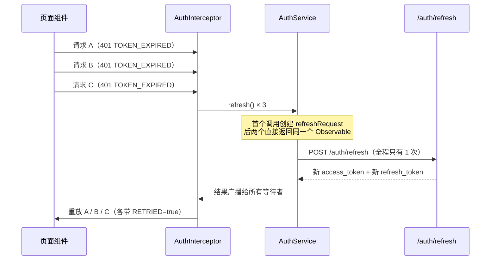
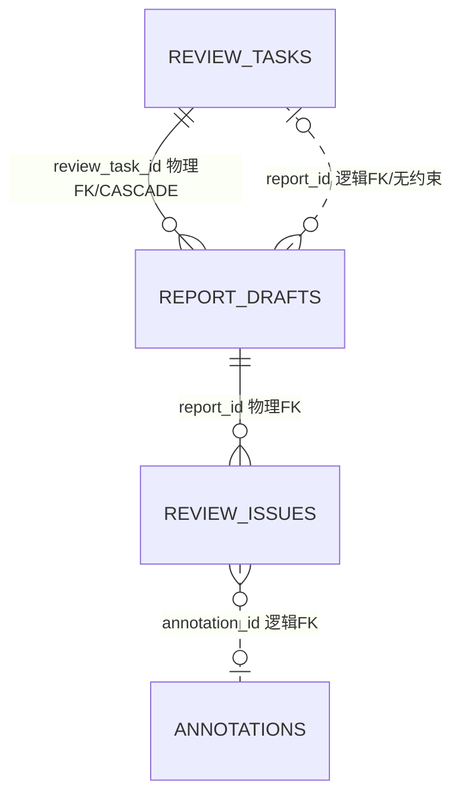

# 从零搭建 AI 预审平台地基：11 个鉴权与 ORM 的连环坑，我一个个踩给你看

这是一个前后端分离的复杂 B 端系统——建筑图纸的 AI 预审平台，多角色、多权限码、长会话、前后端两套独立工程，前端 Angular、后端 FastAPI。D1 阶段的目标很朴素：把地基搭起来，登录能进、权限能拦、表能建。

结果这一天里，我踩了 11 个坑。其中 3 个属于「不报错但结果是错的」，比直接崩掉危险得多。

这篇是《建筑 AI 预审平台实战》系列的第一篇，主题就一个：**从零搭系统地基时，前端鉴权链路和后端 ORM 上那些没人提前告诉你的暗坑**。每个坑我都按「现象 → 排查与解决 → 原理与沉淀」写，能直接抄的代码我留在正文里，能省的废话我省掉。

先说清楚这套地基的规模，方便你对号入座：

| 维度 | 选型 / 交付 |
| :--- | :--- |
| 前端 | Angular 21 Standalone + Zoneless + Signals + Tailwind，初始包 296 kB / gzip 81 kB |
| 后端 | FastAPI + SQLAlchemy 2.0（异步）+ Alembic + SQLite / PostgreSQL 双跑 |
| 数据模型 | 23 张表、30 个枚举、16 条权限码、41 条角色-权限绑定 |
| 鉴权 | JWT 双 token（access 2h / refresh 7d）+ `token_version` 失效机制 |

下面按三块讲：前端基建、后端依赖、数据库与 ORM。

---

## 第一块 · 前端基建与拦截器：RxJS 的高阶玩法

前端这一块的坑有个共同特征——**它们都不是"写错代码"，而是"选错了默认值"**。框架给你的默认姿势、教程给你的默认库、`@latest` 给你的默认版本，在这套组合里都会有代价。

### 1.1 依赖降级：不追最新，追"能对齐生态"的最新

**【现象】**

按 2026 年的标准姿势初始化：

```bash
npx @angular/cli@latest new mydemo
```

拿到的是 Angular 22.3。接着装图标库：

```text
npm error code ERESOLVE
npm error While resolving: lucide-angular@1.0.0
npm error Found: @angular/core@22.3.0
npm error Conflicting peer dependency: @angular/core@"^13 || ... || ^21"
```

`lucide-angular@1.0.0` 的 peer 范围只到 `21.x`，不含 22。

**【排查与解决】**

三条路，都有代价：

- `--legacy-peer-deps` 强装：把不兼容从"安装期"推迟到"运行期"。而图标是模板级渲染，一旦炸就是整页白屏，且 CI 每次装依赖都要复述这个 flag；
- 换图标库 / 自己包 SVG：D1 只有一天，等于把基建工期换成一个可替换的次要组件；
- 降大版本：得确认"降掉的这部分"里没有本次要用的能力。

关键判断在这里：Angular 21 已经是 Zoneless + Signals 的稳定版，22 相对 21 的增量，**没有一项是 D1 依赖的**；而组件库、构建链、团队经验都还锚在 21。于是把版本钉死在 `@angular/cli: 21.2.x`，功能面零损失，并把"为什么是 21 不是 22"写进 README。

**【原理与沉淀】**

`ERESOLVE` 不是安装环境的毛病，它是**运行期风险的前置告警**——npm 在替你预演"这两个包凑在一起会不会出事"。`--legacy-peer-deps` 的本质不是修复，是**关掉告警**。

版本决策我一般看三轴：**能力是否够用、生态是否咬合、回滚成本是否可控**。三轴都过，版本号大小就只是个数字。

还有一条更便宜的纪律：**依赖约束的原因必须落文档**，否则三个月后一定有人"顺手升级"一下，然后花两天重新踩一遍你今天的坑。

### 1.2 图标适配：NgModule 时代的组件，怎么塞进 Standalone

**【现象】**

`lucide-angular@1.0.0` 的 `LucideAngularComponent` 还是 NgModule 的 `declarations`，不是 standalone 组件。而项目是纯 Standalone 架构，组件想用图标，第一步就卡在"能不能 import"。

更麻烦的是它有两种用法：`[name]="'bell'"` 走 `LUCIDE_ICONS` 注册表，`[img]` 直接吃图标数据。前者名字写错会在**运行时抛异常**，而且注册表是"全量声明"，打包器没法按需裁剪。

**【排查与解决】**

不硬碰模块边界，包一个唯一入口 `shared/icon/icon.ts`：

```typescript
const ICONS = { bell: Bell, search: Search /* ... */ } satisfies Record<string, LucideIconData>;
export type IconName = keyof typeof ICONS;

@Component({
  selector: 'app-icon',
  imports: [LucideAngularModule],   // 只能导模块，兼容库的 NgModule 边界
  template: `<lucide-icon [img]="data()" [size]="size()" [strokeWidth]="strokeWidth()" />`,
})
export class IconComponent {
  readonly name = input.required<IconName>();          // 图标名拼错 = 编译期报错
  protected readonly data = computed(() => ICONS[this.name()]);
}
```

用 `[img]` 直传图标数据，绕开运行时注册表；用 `keyof typeof ICONS` 把"名字拼错"从运行期异常变成编译错误；线宽 1.75、尺寸 18 在组件内收敛，业务侧只写 `name="bell"`。

**【原理与沉淀】**

封装 `<app-icon>` 的收益不是少写一行标签，是**把容错点前移**：注册表方案是"运行时查字典，查不到抛错"，直传数据方案是"编译期类型检查，写错根本编不过"。图标这种一天要被引用几十次的基础件，错误提前一小时发现，价值差一个数量级。

顺带一个副作用收益：每个图标保持独立模块、按需进包，tree-shaking 不会被"全量注册表"废掉。

### 1.3 静默续期：并发 401 下的单飞与幂等重放

**【现象】**

需求是 access token 过期时静默续期、重放原请求、用户无感。真实场景不是"一个请求 401"，而是**首页并发 3~5 个接口同时 401**。第一版写法的三个雷一起爆：

- **并发**：每个 401 各自发 refresh，在 refresh token 轮换（rotation）语义下，后到的请求拿着已被作废的 token 去换，直接把人踢下线；
- **递归**：重放后如果还是 401（服务端时钟偏移、新 token 不被接受），无标记的 `next(retryReq)` 会无限重试；
- **职责串味**：拦截器里 `new HttpClient()` 会脱离拦截器链，丢掉其它拦截器和统一错误处理。

**【排查与解决】**

两件事：在 `AuthService` 里做 **single flight**，在请求上做 **幂等标记**。

```typescript
private refreshRequest: Observable<TokenResponse> | null = null;

refresh(): Observable<TokenResponse> {
  if (this.refreshRequest) return this.refreshRequest;      // 单飞：后来者共享同一个
  this.refreshRequest = this.http.post<TokenResponse>(`${API_BASE_URL}/auth/refresh`, { refresh_token })
    .pipe(
      tap(tokens => this.jwt.save(tokens, remember)),
      finalize(() => (this.refreshRequest = null)),          // 完成后必须复位
      shareReplay({ bufferSize: 1, refCount: false }),
    );
  return this.refreshRequest;
}
```

```typescript
export const RETRIED = new HttpContextToken<boolean>(() => false);

if (error.status === 401 && code === 'TOKEN_EXPIRED' && !request.context.get(RETRIED)) {
  return auth.refresh().pipe(
    switchMap(tokens => next(request.clone({
      setHeaders: { Authorization: `Bearer ${tokens.access_token}` },
      context: request.context.set(RETRIED, true),           // 同一请求最多重放一次
    }))),
    catchError(err => { auth.expireSession(); return throwError(() => err); }),
  );
}
```

配套的边界也得钉死：登录 / 注册 / 续期三个端点从 Bearer 注入里排除；续期接口自己返回 401 时不再触发续期（否则就是自己咬自己）；`403 FORBIDDEN` **只弹 Toast、不跳登录**——权限不足不是登录态问题，把用户踹回登录页反而是错的。

正常时序是这样：



**【原理与沉淀】**

`shareReplay` 能做到单飞，是因为它把上游 Observable **多播**了：第一个订阅者触发源订阅，后续订阅者不再触发源，直接拿缓存结果。所以这里必须是 `refCount: false`——**宁可让上游多活一会儿，也要保证同一个"续期窗口"内的所有等待者共享同一次执行**。

反过来，如果你写的是 `refCount: true`，坑会出现在**时间差**上：首页那 5 个请求不是同一毫秒失败的，第二个 401 可能晚到 80ms。第一个请求的续期完成后订阅数归零，`shareReplay` 就会退订上游、丢弃缓存；第 80ms 到达的那个 401 便发起**第二次全新 refresh**——而它手里的 refresh token 已经在第一轮轮换中被作废了。于是用户被踢下线，你在日志里看到的却只是一次"正常的 401"。**单飞在并发下保证"同时"，在时间差下保证不了，只有把上游按住不放才能兜住。**

但 `refCount: false` 有个反作用力你必须自己处理：**它会把错误也缓存下来重放**。如果这次 refresh 失败了、你没有清掉引用，那么三分钟后下一个 401 进来会拿到**上一轮缓存的失败结果**，永远不会再真正请求一次。这就是那个 `finalize(() => this.refreshRequest = null)` 的全部意义——它不是善后代码，它是这个单飞方案的正确性组成部分。

一句话总结这个坑：**401 续期难的不是把 token 换回来，是并发和边界**。

### 1.4 首屏重定向丢失：`router.url` 在导航完成前是假的

**【现象】**

refresh 也失效时应该跳 `/login?redirect={当前路径}`，登录后回到原页面。功能自测通过。但浏览器实测发现：**刷新内页、或直接打开深链时，`redirect` 参数丢了**，登录后一律落到 `/dashboard`。

理想链路：

```text
GET /auth/me 401 → POST /auth/refresh 401 → /login?redirect=%2Fdashboard
```

实际链路：`redirect` 那一截是空的。

**【排查与解决】**

`expireSession()` 原本取 `router.url` 当"用户当前在哪"。但这条路径发生在**初始导航尚未完成时**——Router 还没提交新 URL，`router.url` 仍是 `/`，`routerState.snapshot` 同理，它们表示的是"上一次已完成的导航"，不是"用户想去哪"。

备用方案（把守卫的 `state.url` 一路从路由层传到 HTTP 层）也被否掉了：会让 HTTP 层反向依赖路由层，职责串味。

那就换权威来源——**那一刻只有浏览器地址栏是准的**：

```typescript
const current = `${window.location.pathname}${window.location.search}`;
const shouldRedirectBack = current !== '/' && !current.startsWith('/login');

void this.router.navigate(['/login'], {
  queryParams: shouldRedirectBack ? { redirect: current } : {},
  replaceUrl: true,        // 别把登录页塞进历史栈，用户按返回键会来回弹
});
```

守卫侧保留 `state.url` 作为"首跳兜底"，两条路各管一段。登录页对 `redirect` 再做一次站内白名单校验（必须以 `/` 开头、排除 `//` 与 `/login`），把开放重定向挡在入口。

**【原理与沉淀】**

根因是对框架生命周期的理解偏差：**导航是一个过程，不是一个瞬时状态**。守卫、拦截器、组件初始化分别跑在这个过程的不同阶段，任何"在过程中读取导航结果"的代码，读到的都是旧快照。

`replaceUrl: true` 是同一类思考的延伸：如果我 push 进历史栈，用户从"登录页按返回"会回到那个已经失效的页面，再被 401 踹回来，形成一条死循环历史。

至于白名单——`redirect` 参数本质是**用户可控的跳转目标**，不做校验就是教科书级的开放重定向。这类参数永远只信"站内相对路径"。

### 1.5 Signals + Zoneless：变更检测的契约变了

**【现象】**

登录态、侧边栏折叠、Toast 队列、表单的 `submitting` / `errorMessage` 分散在服务与组件里。早期写法很容易落到一个症状：**数据变了，页面不动**。刷新一下又好了。

**【排查与解决】**

Zoneless 下没有"自动刷新"这回事了，所有驱动视图的状态必须显式化：

```typescript
private readonly userState = signal<CurrentUser | null>(null);
readonly isLoggedIn  = computed(() => this.userState() !== null);
readonly permissions = computed(() => this.userState()?.permissions ?? []);

// HTTP → signal：副作用只做"写信号"这一件事
private fetchMe() {
  return this.http.get<CurrentUser>(`${API_BASE_URL}/auth/me`)
    .pipe(tap(user => this.userState.set(user)));
}
```

规矩定死三条：能驱动视图的状态一律 `signal`；派生值一律 `computed`；副作用（HTTP 回调、`storage` 事件、定时器）**只负责写信号，不做别的**。组件统一 `OnPush`。

效果是可量化的：初始包 296 kB / gzip 81 kB，登录、续期、布局切换全程没有一次手动 `markForCheck`。

**【原理与沉淀】**

`zone.js` 的工作方式是 monkey-patch 掉全局的异步 API（`setTimeout`、XHR、Promise），靠"猜"什么时候该检查视图——猜得很准，但代价是整棵组件树检查，CPU 白烧、重复渲染不可控。

Zoneless 把这个兜底拿掉了。所以这不是"少配了个东西"，而是**契约变了**：从"任意异步都会触发检查"变成"只有信号写入才触发检查"。在 `subscribe` 里给普通字段赋值，Angular 从机制上就不可能知道。

好处也不只是性能：**依赖关系在代码里变显式了**，谁读、谁写、谁派生，一眼看得见，不用再靠 `markForCheck` 祈祷。唯一的边界是第三方非 signal 组件（图表、富文本），接的时候要单独隔离，这点我在 D3 接标注画布时会重新面对。

---

前端的坑基本都在"默认值"和"并发边界"上。而后端这一块，我踩的是另一个维度的问题：**生态里最流行的那个选项，恰好是不能用的那个**。

## 第二块 · 后端选型与依赖地狱：Python 生态的坑

这一块的三个坑，本质上都是同一个问题的三种长相：**你要的能力，标准答案给不了，而错误答案看起来非常像正确答案**。教程推荐的库、约定俗成的组合、随手能写出来的方案，每一个都能跑通 demo，然后在地基上留一道裂缝。

### 2.1 JWT 选型：从 python-jose 切到 PyJWT

**【现象】**

D1 定依赖时，`python-jose[cryptography]` 是 FastAPI 生态里被教程默认推荐的方案，装上就能跑。但在做依赖审计（pip-audit + 人工过 CVE）时发现两个问题：

```text
CVE-2024-33663  algorithm confusion（算法混淆，可用于伪造签名）
CVE-2024-33664  JWE decompression bomb（压缩炸弹 DoS）
python-jose 最新版本 3.3.0（2021 年），无修复版本
```

**【排查与解决】**

这是"生态默认选项"和"供应链安全"的正面冲突：教程、示例、StackOverflow 答案几乎全是 python-jose，换掉意味着重写 `encode/decode` 的参数与异常处理。但继续用，等于把一个**已知可被伪造 token** 的组件放进鉴权链路——这是后端最不能妥协的位置。

于是整体切到 PyJWT 2.9，同时做两件事降低耦合：

1. **收口**：`app/core/security.py` 只对外暴露 `create_token` / `create_token_pair` / `decode_token`，业务层不 import 任何 JWT 库；
2. **收紧校验**：`algorithms=[settings.JWT_ALGORITHM]` 白名单、`options={"require": ["exp", "sub", "type"]}` 强制必需声明、`type` 校验（access 不能拿去调 refresh）、异常统一映射成 `TOKEN_EXPIRED` / `UNAUTHORIZED`，返回 **401 而不是 500**。

换库的实际成本：**一个文件，约 40 行**。顺手把 `prd-06` 的依赖清单同步改了——文档和代码两张皮，是下一个人踩坑的起点。

**【原理与沉淀】**

"算法混淆"能成立，是因为解码时如果 `algorithms` 不写白名单，攻击者可以把 header 里的 `alg` 改成 `none` 或换成非对称/对称混用，让验签逻辑走错分支。**永远不要让 token 自己决定用什么算法验签**。

这次真正学到的是架构层面的东西：**鉴权收口到一个模块，换库成本就等于一个文件**。如果当初图快，在 router 里直接 `jose.jwt.decode(...)`，今天这场切换就是全项目搜索替换 + 回归测试。封装的价值不在"好看"，在于**把未来的变更成本提前买下来**。

顺便一句：`python-jose` 三年没发版这件事比 CVE 本身更值得警惕——**一个不再维护的库，它的 CVE 就是永久性的**。

### 2.2 密码哈希：passlib 崩了，退回原生 bcrypt（附 72 字节截断）

**【现象】**

按计划写好 `passlib[bcrypt]==1.7.4`，服务启动即崩：

```text
AttributeError: module 'bcrypt' has no attribute '__about__'
```

**【排查与解决】**

根因是**库与库之间通过私有属性耦合**：passlib 1.7.4（2020 年发布）通过读 `bcrypt.__about__.__version__` 做后端版本探测，而 bcrypt 4.1 把这个私有属性删了。

三条常规绕法，代价都不小：

| 绕法 | 代价 |
| :--- | :--- |
| pin `bcrypt<4.1` | 为一个不维护的库，把安全组件降级回旧版本，不可接受 |
| 运行时 monkey patch `bcrypt.__about__` | 靠修补第三方私有结构，下次升级必再炸 |
| 换 argon2 | 新算法 + 新依赖，MVP 阶段收益抵不上迁移成本 |

我选了第四条：**弃用 passlib，直接调原生 bcrypt 4.2**。同时顺手补掉一个更隐蔽的坑——bcrypt 只处理输入的前 **72 字节**，超长密码（尤其多字节的中文密码）会被**静默截断**：

```python
def _prehash(pw: str) -> bytes:
    return hashlib.sha256(pw.encode("utf-8")).digest()   # 固定 32B，规避 72B 截断

def hash_password(pw: str) -> str:
    return bcrypt.hashpw(_prehash(pw), bcrypt.gensalt(rounds=12)).decode()

def verify_password(pw: str, hashed: str) -> bool:
    try:
        return bcrypt.checkpw(_prehash(pw), hashed.encode())
    except (ValueError, TypeError):
        return False          # 脏数据返回 False，而不是抛 500
```

DB 侧 `password_hash` 给 `String(128)`（bcrypt 输出 60 字符，留足余量），并且全局只暴露这一对函数，杜绝"某个地方忘了预哈希"。

**【原理与沉淀】**

第一个教训关于依赖治理：**为兼容一个不维护的库，去降级一个安全组件，是把"构建失败"换成"线上可被撞库"**。CI 变绿不是目的。

第二个教训更值得记：bcrypt 的 72 字节上限**不报错**。你写一个 100 字节的密码，注册成功、登录成功，但只有前 72 字节参与运算——意味着两个前 72 字节相同的密码互相可以登录。先做一次 SHA-256 再喂进去（等价于 `bcrypt_sha256`），输入被压成固定 32 字节，问题消失，代价是每次校验多一次哈希，可以忽略。

第三个细节：`verify_password` 里那个 `except` 不是防御性编程的洁癖。哈希存成脏数据时，`checkpw` 会抛 `ValueError`，如果不管它，一个脏行就能让登录接口 500——**密码校验失败应该是 401，不是 500**。

### 2.3 登录限流：进程内滑动窗口 + 显式记账

**【现象】**

PRD 要求"连续 5 次登录失败返回 429"。MVP 阶段是单实例部署，我不想为一个功能引入 Redis。

**【排查与解决】**

完整方案当然是 Redis + 滑动窗口/令牌桶（跨进程共享、可设 TTL）。进程内方案有三个硬缺陷，我先把它们写清楚再决定上：

| 缺陷 | 后果 |
| :--- | :--- |
| 计数不跨进程 | `--workers 4` 时每个 worker 各给 5 次额度，实际防护 = 5 × N |
| 内存无界 | dict 只增不减，长期运行积累垃圾 key |
| 重启即清零 | 部署窗口期防护失效 |

然后才是实现：

```python
_fail_counter: dict[str, list[float]] = defaultdict(list)   # email -> 失败时间戳

def _check_rate_limit(key: str) -> None:
    now, window = time.time(), settings.LOGIN_LOCK_SECONDS
    hits = [t for t in _fail_counter[key] if now - t < window]  # 顺带清理过期项
    _fail_counter[key] = hits
    if len(hits) >= settings.LOGIN_MAX_FAILURES:
        raise RateLimited(f"尝试过于频繁，请 {window // 60} 分钟后再试")
```

三个设计细节值得单独说：

1. **key 用 email 而不是 IP**：NAT 下一个出口 IP 可能是一整栋办公楼，按 IP 限流会误伤一整个公司；而攻击者换个出口 IP 就绕过了。email 才是"被攻击的账号"这个真正的维度；
2. **登录成功即清空计数**（`_fail_counter.pop(email, None)`）：否则正常用户输错 4 次、第 5 次输对了，仍然被锁 5 分钟——**防护措施误伤正常用户，比没有防护更糟**；
3. **代码注释 + PRD 双写"多实例必须换 Redis"**，并把 Redis 实现的位置预留出来。

**【原理与沉淀】**

这个坑的沉淀不是限流算法，是一条工程纪律：**降级方案必须带上边界和出口，并且写进代码里**。

进程内限流本身没问题，问题在于"没人知道它什么时候会失效"。今天单实例它是对的，明天改成 `--workers 4` 它就是错的，而且是**静默地错**——接口还在返回 429，只是额度变成了 4 倍。

所以我在函数上方写了一行注释：`# 单实例有效；部署 --workers > 1 或多实例时必须切 Redis（见 rate_limit_redis.py）`。技术债不可怕，可怕的是没人知道它什么时候到期。

---

前两个块的坑，踩到的时候至少会有反馈：装不上、起不来、页面不动。而第三块这三个，**全都安静得让人放心**——接口返回 200，日志干干净净，只有你去查库的时候才发现数据是错的。

## 第三块 · 数据库与 ORM 进阶：那些不报错但结果错的坑

D1 这天最大的认知转变发生在这里：我把验收口径从"**接口返回 200**"改成了"**库里数据是否如预期**"。

23 张表建完之后，我们的通过标准不再是 Swagger 里点一遍，而是直接查计数：`role_permissions = 41`（16 + 13 + 7 + 5）、`user_roles = 2`、表数 = 23、seed 连跑两次幂等。**用数据资产断言，比用接口状态码断言可靠一个数量级**——因为接口 200 只证明链路通了，不证明它写对了地方。

### 3.1 循环外键：从物理外键退到"单向物理 + 反向逻辑"

**【现象】**

`review_tasks.report_id → report_drafts.id` 与 `report_drafts.review_task_id → review_tasks.id` 双向引用，建表直接失败（SQLite）：

```text
sqlalchemy.exc.CircularDependencyError: Can't sort tables for DDL: cycle
review_tasks -> report_drafts -> review_tasks
```

**【排查与解决】**

这是三条约束同时打架：

1. **建模需求**：任务要指向"当前报告"，报告要指向"所属任务"，双向引用是真实业务语义，不是设计错误；
2. **SQLAlchemy 标准解法失效**：官方对循环依赖的解法是 `ForeignKey(..., use_alter=True)`——先建表，再 `ALTER TABLE ADD CONSTRAINT`。而 **SQLite 不支持 `ALTER TABLE ... ADD CONSTRAINT`**；
3. **可移植性要求**：开发/测试跑 SQLite、生产跑 PostgreSQL，两边都必须能建起来。

还有个容易忽略的细节：即使换到 PostgreSQL，用 `DEFERRABLE INITIALLY DEFERRED` 能绕开环形插入问题——但 **SQLite 连延迟约束都没有**（另外它的 `PRAGMA foreign_keys` 默认是关的，得显式打开，否则你以为有外键其实没有）。

最终取舍：**只保留从属方向的物理外键，反向退化为逻辑外键**。

| 字段 | 处理 | 理由 |
| :--- | :--- | :--- |
| `report_drafts.review_task_id` | 物理 FK + `ON DELETE CASCADE` | 报告依附于任务，级联删除语义明确，且不成环 |
| `review_tasks.report_id` | 普通 `Uuid` 列，**不建约束** | 破环；它是"当前指针"，由 Service 在单事务内维护 |
| `review_issues.annotation_id` | 同样逻辑外键 | 与 annotations 双向引用，同一类问题 |



把两种方案摆在一起，差异就非常清楚了。**右边这一列不只是"对比"，它还记录了我从数据库手里接过来的每一份责任**：

| 维度 | 物理外键 | 逻辑外键 |
| :--- | :--- | :--- |
| 建表 | 循环引用时 DDL 排序直接失败；`use_alter` 是官方解法，但 SQLite 不支持 `ALTER TABLE ... ADD CONSTRAINT` | 无约束、无方言差异，正常建表 |
| 一致性 | 数据库强制兜底，脏 ID 不可能写进去 | 应用层（Service）保证：写入收敛到单事务（采纳 → 建批注 → 回填 ID），并用 `annotations.project_id` 这类冗余字段做查询隔离 |
| 级联删除 | `ON DELETE CASCADE` 由数据库自动处理 | 得手写：删报告时显式清空 `review_tasks.report_id`，否则留下一批野指针 |
| 写入顺序 | 必须先插父行；环形插入需要延迟约束，而 SQLite 没有 | 顺序自由，代码怎么写都不会卡在约束上 |
| 脏数据感知 | 不可能产生，无需关心 | 需要巡检：每日扫 `report_id` 指向不存在报告的行（这条我只写了约定、还没实现，是明确挂账的待偿债项） |
| 跨库兼容 | 方言差异大，SQLite 还得显式 `PRAGMA foreign_keys = ON` | 零方言成本，换库不用动模型 |

**最右列每一行，都是我从数据库手里接过来的一份责任。** 这就是"降级"和"逃跑"的区别：删掉约束让它跑起来叫逃跑；删掉约束、同时把一致性责任搬到应用层并写清边界，才叫降级。

**【原理与沉淀】**

这个坑最值得说的不是方案，是那个钩子——**如果你不把约定写进代码，六个月后一定会有人"好心"把 FK 补回去**。

想象一下那时的场景：某个新人看到 `review_tasks.report_id` 没外键，觉得"这是遗漏"，加了一行 `ForeignKey("report_drafts.id")`，本地跑 PostgreSQL 一切正常，PR 顺利合并。然后所有人的 SQLite 测试环境在下次 `alembic upgrade head` 时直接死在 `Can't sort tables for DDL: cycle`——**而那个报错根本不会指向他改的那一行**，它指向表排序。别人接手时只能从头再走一遍今天这条路。

所以我在迁移脚本里留了这段注释：

```sql
-- ⚠️ 禁止为 review_tasks.report_id 补加外键约束。
-- 与 report_drafts.review_task_id 构成循环 FK，SQLite 不支持 use_alter 的 ALTER TABLE 方案，
-- 会导致 alembic upgrade head 在建表排序阶段直接失败。一致性由 Service 单事务保证。
```

**降级方案的正确写法是"代价 + 补偿 + 禁令"三件套**，而且禁令得写两处——迁移脚本注释（给改模型的人看）和 PRD（给写需求的人看）。只写方案不写禁令，等于给未来埋了一颗延迟引信。

### 3.2 `viewonly`：赋值成功、commit 成功、关联表是空的

**【现象】**

seed 脚本里 `user.roles = [role]`，不报错，`commit()` 成功，日志正常。

然后登录：

```json
{ "roles": [], "permissions": [], "menus": [] }
```

接口 200，数据全空。

**【排查与解决】**

查库才发现 `user_roles` 关联表里一条记录都没有。根因在关系定义上——`relationship(..., viewonly=True)` 的语义是"**只读、不参与 flush**"：赋值只改内存里的集合，**永远不会写关联表**。

修法不是"两个方向都可写"（那会造成双写冲突、重复插入），而是明确**谁是写方向**：

```python
class User(Base):
    # 写方向：可写，与 Role.users 配对
    roles: Mapped[list[Role]] = relationship(
        secondary="user_roles", lazy="selectin", back_populates="users"
    )

class Role(Base):
    # 反向只读，防止两边同时 flush 造成重复插入
    users: Mapped[list[User]] = relationship(
        secondary="user_roles", lazy="noload", back_populates="roles", viewonly=True
    )
```

更重要的是**改掉验证方式**：不再以"接口 200 / 页面有菜单"作为通过标准，而是 seed 之后直接查关联表计数——`role_permissions = 41`、`user_roles = 2`。

**【原理与沉淀】**

为什么 SQLAlchemy 会静默失败？因为 `viewonly=True` 是**用户显式声明"这个关系我只用来读"**。ORM 尊重你的声明，把写入职责从 flush 流程里摘掉了——它认为你是故意的，所以不报警。这是设计上的自洽，不是 bug。

这个坑阴在两点叠加：

1. **静默失败比异常危险得多**。异常会给你堆栈，静默失败只给你一个 200；
2. **`roles` 关系读得出数据**（如果库里已经有），所以"读得到"会让人反向推断"写也没问题"——但读和写在 `viewonly` 下根本不是同一条路径。

一句话沉淀：**当一件事"做成功了但没效果"，第一个该怀疑的不是逻辑，是"我调用的这个 API 到底承诺了什么"**。

### 3.3 类型绑定：JWT 里的 `str` 一路裸奔到 `Uuid` 列

**【现象】**

`login` 正常，`refresh` 500。两边代码看起来"一模一样"，差别只在 refresh 少做了一次类型转换：

```python
# 崩：payload["sub"] 是 str，直接和 Uuid 列比较
user = (await db.execute(select(User).where(User.id == payload["sub"]))).scalar_one_or_none()
```

```text
AttributeError: 'str' object has no attribute 'hex'
```

**【排查与解决】**

SQLAlchemy 2.0 的 `Uuid` 类型在 bind 阶段要调用 `.hex` 之类的属性把值转成存储格式，传 `str` 进去直接炸。而 Python 是动态类型、`payload` 是个裸 `dict`，Pydantic 也拦不到——错误被推迟到 SQL 编译/执行期，于是表现为 **500 而不是 422**。

改法是在**边界层做类型收敛**，外部输入进业务前一律转成领域类型：

```python
try:
    user_id = uuid.UUID(str(payload["sub"]))
except (KeyError, ValueError) as exc:
    raise Unauthorized("无效的凭证") from exc     # 归到 401，不是 500
```

然后把这段收进 `get_current_user` 依赖，让 refresh 复用同一套解析逻辑——**别给第三个入口再漏一次的机会**。

**【原理与沉淀】**

`login` 好、`refresh` 坏，这个信号本身就是最好的线索：**同一类操作出现不一致结果，基本可以断定两个入口的实现分叉了**。别急着看 SQL，先 diff 那两个入口的差异行，通常三行之内就能找到。

更深一层的沉淀是边界纪律：**`sub`、query 里的 `id`、header 里的外部 ID，进入 Service 之前必须是 `uuid.UUID`，不允许 `str` 透传到 ORM**。动态类型的语言不会替你检查这件事，只能在边界上人工设卡。

还有那个异常映射：凭证解析失败是**客户端的错**，返回 401；只有服务端自己出问题才该是 500。这个区分不做好，监控面板上全是假的"服务端故障"，真出事的时候没人信它。

---

## 实战避坑清单

19 条，覆盖上面 11 个坑点（有几个坑一句话说不完，我拆成了两条），建议直接收藏：

1. **`ERESOLVE` 不是环境毛病，是运行期风险的前置告警**——`--legacy-peer-deps` 只是关掉了告警，别用它换一个白屏。
2. **版本选"生态能对齐的最新"，不选"最新"**——能力够用、生态咬合、回滚可控，三轴过完再看版本号。
3. **图标走 `[img]` 直传，不走 `name` 注册表**——注册表是运行时查字典，写错就抛异常，还会废掉 tree-shaking。
4. **静默续期必须做单飞**，用 `shareReplay({ refCount: false })` 让同一窗口内的并发 401 共享一次 refresh。
5. **`refCount: false` 会缓存错误**，所以 `finalize` 里复位引用不是善后，是这个方案的正确性组成部分。
6. **重放必须幂等**：自定义 `HttpContextToken` 打"已重试"标记，否则 401 → refresh → 401 会无限循环。
7. **`403` 不要跳登录页**——权限不足不是登录态问题，把人踹出去反而是错的。
8. **Zoneless 下契约变了**：`subscribe` 里给普通字段赋值不会触发变更检测，能驱动视图的必须是 `signal`。
9. **初始导航完成前，`router.url` 是上一次导航的结果**——要拿"用户意图地址"，读 `window.location`；跳登录用 `replaceUrl: true`。
10. **`redirect` 这类用户可控跳转参数必须做站内白名单**，否则就是开放重定向。
11. **别为兼容一个不维护的库去降级安全组件**——python-jose 有算法混淆 CVE 且停更三年，`algorithms` 白名单永远要写。

剩下的是后端和 ORM 的，这几条更硬：

12. **passlib 读 `bcrypt.__about__` 私有属性做版本探测，bcrypt 4.1 删了它**——直接调原生 bcrypt，别 pin 老版本。
13. **bcrypt 只算前 72 字节，超长密码静默截断**——先 SHA-256 预哈希再喂进去。
14. **循环外键在 SQLite 上无法用 `use_alter` 破环**——只保从属方向物理 FK，反向退逻辑 FK，并把"禁止补 FK"写进迁移注释。
15. **`viewonly=True` 的关系不参与 flush**，赋值成功、commit 成功、关联表是空的。
16. **验证口径从"接口 200"换成"关联表计数对不对"**——`role_permissions = 41` 比任何状态码都有说服力。
17. **`str` 不要透传给 `Uuid` 列**，边界层先转 `uuid.UUID`，解析失败归 401 而不是 500。
18. **`login` 好 `refresh` 坏 = 两个入口实现分叉**，先 diff 差异行，别先看 SQL。
19. **进程内限流只对单实例成立**——把失效条件写进注释和文档，技术债不可怕，不知道它何时到期才可怕。

---

D1 的价值不在"写了 23 张表"，而在**把三个会延迟爆炸的坑（供应链、静默失败、循环约束）在成本最低的时候炸掉了**，并且每个降级方案都留了出口。

下一篇是 D2，主题会转向 AI 预审中心：SSE 流式推送、多实例下的连接计数、以及怎么让一个"看起来在打字"的 AI 不至于把浏览器拖死。这些坑比今天这些更吵，但也更有意思。
