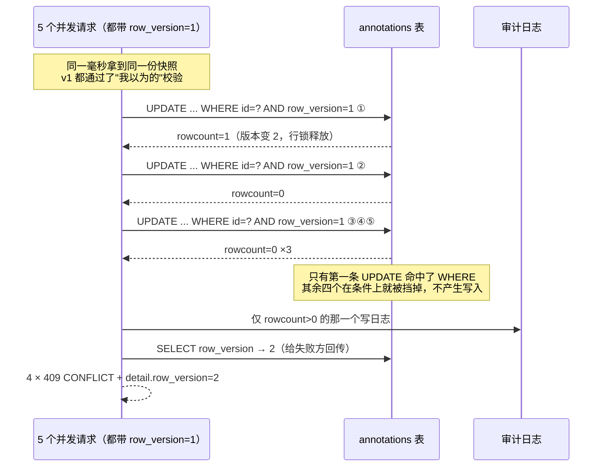

# 5 个并发打进来，3 个返回 200，库里只剩最后一条

> 这一篇讲的坑，全都不抛异常。

上一篇我们搞定了地基：登录能进、权限能拦、23 张表能建起来，那篇结尾我说"能提前按住延迟爆炸的坑，比多写几个接口更值钱"。这一篇开始填业务的血肉——项目、图纸、批注三套 CRUD，一整套数据隔离，外加一版前端工作台。

结果这一天真正花时间的，不是写接口，是**同一类问题的几种长相**：接口返回 200，日志干干净净，前端页面看起来也对，但库里的数据是错的。

这篇是《建筑 AI 预审平台实战》系列的第二篇，主题就一个：**那些不报错的并发与状态坑**。前半段在后端，讲数据怎么被静默覆盖；后半段在前端，讲视图看起来对、状态其实已经漂了。

先把这一天的盘子摆出来，方便你对号入座：

| 维度 | 交付 |
| :--- | :--- |
| 前端 | Angular 21 Standalone + Zoneless + Signals；生产构建 312.8 kB / gzip 83.8 kB |
| 后端 | FastAPI + SQLAlchemy 2.0（异步）+ Alembic |
| 接口 | 项目 7 个、图纸 3 个、批注 5 个，其中 1 个是数据隔离依赖 |
| 验收 | 38 项断言全绿；5 并发同版本号只有 1 个成功 |

D1 我把验收口径从"接口返回 200"改成了"库里数据对不对"。D2 得再往前推一步，因为"库里数据对不对"在单线程下也是够用的假象——你得问三个新问题：**并发下是不是只有一个赢？越权是不是真的 403？视图正确是不是等于状态正确？**

---

## 第一块 · 后端并发：不报错，但数据被静默覆盖

这一块的前三个坑有个共同特征：**它们的第一版实现都能跑通，而且都返回 200**。乐观锁"实现了"，计数器"加上了"，关联数据"查出来了"——只有在并发压测、切到第 2 页、或者一周后看首页数字时，你才会发现哪里不对。

### 1.1 乐观锁：`读-校验-写` 有 ABA 窗口，`rowcount` 才是权威

**【现象】**

批注编辑接口 `PATCH /annotations/{id}` 要求请求体带 `row_version`，不匹配就 409。第一版实现，逻辑上完全说得通：

```python
ann = await db.get(Annotation, annotation_id)
if ann.row_version != payload.row_version:
    raise Conflict("该批注已被他人修改")
ann.title = payload.title
ann.row_version += 1
await db.commit()          # 返回 200
```

自测通过：两个浏览器标签页，一个先存，另一个再存，第二个拿到 409。看起来乐观锁做好了。

然后我开 5 个线程同时打同一个 `row_version=1`。结果是：**返回 200 的每一个请求都以为自己写成功了，而数据库里只留得下最后提交的那一条**——标题是最后那个线程的，四条修改凭空蒸发，全程没有一个 409。

这就是标题里那句话的来历。它不夸张，它就是修复前的样子。

**【排查与解决】**

问题不在判断写错了，在于**这三步不是一个原子操作**。两个请求可以同时读到 `row_version=1`，两个都能通过 `!=` 校验，然后先后 `commit`——后提交的覆盖先提交的，这就是教科书的 lost update。而数据库在这个隔离级别下**不会救你**，因为从它眼里看，这是两条合法的、互不相干的 UPDATE。

想让数据库出手，就得把"校验"变成它必须满足的**执行条件**，而不是我们自己在内存里做的一道 if：

```python
result = await db.execute(
    update(Annotation)
    .where(
        Annotation.id == annotation_id,
        Annotation.row_version == payload.row_version,   # ← 校验即条件
        Annotation.is_deleted.is_(False),
    )
    .values(**data, row_version=Annotation.row_version + 1, updated_at=now())
)
if (result.rowcount or 0) == 0:
    await db.rollback()
    latest = await db.scalar(
        select(Annotation.row_version).where(Annotation.id == annotation_id)
    )
    raise Conflict("该批注已被他人修改，请刷新后重试", detail={"row_version": latest})
```

三个细节比这段 SQL 本身更重要：

1. **回传最新版本号**。`detail.row_version` 不是凑数的字段，它让前端能"刷新后重试"而不是让用户自己去猜现在到第几版了；
2. **审计日志只在更新成功后写**。放在 `rowcount > 0` 的分支里，失败路径不产生脏日志——否则一次冲突会在审计里留下一条"其实没发生"的修改记录；
3. **必须用真并发验证**，而不是开两个标签页手点。手点的时序永远比线程宽松。

5 个线程打同一个版本号，现在的输出是 `[200, 409, 409, 409, 409]`。恰好一个赢。



**顺带一个更阴的小坑：同一个 409，也可能是 422。**

我用一个 1 个字的标题去测并发，期望拿到 409，实际拿到的是 `422 VALIDATION_ERROR`——因为请求体校验发生在依赖和业务逻辑之前，它先炸了。这件事直接改了我的前端写法：**不能只按 HTTP 状态码分支，必须看 `code`**。同一个 409 可能是并发冲突、可能是业务状态不允许；同一个 422 可能是参数格式错、可能是业务校验不过。状态码只告诉你"大类"，`code` 才告诉你"哪一种"。

**【原理与沉淀】**

`rowcount` 之所以是权威，是因为它是**数据库在拿到写锁之后、对真实数据执行完 WHERE 得到的行数**。它不是一个"我检查过了"的声明，而是一个"我确实改到了 N 行"的事实。CAS（compare-and-swap）能成立的前提就是这一步由持有数据的那个组件完成，而任何"先查后改"的变体，都在中间留了一个别人可以插进来的窗口。

换个说法：**乐观锁不是"检查版本号"，是"让版本号成为写入的必要条件"**。前者是断言，后者是约束。

### 1.2 物化计数：`count += 1` 是读-改-写

**【现象】**

项目卡片上要显示"未关闭批注数"和"图纸数"。列表接口每次都 `count(*)` 聚合，数据量一上来首页就拖慢了，所以按 PRD 的要求在 `projects` 表上维护物化字段 `open_annotation_count` / `drawing_count`。

第一版写法，顺手到不需要思考：

```python
project.open_annotation_count += 1   # 读到 5 → 内存里 +1 → 写回 6
await db.commit()
```

单线程测试永远正确。上线前压了一遍：两条批注并发创建，两条都返回 200，库里计数从 5 变成 **6**。

不是 7。少的那一条永远不会回来，也没有任何报错。

**【排查与解决】**

`+=` 在 Python 里是三步：读属性、加一、写回。ORM 把它翻译成一条带具体值的 `UPDATE ... SET open_annotation_count = 6`——**值是应用算好送过去的**，数据库只负责存。两个事务都读到 5，都算出 6，都写 6，第二条覆盖了第一条。

要修的不是算术，是"谁来做这个加法"。让数据库在自己的行上算：

```python
# 增：创建批注，与插入在同一事务
await db.execute(
    update(Project)
    .where(Project.id == project.id)
    .values(open_annotation_count=Project.open_annotation_count + 1)
)

# 减：仅当它原本是未关闭状态；带 > 0 保护，避免任何路径把计数打成负数
if was_open:
    await db.execute(
        update(Project)
        .where(Project.id == ann.project_id, Project.open_annotation_count > 0)
        .values(open_annotation_count=Project.open_annotation_count - 1)
    )
```

`SET count = count + 1` 里那个 `count` 指的是**行上的当前值**，加法在存储引擎里完成，天然串行。

但计数这个坑真正的难点不在并发，在**口径**。`was_open` 那个判断是有故事的：作废一条**已关闭**的批注，不能减 `open_annotation_count`，否则数字会比实际少——这跟漏加是同一类错误，只是方向相反。所以我把"什么叫未关闭"收成一个常量，让写路径和读路径共用：

```python
OPEN_STATUSES = (PENDING_CONFIRM, ISSUED, MODIFIED)   # 唯一口径
```

`drawing_count` 同理，而且更细一层：只有删掉 `is_current=True` 的那个版本才减 1，删历史版本不影响"当前图纸数"。两个字段，两条业务规则，一个都不能凭直觉写。

**【原理与沉淀】**

ORM 最大的幻觉是让你以为"对象属性就是数据库字段"。`project.open_annotation_count += 1` 读起来像 SQL，执行起来是**内存里的 Python 加法**。凡是"读一个值、在应用里算、再写回去"的写法，并发下都是同一个漏洞的不同名字。

第二层沉淀：**物化计数是空间换时间，代价是你亲手维护了一条一致性约束**，所以口径必须常量化。如果 `OPEN_STATUSES` 在 Service 里出现两遍，迟早有一遍会漏掉一个状态，而那时候数字只是"稍微不对"，没人会报警。

### 1.3 N+1：在异步 ORM 里它不是"慢"，是直接 500

**【现象】**

批注列表要返回 `assignee` / `creator`（`UserBrief`）和 `is_stale_version`（需要当前图纸版本号）；图纸列表要返回 `uploaded_by` 和 `issue_stat`（按严重度的问题统计）。

按最直觉的写法——关系不配置、循环里取值、让 ORM 自己去查——本地 3 条数据，一切正常。切到一页 12 条：

```text
sqlalchemy.exc.MissingGreenlet: greenlet_spawn has not been called;
can't call await_only() here. Was IO attempted in an unexpected place?
```

500。不是慢一点，是根本跑不通。

**【排查与解决】**

这里有两层问题同时爆了，而且第二层更致命：

1. **性能层**：`lazy` 逐条触发，SQL 条数随 `page_size` 线性增长，典型 1+N（这里是 1+3N）；
2. **正确性层**：SQLAlchemy 2.0 的异步会话**禁止隐式懒加载**。序列化阶段去访问一个没预加载的关系，等于在"不需要 IO 的上下文里发起 IO"，直接抛 `MissingGreenlet`。

所以"先跑通、再优化"这条经验在异步 ORM 上不成立——**你不处理，它连跑都跑不通**。四类关联，我用了四种手段，目标只有一个：**SQL 条数与返回条数无关**。

```python
# 1) 批注的 assignee / creator：一对一，关系级 joinedload，一次 JOIN 取回
class Annotation:
    assignee: Mapped[User | None] = relationship(
        "User", foreign_keys="Annotation.assignee_id", lazy="joined")
    creator: Mapped[User] = relationship(
        "User", foreign_keys="Annotation.creator_id", lazy="joined")

# 2) 图纸上传人：一次 IN 批量查，替代逐行关系
uploaders = {u.id: u for u in await db.execute(
    select(User).where(User.id.in_({d.uploaded_by for d in drawings}))
)}

# 3) issue_stat：一次 group by；"每个图纸只取最近一次任务"用子查询锁定
latest = (select(ReviewTask.drawing_id, func.max(ReviewTask.created_at).label("ts"))
          .where(ReviewTask.drawing_id.in_(drawing_ids))
          .group_by(ReviewTask.drawing_id).subquery())
rows = (select(ReviewIssue.drawing_id, ReviewIssue.severity, func.count())
        .join(ReviewTask, ReviewTask.id == ReviewIssue.review_task_id)
        .join(latest, (ReviewTask.drawing_id == latest.c.drawing_id)
                     & (ReviewTask.created_at == latest.c.ts))
        .group_by(ReviewIssue.drawing_id, ReviewIssue.severity))

# 4) is_stale_version 需要的 version：一次 IN 取成字典
versions = dict(await db.execute(
    select(Drawing.id, Drawing.version).where(Drawing.id.in_(drawing_ids))
))
```

"没有 N+1"这句话不能靠感觉，得数。我挂了个 `before_cursor_execute` 计数器：

| 请求 | 返回条数 | SQL 条数 |
| :--- | :--- | :--- |
| `GET /annotations?page_size=20` | 12 条 | **8** |
| 同上 `page_size=1` | 1 条 | **8** |

按懒加载写法，12 条的量级是 `3(鉴权) + 1(count) + 1(list) + 12×3 = 41` 条。**12 条 8 个 SQL，1 条也是 8 个 SQL，条数完全平坦**——这才叫证据。

**【原理与沉淀】**

异步 ORM 没有 greenlet 就没法做同步 IO，所以"访问未加载的关系"这件事从"偷偷多发一条 SQL"变成了"直接抛异常"。**框架其实是帮了你一个忙：把性能问题升级成了正确性问题**，逼你在写的时候就面对它。

更值得留下来的是一句话：**列表接口的 SQL 条数，应该是一条回归基线**。比如"列表接口 SQL ≤ 10"。否则今天你预加载了，三个月后有人加了个字段，N+1 就悄悄回来了——而且这回可能因为关系是 `lazy="joined"` 而变得更慢，却不再报错。

后面两个坑换了个维度：它们不在并发上，在**边界**上。代价也不是数据被覆盖，而是**信息被泄露**和**关系被留下**——同样不报错，同样只有主动去查才发现。

### 1.4 一个接口三种"没有数据"：判定顺序本身就是安全边界

**【现象】**

`GET /drawings?project_id=X` 会遇到三种"返回不了数据"的情况：项目不存在、我不是这个项目的成员、项目确实一张图纸都没有。三种情况的正确答案完全不同——`404`、`403`、`200` 加空列表。

我一开始把这个顺序写反了。

原因特别朴素：这个列表接口是从一段通用查询里长出来的——先 `count(*)` 拿总数、再取当页数据，权限校验是后来才补的一行。补的时候我顺手加在了"查完数据之后"，因为那时候手上正好有一个已经解析好的 `project_id`，看起来最省事。

后果是：拿一个不在项目里的账号去请求，拿到 `200` + `total: 0` + 空数组。

**更值得说的是我的断言没抓到它。** 38 项断言里有一条"非成员访问项目资源 → 403"，它一直是绿的——因为那条断言打的是 `GET /projects/{id}/drawings`，`project_id` 在**路径**里，`check_project_member` 这个 path 依赖正常生效。而同一份数据的另一个入口——`project_id` 放在 **query** 里的 `/drawings?project_id=X`——我根本没写断言。

一条断言绿了，不代表这条规则覆盖了所有入口。这是一次代价很小的侥幸：`total: 0` 不吓人，吓人的是它看起来像一个正常的空列表。

**【排查与解决】**

顺序必须固定，而且"写反了会怎样"值得单独列一列，因为每个位置错位的后果并不一样：

| 检查 | 顺序 | 正确返回 | 顺序写反的后果 |
| :--- | :--- | :--- | :--- |
| 项目是否存在且未删除 | 1 | `404 NOT_FOUND` | 先查数据的话，不存在的项目也返回 `200 + total: 0`，等于回答"它可能不存在，也可能你没权限" |
| 我是否项目成员（ADMIN 短路） | 2 | `403 NOT_PROJECT_MEMBER` | 先 count 再判权限 → `200 + total: 0`，**等于确认"这个项目存在"** |
| 数据查询（统一 `is_deleted=False`） | 3 | `200`（可能空列表） | — |
| 创建批注时 `drawing_id` 不属于该 `project_id` | 业务校验 | **`422`**（不确认该图纸是否存在） | 返 `404` 的话，可以拿别人的 `drawing_id` 反复试探 |

那句"先 count 再判权限等于确认项目存在"，我是这么想通的：**同一个 `total: 0`，在两种顺序下的含义是相反的**。权限在前，它是"你有权看，这里确实是空的"；权限在后，它是"我不知道你能不能看，但我先把答案告诉你了"。

最后一行也改过一版。最初"图纸不属于这个项目"直接返 404，语义上很自然——找不到就是找不到。但攻击者可以拿别人的 `drawing_id` 反复打这个接口，404 和 200 的差异就是一条现成的探测通道。改成 422 之后，它表达的是"你这个引用参数有问题"，而**不确认那个资源到底存不存在**。

这里有个取舍要说清楚，不然容易变成"所有场景都该返 404"：项目级我仍然选 403，等于主动承认"这个项目存在"。理由是协作场景里，同事把链接发给你、你点开打不开，"你不是这个项目的成员"比"项目不存在"有用得多——这是拿一点存在性信息换可用性。但在跨项目引用上我选 422，因为那是一次**没有用户体验收益**的探测行为。

**同一个原则，两个方向：有收益的地方承认，没收益的地方闭嘴。**

还有个很容易漏的落点：`check_project_member` 是 **path 依赖**，它依赖 URL 路径里的 `project_id`。批注列表允许只传 `drawing_id`，这时 `project_id` 在 query 里，那个依赖**根本挂不上**——路由上看起来"我挂了隔离依赖"，实际上是空的：

```python
if project_id is None:                      # 批注列表：允许只传 drawing_id
    project_id = await db.scalar(
        select(Drawing.project_id).where(Drawing.id == drawing_id)
    )
    if project_id is None:
        raise NotFound("图纸不存在")
await ensure_project_member(db, project_id, user)   # ← 数据隔离兜底，不依赖路由挂没挂依赖
```

所以隔离我最后落了三层：路由依赖（拦在入口）、Service 兜底（防路径漏挂）、查询条件（`is_deleted=False` 统一写在查询里，不指望每个调用方都记得带）。

软删除这一侧同理：删项目时用一条 `UPDATE drawings SET is_deleted=True WHERE project_id=?` 级联，批注随图纸一起不可见。全部是软删除，保留审计，一个字都不物理删。

**【原理与沉淀】**

在软删除系统里，"没有数据"从来不是一个答案，而是好几个答案叠在一起。**实现顺序会决定它安不安全**，因为顺序决定了"哪一句话先被说出去"——404 是"没有"，403 是"有但你不能看"，200 空列表是"有、你能看、里面没东西"。说错顺序，等于把后一个答案泄漏给了不该听的人。

第二层沉淀更通用：**错误码是信息泄露面**。状态码、`code`、错误文案、甚至响应时间，都在告诉调用方一些他不该知道的事。做隔离的时候不要只想"拦住"，要想"拦住的同时别回答他的问题"。

第三条是这一轮最疼的一条：**断言覆盖的是入口，不是规则**。同一条权限规则，path 版本和 query 版本是两条代码路径，就得写两条断言。规则的绿勾不会自动传播到它的每个入口上。

### 1.5 移除成员：数据库的引用完整性管不了业务不变量

**【现象】**

把一个成员从 `project_members` 里删掉。接口 200，成员列表少了一个人，管理页看起来一切正常。

然后打开批注列表：他名下还有 3 条未关闭批注，`assignee_id` 仍然指着他。卡片上头像、姓名都在，点进去 404——因为项目详情的成员接口里已经没这个人了。

这个坑最难受的地方不是 404，是**它看起来完全正常**。`assignee_id` 不是 `null`，所以前端按"有责任人"渲染；如果不是有人手贱点了一下，这个数据错误可以一直躺到下一次评审会上被人问起"这个人是谁"。

**【排查与解决】**

第一反应是"`ON DELETE SET NULL` 没配"。配了也没用——**它只在用户行被物理删除时触发**，而我们做的是软删除：用户行一直存在，被删掉的只是 `project_members` 里的那一行关系。数据库根本看不到"这个人的这个身份没了"这件事，它是一个跨表、跨语义的业务不变量，表上没有任何约束能表达它。

三条路我都过了一遍：

| 方案 | 代价 |
| :--- | :--- |
| 写触发器 | 语义藏进数据库，换库要重写，测试得单独造场景，改需求时没人想得起它在那儿 |
| 读时修正（查出来时把"已不在成员表里的 assignee"当成空） | 数据**仍然是错的**，写入方一点责任都不担；导出、统计、审计、报表每加一个读路径，就得再实现一遍同一段过滤 |
| 写时修正一次 | 成本是一条带条件的 UPDATE，谁被摘了、摘了几条、什么时候摘的都留痕 |

选第三条。关键在于**"一次写清"而不是"每次读的时候遮"**——遮蔽是把错误藏起来，修正是把错误消掉。

具体到代码，一条带业务条件的批量 UPDATE，把"摘责任人 + 打标记"合成一次写，并把受影响行数返回给前端：

```python
orphaned = (await db.execute(
    update(Annotation)
    .where(
        Annotation.project_id == project_id,
        Annotation.assignee_id == target_user_id,
        Annotation.status.in_(OPEN_STATUSES),      # 已关闭的保留历史责任人
        Annotation.is_deleted.is_(False),
    )
    .values(assignee_id=None, assignee_missing=True)
)).rowcount or 0

await db.delete(member)
await db.commit()
return {"removed": True, "orphaned_annotations": orphaned}
```

四个边界，每一个都是踩过或者差点踩过的：

1. **只清 `OPEN_STATUSES`**。这是差点一刀切错的地方——已关闭的批注必须保留原责任人，否则"谁改的、谁复核的"这段审计直接断掉。清理范围本身就是一个业务判断，不能交给"顺手全清"；
2. **UPDATE 和 `delete(member)` 在同一个事务里**。分开写就会出现一个中间态：人已经不在项目里了，批注还挂着他，此刻任何一次读都会看到脏数据；
3. **移除前校验"项目至少保留一名 OWNER"**（不满足返 422）。否则一次误操作就能把项目变成无人可管理，而这个状态没有任何页面能恢复；
4. **用 `assignee_missing` 标记，而不是单纯置 `null`**。置 `null` 在前端就是一个空白格，用户会以为"本来就没人负责"；有了标记，前端才能说"责任人已离项，请重新指派"。配套地，重新指派（PATCH `assignee_id`）要自动把它清回 `False`，否则这个提示会一直挂着，变成另一种噪音。

**【原理与沉淀】**

外键管的是**行在不在**，管不了**关系还在不在**。所有"成员、权限、归属"这类关系型不变量，最终都得在 Service 层用一条带条件的批量写来完成，而且必须和引发它的那个动作在同一个事务里。

第二层沉淀是"写时修正 vs 读时遮蔽"这条线。遮蔽方案在单点测试里是完全正确的，坑在于它是**一处一处复制**的：今天你补了列表，明天导出忘了，后天统计忘了，而这个错误永远不会报错，只会让某个报表的数字和另一个报表对不上。**能一次写清的错误，就不要留给每个读路径去遮。**

第三个细节是 `rowcount` 回传。用户点"移除成员"的时候，他并不知道这背后会波及多少条未关闭批注——不告诉他，他就得事后自己去批注列表里逐条翻。这个数字的成本是一条 `rowcount`，收益是用户知道自己刚刚做了什么。

还有一个我记在账上的边界：更彻底的方案是把"成员资格"做成带时间区间的历史表（谁在什么时候是成员），这样"这条批注当时该归谁"天然有答案，连标记都不用打。这轮没做——只留了一个布尔标记，够用，但我知道它不够优雅。**知道自己方案的边界在哪，比方案本身更值钱。**

---

后端这一块的坑都有个共同点：**你写的是"看起来对"的代码，跑出来是"事实上错"的数据**。而前端这一块的坑换了个方向——**数据其实是对的，但视图和状态之间已经不同步了**。你盯着页面看，看不出来；你换个标签页、按一下返回键、或者在两个项目之间跳一次，它就露头了。

## 第二块 · 前端状态：视图看起来对，状态已经漂了

D2 的前端复杂度不在画页面。四个页面加一个弹窗，任何人两天都能画完。真正的成本在**状态归谁**：菜单归谁、表单归谁、路由参数归谁、错误归谁能展示它的那一层。下面四个坑，每一个都是所有权没划清导致的。

### 2.1 弹窗：不要"重置"，要"销毁"

**【现象】**

新建项目弹窗的需求很普通：关闭后再打开是干净表单、Esc 和遮罩都能关、打开时锁页面滚动并自动聚焦项目名、提交失败时错误只出现在弹窗里。

第一版是最常见的写法——弹窗常驻 DOM，靠一个 `open` 输入控制显隐，关闭时手动 `form.reset()`。三个问题一次全来了：

- 第二次打开，先看到上一次残留的红色报错；
- 偶尔第一次打开聚焦不生效；
- 某次提交抛异常之后，整站滚不动了。

**【排查与解决】**

`reset()` 只清值，**不清 `touched` / `dirty` / 错误文案 / 提交中状态**。这四个东西全在 `FormGroup` 上，`reset()` 一个都不碰。想去补，就得再写四行"手动清状态"——而每加一个字段、每加一个校验，这四行就多一处可能漏掉的地方。

所以我换了方向：**不重置，直接销毁**。

父级用 `@if` 控制弹窗的存在性，弹窗自己完全不持有开关状态：

```html
@if (createOpen()) {
  <app-project-create-modal (closed)="closeCreate()" (created)="onCreated($event)" />
}
```

`FormGroup` 是组件字段，组件随弹窗创建、随弹窗销毁 → **下次打开天然是实例级干净状态**，一个 `reset()` 都不需要。`open` 那个输入、`ngOnChanges` 里的初始化逻辑、以及"首次打开时机"这个坑，一起消失了。

副作用挂在生命周期两端：

```typescript
constructor() {
  afterNextRender(() => this.nameInput()?.nativeElement.focus());
}

ngOnInit()  { document.body.style.overflow = 'hidden'; }   // 锁滚动
ngOnDestroy() { document.body.style.overflow = ''; }        // 销毁即恢复
```

聚焦用 `afterNextRender` 而不是 `setTimeout(0)`：后者是"赌 DOM 已经插入"，前者是"框架告诉你 DOM 已经就绪"。

再加两条工程约束：`host: { '(document:keydown.escape)': 'closed.emit()' }` 统一关窗快捷键，不用在每个输入框上处理 Esc；提交成功后**父级重新拉列表**，而不是本地 `unshift` 一条进去——新项目的排序位置由后端的 `updated_at` 决定，前端猜不准，也不该猜。

**【原理与沉淀】**

"重置"和"销毁"的差别不是代码量，是**状态的所有权边界**。常驻弹窗意味着它必须手工处理 N 个状态的归零，而 N 会随着表单变复杂而增长；销毁意味着归零这件事由运行时保证，你不需要维护那份清单。

顺带一句关于那对 `overflow`：**副作用必须成对，而且必须挂在生命周期上**。写成"打开时设置、提交成功后恢复"，就必然有一条路径（提交抛异常、用户按 Esc、路由被切走）会漏掉恢复，然后整站滚动被锁死。

### 2.2 `/projects/:id` 之间跳转：`snapshot` 是一次快照，不是数据源

**【现象】**

项目详情页现在还是占位页，但它马上要承载图纸、批注、预审报告。用户从 A 项目切到 B 项目，或者按浏览器前进后退，页面上的 ID 和标题**不跟着变**。

刷新一下就对了。这个"刷新一下就好了"的 bug，是最典型的线上串数据前兆。

**【排查与解决】**

`route.snapshot.paramMap.get('id')` 在 `constructor` 或 `ngOnInit` 里读一次就定住了。而 Angular 的默认行为是：**同一个路由配置、只变参数 → 复用组件实例**，不重建。组件没重建，`ngOnInit` 就不会再跑，那段代码读到的永远是第一次的 `/p-0001`。

常规修法是 `route.params.subscribe(...)`。它能用，但代价是每个组件都要手写订阅、手管退订（`takeUntilDestroyed`）、模板里还容易漏掉一处。

我在 `provideRouter` 里开了 `withComponentInputBinding()`，把路由参数直接映射成组件 input：

```typescript
export const appConfig: ApplicationConfig = {
  providers: [provideRouter(routes, withComponentInputBinding(), /* ... */)],
};
```

```typescript
// project-detail.ts
export class ProjectDetailComponent {
  readonly id = input.required<string>();   // /projects/:id → id
}
```

参数变化由框架驱动 input 更新，组件里一行订阅都没有。后续接真实数据时，`resource()` / `toSignal()` 只需要以 `id` 为源，参数一变数据自动重取。

实测：在详情页用 `history.pushState` + `popstate` 从 `p-0001` 切到 `p-0003`，组件未重建、ID 已更新、页面跟着变。

**【原理与沉淀】**

`snapshot` 的语义是"**此刻的路由状态**"，它是一个值，不是一个流。凡是"只发生一次"的读取，都注定漏掉后续变化——而这在单页应用里是默认行为，不是边缘情况。

这也是我在这一轮里第二次遇到同一个问题：上一轮是 `router.url` 在导航完成前是旧值（那次要读 `window.location`），这一轮是 `snapshot` 在组件复用后是旧值。**框架里凡是叫 snapshot 的东西，都要先问一句"它什么时候会刷新"**。

### 2.3 403 的读写分流，和那个 `403 → 守卫 → /403` 的死循环

**【现象】**

D1 的 403 只是弹一个 Toast。D2 要求给一个 `/403` 空状态页。需求一句话，实现上立刻变成两个问题：**哪些 403 该换页，哪些不该？**

第一版按"状态码一刀切"，拦截器里对所有 403 都 `navigate(['/403'])`。三个后果：

- 用户在新建项目弹窗里提交被 403，整页被踢走，**刚填的内容全丢**；
- `/403` 放在带侧边栏的受保护布局里，于是守卫又判一次无权限，又跳 `/403`，**页面白屏**；
- 拦截器弹 Toast、表单自己内联报错，同一句话出现两次，互相打架。

**【排查与解决】**

第一个要切断的是死循环。极简地说：

```text
403 → 守卫裁决「无权限」→ 跳 /403 → /403 也在守卫范围内 → 再判无权限 → 跳 /403 → …
```

**切断点只有一个：把 `/403` 移出守卫覆盖范围。**

```typescript
{ path: '403', loadComponent: () => import('./pages/forbidden/forbidden').then(m => m.ForbiddenComponent) },
{ path: '', canActivate: [authGuard], loadComponent: /* 带侧边栏的布局 */ },
```

第二个是按**请求语义**分流，而不是按状态码：

```typescript
// 403 的错误体由调用方展示（表单内联 / 页面空状态），这里只负责"该不该换页"
if (error.status === 403 && code === 'FORBIDDEN' && request.method === 'GET') {
  void router.navigate(['/403']);
}
```

读请求换个页面是对的——页面拿不到数据，留在原地也只能显示空白；写请求把错误原样抛回调用方，让表单内联展示，用户的输入一个字都不丢。

第三个是把"无权限"从"未登录"里拆出来。守卫原来只有两个出口（放行 / 去登录），三态化之后：

```typescript
type SessionState = 'authenticated' | 'anonymous' | 'forbidden';

// forbidden  → /403
// anonymous  → /login?redirect=
```

实测：`GET /auth/me` 403 → `/403` 空状态页；`POST /projects` 403 → 弹窗保留、表单内容保留、错误内联、无 Toast。

**【原理与沉淀】**

"按状态码处理错误"是所有前端错误处理的默认姿势，而它的破绽在于：**状态码描述的是"服务端怎么了"，不是"用户此刻在干嘛"**。同一个 403，在读数据时是"这个页面你看不了"，在提交表单时是"这次操作没被允许"——前者该换页，后者该留在原地。

死循环那条更值得记：**任何"跳转到某个页面"的逻辑，都要先问一句"那个页面自己会不会再触发同一段逻辑"**。守卫、拦截器、重定向三者组合起来，形成环的概率远比你想象的高，而且它只在"用户恰好无权限"这条冷路径上出现，自测很难碰到。

### 2.4 菜单与面包屑：一份信号，两处派生

**【现象】**

侧边栏菜单、面包屑标题、模块可用性（置灰 + "待开放"角标），全都来自 `/auth/me` 返回的 `menus`。用户在另一个标签页登出、或者权限被回收后刷新登录态，这些视图要跟着变。

第一版写法很自然：侧边栏组件里 `this.menus = this.auth.currentUser()?.menus ?? []`，组件创建时拷一份快照。

于是：**换个标签页改了权限，侧边栏不变；面包屑和侧边栏还会对不上**——因为面包屑是另一套逻辑，从路由 URL 反查一张前端硬编码的映射表。

**【排查与解决】**

服务里只暴露一个 `computed` 信号，视图全部派生，谁也不拷贝：

```typescript
readonly menus = computed<readonly MenuItem[]>(() => this.userState()?.menus ?? []);
```

侧边栏直接引用这个信号，面包屑用同一份数据做最长前缀匹配：

```typescript
protected readonly breadcrumb = computed(
  () => findMenuTitle(this.auth.menus(), this.currentUrl()) ?? '概览',
);
```

这一改，"菜单来自后端、面包屑来自前端常量"的两套真相就没了：后端改标题，面包屑自动跟着改，前端一行都不用动。

可用性判断也收进同一棵树。菜单是两级的，所以必须递归——一层 `find(...)` 会漏掉所有子项：

```typescript
const IMPLEMENTED_PATHS: ReadonlySet<string> = new Set(['/dashboard', '/projects']);

export function isMenuImplemented(menu: MenuItem): boolean {
  if (menu.path && IMPLEMENTED_PATHS.has(menu.path)) return true;
  return menu.children.some((child) => isMenuImplemented(child));
}
```

**父级是否可用 = 自己可用 或 任一子项可用**。这样"预审中心"因为子项没落地而置灰，"系统管理"因为两个子项都置灰而置灰——不需要前端硬编码每个菜单的开关。

**【原理与沉淀】**

`computed` 的缓存是靠依赖图失效的：它记住读过哪些 signal，只有那些 signal 变了才重算；反过来，**没有在信号图上登记的东西，它永远不会因为"数据变了"而重算**。

这就是为什么"拷一份快照到普通字段"能把这个机制整个废掉——`this.menus = [...]` 之后，视图依赖的是一个普通数组，它和 `userState` 之间那条边被你自己剪断了。在 zoneless 下这个后果更彻底：没有 zone 帮你"碰巧重跑一次变更检测"，页面就是不动，而数据早就变了。

一句话：**状态只存在 service 的 signal 里，视图只做派生。** 想拷贝之前先问自己：我拷的这份，谁来负责让它和源同步？

### 2.5 附：闭包里被赋值的变量，TS 会当成 `never`

这个不是并发坑，是这一轮真实卡了十几分钟的编译期坑，顺手记一下。

**【现象】**

写 `findMenuTitle` 时第一版是"递归闭包 + 外部变量"：

```typescript
let matched: { title: string; length: number } | null = null;
const walk = (items: MenuItem[]) => { /* matched = { title, length } */ };
walk(menus);
return matched?.title;   // TS2339: Property 'title' does not exist on type 'never'
```

**【排查与解决】**

TypeScript 的控制流分析**不追踪闭包内的赋值**，它沿着当前作用域往下看，只看见 `matched` 被初始化成 `null` 且再没被改过，于是把类型收窄成 `null`，`matched?.title` 自然就是 `never`。

修法不是 `as any`，是换掉"闭包改写外部变量"这个模式——改成收集数组，再排序取首项：

```typescript
const matches: { title: string; length: number }[] = [];
// walk 里 matches.push({ title, length: 前缀长度 })
matches.sort((a, b) => b.length - a.length);
return matches[0]?.title;
```

可读性反而更好了，还顺手把"最长前缀匹配"从一句隐含的约定写成了一条显式规则。

**【原理与沉淀】** 当类型检查器和你的直觉打架时，先假设是你写的模式超出了它的分析能力，而不是它坏了。`as` 能让红波浪线消失，但也会让那个"其实匹配不上"的 bug 留到运行期。

---

## 实战避坑清单

16 条，覆盖上面 9 个坑点，建议直接收藏：

1. **乐观锁的正确形态是"条件 UPDATE + 看 `rowcount`"**，不是"查出来比一下再写"——`rowcount` 是数据库拿到写锁后的事实，"我检查过了"只是你的声明。
2. **冲突分支回查并回传最新 `row_version`**，审计日志只在更新成功的分支写；**前端别按状态码分支，看 `code`**，同一个 409 可能是并发，同一个 422 可能是业务校验。
3. **物化计数一律写成 `SET count = count + 1`**——ORM 里 `count += 1` 是读-改-写，并发下静默丢更新，而且永不报错。
4. **减计数带 `> 0` 保护，"什么算未关闭"收成一个常量**，让写路径和列表查询共用同一份口径，否则漏减和漏加是同一类错误的两个方向。
5. **异步 ORM 里的 N+1 是正确性问题**：`MissingGreenlet` 直接 500，"先跑通再优化"在这条路上不成立。
6. **验证 N+1 的方式是数 SQL 条数**：12 条数据和 1 条数据都是 8 个 SQL 才算过，最好把"列表接口 SQL ≤ 10"做成回归基线。
7. **软删除下"没有数据"有多种原因，判定顺序必须是：资源存在 → 是否成员 → 查数据**，顺序写反就等于告诉对方"这个项目存在"。
8. **跨项目引用统一返 422 而不是 404**，404 和 200 的差异本身就是存在性探测信号。
9. **`project_id` 落在 query 里时，path 依赖根本挂不上**，Service 层必须有一道 `ensure_project_member` 兜底——**断言覆盖的是入口，不是规则**，同一份数据的每个入口都得单独验。
10. **外键管得了行在不在，管不了关系还在不在**——成员被移出项目后的责任人清空得自己写，而且只清未关闭的，已关闭的保留审计。
11. **这类连带影响要把 `rowcount` 返回给前端**，让用户知道这次移除动了多少条问题。
12. **弹窗不要常驻 + `reset()`**：`reset()` 不清 `touched` / 错误 / 提交中状态，让父级用 `@if` 管存在性，表单实例跟着组件一起销毁。
13. **锁滚动、自动聚焦这类副作用必须挂在生命周期两端**：`afterNextRender` 聚焦，`ngOnInit` / `ngOnDestroy` 成对恢复 `body.overflow`。
14. **`route.snapshot` 是快照不是数据源**，开 `withComponentInputBinding()` 把路由参数变成 `input()`；凡是叫 snapshot 的东西，都先问一句"它什么时候刷新"。
15. **`/403` 必须放在守卫之外切断死循环，拦截器只对读请求换页**——写请求如果也跳页，用户刚填的表单就没了。
16. **状态只存在 service 的 signal 里、视图只做派生**：`computed` 只对依赖图里的变化失效，你拷一份快照，就等于自己剪断了那条边，zoneless 下连"碰巧刷新一次"都不会发生。

---

## 最后

D1 的价值是把会延迟爆炸的坑在成本最低的时候炸掉了。D2 的价值不太一样：它把三类**只在生产环境才暴露**的问题，提前变成了确定行为——N+1 在异步 ORM 下直接 500、乐观锁的 ABA 窗口会静默覆盖、物化计数会静默漂移。

这三件事的共同点是：**不报错，但结果是错的**。而能按住它们的，从来不是更多的接口，是更硬的验收口径——是 5 个线程压出来的 `[200, 409, 409, 409, 409]`，是 12 条数据与 1 条数据都是 8 个 SQL，是"库里数据对不对"这个比状态码可靠一个数量级的问题。

前端那半边则指向另一件事：**页面画得快不代表状态管得住**。菜单归 service 的 signal、表单归弹窗实例、路由参数归框架的 input、错误归能展示它的那一层——把所有权划清之后，模板里就只剩派生，剩下的坑也就从"打补丁"变成了"做设计"。

下一篇是 D3，主题会转到文件上传。那里有一场更硬的并发：**分片乱序到达、重复分片、合并的那一刻还在写**——上一片和下一片之间，谁先到、谁重了、谁该丢，全得自己定规则。

以及一个更朴素的教训：**`Content-Type` 是客户端说的，文件头才是真的**。把 `.exe` 改名成 `.pdf` 上传，中间件会一路放行到你解压它的那一刻。

下一篇见。
