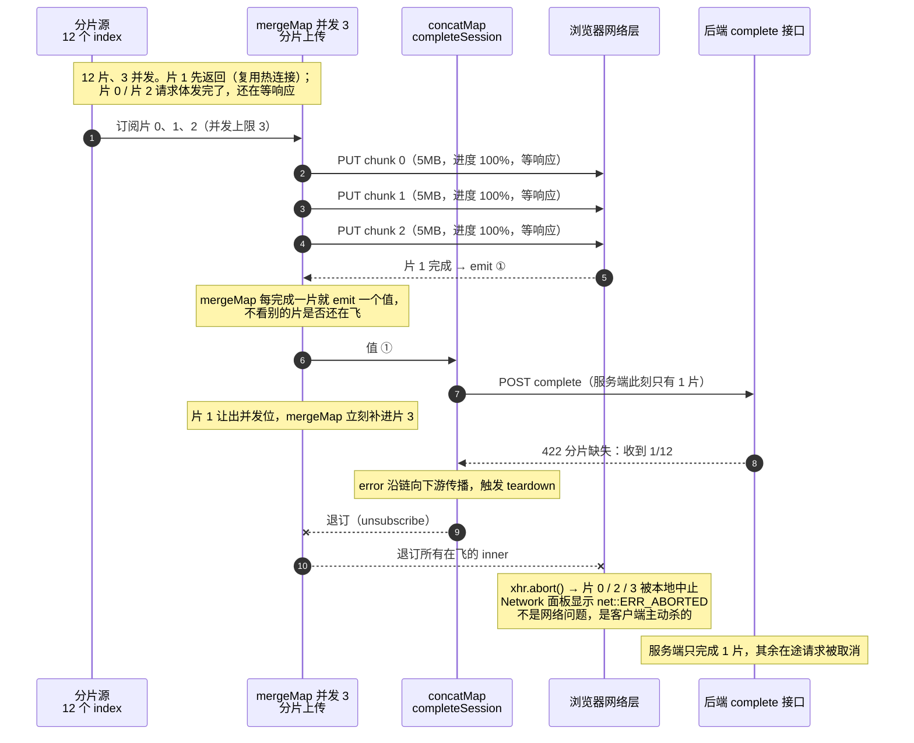

# 12 个分片都在飞，服务端只收到 1 个

> 一次 60MB 上传里的三层竞态：客户端编排、服务端落盘、信任边界。

上一篇结尾我留了两句话。

一句是“分片乱序到达、重复分片、合并的那一刻还在写”，另一句是“`Content-Type` 是客户端说的，文件头才是真的”。

写的时候只是预告。真到 D3 这天，它们不是依次发生，是挤在同一个 60MB 的 PDF 上一起发生。

先把这一天的盘子摆出来：

| 维度 | 交付 |
| :--- | :--- |
| 前端 | Angular 21 + RxJS；`POST upload-sessions → 5MB × 3 并发 → complete`；生产包 323.6 kB / gzip 86 kB |
| 后端 | FastAPI + SQLAlchemy 2.0 异步；会话、分片、合并、签名 URL、文件流 5 个接口 |
| 存储 | 开发库 SQLite；分片落盘 + `os.replace` 原子替换 |
| 验收 | 前端 11 条链路；后端 37 项断言；3 并发、重传幂等、伪造文件拦截 |

主角是一个 60MB 的 PDF：切成 12 片，每片 5MB，3 片并发。

一个上传动作，其实同时踩在三个边界上：

1. **编排层**——谁先发、谁后发，什么时候算“全都发完了”？
2. **落盘层**——字节写在哪个文件名上，别人什么时候能看见它？
3. **信任层**——这个文件到底是什么，谁说了算？

三层各有一类坑。而且每一类的第一版实现，全都跑通了。

上传是我做过的功能里最容易被低估的一个。它看起来只是“选文件、发请求、存下来”，实际上同时踩在浏览器的调度、文件系统的可见性、以及一条谁都能伪造的信任边界上。

这是我最想强调的一点：**上传功能的 bug 几乎不以“报错”的形式出现，它们以“传上去了，但不对”的形式出现**。所以这一篇的每一节，我都会尽量给出当时看到的数字和日志，而不是“我改了一下就好了”。

---

## 第一块 · 前端：编排层的三个“看起来对”

前端这一块的三个坑，第一版代码都长得很标准。3 并发是 RxJS 的标准写法，按片数算进度是最直观的算法，退订是最基本的收尾。

问题在于，这三件事的正确性都只在“高负载 + 乱序”的路径上才暴露。

### 1.1 三片都跑到 100%，服务端说只收到一片

**【现象】**

拖进一个 60MB 的 PDF，队列里出现 12 个分片，3 个并排跑。前三片的进度条一起走到 100%，然后弹窗顶上冒出一行红字：

```text
[upload] chunk 0  sent 100%  5.0MB
[upload] chunk 1  sent 100%  5.0MB
[upload] chunk 2  sent 100%  5.0MB
[upload] complete  ->  422  {"code": "ERR_CHUNK_MISSING", "detail": "收到 1/12"}
[network] PUT /chunks/0  net::ERR_ABORTED
[network] PUT /chunks/2  net::ERR_ABORTED
```

三条日志摆在一起很荒诞：三片都显示发完了，服务端说只有一片到，另外两片是“被中止”。

**当时的第一反应是服务端丢片。**

**【排查与解决】**

先看第一版代码。它在当时的我眼里天经地义：

```typescript
// ❌ 第一版：我以为这是“3 并发上传，全部完成后合并”
from(indexes).pipe(
  // 3 并发上传分片
  mergeMap((index) => this.putChunk(session.upload_id, index, blob), 3),
  // 我以为 concatMap 会“等前面的全部完成”
  concatMap(() => this.completeSession(session.upload_id)),
);
```

为了证明不是服务端的问题，我起了一个临时的 mock 后端，在 `/__mock` 上挂了几个计数器：`sessionCreates`、`chunkPuts`、`maxConcurrency`、`completeCalls`。

拖一次文件，读出来的数是：

```text
sessionCreates: 1
chunkPuts:      3        ← 三片确实都到了
maxConcurrency: 3        ← 并发也确实生效了
completeCalls:  1        ← 但合并只该在最后调一次
```

这也是这一轮养成的一个习惯：**别用 `console.log` 证明并发，用计数器证明并发。**

日志是时序的，人会看错；计数器是状态的，`maxConcurrency` 是 3 还是 1，一眼就能判。后来这套 mock 一直留在我本地的调试脚本里，专门回答一个问题：到底是前端发少了，还是后端收少了。

再看时间戳：`complete` 到达服务端的时刻，比片 0 和片 2 落地早了三十多毫秒。

**服务端没丢片，是客户端提前合并了。**

问题出在两个 operator 的语义上：

- `mergeMap` 是“每有一个分片完成，就往下游 **emit 一个值**”。它不管别的分片还在不在飞。
- `concatMap` 是“对上游 **每一个值** 依次执行投影函数”，它串行等待的是“上一次投影完成”，不是“上游结束”。

所以真实发生的事情是：片 1 最先回来。它和片 0 一样是 5MB，快的原因不是它小，是它复用了一条已经热起来的连接——而片 0 还在等服务端把那 5MB 写完、改名、提交事务。

片 1 一完成就 emit 了一个值，`concatMap` 立刻拿这个值去调 `complete`。

此刻片 0 和片 2 还在飞——它们的请求体确实发完了（所以进度 100%），但响应没回来，服务端那边也还没落定。

`complete` 拿到 422，错误沿链向下传播，整条流 teardown，把还在飞的分片全部 abort——片 0、片 2，以及刚补位、还没发出几字节的片 3。面板上最显眼的是前两条。这就是 `ERR_ABORTED` 的来历。

还有一个更隐蔽的后果：**就算第一次 `complete` 侥幸成功，`concatMap` 还会为后面 11 个值再调 11 次。** 这不是“提前一次”，是“每片一次”。只是因为第一次就 422 炸了，没机会看到后面的 409。

画成时序图是这样：



修法只有一行，但要理解它为什么只有一行：

```typescript
// ✅ 修复：先把上游压成“一次 emit”，再进入合并
return from(indexes).pipe(
  mergeMap((index) => {
    const start = index * CHUNK_SIZE;
    const blob = this.file.slice(start, start + CHUNK_SIZE);

    // 每片独立上报进度；失败也只影响这一片（下一节展开）
    return this.putChunk(session.upload_id, index, blob).pipe(
      tap((event) => this.reportProgress(index, event)),
    );
  }, concurrency),

  // toArray 只在源 complete 时吐一次数组。
  // 它把“每片一次 emit”压成“整体一次 emit”，这才是“全部分片送达”的信号。
  toArray(),

  // 到这里上游只会 emit 一次，concatMap 才真正等价于“全部完成后合并”
  concatMap(() => this.completeSession(session.upload_id)),
);
```

同理可用的还有 `last()`、`forkJoin()`。但 `forkJoin` 有个坑：源为空数组时它直接 complete、一个值都不发，合并就永远不会触发。

`toArray` 在空源上至少会 emit 一个 `[]`，你还能在下一步断言“分片数不对”。**让错误早一点以“值不对”的形式出现，比让它以“什么都不发生”的形式出现好排查得多。**

**【原理与沉淀】**

RxJS 的 observable 有两个通道：**next（值）** 和 **complete（结束）**。

`concatMap` 关心的是 next，它对每个值执行一次投影；它从不“等待 complete”。所以“看起来像队列”和“等上游结束”是两件完全不同的事，只是顺序执行的场景里，两者恰好长得一样。

`mergeMap(fn, 3)` 里的 3，是“同时订阅几个 inner observable”，它限制的是**订阅数**，不是**下游节奏**。完成一个 emit 一个是它的定义，不是 bug。

最危险的地方在于：**这个 bug 在顺序上传时永远不会出现。** 因为顺序上传时，第一次 emit 恰好就是最后一次完成——错误的代码在错误的场景下恰好正确。

这也是为什么这类问题必须用并发 + 乱序去测，手点两个文件是测不出来的。

我后来的判断标准很简单，写代码前先问自己一句：

> 我等的是一次事件，还是全部事件结束？

如果是后者，代码里必须有一个**只在 complete 时发射**的 operator。没有它，就说明我在靠运气。

| 我想表达 | 该用 | 不该用 |
| :--- | :--- | :--- |
| 全部完成后做一次 | `toArray` / `last` / `forkJoin` | `concatMap` |
| 每个值依次处理 | `concatMap` | `mergeMap` + 手工计数 |
| 并发处理后汇总 | `mergeMap` + `toArray` | `mergeMap` + `concatMap` |

### 1.2 进度条卡在 33%、66%，然后一瞬间跳满

**【现象】**

12 片，进度条停在 33%，停一两秒，跳到 66%，再停，然后一瞬间满。

速度数字在旁边乱跳：8MB/s、200KB/s、15MB/s，读起来像随机数。

33% 和 66% 不是巧合：12 片、3 并发，等于 4 批；每批同时完成，进度就一次跳 4/12。

**进度条的粒度不是文件，是“批”。**

**【排查与解决】**

第一版的两个公式都很直观，也都错在同一个地方——把离散的采样当成了连续的度量：

```typescript
// ❌ 进度按“完成的片数”算：粒度是片，一批完成就跳 4/12
const percent = (completedChunks / chunkTotal) * 100;

// ❌ 速度按“两次采样的差值”算：事件间隔不均匀，除出来就是噪声
const instant = (loaded - lastLoaded) / (now - lastTs);
this.speed.set(instant);
```

改成按字节聚合，速度做低通滤波：

```typescript
// 每片的已发送字节单独记，按 index 回写
// 重传会覆盖旧值，天然幂等，不会把同一片算两次
private readonly chunkLoaded = new Map<number, number>();

private reportProgress(index: number, event: HttpProgressEvent): void {
  // ⚠️ 分片上传里 event.total 是“这一片的大小”，不是文件总大小
  this.chunkLoaded.set(index, event.loaded);

  const sent = [...this.chunkLoaded.values()].reduce((a, b) => a + b, 0);

  // 进度是“已发送字节 / 文件总字节”，粒度是字节，不是片。
  // Math.max 兜住重试：某一片重传时 loaded 归零，总字节会瞬间变小
  this.progress.update((prev) =>
    Math.max(prev, Math.min(100, (sent / this.file.size) * 100)),
  );
}

private lastTs = 0;
private lastLoaded = 0;

private updateSpeed(loaded: number, now: number): void {
  const elapsed = (now - this.lastTs) / 1000;
  const delta = loaded - this.lastLoaded;

  // 采样太密（< 50ms）时丢弃这一拍：除出来的全是噪声
  // 注意不动 lastTs / lastLoaded，下一拍会把这段时间的字节一起算进去
  if (elapsed <= 0.05 || delta <= 0) return;

  const instant = delta / elapsed;
  // EMA 低通滤波：0.7 保留历史、0.3 吸收新值，抖动被压平
  this.speed.set(this.speed() > 0 ? this.speed() * 0.7 + instant * 0.3 : instant);

  this.lastTs = now;
  this.lastLoaded = loaded;
}

// “最后一片送达” ≠ “上传完成”：中间还有服务端合并与校验
readonly merging = computed(
  () => this.uploadedChunks() >= this.chunkTotal() && !this.done(),
);
```

上面那个 `Math.max` 不是随手加的。**重试会让进度倒退**：第 5 片失败重传时，它的 `event.loaded` 从 0 重新开始，Map 里那一项被覆盖，已发送字节总数瞬间变小，进度条会往回跳。

观感上这比卡住更糟——用户会以为文件传坏了。

但夹取只能放在**展示**上，不能写进 `chunkLoaded`：否则“重试了三次、实际只传了 80%”的时候，你会显示 100%，比倒退更糟。

`merging` 这个状态是顺手补的，但它补上了一个真实的空窗：最后一片到 `complete` 返回之间，服务端在做 1MB 分块的流式合并和两个哈希，60MB 大概要一两秒。

这一两秒里，进度条已经 100%，如果没有独立状态，用户会以为卡死了，然后去点第二次。

**【原理与沉淀】**

- 粒度决定观感。12 片就是 8.3% 一格，再叠加并发成批完成，就变成 33% 一格。文件越大、片数越少，卡顿越明显。
- 进度必须是“已传输字节”的单调函数。片数只是它的离散采样；采样可以用于调度，不能用于展示。
- 速度是位移的导数，导数天然放大噪声。EMA 是最便宜的低通滤波，0.7 / 0.3 大致相当于 3 个采样周期的时间常数。别用“滑动窗口平均”，窗口一长，数字会变得迟钝。
- 协议有几个阶段，UI 就该有几个状态。`uploading → merging → done`，少一个，用户就会在“满了但没反应”的那两秒里再点一次。
- `event.total` 在分片上传里是分片大小，不是文件大小。拿它当分母，第一片的进度会直接跳到 100%——而且只在最后一片上看起来是对的。

### 1.3 那个 ERR_ABORTED，是我自己发的

**【现象】**

Network 面板里两条红色 `net::ERR_ABORTED`。

第一反应是代理超时。查了网关 60s 超时、keepalive、HTTP/2 设置，全都没问题。

而且如果是超时，应该是 `ERR_TIMED_OUT`，不是 `ERR_ABORTED`。

**【排查与解决】**

把时间戳排一下序就清楚了：`ERR_ABORTED` 发生在 422 之后几毫秒。

**不是网络杀的，是 RxJS 杀的。**

链路是这样的：

1. `complete` 抛 422；
2. error notification 沿链向下游传播；
3. teardown 从下游一路回卷到上游；
4. `mergeMap` 退订所有在飞的 inner；
5. Angular 的 `HttpClient` 在退订时调 `xhr.abort()`；
6. 浏览器把这几个请求标记为 `ERR_ABORTED`。

也就是说：**我用一个错误，杀掉了自己三个请求。**

第一版的结构让错误畅通无阻地冒到了编排层：

```typescript
// ❌ 错误直接冒到编排层：一片失败，整条流一起死
mergeMap((index) => this.putChunk(session.upload_id, index, blob), 3)
```

正确的做法是把失败关在分片这一层：

```typescript
// ✅ 把“单片失败”降级成数据，别让它掀桌子
mergeMap((index) => {
  const start = index * CHUNK_SIZE;
  const blob = this.file.slice(start, start + CHUNK_SIZE);

  return this.putChunk(session.upload_id, index, blob).pipe(
    // 1) 网络抖动：原地重试 2 次，不惊动上层
    retry({ count: 2, delay: 400 }),

    // 2) 结构性失败：把 error 转成 value，让兄弟分片继续跑完
    catchError((error) => of({ index, error })),
  );
}, concurrency),

// 3) 汇聚层统一判定：有失败就不发 complete，一次性报给用户
toArray(),
concatMap((results) => {
  const failed = results.filter((r) => r.error);
  if (failed.length > 0) {
    throw new UploadError('CHUNK_FAILED', failed.map((f) => f.index));
  }
  return this.completeSession(session.upload_id);
}),
```

这里最关键的一步是 `catchError` 不“吞掉”错误，而是把错误**降级成一个数据**。

吞掉是 `of(undefined)`，上层什么都不知道；降级是 `of({ index, error })`，上层还能说清“哪几片失败了、要不要重传”。

收尾也一样，只写一处：

```typescript
private readonly beforeUnload = (event: BeforeUnloadEvent): void => {
  // 没有活跃任务就不打扰：传完了关页面不该被拦第二次
  if (!this.hasWork()) return;
  event.preventDefault();
  event.returnValue = '';
};

ngOnInit(): void {
  window.addEventListener('beforeunload', this.beforeUnload);
  document.body.style.overflow = 'hidden';   // 弹窗打开，锁滚动
}

ngOnDestroy(): void {
  // 三件事成对还原：监听器、滚动锁、在途请求
  window.removeEventListener('beforeunload', this.beforeUnload);
  document.body.style.overflow = '';         // 忘了这行，整站都滚不动
  this.abortAll();                           // 逐个 unsubscribe → HttpClient abort XHR
}
```

验证方式是读返回值：上传中 `dispatchEvent(new Event('beforeunload'))` 返回 `false`（已拦截），完成后返回 `true`（不打扰）。

顺带一提，teardown 不只发生在失败路径。`complete` 成功返回后，整条链同样会 teardown——这是正常收尾。

所以别把“清理”随手写进 `finalize`：它在成功、失败、退订三种情况下都会跑，分不清这三件事的清理逻辑，迟早会误删一次成功的结果。

**【原理与沉淀】**

- RxJS 的取消语义是“退订沿链传播”，不是“跳过这个值”。error 走的是同一条路，所以一个错误天然具有“杀全链”的能力。
- 想让失败范围停在单片，就在单片层把 error 转成 value，再在汇聚层统一判定。**错误要么被处理，要么被包装，不能让它自由传播。**
- 网络面板里的“取消”有两个来源：对端拒绝、本地主动。看它和 422 的时间戳先后，一眼就能分清。`ERR_ABORTED` 这个词本身没有信息量，信息量在“谁调的 abort”。
- 收尾的唯一原则是“只写一处”。监听器、滚动锁、定时器、订阅，全放 `ngOnDestroy`，否则总有一个会在某条路由上漏掉。
- `beforeunload` 的提示文案在现代浏览器里不可定制，`returnValue` 只是一个开关。别在这上面花时间。

---

## 第二块 · 后端：落盘层的原子性与可见性

前端决定“什么时候发”，后端决定“什么时候算存在”。

这一块的三个坑，分别关于字节怎么写下去、时间怎么读出来、文件到底是什么。

### 2.1 半个文件，和一个永远对不上的计数

**【现象】**

第一版实现短得让人放心：

```python
# ❌ 第一版：直接写最终文件名 + 累加计数
dest = chunk_dir / f"{index:05d}.part"
async with aiofiles.open(dest, "wb") as f:
    async for block in request.stream():
        await f.write(block)

session.uploaded_chunks += 1     # 读-改-写
await db.commit()
```

3 片并发上来之后，出现了两种症状。

**第一种：合并出一个打不开的 PDF。**

同一片重传时，两个写者会同时打开同一个路径。文件长度最后可能看起来是对的（两个人都写了 5MB），内容却是两次写入交错的结果。

合并器读到它时没有任何长度异常——字节数对、哈希也能算出来——但 PDF 打开是坏的。

更常见的情况是合并器正好读到写了一半的文件：长度不足，`complete` 返回 422。于是一次网络抖动，变成了一个需要人工归因的故障。

**第二种：计数永远对不上。**

`uploaded_chunks += 1` 在重传时会变成 4、5。前端显示 3/3，服务端认为还差。

并发时两个请求读到同一个旧值、又各自写回，还会丢一次更新。

这就是 D2 那个读-改-写，换了个字段名又出现了一次。

**【排查与解决】**

三件套：**唯一临时名、原子替换、数磁盘。**

```python
# ✅ 写法一：每个写者一个唯一临时名，写完再原子换名
tmp = chunk_dir / f".{index:05d}.{uuid4().hex}.tmp"
final = chunk_dir / f"{index:05d}.part"

async with aiofiles.open(tmp, "wb") as f:
    async for block in request.stream():
        await f.write(block)

# 同分区上的 rename 是原子操作：
# 读者要么看不到 final，要么看到完整的一片，不存在“看到半个”的中间态
await asyncio.to_thread(os.replace, tmp, final)
```

```python
# ✅ 写法二：计数不累加，直接数磁盘上的完整分片
# count_chunks 只匹配 [0-9]*.part，以 . 开头的临时文件天然被排除
received = await asyncio.to_thread(storage.count_chunks, upload_id)

await db.execute(
    update(UploadSession)
    .where(UploadSession.id == upload_id)
    .values(uploaded_chunks=min(received, session.chunk_total))
)
await db.commit()
```

`min(received, chunk_total)` 这个夹取不是装饰：如果上一次失败的会话留下了多余分片，或者有人手工往目录里塞了一个 `00012.part`，`received` 会大于总数。计数可以大，展示不能。

```python
# ✅ 写法三：合并时不信 DB 计数，缺片判定以磁盘为准
on_disk = set(await asyncio.to_thread(storage.list_chunks, upload_id))
missing = [i for i in range(chunk_total) if i not in on_disk]

if missing:
    # 把“缺哪几片”回给前端，而不是只说一句“分片缺失”
    raise Unprocessable(
        "分片缺失",
        code="ERR_CHUNK_MISSING",
        detail={"received": len(on_disk), "missing": missing[:10]},
    )
```

实测数据：3 个线程并发上传，`received` 依次返回 `[2, 3, 1]`。

这是并发中间态，读到的数取决于此刻磁盘上有几片，本身没有意义；最终稳定在 3。再重传第 2 片，返回值仍然是 3。

**【原理与沉淀】**

- `os.replace` 提供的是**可见性**保证，不是**写入**保证。写入本身仍然可能失败，但失败只影响那个临时文件；最终名永远只会指向一个完整的文件。
- 可见性是一个独立的正确性维度。只测“能不能传上去”，永远测不出它；只有在“写的时候去读”，才测得出。
- 计数是缓存，磁盘是事实。一旦两者可能不一致，就让事实做判定，缓存只做展示。这和 D2 的物化计数是同一条原则的两面：那边是“别在内存里 +1”，这边是“别拿 +1 的结果当判定依据”。
- 幂等不是“重复请求返回一样的结果”，是“重复执行不改变最终状态”。数磁盘天然幂等，因为它每次都在重新求事实。

### 2.2 `DateTime(timezone=True)` 只是一句声明

**【现象】**

分片上传接口第一次压测，直接 500。日志只有一行：

```text
TypeError: can't compare offset-naive and offset-aware datetimes
```

出错点是会话过期判断：

```python
if session.expires_at < datetime.now(timezone.utc):
    raise Unauthorized("上传会话已过期", code="UPLOAD_SESSION_EXPIRED")
```

同一个模型，别的接口都没事——因为它们没有拿这个字段去比较。

**【排查与解决】**

问题不在比较，在类型。

`DateTime(timezone=True)` 只是 **DDL 层面的声明**。

到了 PostgreSQL，它生成 `TIMESTAMP WITH TIME ZONE`，读回来是 aware；到了 SQLite，根本没有原生时区类型，写进去是 UTC 字面量，读回来是 **naive**。

于是“库里读出来的时间”和“代码里 `now(timezone.utc)`”永远比不了。

更麻烦的是它的跨库不一致性：这段代码在 PG 上完全正常。也就是说，这是一个“换个数据库就炸、或者换个环境才好”的陷阱——**类型不是装饰，它决定运行时语义。**

修法不是在每个比较点加兜底，而是在 ORM 边界统一收敛：

```python
class UTCDateTime(TypeDecorator):
    """始终返回带 UTC 时区的 datetime。

    SQLite 没有原生时区类型：写进去是 UTC，读出来是 naive，
    一和 now(timezone.utc) 比较就抛 TypeError。
    在 bind / result 两端归一化，DDL 仍与 DateTime(timezone=True) 完全一致。
    """
    impl = DateTime(timezone=True)
    cache_ok = True

    def process_bind_param(self, value, dialect):
        if value is None:
            return None
        # naive 一律视为 UTC（本项目的存储约定），aware 统一换算到 UTC
        if value.tzinfo is None:
            return value.replace(tzinfo=timezone.utc)
        return value.astimezone(timezone.utc)

    def process_result_value(self, value, dialect):
        if value is None:
            return None
        # 出口保证：从库里出来的 datetime 一定是 aware 的
        if value.tzinfo is None:
            return value.replace(tzinfo=timezone.utc)
        return value.astimezone(timezone.utc)
```

替换范围是 8 个模型文件里的 26 处日期列。改完用 Alembic 自证“没改结构”：

```text
$ alembic check
No new upgrade operations detected.
```

零迁移。

**【原理与沉淀】**

- 类型标注在 DDL 层，语义在驱动层。两者不一致时，Python 拿到的对象会“看起来正常，一用就炸”。
- 修在边界，不修在调用点。26 个比较点，如果每处写一遍 `if dt.tzinfo is None`，第 27 处一定会忘。`TypeDecorator` 让“读出来一定是 aware”变成不变量，而不是纪律。
- “naive 当 UTC 还是当本地”是一个必须显式做的决策。选哪个都行，但必须写进代码；靠“大家一般都这么写”的约定，会在服务器换时区的那天集中爆炸。
- `alembic check` 在这里不是仪式：它证明“改了 ORM、没改 schema”，也就是这个修复零迁移风险。能证明“没变”，和能证明“变了”一样重要。
- 同类潜伏点还有三个：`interrupt_tasks.expires_at`（超时扫描）、`annotation.closed_at`（周统计）、`report_drafts.confirmed_at`。它们现在没报错，只是因为还没被拿去做比较。

### 2.3 后缀是声明，文件头才是事实

**【现象】**

把 `恶意.exe` 改名成 `图纸.pdf`，上传。

前端的 `inspectFile()` 看后缀，过；后端的会话创建看后缀和 `file_type`，过；`Content-Type` 是客户端自己填的，也是 `application/pdf`。

三个字段彼此一致，一路绿灯。

**它们一致，只能证明“用户很配合”，不能证明“这是 PDF”。**

**【排查与解决】**

校验必须回到字节：

```python
def sniff_type(path: Path) -> str | None:
    """只看文件头，不看任何客户端字段。"""
    with path.open("rb") as f:
        head = f.read(512)          # 512 字节足够覆盖 PDF 与 ASCII DXF 的头

    if head[:4] == b"%PDF":
        return "pdf"
    if b"SECTION" in head:          # ASCII DXF 的 SECTION 必在前 512B 内
        return "dxf"
    return None
```

顺便说一句前端的 `accept`：它只约束文件选择器，拖拽进来的文件根本不受它管。就算受管，它也只是客户端的一句声明。所以格式校验从来不该只有一层，而第二层必须在服务端。

然后是三重视校验，顺序按成本从低到高：

```python
# 校验 1：魔数。最便宜，读 512B 就能拦掉绝大多数伪造
actual = await asyncio.to_thread(sniff_type, merged_path)
if actual is None or actual != session.file_type:
    raise _reject("ERR_FILE_CORRUPTED", "文件头与声明类型不符")

# 校验 2：实际大小 vs 声明大小。防“声明 1MB、实传 90MB”
if size != session.total_size:
    raise _reject("ERR_FILE_CORRUPTED", "实际大小与声明不符")

# 校验 3：MD5。客户端传了才比，且比的是服务端流式算出来的值
if effective_md5 and effective_md5 != md5_hex:
    raise _reject("ERR_MD5_MISMATCH", "文件校验和不符")
```

顺序是有讲究的：先做 512 字节的魔数，再做 `stat` 的大小，最后才做全文件哈希。

否则你会为一个 100MB 的假 PDF 先算完 MD5，再发现它根本不是 PDF。

失败路径统一收在一个兜底里：

```python
except BaseException:
    # 顺序有讲究：先删半成品，再回滚事务，最后显式提交 FAILED
    if dest is not None:
        await asyncio.to_thread(storage._safe_unlink, dest)

    await db.rollback()

    await db.execute(
        update(UploadSession)
        .where(UploadSession.id == upload_id)
        .values(status=UploadSessionStatus.FAILED)
    )
    await db.commit()          # 异常已经把事务回滚了，这里必须再提交一次
    raise
```

这里用 `BaseException` 不是过度防御：客户端中途断开会抛 `asyncio.CancelledError`，它继承自 `BaseException`，不是 `Exception`。

只写 `except Exception`，断线的临时目录会永远留在磁盘上。

成功路径的清理放在 `commit` 之后：

```python
await db.commit()   # 到这里，“文件已上传成功”已经是事实

# 清理失败只影响磁盘，不能影响上面这个事实，所以 ignore_errors
await asyncio.to_thread(shutil.rmtree, chunk_dir, ignore_errors=True)
```

实测：改名伪造 → `422 ERR_FILE_CORRUPTED`，且 `uploads/{project}/` 下无残留；MD5 不符 → `422 ERR_MD5_MISMATCH`。

**【原理与沉淀】**

- 信任边界要画在“我能自己算出来”的地方。后缀、`Content-Type`、`file_type`、客户端 MD5 都是声明；魔数、服务端哈希、实际大小是事实。
- 校验顺序按成本排序：512 字节 → `stat` → 全文件哈希。安全性和性能在这里不冲突，冲突的是“校验的写法”。
- 失败也要有确定性终态。只 `raise` 不清理，等于每失败一次留 12MB；不报警、不中断，只会某天突然写不进去。
- 错误码要能指导前端行为：`ERR_DWG_UNSUPPORTED` 弹转换引导、`ERR_EXT_NOT_ALLOWED` 标红拦截、`ERR_FILE_CORRUPTED` 提示重新上传、`ERR_MD5_MISMATCH` 提示网络问题。

同一个 422，四种处理——这就是为什么状态码不能只用状态码。

### 2.4 合并本身也是一次并发

**【现象】**

100MB 的 PDF 要合并。三个约束同时挤过来：

- `b"".join(chunks)` 然后一次写盘，内存峰值等于文件大小。10 个并发上传就是 1GB，容器直接 OOM。
- 直接写最终路径，下载端和预览端可能拿到“合并中”的半成品。
- 用户手抖点两次“完成”，或者两个标签页同时触发，两次 `complete` 都能通过“先查状态”的检查——双份文件、两条 `Drawing` 记录。

**【排查与解决】**

**一、流式合并 + 增量哈希：**

```python
async def merge_and_hash(chunks: list[Path], dest: Path) -> tuple[int, str, str]:
    """1MB 分块循环：内存恒定，与文件大小无关；两个哈希一次读完。"""
    def _run() -> tuple[int, str, str]:
        size = 0
        md5, sha = hashlib.md5(), hashlib.sha256()

        with dest.open("wb") as out:
            for path in chunks:
                with path.open("rb") as src:
                    while block := src.read(1 << 20):      # 1MB
                        out.write(block)
                        md5.update(block)                  # 边读边算，不回头
                        sha.update(block)
                        size += len(block)

        return size, md5.hexdigest(), sha.hexdigest()

    # 合并是秒级 CPU + IO，必须离开事件循环，否则卡住的是所有请求
    return await asyncio.to_thread(_run)
```

**二、抢合并权：**

```python
# 条件 UPDATE 把状态从 UPLOADING 改成 MERGING：状态本身就是锁
claimed = await db.execute(
    update(UploadSession)
    .where(
        UploadSession.id == upload_id,
        UploadSession.status == UploadSessionStatus.UPLOADING,
    )
    .values(status=UploadSessionStatus.MERGING)
)

# 关键：先提交抢占，再做 IO。
# 否则一个长事务会一直持锁，第二个请求只能在锁上干等
await db.commit()

if (claimed.rowcount or 0) == 0:
    raise Conflict("该上传正在合并或已完成", code="INVALID_STATE_TRANSITION")
```

合并写到 `.merging` 临时名，校验通过后 `os.replace` 一次性落位，再插 `Drawing` 记录、提交。

实测：重复调 `complete` → `409`；合并后 `校验落盘 sha256 == 库里 checksum`。

**【原理与沉淀】**

- 合并的三个约束——内存、可见性、幂等——没有一个是算法问题，全是资源和状态问题。
- 抢占的关键不是 SQL，是**提交时机**。条件 UPDATE 只在事务提交后才对其他事务可见；如果把 `commit` 放到合并之后，第二个请求会在锁上等到第一个做完，才拿到 `rowcount=0`。结果是对的，但并发被退化成了串行。
- 阻塞 IO 必须 `to_thread`。合并 100MB 是秒级 CPU + IO，放在事件循环里，卡住的是所有请求，包括健康检查。健康检查超时 → 容器被重启 → 所有上传一起丢。
- `.merging` + `replace` 和 2.1 是同一个手法，只是用在生命周期的不同阶段：**先让内容完整，再让它可见。**

---

## 第三块 · 合流：谁说了算

把三层的东西排在一张表里，会发现它们其实是同一个问题的六种长相：

| 声明（便宜、来自“我这边”） | 事实（贵、只能由持有数据的一方产生） |
| :--- | :--- |
| 文件后缀、`Content-Type` | 前 512 字节的魔数 |
| 客户端算的 MD5 | 服务端流式算出来的哈希 |
| `uploaded_chunks` 字段 | 磁盘上完整的分片数 |
| 进度条 100% | `complete` 返回 200 |
| `concatMap` 看起来像队列 | 上游的 `complete` 事件 |
| `DateTime(timezone=True)` | 该数据库实际返回的类型 |

左边这一列有个共同点：都便宜、都来自“我这边”、都不需要读字节。

右边这一列也有个共同点：都贵，但只能由真正持有数据的那一方产生。

**把左边的当成右边的，就是我这一天所有坑的病因。**

- 把“片完成”当“全部完成”，于是提前合并；
- 把“请求体发完”当“服务端收到”，于是看不懂 100% 和 422 为什么同时出现；
- 把“后缀 + Content-Type”当“文件类型”，于是放进来一个改名的 exe；
- 把“DB 里的计数”当“磁盘上的事实”，于是合并时缺片；
- 把“`DateTime(timezone=True)`”当“带时区的时间”，于是 500。

更准确地说，声明不是没用。声明是**输入**，它决定了我要去验证什么；事实才是**判定**，它决定这件事成不成。

把两者搞反，就会出现“我校验了，但校验的是用户填的那一份”。

这条判断可以迁移到很多地方：缓存 vs 数据库、前端状态 vs 服务端响应、监控面板 vs 真实调用、文档 vs 代码。

凡是两个来源在描述同一件事，先问一句：**哪个是声明，哪个是事实？**

上传这个功能的验收标准，也不该是“能传上去”。

而是“传坏了会怎样”：

- 3 片并发，会不会串位？
- 同一片重传，计数会不会漂？
- 改名的 exe，能不能进来？
- 合并到一半失败，现场干不干净？
- 两个标签页同时点完成，会不会出两份？

这五个问题都有确定答案，才算把这个接口做完。

---

## 实战避坑清单

10 条，覆盖上面 7 个坑：

1. **“全部完成后做一次”必须显式等 complete**：`toArray()` / `last()` / `forkJoin`；`concatMap` 是逐值投影，不是“等上游结束”。
2. **`mergeMap(fn, 3)` 的 3 只管订阅数**，它每完成一个就往下游 emit 一个；顺序上传不复现，是因为第一次 emit 恰好是最后一次完成。
3. **进度按字节算，不按片数算**；速度用 EMA（0.7 / 0.3）并丢掉 50ms 内的采样；`event.total` 在分片上传里是分片大小，不是文件大小。
4. **“100%”只是请求体发完**，不等于服务端收到；UI 要有 `merging` 阶段，协议有几个阶段就画几个状态。
5. **一条流里的单片错误会杀掉整条流**：`retry` 处理抖动、`catchError` 把 error 降级成 value，汇聚层再统一判定。
6. **`ERR_ABORTED` 先分清是谁取消的**：看它和 422 的时间戳先后；`HttpClient` 的退订就是 `xhr.abort()`。
7. **并发写文件用唯一临时名 + `os.replace`**：读者要么看不见，要么看见完整的；永远不要直接写最终名。
8. **计数不 `+= 1`，数磁盘**；合并缺片也只信磁盘，DB 字段只做展示。
9. **时区约定下沉到 `TypeDecorator`**，用 `alembic check` 证明零迁移；“naive 当 UTC”要写进代码，不能只写在脑子里。
10. **后缀和 `Content-Type` 都是声明，魔数才是事实**；校验按成本排序（512B → size → hash），失败路径用 `except BaseException` 删干净并显式提交 `FAILED`。

---

## 最后

D3 这一天的价值，不在“把上传做出来了”。

而在于它把上传这件事的三种失败模式，都变成了确定性结果：**并发分片不串位、伪造文件进不来、失败必留干净现场**。

回头看我最初那版代码，最值得警惕的不是写错了哪个 operator，而是它“看起来全对”。

`mergeMap` 带并发参数、`concatMap` 做合并、进度条有百分比、后端校验了后缀——每一处都像一个及格的实现。它们只是在等一个 60MB 的文件、一次网络抖动、一个改了名的 exe。

所以这一天之后，我对“基础设施型接口”的验收口径变了一句话：

> 不是“能跑通”，是“跑坏了会怎样”。

前端的并发是编排出来的，后端的并发是抢出来的，而安全是校验出来的——三件事都不写在需求文档里，但都写在出问题的那一天。

下一篇，我们来看当 AI Agent 需要“暂停”时，LangGraph 的断点恢复和 SSE 长连接能擦出怎样致命又迷人的火花。
