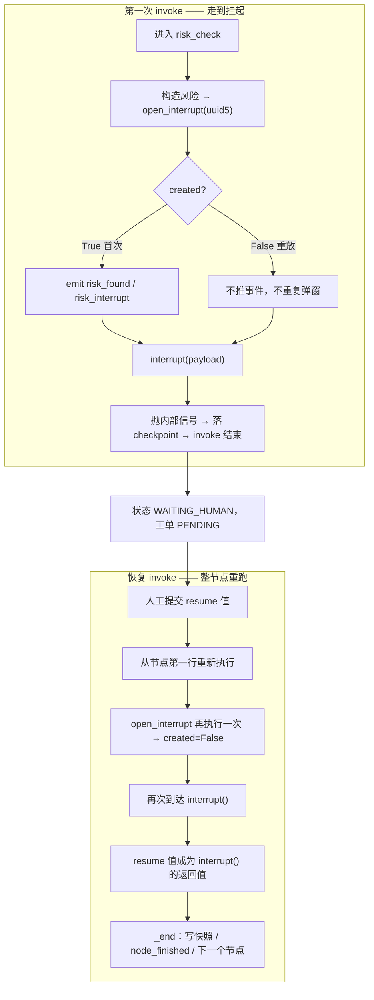
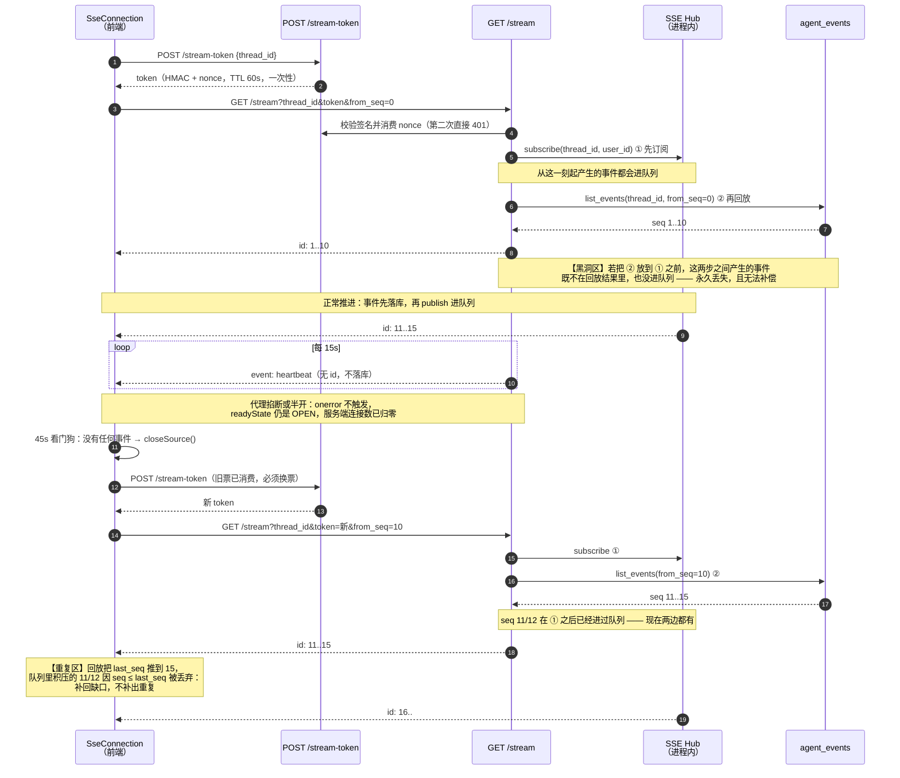

# 弹窗刚关掉，它又自己弹了出来

> 一次状态机重放、一次网络重放，把同一个“风险确认”推了两遍。

上一篇结尾我写：“下一篇，我们来看当 AI Agent 需要‘暂停’时，LangGraph 的断点恢复和 SSE 长连接能擦出怎样致命又迷人的火花。”

写的时候，我以为主角是“暂停”。

真到 D4 这天，主角是**重放**。

先摆盘子：

| 维度 | 交付 |
| :--- | :--- |
| 后端引擎 | LangGraph 10 节点 DAG、12 个子结构的 `ArchReviewState`、以 `checksum` 为唯一 seed 的确定性 Mock |
| 后端交互 | 两处 `interrupt()`（风险确认、报告确认）、`Last-Event-ID` 重放、24h 超时扫描、跨进程恢复 |
| 后端验收 | 真实 `uvicorn` + 真实 HTTP，4 阶段 64 项断言，含“杀进程再唤醒”和“卡点二退回重规划” |
| 前端 | Angular 21 + signals：480px 可拖拽清单、200px 思考链路、两个 HITL 弹窗、断线续传 |
| 前端验收 | 17 条浏览器链路；生产包 338.06 kB / gzip 89.41 kB，预审中心懒加载 71.28 kB |
| 关键数字 | 68 帧事件/轮、token 60s 一次性、心跳 15s、看门狗 45s、行高 56px |

这一天有两条时间线，各自都带一个“倒带键”。

**状态机的时间线**：checkpoint 让一个已经跑到一半的节点，可以回到第一行重新执行。
**网络的时间线**：`seq` 和 `from_seq` 让一段已经发过的事件，可以按客户端的要求再发一遍。

两个倒带键都是特性，不是 bug。bug 出现在它们同时按下、而链路上没有人负责去重的那一刻。

所以这一篇的每一节，最后都会落到同一个问题上：

> 当同一件事被执行第二次，谁知道这是“第二次”？

---

## 第一块 · 后端：状态机的倒带键

### 1.1 `interrupt()` 不是暂停，是把整个节点重跑一遍

**【现象】**

第一版 `risk_check` 的写法，在我当时看来没有任何问题：构造风险 → 插一条 `interrupt_tasks` 工单 → 推 `risk_interrupt` 事件 → 调 `interrupt(...)` 挂起。

人工点“确认风险”之后，SSE 里出现了这样一段：

```text
[SSE] seq=41  event=risk_found      interrupt_id=3c8d82b4-...
[SSE] seq=42  event=risk_interrupt  interrupt_id=3c8d82b4-...   ← 第一次，弹窗打开
[UI ] 用户选择"确认风险"，点击提交
[API] POST /hitl/3c8d82b4-.../resolve → 200
[SSE] seq=57  event=risk_interrupt  interrupt_id=3c8d82b4-...   ← 第二次，弹窗又弹了出来
[API] POST /hitl/3c8d82b4-.../resolve → 500
      IntegrityError: UNIQUE constraint failed
      (interrupt_tasks · uq_interrupt_tasks_pending_per_thread)
```

三个症状挤在十秒里：弹窗关了又弹、事件重复、恢复请求直接 500。

**最初的判断是前端把事件重放了一遍。**

但那一轮连接从头到尾没断过，`seq` 一路单调递增，57 这一帧不是回放出来的——是服务端真的又发了一次。

**【排查与解决】**

把 `risk_check` 单独抽出来跑，只留一句 `print`：

```python
async def risk_check(state):
    print(">>> enter risk_check")
    ...
    answer = interrupt(payload)
    print(">>> resumed", answer)
```

恢复时的输出是：

```text
>>> enter risk_check
>>> enter risk_check     ← 恢复时，从第一行又进来了
>>> resumed {'decision': 'CONFIRM', 'note': '...'}
```

**节点被执行了两遍，`interrupt()` 的返回值是第二遍才拿到的。**

这就是 LangGraph 挂起的真实语义：

1. `interrupt()` 不是“在这里停住、下次从这行继续”，而是**抛出一个内部信号**；
2. 信号一路冒泡，引擎把当前 State 落成 checkpoint，结束这次 `invoke`；
3. 恢复时用 `Command(resume=value)` 重新 `invoke`，引擎找到挂起的位置，**从这个节点的第一行重新执行**；
4. 执行到 `interrupt()` 时，它不再抛信号，而是直接把 `value` 作为返回值返回。

第 3 步是全部问题的根源：**`interrupt()` 之前的所有副作用，都会执行两次。**

而这正好和 PRD 的一条硬要求正面冲突：中断前必须先把工单落库、把事件推出去，保证人一定能看到。不落库会漏通知，落了库就重复——第一版无论选哪边都是错的。

还有一个更隐蔽的后果：恢复后拿到的 `state` 里没有任何“我刚处理过”的痕迹，`hitl_history` 仍然是空数组。它不会自动帮你记，得节点自己 append。

**修法不是“别执行两次”，而是“执行两次也只产生一份数据”。**

三个副作用，三种幂等策略。

第一种，把 id 从随机变成确定：

```python
# ❌ 第一版：每次进入都是新 id，重放必然插出第二条
interrupt_id = uuid.uuid4()

# ✅ 修复：(thread, 卡点类型, 重规划轮次) 的确定性函数
def interrupt_uuid(thread_id: str, itype: InterruptType, plan_revision: int) -> uuid.UUID:
    return uuid.uuid5(
        uuid.NAMESPACE_URL,
        f"arch-harness:{thread_id}:{itype}:{plan_revision}",
    )
```

`plan_revision` 进 key 是关键，不是顺手加的。

卡点二被退回后，图会回到 `detect_issues` 重规划，再走一次 `risk_check`。这时候**必须**产生一个新的中断 id，否则第二次中断会被当成第一次的重放，用户永远看不到第二轮的风险确认。验证时两轮 id 分别是 `3c8d82b4…` 和 `de40e795…`，而同一轮内的任意次重放，命中的都是同一个 id。

第二种，把“插入”变成“插入或忽略”，并且用“这次是不是新建”当事件门闩：

```python
async def open_interrupt(*, interrupt_id, thread_id, itype, expires_at, db) -> tuple[bool, datetime]:
    """幂等建单：返回 (created, expires_at)。

    created 为 True 才代表"这是第一次进入这个卡点"，
    也才允许推 risk_found / risk_interrupt —— 重放不该再弹一次窗。
    """
    stmt = (
        _insert(db)                                  # 按方言选 sqlite / pg 的 insert
        .values(id=interrupt_id, thread_id=thread_id, type=itype,
                status=InterruptStatus.PENDING, expires_at=expires_at)
        .on_conflict_do_nothing(index_elements=["id"])
        .returning(InterruptTask.id, InterruptTask.expires_at)
    )
    row = (await db.execute(stmt)).first()
    created = row is not None

    if not created:                                  # 重放：读回原有的过期时间
        row = (await db.execute(
            select(InterruptTask.expires_at).where(InterruptTask.id == interrupt_id)
        )).first()

    return created, row.expires_at
```

节点里就变成：

```python
created, expires_at = await open_interrupt(...)

if created:                    # ← 门闩：只有首次进入才推事件
    await bus.emit("risk_found", ...)
    await bus.emit("risk_interrupt", ...)

answer = interrupt({"interrupt_id": str(it_id), "expires_at": expires_at.isoformat(), ...})
```

注意门闩用的是 `created`，不是“查一下存不存在”。

“先查再插”在两次重放挨得很近时仍然会双插，真正兜住的是 `ON CONFLICT DO NOTHING` + 返回值。**能由数据库原子给出的答案，不要自己在应用层推。**

第三种，确认后追加的问题用固定前缀 + 先删后插：

```python
# 风险确认后，把人工确认的风险转成可挂批注的 ReviewIssue
await db.execute(delete(ReviewIssue).where(
    ReviewIssue.review_task_id == task.id,
    ReviewIssue.rule_code.like("RISK:%"),
))
await db.execute(insert(ReviewIssue), [ ... ])
```

只删自己这一类（`RISK:` 前缀），不碰 `detect_issues` 检出的常规问题。重放时先删后插，结果仍然是一份。

顺手还修了一个语义错误：第一版在 `interrupt()` 之前发 `node_finished`，前端会把“正在等待人工”的步骤提前打勾。

现在挂起只写快照、不发 `node_finished`——**只有走完 `_end` 才算真的完成**。

这个错误是靠统计露出来的：一轮下来 12 个 `node_started`，却有 14 个 `node_finished`。多出来的两帧，正是两个挂起节点在 `interrupt()` 前“提前宣布完工”的那两次。

顺带说明那 12 个 `node_started` 为什么不是 10：那一轮含一次退回重规划——**图的节点数不等于执行次数**，这也是“用事件统计做验收”比“看图长什么样”更可靠的原因。

【原理与沉淀】

`interrupt()` 的设计其实很干净：它把“恢复”实现成“重放 + 注入返回值”，代价小、实现简单、对任意节点都成立。代价被转移给了写节点的人：**节点必须假设自己会被执行任意多次。**

于是“副作用”这个词要重新定义。它不是“写了一次数据库”，而是“向一个可能执行多次的世界提交了一次变更”。能提交多次还只留一份的，才叫副作用；否则叫“一次性动作”，而一次性动作在可重放的系统里是定时炸弹。

幂等键的维度也要想清楚。这个例子里，`thread_id` 不够（重规划会产生合法的第二次中断），随机 id 也不够（重放会插出第二条）。正确的键是“能让这次执行合法地产生新结果”的那一维——这里是 `plan_revision`。

门闩同理：判断“要不要推事件”的依据，不是“这条数据在不在”，而是“这条数据是不是我刚刚创建的”。前者是状态，后者是因果。

画成图是这样：



图里最容易被忽略的是那条从 `R` 回到 `B2` 的边：**恢复不是从 `F` 继续，而是从 `A` 重来。** 理解了这条边，后面所有“为什么会重复”的问题都不用再问。

### 1.2 订阅与回放之间，有一个几十毫秒的黑洞

**【现象】**

`Last-Event-ID` 续传的第一版，顺序很自然：先查 `agent_events` 把历史回放出去，再把连接挂到实时队列上。

压测脚本做 10 次“断开 → 重连”，对比每轮前端最终收到的问题数和 `issue_total`：

```text
run 1   issue_found=12   issue_total=12   OK
run 2   issue_found=11   issue_total=12   MISS 1
run 3   issue_found=12   issue_total=12   OK
...
run 10  issue_found=10   issue_total=12   MISS 2
```

10 次里有 2 次缺，而且缺的永远是 `issue_found`，不是别的帧。

**一开始怀疑是前端渲染丢了。** 但把收到的每一帧打到控制台，服务端确实没发——缺口在链路上，不在 DOM 里。

**【排查与解决】**

把第一版的时序摊开，问题一目了然：

```text
① 查库：SELECT ... WHERE seq > 10      → 拿到 11..13
② 建立订阅：hub.subscribe(thread)
③ 实时循环：queue.get()
```

如果一条事件在 ① 查完之后、② 建立之前落库并发布，它就同时躲过了两个地方：回放结果里没有（查的时候还不存在），队列里也没有（还没订阅）。

这个窗口在真实网络里通常是几毫秒到几十毫秒；但在 Mock 引擎里，节点是纯计算、不等待任何 IO，一轮 68 帧可以在几十毫秒内推完，所以这个窗口的命中率被放大到了 20%。

**慢引擎几乎测不出来，快引擎必现。** 这也是为什么它一直活到压测才暴露。

修法是把顺序反过来，并且接受“会重叠”：

```python
@router.get("/drawings/{drawing_id}/stream")
async def stream(drawing_id: str, thread_id: str, from_seq: int = 0, ...):
    # ① 先进队列：从这一刻起，新事件一定会被接住
    sub = await hub.subscribe(thread_id, user_id)

    async def gen():
        last_seq = from_seq
        try:
            # ② 再查库：把"过去"补上
            for ev in await list_events(thread_id, from_seq=from_seq):
                last_seq = max(last_seq, ev.seq)
                yield frame(ev)

            # ③ 实时：重叠部分按 seq 丢弃
            while True:
                try:
                    item = await asyncio.wait_for(sub.queue.get(), timeout=HEARTBEAT_SECONDS)
                except TimeoutError:
                    # 心跳不带 id，不落库，因此不会污染 Last-Event-ID
                    yield "event: heartbeat\ndata: {\"ts\": 0}\n\n"
                    continue

                if item["seq"] <= last_seq:
                    continue

                last_seq = item["seq"]
                yield frame(item)

                if item["event"] in TERMINAL_EVENTS:
                    await asyncio.sleep(2)      # 让前端收完最后几帧再关
                    return
        finally:
            await hub.unsubscribe(sub)          # 不写这一行，长连接一定泄漏
```

这个顺序的代价是：**订阅之后、回放之前产生的事件，会既在队列里、又在回放结果里。**

于是链路上出现了“重复”，而不是“缺口”。这一步是整个修复的关键取舍——重复可以按 `seq` 消掉，缺口消不掉。

画成时序图，两个区域必须分清楚：



另外三个收尾细节，都是“不写就一定出事”的那种：

- **心跳 15s**，且 `id` 留空、不落库。带了 id，`Last-Event-ID` 就会被心跳推着走，真断线时反而从心跳位置续传，中间的业务帧全丢；
- **终态后留 2s** 再关连接，否则最后一帧可能还在内核缓冲区里，前端只看到“连接正常关闭”；
- **30 分钟无业务事件**主动发 `stream_idle` 并关闭，避免反向代理和连接池被慢慢抽干。

【原理与沉淀】

事件流能提供的可靠性上限是 **at-least-once**。想让“至少一次”在效果上等于“恰好一次”，只有一条路：给每个事件一个稳定、单调的坐标，然后让消费侧按坐标去重。

这个坐标就是 `seq`。它必须由数据库原子分配，不能是进程内计数器：

```sql
UPDATE review_tasks
   SET last_seq = last_seq + 1
 WHERE id = :task_id
RETURNING last_seq;
```

再配一条 `UNIQUE (thread_id, seq)` 当最后防线。重启归零、多实例撞号，这两件事只要发生一次，整个去重逻辑就全废了。

顺序也有讲究：**先建“未来”的通道，再补“过去”的记录。** 反过来，两步之间就是一个永远补不回来的洞。这个原则不只适用于 SSE——任何“历史 + 订阅”的组合（消息队列的 consumer + 历史查询、数据库快照 + CDC）都是同一个形状。

最后一条，是本轮验证方式上的收获：**别用“看页面”验证事件流，用计数验证。** `sum(issue_found) == issue_total` 这一条断言，比盯十分钟进度条有用得多。

### 1.3 `BIGINT PRIMARY KEY` 在 SQLite 上不会自增

**【现象】**

图第一次真正跑通，第一个事件就 500：

```text
sqlalchemy.exc.IntegrityError: (sqlite3.IntegrityError)
NOT NULL constraint failed: agent_events.id
[SQL: INSERT INTO agent_events (thread_id, run_id, seq, event, data)
      VALUES (?, ?, ?, ?, ?) RETURNING id, created_at]
```

`agent_events.id` 是从 D1 就设计好的自增主键，DDL 里写着 `BigInteger, primary_key=True, autoincrement=True`。在 PostgreSQL 上这条 INSERT 从来没出过问题。

**【排查与解决】**

先看 SQLite 里实际建出来的表：

```text
sqlite> SELECT sql FROM sqlite_master WHERE name='agent_events';
CREATE TABLE agent_events (
    id BIGINT NOT NULL,
    ...
    PRIMARY KEY (id)
);
```

注意是 `BIGINT NOT NULL`，不是 `INTEGER PRIMARY KEY`。

SQLite 有一条死规定：**只有声明为 `INTEGER PRIMARY KEY` 的列，才是 rowid 的别名，才会在插入 NULL 时自动填值。** `BIGINT PRIMARY KEY` 只是一个带主键约束的普通列，插入不传值就是 `NULL`，直接违反 `NOT NULL`。

而 SQLAlchemy 的 `BigInteger` 在 PG 上编译成 `BIGSERIAL`，序列自动兜底，所以这段代码“在 PG 上正确、在 SQLite 上必挂”——和 D3 的 `DateTime(timezone=True)` 是同一族问题：**DDL 看起来对，运行时语义完全不同。**

修法是在类型层按方言分叉，业务代码一行不改：

```python
from sqlalchemy import BigInteger, Integer

id: Mapped[int] = mapped_column(
    BigInteger().with_variant(Integer, "sqlite"),
    primary_key=True,
    autoincrement=True,
)
```

`with_variant` 的语义是“在指定方言上换成另一个类型”：

| 方言 | 编译结果 | 插入不传 id 时 |
| :--- | :--- | :--- |
| PostgreSQL | `BIGINT` + `BIGSERIAL` 序列 | 序列给值 |
| SQLite（修复前） | `BIGINT NOT NULL` | `NULL` → 约束失败 |
| SQLite（修复后） | `INTEGER NOT NULL PRIMARY KEY` | rowid 自动给值 |

配套一条**只在 SQLite 上生效**的迁移。PG 的 `BIGSERIAL` 本来就是对的，生产库不折腾：

```python
def upgrade() -> None:
    if op.get_bind().dialect.name != "sqlite":
        return

    # SQLite 不支持 ALTER COLUMN，用 batch 模式重建表并搬运数据
    with op.batch_alter_table("agent_events", recreate="always") as batch:
        batch.alter_column(
            "id",
            existing_type=sa.BigInteger(),
            type_=sa.Integer(),
            existing_nullable=False,
        )
```

改完 `alembic check` 依然是 `No new upgrade operations detected`——因为 PG 侧的 DDL 根本没变。

同一族的第二处，藏得更深。

超时扫描里的“认领 50 条过期工单”原本写得很顺：

```python
# ❌ SQLAlchemy 的 Update 在 SQLite 方言下没有 limit()
await db.execute(
    update(InterruptTask)
    .where(InterruptTask.status == PENDING, InterruptTask.expires_at < now)
    .values(status=EXPIRED)
    .returning(InterruptTask.id)
    .limit(50)
)
```

`Update.limit()` 在 SQLite 方言下不可用，直接抛 `AttributeError`。而且 `UPDATE ... LIMIT` 本来就不是 PG 的原生语法——这条写法当时是被“链式调用看起来能拼起来”骗过去的。

而这个协程外面包着 `except Exception: log.exception(...)`，于是它**每 5 分钟静默失败一次**，日志里只有一行被吃掉的异常，工单永远不会过期。

最后不是靠日志抓到的，是靠一条端到端断言：

```text
断言：把 expires_at 拨到 25 小时前，6 秒内工单必须变成 EXPIRED
实际：25 秒后仍是 PENDING
```

改成两步，并且第二步保留条件判断：

```python
# ✅ 先按条件选 id（方言无关），再按 id 更新
ids = (await db.execute(
    select(InterruptTask.id)
    .where(InterruptTask.status == PENDING, InterruptTask.expires_at < now)
    .limit(50)
)).scalars().all()

if ids:
    await db.execute(
        update(InterruptTask)
        .where(
            InterruptTask.id.in_(ids),
            # 关键：并发下被人工抢先处理的工单不能被误改
            InterruptTask.status.in_([InterruptStatus.PENDING, InterruptStatus.VIEWED]),
        )
        .values(status=InterruptStatus.EXPIRED)
    )
```

【原理与沉淀】

这两处坑值得放在一起说，因为它们暴露了同一件事的两面。

第一面是**声明与事实**：`BigInteger` 是声明，数据库驱动把它编译成什么、运行时怎么填值，才是事实。D3 那句“DDL 是声明，驱动是事实”在这里第二次应验。判断一个类型能不能跨库用，不能看它“长得对不对”，要看它在目标方言里的**取值语义**。

第二面更贵：**兜底 catch 让静默失败变得极其廉价。**

`except Exception: log.exception(...)` 写下去的那一刻，这个后台任务就从“可能出错”变成了“出错了也没人知道”。每 5 分钟失败一次，一小时 12 次，一天 288 次，日志里全是同一行，而 UI 上一切正常——直到有人发现工单再也不过期。

后台协程的正确验收口径不是“没抛异常”，而是“**状态必须在 X 秒内发生指定的变化**”。异常日志只能帮你定位，不能帮你发现。

### 1.4 恢复的地基：checkpointer 必须是应用级单例

**【现象】**

这一节不是某一个 bug，而是三个连环问题。它们共同的后果是：**挂起能成功，恢复必失败。**

1. 第一版在每个创建预审任务的请求里 `AsyncPostgresSaver.from_conn_string(...)`，跑完发现“恢复时 checkpoint 找不到”；
2. 换成本机 SQLite 后，`AsyncSqliteSaver` 每次 `setup()` 都报 `database is locked`；
3. 迁移校验突然从“无漂移”变成 `alembic check` 报 `Detected removed table 'writes'`。

**【排查与解决】**

**第一件：`from_conn_string` 返回的不是 saver，是异步上下文管理器。**

```python
# ❌ 这不是 saver，是 _AsyncGeneratorContextManager
saver = AsyncPostgresSaver.from_conn_string(dsn)
```

必须 `async with` 才能拿到真对象。而一旦在请求里创建、请求结束就关，checkpoint 的连接随请求一起没了——恢复时去连一个已经关闭的 saver，自然找不到历史。

正确的做法是把它的生命周期绑到应用的 lifespan 上，全进程只有一份：

```python
@asynccontextmanager
async def lifespan(_: FastAPI):
    await run_manager.startup()      # enter_async_context + setup()，只做一次
    try:
        yield
    finally:
        await run_manager.shutdown()
```

```python
class RunManager:
    async def startup(self) -> None:
        self._stack = AsyncExitStack()

        if settings.is_sqlite:
            self._saver = await self._stack.enter_async_context(
                AsyncSqliteSaver.from_conn_string(settings.sqlite_path)
            )
            # busy_timeout 是 per-connection 的 PRAGMA，saver 的连接不会继承业务引擎的设置
            await self._saver.conn.execute("PRAGMA busy_timeout=5000")
        else:
            self._saver = await self._stack.enter_async_context(
                AsyncPostgresSaver.from_conn_string(settings.pg_dsn)
            )

        await self._saver.setup()            # 幂等建表
        self._graph = build_graph(self._saver)
```

**第二件：SQLite 的 `database is locked` 不是并发太高，是缺了一个 PRAGMA。**

checkpointer 用自己的连接写同一个库文件，而业务引擎的 `busy_timeout` 是**每个连接各自生效**的 PRAGMA。saver 的连接没设，于是“图写 checkpoint”和“节点写业务表”并发时，一个立刻拿锁失败并抛错，而不是等待。

补上那 5 秒之后，两个写者从“撞死”变成了“排队”。

**第三件：Alembic 把 LangGraph 自建的表判定成“要删的表”。**

autogenerate 的比较基准是“数据库里有什么 vs metadata 里有什么”，LangGraph 自己建了 `checkpoints`、`checkpoint_writes`、`writes`、`checkpoint_migrations`，而它们不在你的 metadata 里，于是被判定为 `remove_table`，`alembic check` 永远红。

```python
LANGGRAPH_TABLES = {"checkpoints", "checkpoint_writes", "writes", "checkpoint_migrations"}

def include_object(obj, name, type_, reflected, compare_to):
    if type_ == "table" and name in LANGGRAPH_TABLES:
        return False
    return True
```

顺带说一个不在坑点清单里、但比上面三条都危险的约束：**同一个 thread 只能有一个执行体。**

两个 `ainvoke` 同时跑同一个 `thread_id`，会写出**分叉的 checkpoint 历史**——两条支线各自往前走，恢复时取到哪一支全看运气。这里的兜底是双保险：进程内 per-thread `asyncio.Lock`，跨进程靠 DB 条件更新把任务状态从 `PENDING` 抢成 `RUNNING`，抢不到就 409。

【原理与沉淀】

checkpointer 不是一个“库”，是一个**有状态的基础设施**。它有自己的连接、自己的生命周期、自己的方言差异、自己的表。

把它当库用，就会在每个请求里 new 一个；把它当基础设施用，才会在 lifespan 里只初始化一次，并且意识到“方言分叉只应该发生在一个地方”：

```python
if settings.is_sqlite:
    ...
else:
    ...
```

这段 `if` 在整个项目里只出现一次（`runtime.py` 的 startup）。graph、节点、HITL、路由全都感知不到底层是 SQLite 还是 PG。**方言差异是基础设施的责任，不该漏到业务代码里。**

---

## 第二块 · 前端：长连接的倒带键

### 2.1 EventSource 的自动重连，和一次性 token 是死结

**【现象】**

预审流跑到 38%，用 mock 的 `/__mock/drop` 掐掉服务端连接。

页面上的表现是：进度条卡住、没有任何报错、没有“正在重连”的横幅。控制台干净。

在浏览器里读连接对象的状态：

```text
source.readyState  → 1        (OPEN)
source.url         → ...stream?thread_id=t-0001&token=st_9f3c...
lastEventId        → "10"
服务端 /__mock/state → { connections: 0 }
```

**客户端认为自己连着，服务端说连接早就没了。**

等到 45 秒的心跳看门狗触发，页面才动——这 45 秒里，用户看到的是一个“还在跑但其实死了”的界面。

**【排查与解决】**

这里有三层冲突叠在一起，任何一层单独处理都不成立。

**第一层：自动重连复用的是同一个 URL，而 URL 里的 token 是一次性的。**

`EventSource` 断线后会自己重连，但它只会重发**同一个 URL**。而 PRD §1.4 要求 `stream_token` 一次性、TTL 60 秒。不接管的话，浏览器会拿着已经消费过的 token 反复重试，表现为一串 401；而 `EventSource.onerror` **不暴露状态码**，你连“是鉴权失败还是网络抖动”都分不出来。

浏览器要“自动重连”，产品要“票据一次性”，这两个需求在物理上冲突。

**第二层：换 token 必然新建实例，而新建实例设不了 `Last-Event-ID`。**

`Last-Event-ID` 是浏览器自动重连时自己带的头，属于“同一个实例自己重连”的能力。我们换了 token，就是新实例，这个头设不了。

契约里给了一个等价口子：`from_seq` 查询参数（prd-07 §5.5）。但它必须自己拼。

**第三层，也是最要命的：静默假死。**

经 Vite 或网关代理时，上游连接被掐断，浏览器侧可能既不报错也不结束——半开连接。实测 `onerror` 一次都没触发，`readyState` 一直是 `OPEN`。

**第三层直接否掉了“监听 onerror 就够了”这个方案。**

修法的核心是两句话：

> 把重连的所有权从浏览器手里拿回来。
> 把“存活”的判断从“连接状态”改成“事件流状态”。

```ts
private open(token: string): void {
  this.closeSource();

  const url = this.withFromSeq(
    `/api/drawings/${this.drawingId()}/stream?thread_id=${this.threadId()}&token=${token}`,
    this.lastSeq(),
  );

  const source = new EventSource(url);
  this.source = source;
  this.openedAt = Date.now();
  this.receivedBusinessEvent = false;

  source.onopen = () => { this.retry = 0; };

  // 业务事件统一走 addEventListener，收到任何一帧就把看门狗续上
  for (const type of BUSINESS_EVENTS) {
    source.addEventListener(type, (event) => this.onBusinessEvent(type, event));
  }

  source.onerror = () => {
    // 关键：不 close 的话，浏览器会拿同一个已失效的 token 无限重连 → 401 风暴
    this.closeSource();
    this.scheduleReconnect();
  };
}

private scheduleReconnect(): void {
  // 连上就断、且一个业务事件都没收到 → 按 token 失效（401）处理
  const looksLikeAuthFailure =
    !this.receivedBusinessEvent &&
    this.openedAt > 0 &&
    Date.now() - this.openedAt < AUTH_FAILURE_WINDOW_MS;

  if (looksLikeAuthFailure && !this.authRetried) {
    this.authRetried = true;     // 只给一次，避免 401 循环
    this.start();                // start() 内部重新 POST /stream-token
    return;
  }

  // 1s / 2s / 4s / 8s，最多 5 次；每次都用新票
  const delay = BACKOFF_MS[Math.min(this.retry, BACKOFF_MS.length - 1)];
  this.retry += 1;

  if (this.retry > MAX_RETRY) {
    this.state.set('failed');
    return;
  }

  this.state.set('reconnecting');
  this.reconnectTimer = setTimeout(() => this.start(), delay);
}
```

`start()` 每次都重新取票，`withFromSeq()` 负责把断点拼进新 URL：

```ts
private withFromSeq(url: string, fromSeq: number): string {
  if (fromSeq <= 0) return url;
  return `${url}${url.includes('?') ? '&' : '?'}from_seq=${fromSeq}`;
}
```

最后是那个真正能抓住“半开连接”的东西——心跳看门狗：

```ts
// 每 5s 检查一次：45s 没有任何事件，就判定链路已死
private readonly watchdog = setInterval(() => {
  if (!this.source) return;
  if (Date.now() - this.lastEventAt > IDLE_TIMEOUT_MS) {
    this.closeSource();
    this.scheduleReconnect();
  }
}, 5_000);
```

实测结果：

```text
[drop]  服务端连接被掐断
[watch] 45s 无事件 → closeSource()
[fetch] POST /stream-token → 新 token
[open ] GET .../stream?thread_id=t-0001&token=st_xxx&from_seq=10
[SSE  ] id: 11..15（回放）
[UI   ] 进度 38% → 78%，问题行 3 条，无重复
```

**【原理与沉淀】**

这一天之后，我对 SSE 的判断标准变成了一句话：**只信事件流，不信连接状态。**

`readyState === OPEN` 是一个声明，它只说明“本地的 socket 对象没关”。事件流有没有在推进，才是事实。这和 D3 的“声明 vs 事实”是同一条，只是在长连接里，声明变得特别有欺骗性——因为它看起来像是一个实时的、来自操作系统的信号。

第二个沉淀是关于“接管”的：`EventSource` 的自动重连是一个**为公开 URL 设计的默认值**，它假设 URL 永久有效。一旦 URL 里带了凭证，这个默认值就从便利变成了负担。这时候要做的不是和它搏斗，而是把它关掉、自己排期。

第三个是妥协要写进契约。`onerror` 不暴露状态码，所以“401”只能靠“连上即断且无业务事件”启发式判断。这是一个已知的近似，必须在文档里写清楚，否则它会以“偶发 401”的形式在半年后回来找你。真要更准，就得放弃 `EventSource`，改用 `fetch` + `ReadableStream` 拿真实状态码——这是 D5 的待办。

### 2.2 120 条问题，只渲染 16 个 DOM

**【现象】**

左清单只有 480px 宽，但一个问题清单可以到几百条。同时要满足四件事：

- 全选、批量采纳；
- 按严重度 / 专业 / 状态筛选后重新拉取；
- SSE 实时插入新的 `issue_found`；
- 点画布上的框，列表要定位到对应行（可能在视口外）。

直接 `@for` 全量渲染，120 条就是 120 个 DOM 行、每行 6 个绑定。改成窗口化之后，滚动、选中、定位三套行为立刻互相打架。

**【排查与解决】**

打架的根源是三个“不稳定量”：

1. **行高不固定** → 偏移量算不准。标题可能两行、规则号可能更长，几十行之后误差会累积到肉眼可见；
2. **`track $index` 会串行** → 窗口化之后，同一个 index 在不同时刻不是同一行。用 index 追踪，会把 A 的勾选状态画到 B 上；
3. **筛选和插入会改下标** → 用户点画布第 46 条，如果按“第 46 个下标”滚动，一次筛选或一条 `issue_found` 就滚错位置。

修法是先把“行高”和“身份”变成硬约束，滚动只做纯计算。

```ts
const ROW_HEIGHT = 56;   // 每行强制 h-14，内容一律 truncate
const OVERSCAN = 6;

protected readonly visibleWindow = computed(() => {
  const total = this.filteredIssues().length;
  const start = Math.max(0, Math.floor(this.scrollTop() / ROW_HEIGHT) - OVERSCAN);
  const visibleCount = Math.ceil(this.viewportHeight() / ROW_HEIGHT) + OVERSCAN * 2;
  const end = Math.min(total, start + visibleCount);

  return {
    rows: this.filteredIssues().slice(start, end),
    totalHeight: total * ROW_HEIGHT,   // 撑开滚动条
    offset: start * ROW_HEIGHT,        // translateY 定位
  };
});
```

模板这边，`@for` 必须 `track issue.id`，不能用 `$index`：

```html
<div #viewport class="h-full overflow-y-auto" (scroll)="onScroll()">
  <!-- 外层用总高度撑开滚动条 -->
  <div class="relative" [style.height.px]="visibleWindow().totalHeight">

    <!-- 内层整体平移，只渲染窗口内的行 -->
    <div class="absolute inset-x-0 top-0"
         [style.transform]="'translateY(' + visibleWindow().offset + 'px)'">

      @for (issue of visibleWindow().rows; track issue.id) {
        <div class="h-14 flex items-center gap-3 px-3 cursor-pointer truncate"
             [class.bg-primary-soft]="issue.id === selectedId()"
             (click)="selectIssue(issue.id)">
          <span class="h-2 w-2 rounded-full" [class]="severityDot(issue.severity)"></span>
          <span class="truncate">{{ issue.title }}</span>
          <span class="ml-auto shrink-0 text-xs text-slate-400">{{ issue.ruleCode }}</span>
        </div>
      } @empty {
        <div class="h-14 flex items-center justify-center text-sm text-slate-400">
          没有符合条件的问题
        </div>
      }
    </div>
  </div>
</div>
```

配套四条规则，每一条都对应上面一个“不稳定量”：

**① 勾选状态存 `Set<id>`，不存下标。**

```ts
protected readonly checked = signal<ReadonlySet<string>>(new Set());
```

窗口化之后，行会被销毁重建，只有 id 是跨滚动稳定的。

**② 滚动事件用 `requestAnimationFrame` 合并。**

```ts
private rafId = 0;

onScroll(): void {
  if (this.rafId) return;
  this.rafId = requestAnimationFrame(() => {
    this.rafId = 0;
    const el = this.viewportRef()?.nativeElement;
    if (el) this.scrollTop.set(el.scrollTop);
  });
}
```

`scroll` 一次拖动可以触发上百次；不合并，就等于让变更检测跟着鼠标跑。

**③ 视口高度用 `ResizeObserver` 量，窗口变化时窗口大小自动跟着变。**

```ts
private readonly ro = new ResizeObserver(([entry]) => {
  this.viewportHeight.set(entry.contentRect.height);
});

ngAfterViewInit(): void {
  const el = this.viewportRef()?.nativeElement;
  if (el) this.ro.observe(el);
}
```

**④ 定位先按 id 找下标，且只在目标不可见时才滚。**

```ts
private revealIssue(id: string): void {
  const index = this.filteredIssues().findIndex((issue) => issue.id === id);
  if (index < 0) return;                  // 被筛掉了：不滚，避免滚到错的位置

  const top = index * ROW_HEIGHT;
  const viewTop = this.scrollTop();
  const viewBottom = viewTop + this.viewportHeight();

  // 已经可见就什么都不做：每次点击都滚一下，列表会抖
  if (top >= viewTop && top + ROW_HEIGHT <= viewBottom) return;

  this.viewportRef()?.nativeElement.scrollTo({
    top: top - (this.viewportHeight() - ROW_HEIGHT) / 2,
    behavior: 'smooth',
  });
}
```

实测的数字可以对上：

```text
问题总数        120
占位高度        6720px   (120 × 56)
DOM 行数        16       (视口行数 + 2 × OVERSCAN)
滚到底          仍只有 16 行，滚动条位置与内容始终对齐
点画布定位      列表滚到目标行并选中；目标已在视口内时不动
```

**【原理与沉淀】**

虚拟滚动真正难的不是切片，切片只有三行。难的是**身份**和**测量**。

- 身份：窗口化把“位置”和“元素”解耦了。凡是需要跨滚动存活的状态（勾选、展开、高亮），都必须挂在 id 上，不能挂在下标上。`track $index` 在普通列表里只是性能问题，在虚拟列表里是正确性问题。
- 测量：偏移量的计算建立在“每一行高度相同”这个假设上。这个假设不能靠“内容一般不会太长”来维持，得靠 `h-14` + `truncate` 强制。**固定行高不是偷懒，是把测量问题提前消灭在样式里。**

还有一条容易被忽略的：**“定位”和“选中”是两件事。** 定位是滚动，选中是状态。混在一起写，就会出现“点了画布，列表滚了，但选中态没跟上”或者反过来。分开之后，两边各自幂等，谁也不依赖谁。

### 2.3 事件重放会“回到过去”，倒计时也会

**【现象】**

风险确认弹窗里，用户选了“特殊豁免”，正在输入依据。此时网络抖动触发 `from_seq` 续传，服务端把 `risk_interrupt` 又回放了一遍。

三个问题立刻浮上来：

1. 表单会不会被清空？
2. 倒计时会不会重置？
3. 点“稍后处理”关掉弹窗，20 秒后再点“去处理”，倒计时从 `23:59:58` 重新开始——**凭空多出 20 秒。**

前两个是“可能会”，第三个是实测出来的。

**【排查与解决】**

第一个问题的答案取决于一个 Angular 的细节：父级写的是

```html
@if (riskInterrupt(); as interrupt) {
  <app-risk-confirm-modal [interrupt]="interrupt" />
}
```

事件重放时，`riskInterrupt()` 被替换成一个**新对象**。这里的关键是：`@if` 在这种情况下**不会销毁子组件**，只是更新了 input。所以弹窗实例还在，`decisions` / `remarks` 这两个 signal 都还在，用户输入不会丢。

**这是一个“恰好正确”。**

只要有人为了“干净”，在 `ngOnChanges` 里补一句 `this.reset()`，就前功尽弃——而且这种改动看起来非常合理，code review 很容易放过。

所以正确的做法不是依赖这个巧合，而是把所有权写清楚：

```ts
// 草稿只属于弹窗实例。父级用 @if 控制存在性 → 真正关闭时天然归零
protected readonly decisions = signal<Record<string, HitlDecision>>({});
protected readonly remarks = signal<Record<string, string>>({});
```

服务端事件是**事实**，只更新 `input`；用户填的是**草稿**，只存在实例里。两者不互相重置，也不互相覆盖。

至于第二个问题——重放确实会把 `remaining_seconds` 覆盖一次。但只要倒计时不是“存下来的值”，而是“从绝对时间算出来的派生值”，覆盖就无所谓。

这正好接到第三个问题：时间源。

```ts
// ❌ 用事件里的瞬时值：关掉弹窗 20 秒再打开，就等于续了 20 秒
this.remainingSeconds.set(interrupt.remaining_seconds);

// ✅ 用绝对时间算：不管什么时候打开，剩余时间都是对的
const expiresAt = new Date(interrupt.expires_at).getTime();
const fromExpiry = Number.isNaN(expiresAt)
  ? null
  : Math.floor((expiresAt - Date.now()) / 1000);

this.remainingSeconds.set(Math.max(0, fromExpiry ?? interrupt.remaining_seconds ?? 0));
```

`remaining_seconds` 是事件发生那一刻的快照，`expires_at` 是绝对时间。**快照可以展示，不能参与计算。**

顺带把错误语义也分开了：422 是“你填错了”，留在弹窗里改；409 是“这单已经被别人处理了”，关窗 + Toast + 拉快照。

继续留着弹窗让用户重试，才是错的——他改到天亮也提交不上去。

**【原理与沉淀】**

事件驱动的界面，本质上有两个真相源在抢同一个组件：**服务端推来的事实**和**用户正在创造的草稿**。

大部分“输入被冲掉”的 bug，都来自把这两者当成了一个东西：`ngOnChanges` 里统一 reset、用同一个 model 双向绑定、每次事件到达就重建表单。

正确的划分是：

| | 归属 | 生命周期 | 事件重放时 |
| :--- | :--- | :--- | :--- |
| 中断数据（类型、期限、风险项） | 服务端事实 | 随中断存在 | 覆盖，不重置草稿 |
| 用户选择、输入的依据 | 组件草稿 | 随组件实例 | 保留 |
| 倒计时 | 由 `expires_at` 派生 | 每帧重算 | 与重放无关 |

第二层沉淀是关于时间的：**凡是“还剩多久”，都必须由绝对时间派生。** 用剩余秒数的地方，早晚会出现“关掉再打开就续命”的问题——不只是弹窗，还有 token 过期、缓存 TTL、验证码有效期。

这和 1.1 是同一条定律的两种长相：1.1 是“同一件事被执行两次”，这里是“同一个时刻被读取两次”。前者要靠幂等键，后者要靠绝对时间。

### 2.4 增量事件与全量快照：两个真相怎么合并

**【现象】**

`issue_found` 的 payload 只有 `issue_id / severity / discipline / title / confidence`，**没有坐标**。

但画布高亮、定位按钮都依赖 `location`。

同时，`run_completed` 之后要求“刷新全量列表、状态变为已完成”，而重连回放又会把同一批问题再推一遍。

**【排查与解决】**

先把两个类型分清楚：`IssueDraft`（事件）和 `IssueOut`（落库）本来就不是同一个东西，硬塞进一个模型就得造假字段。

做法是清单统一成 UI 行模型，用一个 `live` 标记区分“占位行”和“落库行”：

```ts
export interface IssueRow {
  id: string;
  severity: Severity;
  discipline: Discipline;
  title: string;
  confidence: number;
  status: IssueStatus;
  location: Location | null;    // 占位行没有坐标
  locationValid: boolean;
  live: boolean;                // 来自 SSE issue_found，尚未落库
}
```

三条规则：

```ts
// ① 插入前按 id 去重：回放/重连会把同一个 issue 再推一次
if (this.issues().some((issue) => issue.id === id)) return;

// ② 画布只渲染有合法坐标的行，占位行的"定位"按钮置灰
readonly drawable = computed(() =>
  this.issues().filter((issue) => issue.location && issue.locationValid),
);

// ③ 终态只做一次全量对齐，不是轮询
case 'run_completed':
  this.closeStream();
  this.loadIssues();            // 用落库数据替换占位行
  this.refreshSnapshotOnce();   // issue_total / summary / cost_ms
  this.scheduleCollapse();      // 3s 后收起思考链路
```

进度同理：`percent` 只增不减（`Math.max`），中断时暂停并转琥珀色，只有 `stream_reset` 才清空过程记录并全量刷新。

**【原理与沉淀】**

增量负责“看得见”，全量负责“对得齐”。

- 增量事件的价值是**时延**：检出即插入，用户不用等整轮跑完；
- 全量快照的价值是**一致性**：`issue_total`、`summary`、`issue_stat` 这些聚合值，只有落库之后才算数；
- 两者之间必须有一个显式的“对齐时刻”，否则就会出现“列表 12 条、顶部写着 11 条”这种永远解释不清的偏差。

还有一个隐性的收益：把 `live` 做成显式字段之后，“为什么这条不能定位”变成了一个可以在 UI 上解释的状态，而不是一个偶发的、看起来像 bug 的空点击。

---

## 第三块 · 合流：两次倒带的同一条定律

把前后端排在一张表里，会发现它们其实是同一个问题的六个面：

| | 状态机重放 | 网络回放 |
| :--- | :--- | :--- |
| 谁触发 | LangGraph 恢复 `invoke` | 客户端带 `from_seq` 重连 |
| 重放单位 | 整个节点 | 一段事件区间 |
| 天然后果 | 副作用执行两次 | 同一批事件到达两次 |
| 稳定身份 | `uuid5(thread, 卡点, revision)` | `seq` / `issue.id` |
| 幂等手段 | insert-if-absent + `created` 门闩 | `seq <= last_seq` 丢弃 |
| 失败形态 | 唯一约束 500、弹窗重复 | 清单缺条、表单被冲、倒计时续命 |

三条结论。

**第一，至少一次是物理现实，恰好一次是工程幻觉。**

网络会重发，进程会重启，节点会重跑。任何声称“恰好一次”的设计，底下都藏着一次“至少一次 + 去重”。承认这一点，代码结构才会自然地长成幂等的样子；不承认，就会在每个“不应该发生”的重复上打补丁。

**第二，可重放的链路需要三件套：稳定身份、单调序号、幂等写入。**

- 稳定身份：让“第二次”能被认出来是同一个东西（`uuid5`、`issue.id`、`seq`）；
- 单调序号：让“补到哪儿了”有唯一答案（`last_seq` 原子自增 + 唯一约束）；
- 幂等写入：让“认出来之后”有能力不做第二次（`ON CONFLICT DO NOTHING`、`seq <= last_seq` 丢弃、`RISK:` 先删后插）。

少任何一件，重放就会从“能力”变成“故障”。

**第三，“重”永远比“丢”便宜。**

1.2 那个顺序反转，本质就是一次成本选择：先订阅再回放，会多出几条重复；先回放再订阅，会永久丢掉几条。重复可以用 `seq` 消掉，丢失没有任何办法补——因为服务端都不知道你缺了。

这条判断可以迁移到很多地方：消息队列的 ack 时机、缓存的写回、日志的采集、甚至人和人之间的同步。

---

## 实战避坑清单

12 条，按“状态机 / 长连接 / 跨库 / 前端”四组排。

**状态机**

1. **`interrupt()` 是整节点重放，不是断点续行**：恢复时从节点第一行重跑，`resume` 值只是 `interrupt()` 的返回值。中断节点里的一切副作用都必须幂等，且幂等键要包含“合法的第二次”那一维——`uuid5(thread, itype, plan_revision)`，少了 `plan_revision`，重规划会被当成重放吞掉。
2. **门闩用 `created`，不用“是否存在”**：`ON CONFLICT DO NOTHING ... RETURNING` 的返回值决定推不推事件；先查再插在并发下会双插。
3. **挂起不发 `node_finished`**：只有走完 `_end` 才算完成；一轮 12 个 `node_started` 对 14 个 `node_finished`，就是破绽。
4. **checkpointer 是应用级单例**：`from_conn_string` 返回异步上下文管理器，绑 lifespan；SQLite 记得给 saver 的连接补 `PRAGMA busy_timeout`，否则和业务写入撞成 `database is locked`。

**长连接**

5. **先订阅、再回放、按 `seq` 去重**：把“可能丢”换成“可能重”；反过来的顺序中间有一个补不回来的黑洞。`seq` 必须由数据库原子分配（`UPDATE ... last_seq + 1 RETURNING`）并配 `UNIQUE(thread_id, seq)`，进程内计数器一重启就归零。
6. **心跳不带 `id`、不落库**：否则 `Last-Event-ID` 被心跳推着走，真断线时从心跳位置续传，业务帧全丢。
7. **`EventSource` 只信事件流，不信 `readyState`**：半开连接下 `onerror` 不触发、状态仍是 `OPEN`，45s 心跳看门狗是必需品。一次性 token 与自动重连必须显式二选一：接管 `onerror`、先 `close()` 再排期，`from_seq` 自己拼，401 用“连上即断且无业务事件”启发式判定并写进契约。

**跨库**

8. **`BIGINT PRIMARY KEY` 在 SQLite 上不自增**：只有 `INTEGER PRIMARY KEY` 是 rowid 别名；用 `BigInteger().with_variant(Integer, "sqlite")`，迁移只对 SQLite 生效。
9. **兜底 catch 会让静默失败变得极其廉价**：后台协程的验收口径是“状态必须在 X 秒内变化”，不是“日志里没有异常”。

**前端**

10. **虚拟滚动固定行高 + `track id`**：56px + `truncate` 是正确性前提；勾选存 `Set<id>`，定位先按 id 找下标、只在不可见时才滚，滚动事件用 `rAF` 合并。
11. **草稿归实例，事实归事件**：`@if` 不销毁子组件这件事不要依赖；`ngOnChanges` 里 reset 表单，等于每次重放都清空用户输入。
12. **倒计时用 `expires_at`，不用 `remaining_seconds`**：瞬时值只能展示，不能参与计算，否则关掉再打开就“续命”。409 与 422 也要分开：前者关窗拉快照，后者留在弹窗里改。

---

## 最后

D4 这一天，真正让我改观的不是“LangGraph 能挂起”这件事。

而是：**“重放”不是一个需要被消灭的异常，它是这两个系统的设计前提。**

状态机重放，是为了让“暂停”可以发生在任意节点，而不用为每个节点手写一个“从这里继续”的入口；事件回放，是为了让客户端可以随时断线，而不用在服务端维护每个客户端的游标。

两个选择都是对的，代价都被转移到了“去重”这一侧。

所以这一天的代码，最后长成了一个很朴素的样子：

- 每个副作用都有一个可以算出来的 id；
- 每条事件都有一个单调的序号；
- 每次写入都问一句“如果这是第二次，会怎样”；
- 每个“还剩多久”，都由绝对时间算出来。

这四句话没有一句写在需求文档里。但 64 项断言、17 条浏览器链路，最后守的都是这四句话。

下一篇，业务进入深水区。我们将用 Outbox 模式解决站内信的最终一致性，并揭开状态管理导致审计日志被静默篡改的谜团。
