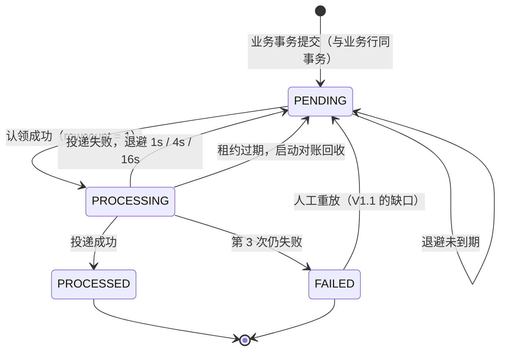
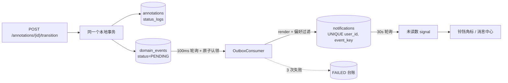

# 从已下发，改到已下发

> 一次条件更新、一次秒级时间戳、一枚永远不会变脏的 `computed`。它们都在说同一句话：变化发生了，但没有人负责转达。

上一篇结尾我写的是：

> 下一篇，业务进入深水区。我们将用 Outbox 模式解决站内信的最终一致性，并揭开状态管理导致审计日志被静默篡改的谜团。

写完 D5 回头看，这个预告对了一半。

Outbox 确实是主角，但它解决的问题没"最终一致性"这么抽象，而是一个具体到不能再具体的问题：**业务已经提交了，那条消息现在归谁管？**

审计日志也确实被静默篡改了。但动手的不是"状态管理"，是 ORM 的一次顺手同步。

而下午切到前端，看着那个"到底了还一直加载"的滚动列表，我忽然意识到这两件事是一个形状：

**后端有一个变化没人转达，前端也有一个变化没人转达。**

先摆盘子。

| 维度 | 交付 |
| :--- | :--- |
| 后端 · 状态机 | 5 个动作 × 4 个状态的合法流转表、权限矩阵、`allowed_actions` 三者同源（`annotation_state.py`） |
| 后端 · 事件链 | 与业务同事务写 `domain_events`；`OutboxConsumer` 100ms 轮询、`claimed_at` 租约、指数退避 1s/4s/16s |
| 后端 · 通知 | 三类适配器、60s 批量合并、7 个站内信接口、`unread-count` P95 28ms |
| 后端验收 | 真实 `uvicorn` + 真实 HTTP，7 组 82 项断言；20 条批量下发 303ms |
| 前端 | 48px 工具条 + 画布 + 380px 面板、三个流转弹窗、时间线、铃铛 30s 轮询、消息中心无限滚动、偏好页 |
| 前端验收 | 24 条浏览器链路；生产包 345.70 kB / gzip 90.71 kB（`annotation-canvas` 懒加载 75.40 kB / 17.62 kB） |
| 坐标 | 屏幕 px / pt / 百分比三套单位只在 `relativePoint → toLocation` 一处换算（这件事留给 D6 展开） |
| 关键数字 | 轮询 100ms、合并窗口 60s、租约 60s、退避 1/4/16s、角标 30s、降级阈值 3 次 |

这一天有五个瞬间，每一个都值得单独说：

1. 批注从 `ISSUED` 变成 `MODIFIED`——**审计日志不知道它原来是什么**；
2. 一次流转写了三条日志——**读时间线的人不知道谁先谁后**；
3. 业务事务提交了——**收件人不知道**，因为事件卡在 `PROCESSING`；
4. 又来了 20 条批注——**用户不知道**，因为消息被合并进一条已经读过的记录里；
5. `pages` 从 1 变成 3——**`hasMore` 不知道**，因为它读的不是 signal。

五处断点，两种系统，一个病因。

---

## 第一块 · 后端：一条事件链上的五个断点

### 1.1 审计日志写成"从已下发改到已下发"

**【现象】**

第一次跑时间线断言，`B6 from/to 状态齐全` 直接红。

把六条状态日志全打出来：

```text
log_type         from                    to
CREATED          None            ->      PENDING_CONFIRM
STATUS_CHANGED   ISSUED          ->      ISSUED            ← 应该是 ISSUED -> MODIFIED
STATUS_CHANGED   MODIFIED        ->      MODIFIED
STATUS_CHANGED   CLOSED          ->      CLOSED
```

写库那一行明明是对的。批注状态确实变成了 `MODIFIED`，`row_version` 也确实加了 1，事件也正常发出了。

**只有审计日志错。**

而这恰恰是审计表里最不能错的东西。它存在的唯一理由，就是回答"谁在什么时候把它从哪改到了哪"。现在它给出的答案是"它从已下发改成了已下发"——一句废话，而且是一句会被当成事实存档的废话。

**【排查与解决】**

先写了个最小复现：

```python
ann = await db.get(Annotation, 1)
print("before:", ann.status)          # ISSUED

await db.execute(
    update(Annotation)
    .where(Annotation.id == 1, Annotation.row_version == ann.row_version)
    .values(status="MODIFIED", row_version=ann.row_version + 1)
)

print("after:", ann.status)           # MODIFIED —— 我没有重新查询，也没 commit
```

第二个 `print` 是全部线索。

那条 UPDATE 没有提交，没有 `refresh`，`ann` 也没被重新赋值，可它已经变成了新值。**是数据库反过来写了我的内存对象。**

于是第一版的 bug 就解释清楚了：

```python
# ❌ 第一版：先更新，再用"当前值"当旧值
await db.execute(update(Annotation).where(...).values(status=to_status))
db.add(AnnotationStatusLog(
    from_status=ann.status,      # 这里已经是 to_status 了
    to_status=to_status,
))
```

修法不需要任何技巧，只需要把顺序倒过来——**在写下第一笔之前，把旧值按进局部变量**：

```python
# ✅ 先按住旧值，再动手
from_status = ann.status
from_assignee_id = ann.assignee_id

await db.execute(update(Annotation).where(...).values(status=to_status))

db.add(AnnotationStatusLog(
    log_type=STATUS_CHANGED,
    from_status=from_status,             # 快照，不是 ann.status
    to_status=to_status,
    from_assignee_id=from_assignee_id,
    to_assignee_id=new_assignee_id,
))
```

同一个家族还有第二个坑，藏在通知 payload 里。

`_apply_transition` 组装事件时读 `ann.assignee_id`。被同步成新值之后，"重新指派"这条链路会把消息发给**上一个人**——因为 payload 里的"接收人"取的是已经被改写的新值，而逻辑上它应该取"这次要指派给谁"。

这个 bug 更阴：它不发错消息给陌生人，它把消息发给上一个人。上一个人恰好是责任链上的合法角色，所以谁都不会觉得异常。

修法是把"读"这条路堵死：

```python
# ❌ 组装函数自己读 ORM 对象：调用时机一变，读到的就是新值
def event_payload(ann: Annotation) -> dict:
    return {"annotation_id": ann.id, "assignee_id": ann.assignee_id, ...}

# ✅ 新值必须由调用方显式给出，函数里不许出现 ann
def event_payload(
    *, annotation_id: int, assignee_id: int | None, assignee_name: str | None, ...
) -> dict:
    ...
```

这不是"多加一个参数"，这是把"可能读到脏值"变成"根本传不进去"。前者靠纪律，后者靠签名。

**【原理与沉淀】**

SQLAlchemy 2.0 里，`session.execute(update(Model)...)` 默认 `synchronize_session="auto"`：能 `evaluate` 就在内存里按 WHERE 条件筛出对象、按 SET 子句就地改掉；不能 `evaluate` 就 `fetch` 回来再改。两条路径的结果一样——**UPDATE 执行完之后，identity map 里的那个对象不再代表 UPDATE 之前的状态。**

这件事在纯 ORM 赋值时是透明的，因为你本来就要改它。但在"条件更新 + 事后读旧值"这个组合里，它变成一个静默的语义错误。

| 写法 | 数据库 | 内存对象 | 事后能读到旧值吗 |
| :--- | :--- | :--- | :--- |
| `ann.status = x`，再 `flush()` | 改了 | 你主动写的 | 不能（本来就该改） |
| 先 `SELECT` 比对，再赋值 | 改了 | 你主动写的 | 不能 |
| `UPDATE ... WHERE row_version=?` | 改了，且原子 | **被数据库同步** | **不能，且很容易忘** |

三种写法没有一种"更好"，它们买的东西不一样。第三种买到的是**原子性**：两个标签页同时提交时，只有 `UPDATE ... WHERE row_version=3` 能让"比较"和"写入"变成同一个操作。

```python
# ❌ 两个标签页都能通过检查，然后都写进去
if ann.row_version != body.row_version:
    raise Conflict
ann.status = to_status
```

所以你不是在做一道选择题，你是在做一笔交易：**用"内存对象会被同步"换"检查与写入的原子性"**。知道自己在付什么，就不会在审计日志上翻车。

三条沉淀：

- **快照必须在任何写操作之前取。** 不是"小心一点"，是"取值的语句必须写在写语句上面"。
- **能让签名拦住的事，不要交给纪律。** payload 组装函数改成显式入参之后，这个 bug 从"每个调用方都要记得"变成"想写错都写不出来"。
- **业务全绿，不代表系统正确。** 这个 bug 没影响状态、没影响版本号、没影响事件。它只毁掉了追溯能力。而追溯能力是不可逆的：日志写错了，就永远不知道当时发生了什么。

也正因为如此，时间线上那句 `from/to 状态齐全` 的强断言才值钱。如果我只断言"有六条记录"，这个 bug 会一路活到生产。

### 1.2 三条日志撞在同一个秒上

**【现象】**

修完 1.1 再跑，`from/to` 全对了，顺序又错了：

```text
CLOSED           ISSUED  -> CLOSED
STATUS_CHANGED   ISSUED  -> MODIFIED
VERSION_LINKED   v1      -> v2
```

人读时间线的顺序应该是"先状态变更，再关联版本，最后关闭"。现在 `CLOSED` 排到了最前面。

更让人不安的是：同一批断言里 `B8 按 created_at 正序` **是绿的**。

**【排查与解决】**

把时间戳带精度打出来：

```text
2026-11-25 14:32:07.000000  STATUS_CHANGED
2026-11-25 14:32:07.000000  CLOSED
2026-11-25 14:32:07.000000  VERSION_LINKED
```

三条一模一样。

`annotation_status_logs.created_at` 用的是 `server_default=func.now()`。而这一个函数在两种数据库上有两种精度：

- **PostgreSQL** 的 `now()` 是**事务开始时间**——同一个事务里调一百次，拿到的都是同一个值；
- **SQLite** 的 `CURRENT_TIMESTAMP` 只有**秒精度**。

两条路径，同一种结果：**一次流转写下的三条日志，时间戳完全相等。**

于是 `ORDER BY created_at` 退化成了"随便排"。这不是性能问题，是语义问题："状态变更在关闭之前"是业务规则，不是排序偏好。

再看那条绿着的断言：

```python
assert [r.created_at for r in rows] == sorted(r.created_at for r in rows)
```

对 `[t, t, t]` 恒真。

**它验证的是"没有逆序"，不是"顺序正确"。** 相等序列天然满足非降序，所以时间戳全部撞车的那个版本，恰好是最容易通过这个断言的版本。

修法分两层，一层管"通常情况"，一层管"万一"。

第一层，写入侧显式给微秒：

```python
now = datetime.now(timezone.utc)

db.add(AnnotationStatusLog(..., log_type=STATUS_CHANGED, created_at=now))
db.add(AnnotationStatusLog(..., log_type=CLOSED,         created_at=now + timedelta(microseconds=1)))
db.add(AnnotationStatusLog(..., log_type=VERSION_LINKED, created_at=now + timedelta(microseconds=2)))
```

一个事务内按语义顺序递增 1μs。这样即使有人直接看数据库，顺序也是对的；跨表归并（评论 vs 日志）也不会因为两张表用了不同的默认值而错位。

第二层，读取侧给一个语义 rank：

```python
LOG_ORDER = {
    CREATED: 0, STATUS_CHANGED: 1, ASSIGNED: 2, VERSION_LINKED: 3,
    CLOSED: 4, DELETED: 5, COMMENT: 6,
}

merged.sort(key=lambda row: (
    row.created_at,               # ① 物理时间
    LOG_ORDER[row.log_type],      # ② 撞车时的语义顺序
    str(row.id),                  # ③ 连语义都一样时，保证全序
))
```

三级排序键，缺一不可。第三级看起来最没用——`str(row.id)` 只是为了让"排序结果唯一"。但**排序键不唯一，就等于没有排序键**：同一个查询跑两次可能给出两个顺序，翻页时会重复或漏行，测试也会随机红。

**【原理与沉淀】**

- **同一事务内的时间戳不是"顺序"，只是"同一时刻"的标记。** 想表达顺序，要么有单调递增的序号，要么有能表达语义的 rank，要么两者都要。指望 `now()` 帮你排序，等于指望一个只会说"刚刚"的人给你讲清楚先后。
- **假绿断言有三个常见变体**：`assert len(rows) == 6`（条数对、内容错）、`assert resp.status_code == 200`（状态码对、副作用错）、`assert a == sorted(a)`（非降序被当成有序）。它们的共同点是：**验证了某个必要条件的"不违反"，然后被当作充分条件。**
- **归并为什么用 Python 而不是 `UNION ALL`**：两张表列集不同（一张是状态枚举，一张是正文），跨方言 UNION 要给缺失列补 `CAST`，而 SQLite 与 PG 对 NULL 的类型推断并不一致。加上时间线是**单条批注维度**的数据，行数天然有界（`TIMELINE_MAX_ROWS=2000` 是护栏），归并成本可以忽略。用数据库擅长的事，但不为了少写十行 Python 去换方言玄学。

这里要如实记一笔：`TIMELINE_MAX_ROWS` 是**硬截断**，不是分页方案。单条批注上千条评论时，时间线会退化。D5 没做游标分页，这是 V1.1 的债。

---

### 1.3 Outbox：业务成功之后，那条消息归谁管

**【现象】**

两个现场，一个在代码里，一个在测试里。

**现场一。** 我为了验证"租约回收"，故意在消费者认领之后把进程 kill 掉。重启后看库：

```text
event_key                          status       claimed_at
ANNOTATION_ASSIGNED:1043:2         PROCESSING   14:10:03.221     ← 永远停在这
ANNOTATION_ASSIGNED:1044:2         PROCESSING   14:10:03.224     ← 永远停在这
```

没有报错，没有告警，接口全部 200。用户只是"没收到通知"。

这一类失败最难查，因为它不违反任何一条你已经写下的断言：事件确实创建了，消费者确实跑起来了，数据库确实没有异常。**只是某一批事件进入了"正在处理"，然后处理它的人死了，而系统里没有任何一个字段能表达"那个人还活着吗"。**

**现场二。** 幂等断言第一版写的是："重放最新一条事件，通知总数不变。"

结果 `8 → 9`。

我第一反应是幂等坏了。查库发现多出来的那一条，跟重复投递毫无关系：前面的用例把接收人的订阅改成了 `["ANNOTATION_CLOSED"]`，那条 `ANNOTATION_ASSIGNED` 事件投递时被过滤成 0 个目标；随后用例又把订阅重置成全部，我重放的正好是它——**它从头到尾只被投递过一次。**

不是幂等坏了，是断言选错了重放对象。

**【排查与解决】**

先说为什么不能在请求里直接发消息。

```python
# 版本 A：先发消息，再提交
await notifier.dispatch(event)     # 消息已经出去了
await db.commit()                  # 业务如果在这里回滚 → 幽灵通知
```

```python
# 版本 B：先提交，再发消息
await db.commit()
await notifier.dispatch(event)     # 进程如果在这里挂掉 → 消息永久丢失
```

两种顺序都不成立：

| 顺序 | 业务回滚时 | 投递失败时 |
| :--- | :--- | :--- |
| 先投递再提交 | 幽灵通知：数据没了，消息还在 | 业务接口被拖慢甚至 500，明明数据可以成功 |
| 先提交再投递 | 消息永久丢失 | 消息永久丢失，且接口变慢 |
| **同事务写事件表** | **事件随业务一起回滚** | **业务不受影响，消息留给后台重试** |

第三行就是 Transactional Outbox 的全部内容：

```python
async def _apply_transition(db, ann, to_status, ...):
    from_status = ann.status              # 1.1 的快照，先按住

    await db.execute(update(Annotation).where(...).values(...))
    db.add(AnnotationStatusLog(..., from_status=from_status, to_status=to_status))

    await add_domain_event(               # 同一个 Session，同一个事务
        db,
        event_type=ANNOTATION_STATUS_CHANGED,
        aggregate_id=ann.id,
        event_key=make_event_key(...),
        payload=event_payload(annotation_id=ann.id, assignee_id=new_assignee_id, ...),
    )
    # 不 commit —— 调用方负责，业务行与事件行要么一起在，要么一起不在
```

这里必须把承诺说准确，因为"最终一致性"这个词太容易让人放松：

> Outbox 保证的不是"消息一定送达"。
> 它保证的是：**业务事务提交成功 ⇒ 至少存在一条待投递的事件记录。**

"送达"是后面三件事的总和：**认领的原子性 + 认领者的存活证明 + 投递的幂等**。少任何一件，Outbox 就从"至少一次"退化成"零次或多次"——而零次，就是静默丢失。

先把状态机画出来，后面三节都在这个图上做文章。



图上有三条边是"往回走"的：认领失败回 `PENDING`、投递失败回 `PENDING`、租约过期回 `PENDING`。这三条边就是整套设计里所有的可靠性，全部集中在"回退"上。

#### 第一击 · 认领必须是原子的

消费者每 100ms 扫一次。扫描和认领之间有一个天然的窗口：你看到 10 条 `PENDING`，等你准备写的时候，另一个实例可能已经把它们拿走了。

PostgreSQL 上最干净的写法是行级锁加 `SKIP LOCKED`：

```python
# 多个消费者各拿各的，谁也不等谁
stmt = (
    select(DomainEvent.id)
    .where(
        DomainEvent.status == PENDING,
        or_(DomainEvent.next_retry_at.is_(None), DomainEvent.next_retry_at <= now),
    )
    .order_by(DomainEvent.id)
    .limit(BATCH_SIZE)
    .with_for_update(skip_locked=True)
)
ids = (await db.execute(stmt)).scalars().all()
```

但 `SKIP LOCKED` 只是"选的时候不打架"，**它不负责把状态改掉**。从 SELECT 到 UPDATE 之间，锁一旦释放（换了事务、换了连接），窗口就又回来了。所以认领的第二步必须自带条件：

```python
result = await db.execute(
    update(DomainEvent)
    .where(DomainEvent.id.in_(ids), DomainEvent.status == PENDING)   # ← 关键
    .values(status=PROCESSING, claimed_at=now)
)

if (result.rowcount or 0) == 0:
    return []          # 全被抢走了。安静退出，不是错误
```

`rowcount == 0` 在这里不是异常，是**正常的并发结果**。这一点很重要：如果把它当错误抛出去，多实例部署时日志会被"抢不到"刷满，真正的异常反而看不见了。

SQLite 上这条路径更有意思。它没有行级锁，`with_for_update()` 在上面**被静默忽略**——不报错，也什么都不做。

于是那条带条件的 `UPDATE` 从"第二道保险"变成了"唯一一道保险"：

```python
# SQLite：没有 SKIP LOCKED，条件更新是唯一可靠的手段
# 两个协程同时执行这条语句，数据库保证只有一个的 rowcount 是 1
result = await db.execute(
    update(DomainEvent)
    .where(DomainEvent.id.in_(ids), DomainEvent.status == PENDING)
    .values(status=PROCESSING, claimed_at=now)
)
claimed = result.rowcount or 0
```

这其实是件好事。它逼着我把"认领"写成一个**幂等的、结果可判定的原子操作**，而不是依赖某一种数据库的锁语义。换成 PG 之后，`SKIP LOCKED` 是性能优化，条件更新仍然是正确性保证。

#### 第二击 · 租约：让"处理中"有一个保质期

认领成功之后，事件进入 `PROCESSING`。这时进程死了。

`PROCESSING` 这个状态本身不包含任何时间信息，所以它无法回答唯一重要的问题：**认领它的人还活着吗？**

加一个字段就能回答：

```python
LEASE = timedelta(seconds=60)

async def reap_expired_claims(db, now: datetime) -> int:
    """把租约过期的 PROCESSING 放回 PENDING。"""
    result = await db.execute(
        update(DomainEvent)
        .where(
            DomainEvent.status == PROCESSING,
            or_(
                DomainEvent.claimed_at.is_(None),          # 老数据，没有租约
                DomainEvent.claimed_at < now - LEASE,     # 认领太久，人大概率没了
            ),
        )
        .values(status=PENDING, claimed_at=None, next_retry_at=now)
    )
    if result.rowcount:
        log.warning("回收 %d 条租约过期的 PROCESSING 事件", result.rowcount)
    return result.rowcount or 0
```

这段在 `lifespan` 启动时跑一次。逻辑很简单：**一个超过 60 秒还没投递完的事件，按"认领者已死"处理**。可能误伤（真的有事件处理了 61 秒），但误伤的代价是"重投一次"，被唯一约束挡住；不回收的代价是"永远丢失"。**重永远比丢便宜**——这条判断 D4 已经付过一次学费了。

验证方式我是"伪造"的，比等 60 秒靠谱：

```sql
-- 把一条已经投递成功的事件，伪装成 5 分钟前卡住的样子
UPDATE domain_events
SET status = 'PROCESSING', claimed_at = datetime('now', '-5 minutes')
WHERE event_key = 'ANNOTATION_ASSIGNED:1043:2';
```

重启进程，日志里出现回收告警，事件被重新投递，因为 `(user_id, event_key)` 唯一约束命中 `skipped=1`，最终 `PROCESSING` 残留 0、状态回到 `PROCESSED`。

这个验证同时证明了三件事：租约能回收、回收后不会重复发消息、最终状态一致。

说清楚它的边界：**我做的是启动对账，不是周期对账。** 它兜得住"进程崩了再起来"，兜不住"进程一直活着，但协程在认领之后被 cancel"。后一种情况要等到下一次重启才能回收。V1.1 应该把对账挂到轮询循环里，每 N 轮跑一次。

#### 第三击 · 幂等按 key 验，不按表验

回到那个 `8 → 9`。

为什么"总数不变"是个坏断言？因为 `notifications` 的总数会被至少四种原因改变：偏好过滤、60s 合并、其他并发事件、以及重放。你把四个变量塞进一个数字里，然后指望它只反映其中一个。

改成按 `event_key` 验：

```python
# 重放前
before_per_key = count_notifications(event_key="ANNOTATION_ASSIGNED:1043:2")   # 1
before_total   = count_notifications()                                        # 8

# 重放同一条事件
await replay(event_key="ANNOTATION_ASSIGNED:1043:2")

# 重放后
assert count_notifications(event_key="ANNOTATION_ASSIGNED:1043:2") == 1        # per-key 恒定
assert count_notifications() == before_total                                  # 总数也不变
```

还有一个更隐蔽的前提：**你必须挑一条"真的投递出过消息"的事件来重放。**

```python
# ❌ 随便挑最新一条：可能是一条被偏好过滤掉的事件，测出来的"新增"根本不是重复投递
event = await latest(events)

# ✅ 只挑已经在 notifications 里有痕迹的事件
event = await db.scalar(
    select(DomainEvent).where(
        DomainEvent.event_key.in_(select(Notification.event_key))
    ).limit(1)
)
```

前者测的是"过滤逻辑有没有生效"，后者测的才是"重复投递会不会多一条"。两个断言都该有，但不能互相冒充。

最后一道保险放在数据库里，不放在应用里：

```python
from sqlalchemy.dialects.sqlite import insert as sqlite_insert

stmt = (
    sqlite_insert(Notification)
    .values(user_id=uid, event_key=event.event_key, notification_type=etype, ...)
    .on_conflict_do_nothing(index_elements=["user_id", "event_key"])
)
res = await db.execute(stmt)

if (res.rowcount or 0) == 0:
    return "skipped"          # 这条 key 已经投过，重试多少次都一样
return "created"
```

`rowcount` 在这里是**门闩**：只有真正插入成功的那一次，才允许继续做后面的事（在 1.4 里，后面的事是"把父行的 merge_count 加一"）。这个 `created` 门闩的用法，和 D4 里 `ON CONFLICT DO NOTHING ... RETURNING` 判断"是不是新建"是同一招。

为什么非要唯一约束？因为应用层的"先查再插"永远有 TOCTOU 窗口：

```text
消费者 A: SELECT ... WHERE event_key = ?   → 没有
消费者 B: SELECT ... WHERE event_key = ?   → 没有
消费者 A: INSERT                            → 成功
消费者 B: INSERT                            → 也成功（如果没约束）
```

而消费者重试三次以内都可能走到这条路径。**应用层的检查只能降低概率，唯一约束才能把概率变成零。**

**【原理与沉淀】**

把六种失败排成一张表，看每一层兜住了什么：

| 失败形态 | 谁兜住 | 兜不住时用户看到什么 |
| :--- | :--- | :--- |
| 业务事务回滚 | 同一个本地事务 | 什么都不发生（正确） |
| 进程崩在认领之后 | `claimed_at` 租约 + 启动对账 | 晚 60 秒收到 |
| 两个实例同时认领 | `SKIP LOCKED` / 条件更新 `rowcount` | 无感知 |
| 渠道抖动、投递失败 | 指数退避 1s/4s/16s | 最多晚 21 秒收到 |
| 三次重试仍失败 | 落 `FAILED`，保留台账 | 收不到，但**有据可查** |
| 消费者重复投递 | `(user_id, event_key)` 唯一约束 | 一条 |

三条沉淀。

**第一，Outbox 不是"多一张表 + 一个轮询协程"。**

它是把"发消息"这个动作，从**一次函数调用**降级成**一份可被重放的持久事实**。

这个降级的收益是：消息的生命周期不再绑定请求的生命周期，业务回滚不会发出幽灵通知，投递失败不会拖垮接口。

代价是：你必须自己负责三件原来由函数调用栈免费提供的事——**认领的原子性**（谁在执行）、**认领者的存活证明**（执行到哪了）、**投递的幂等**（重复执行会怎样）。

**第二，别写兜底 `except`。**

D4 写过一次：兜底 catch 会让静默失败变得极其廉价。这里的验收口径必须是"事件状态在 X 秒内发生变化"、"`PROCESSING` 残留为 0"，而不是"日志里没有异常"。因为一个吞掉异常的消费者，从外部看起来和一个正常消费者完全一样。

**第三，为什么是轮询，不是 MQ。**

这个问题一定会被问。D5 的答案是三个具体约束：

- 单库、单进程，事务边界清晰，`domain_events` 天然和业务共享同一个连接；
- 引入 RabbitMQ / Kafka 意味着业务提交与消息发送之间重新出现一个"不可原子"的缝，得用事务消息或本地消息表再补一次——那我们其实是在自己实现 Outbox；
- 100ms 轮询 + 单批 20 条，实测落库延迟 150ms 级，`unread-count` P95 28ms，**对"站内信"这个场景，够了。**

而 `domain_events` 这张表本身就是未来的发件箱：V1.5 真上 MQ 时，消费者从"轮询表"换成"消费队列"，生产侧一行代码都不用改。

### 1.4 60 秒合并 vs 幂等台账：被合并掉的 20 条必须仍然落库

**【现象】**

PRD 写得很明确：一次性批量下发 20 条给同一人，最终只产生一条"20 条批注待处理"。

第一版实现得非常直白：`dispatch` 时发现 60 秒内有同 type 同接收人的消息，就**不插入**，只把旧消息的 `merge_count += 1`。

跑完 H 组断言，两个问题同时炸：

1. `merge_count` 变成了 21、22——消费者重试/重放时，那条"被合并不插入"的事件没有留下任何幂等痕迹，于是每次都再加一；
2. 用户把合并后的消息读了，第 21 条批注下来时，因为"不插入"，这条消息**保持已读**。新任务被静默吞掉。

第二个问题比第一个严重得多。第一个是数据难看，第二个是**漏通知**——而这恰恰是整套系统存在的理由。

**【排查与解决】**

把两条需求摆在一起看，冲突是结构性的：

- 要**幂等**，就得让每个 `event_key` 在 `notifications` 里有一行可以被唯一约束拦住；
- 要**合并**，就得让这 20 行"不占位"、不出现在列表里、不计入未读数。

单表上这两条不可能同时成立。**只保留聚合行就没有幂等台账；只保留 20 行就没有合并。**

两条规则都删不掉，说明问题不在规则，在模型——**少了一层。**

补上这一层：

```text
notifications
├── 父行：merge_count=23, merged_into_id=NULL        ← 用户唯一可见的那条
└── 子行 ×22：merged_into_id=父行.id, merge_count=1  ← 幂等台账，列表与角标一律过滤
```

三条实现要点，每一条都对应一个具体的失败。

**其一，可见条件必须写进公共条件，不能靠调用方自觉。**

```python
_visible = (
    Notification.user_id == me,
    Notification.is_deleted.is_(False),
    Notification.merged_into_id.is_(None),      # ← 这一条
)
```

列表、未读数、最近 5 条、`unread-count`，全部走这个元组。只要有一个查询漏了它，子行就会漏到用户眼前——用户会看到"23 条批注待处理"下面还跟着 22 条一模一样的单条消息。

**其二，先插子行，插成功了才 bump 父行。**

```python
inserted = await db.execute(
    sqlite_insert(Notification)
    .values(user_id=uid, event_key=key, notification_type=etype,
            merged_into_id=parent.id, merge_count=1, ...)
    .on_conflict_do_nothing(index_elements=["user_id", "event_key"])
)

if (inserted.rowcount or 0) == 0:
    return "skipped"          # 子行已存在 → 这是重试，不要再累加

await self._bump_parent(db, parent, target)
```

顺序反过来就会重现那个 bug：先 bump 再插，插入冲突时 bump 已经发生了。**幂等门闩必须挡在副作用之前。**

**其三，合并之后强制未读。**

```python
parent.is_read = False
parent.read_at = None
```

这是那个"第 21 条被吞掉"的正面修法。合并的语义是"**又来了一条**"，不是"还是那些"。一条已经读过的消息，收到新内容时必须重新变成未读，否则合并就成了静音。

标题与摘要按 PRD 生成：父行标题 `23 条批注待处理`，摘要取"前两条标题 + 等 N 条"（第一条从父行原来的单条标题里剥，第二条从最早的子行剥）。`deeplink` 改指列表页 `/annotations?assignee=me&status=ISSUED`——合并之后已经没有"唯一一条批注"可以跳了。

**【原理与沉淀】**

这一节的收获不是"父子表怎么做"，而是一条可以复用的判断法：

> **当两条需求在同一张表上打架，先问"是不是缺了一层"，别急着加 `if`。**

加 `if` 的版本会长成这样：`if 有父行 and 没读过 and 不是重试 then ... else ...`。每加一个条件，就多一个组合没被测到。而加一层的版本，每个查询只需要多一个 `merged_into_id IS NULL`，而且它是**可穷举**的——一个字段，两种取值。

顺带说一个同构：1.5 的"不通知自己"是同一个病。一个字段（`actor_id`）承担了两种语义（人操作 / 系统触发），规则就必然在某个方向出错。**模型里少一层，代码里就多一层 if。**

如实记一笔已知边界：合并逻辑目前跑在单进程协程里。多副本部署时，"找父行 + 插子行 + bump 父行"三步之间没有行锁，同一个人在同一时刻被两个实例分别认领，可能产生两个父行。彻底解决要么把三步包进同一把行锁，要么在 `notifications` 上建部分唯一索引 `(user_id, type, date_trunc('minute', created_at))`。V1.1 再做。

### 1.5 "不通知自己"把复盘通知吃掉了

**【现象】**

`REVIEW_COMPLETED` 的接收人是"任务发起人"。

而发起预审的人，就是那个点"发起预审"的人。

于是这条通知被"不通知自己"的规则过滤掉了——**唯一的接收人恰好就是 actor**。预审跑完了，一条通知都没有。

`HITL_PENDING` 更严重。它的接收人是"中断处理人"，而处理人往往就是刚点了"确认风险"的那个人。他需要收到"报告初稿已生成"才能继续往下走。跳过这条，等于**把流程挂死在等人这一步**，而人等的是一个永远不会到的通知。

**【排查与解决】**

根因不是规则写错了，是规则的前提不成立。

"不通知自己"用 `actor_id == recipient` 判断，暗含一个假设：**事件的 actor 是一个人。**

但域事件有两类：

- **人操作触发**（批注下发/复核、拉人进项目）→ actor 是人，应该过滤；
- **系统状态机触发**（预审完成/失败、进入人工中断）→ **没有操作人**，过滤的前提根本不成立。

修法两半：

```python
# ① 系统事件一律把 actor 留空：没有操作人，就是最准确的表达
await add_domain_event(db, event_type=REVIEW_COMPLETED, actor_id=None, ...)

# ② 两类"确实是自己操作、但必须提醒自己"的，显式白名单
SELF_NOTIFY_ALLOWED = {HITL_PENDING, REPORT_READY}   # 流程卡着等你，跳过=挂死

def _filter_self(event, recipients, etype):
    if event.actor_id is None or etype in SELF_NOTIFY_ALLOWED:
        return recipients
    return [uid for uid in recipients if uid != event.actor_id]
```

还有一个细节值得单独说：这两类中断提醒，是在 `open_interrupt` 的**同一个事务**里写的：

```python
async def open_interrupt(db, thread_id, itype, plan_revision, notify):
    interrupt_id = interrupt_uuid(thread_id, itype, plan_revision)   # 确定性 id
    db.add(InterruptTask(id=interrupt_id, ...))
    await add_domain_event(
        db,
        event_type=HITL_PENDING,
        event_key=make_event_key(HITL_PENDING, interrupt_id, "v1"),
        actor_id=None,
        payload=notify,
    )
    # 工单与提醒同生共死
```

`event_key` 的 version 用确定性的 `interrupt_id`（`uuid5(thread, 卡点, 重规划轮次)`），所以 LangGraph 节点重放不会给处理人发第二遍。这是 D4 那套"稳定身份"的直接复用：**同一个逻辑事件，永远算得出同一个 key。**

验证就是 G8 那条：风险中断由 admin 自己确认，最后 `REPORT_READY` 仍然到达 admin。

**【原理与沉淀】**

- **用空值表达"不存在"，比用哨兵值表达"不存在"更诚实。** 另一种写法是给系统建一个 `system` 用户，然后所有系统事件的 actor 都是它——但那样"不通知自己"还要再加一条"除非 actor 是 system"，而这条又会和 `HITL_PENDING` 的白名单打架。
- **通知有两种语义，不该共用一条规则。** "告诉别人我改了"要过滤自己；"提醒你流程卡着等你"绝不能过滤。前者是社交，后者是流程。混在一起写，一定在某个方向上出错。
- 这一节和 1.4 是同一个病：**一个模型承担两种语义 → 代码里长出 if → 总有一个分支没被测到。**

---

## 第二块 · 前端：依赖追踪的边界在哪

### 2.1 无限滚动"到底了还一直加载"

**【现象】**

消息中心首屏 20 条，一切正常。

滚到底，加载第 2 页，追加 6 条。底部却仍然显示"加载更多"。

继续滚，它继续请求第 3 页。第 3 页返回空数组，页面看起来毫无变化——因为我加了 `loadedIds` 去重，重复的行不会渲染。再滚，再请求。

**UI 上完全看不出问题。** 只有打开网络面板才能发现：每滚一下，就多一个 `GET /notifications?page=3`。

**【排查与解决】**

`hasMore` 的写法是这样的：

```ts
export class NotificationCenterComponent {
  private page = 0;            // 当前页
  private pages = 1;           // 总页数
  protected readonly hasMore = computed(() => this.page < this.pages);
}
```

看起来没有任何问题。而这正是它危险的地方——它没有语法错误、没有类型错误、构建通过、首屏表现完全正确。

把执行过程逐步写出来，就藏不住了：

```ts
// 惨状复现：computed 的依赖集是空的
let page = 0;
let pages = 1;

const hasMore = computed(() => page < pages);
hasMore();        // true   ← 首次求值时，依赖集 = {}（里面什么都没有）

page = 5;         // 写一个普通变量
hasMore();        // true   ← 缓存没有失效，因为依赖集是空的，永远不会有东西让它失效
```

换成 signal，同一个表达式就活了：

```ts
const page = signal(0);
const pages = signal(1);

const hasMore = computed(() => page() < pages());
hasMore();        // true   ← 依赖集 = {page, pages}

page.set(5);      // 写入 → hasMore 被标记为 dirty
hasMore();        // false  ← 重新求值
```

差别只有一处：**`page()` 是一次"可追踪的读取"，`this.page` 只是一次属性访问。**

把整个过程摊到时间轴上：

| 时刻 | `page` | `pages` | `hasMore` 是否重算 | 返回 | 原因 |
| :--- | :--- | :--- | :--- | :--- | :--- |
| 首屏渲染 | 0 | 1 | 是（首次求值） | `true` | 建立依赖集 = ∅ |
| 第 2 页返回 | 1 | 1 | 否 | `true`（缓存） | 没有 signal 被写入，不 dirty |
| 第 3 页返回空 | 1 | 1 | 否 | `true`（缓存） | 同上 |
| 用户继续滚 | 1 | 1 | 否 | `true`（缓存） | 同上 |

**依赖集为空，意味着这个 `computed` 在语义上退化成了一个常量。** 它不是"算错了"，它是"从来没有再算过"。

这里要纠正一个很常见的误会：有人会说"以前有 Zone.js 会帮我兜一次"。

不会。`computed` 的失效判定只看依赖集，变更检测只是"有人来读一次"，而读到的是缓存。Zone.js 改变不了这一点。

Zoneless 真正改变的是另一件事：**模板里直接绑普通字段也不再自动刷新了。** 于是同一个坏习惯在两处同时露头——模板绑 `this.page` 不动，`computed` 派生 `this.page` 也不动。以前是"一半坏"，现在是"一整个坏"。

修法：

```ts
private readonly page = signal(0);
private readonly pages = signal(1);
private readonly loadingMore = signal(false);
private readonly loadedIds = new Set<string>();

protected readonly hasMore = computed(() => this.page() < this.pages());

private loadNext(): void {
  if (this.loadingMore()) return;                    // 并发互斥
  const next = this.page() + 1;
  if (next > this.pages()) return;                   // 已经到最后一页

  this.loadingMore.set(true);
  this.api.list({ page: next, size: PAGE_SIZE }).subscribe({
    next: (res) => {
      const items = res.items ?? [];
      const fresh = items.filter(i => !this.loadedIds.has(i.id));
      fresh.forEach(i => this.loadedIds.add(i.id));
      this.items.update(list => [...list, ...fresh]);

      this.page.set(next);
      this.pages.set(res.pages ?? next);

      // 终点收敛：空页 / 不足一页 → 当前页就是最后一页
      if (items.length === 0 || items.length < PAGE_SIZE) {
        this.pages.set(next);
      }
      this.loadingMore.set(false);
    },
    error: () => this.loadingMore.set(false),
  });
}
```

**【原理与沉淀】**

这一节的重点不是"改两行代码"，是搞清楚 Signals 的依赖追踪**边界画在哪**。

**边界一：什么算"读取"。**

`page()` 这一次调用同时做了两件事：返回当前值，以及把当前正在求值的 consumer 登记进自己的订阅列表。

`this.page` 只是 `[[Get]]`。运行时没有钩子，框架看不见这次读取——它甚至不知道这次读取发生过。

所以规则可以写得很硬：**派生值只能派生自 signal。`computed` 体里每出现一次 `this.`，就当成一次待审的读取。**

不是"不许出现 this"——注入进来的 service、不会变的常量都可以。是"每出现一次，就要能回答：这个字段会不会变？变了之后谁负责让它重算？"

**边界二：依赖集什么时候建立。**

首次求值时，不是声明时。

```ts
const a = computed(() => heavy());     // 声明。一次都没算
a();                                    // 这才建立依赖集
```

这是 `computed` 的懒求值（lazy）+ 缓存（memoized）+ 拉取（pull）模型：没人读就不算；读过就缓存；依赖变了只标 dirty，等下一次读才重算。

有个直接推论：**一个从未被读过的 `computed`，一次都不会执行。** 调试时如果 `console.log` 打在 `computed` 里没输出，先确认有没有人读它。

**边界三：什么时候失效。**

依赖集里任意一个 signal 被写入，且新值不等于旧值（Angular 用 `Object.is` 比较）。

第二半句很容易漏：

```ts
const pages = signal(1);
pages.set(1);        // 值没变 → 不通知任何订阅者
```

所以"我明明 set 了"和"依赖被通知了"是两件事。写回同值时，下游什么都不会发生。

**边界四：`untracked` 是主动越界。**

```ts
readonly label = computed(() => {
  const n = this.count();                       // 依赖：count
  const unit = untracked(() => this.unit());    // 读，但不登记依赖
  return `${n} ${unit}`;
});
```

`untracked` 不是"高级技巧"，它是**显式声明"我不希望这里成为依赖"**。用它的场合很少但很明确：读一个确实不会变、或者变了也不该触发重算的值。滥用它的后果和用普通字段一样——你亲手把一条依赖线剪断了。

**边界五：去重不等于收敛。**

这是这一节里最贵的一课。

`loadedIds` 是幂等手段：它让重复的行不显示。但它同时**把"状态机没有收敛"这件事藏了起来**——数据被去重挡住，页面看起来"没变化"，于是没有报错、没有抖动、没有人发现。

**去重让错误变得不可见，收敛才能让错误消失。** 判断方法很简单：把去重那段临时注释掉，如果页面开始重复渲染，说明你的分页根本没有终点。

所以终点要写全，三条缺一不可：

1. 返回空页 → 到底了；
2. 返回条数不足 `PAGE_SIZE` → 到底了（最后一页恰好整页时，这条不成立，靠第 3 条）；
3. `page >= pages` → 到底了。

只判第 3 条，会在"整页边界"上多打一次请求；只判前两条，会在 `pages` 口径与前端 `PAGE_SIZE` 不一致时停不下来。

补两个工程细节：

- **`IntersectionObserver` 会连续触发。** 快速滚动时同一个 sentinel 可能在一次滚动里回调两次，必须用 `loadingMore` 互斥，否则两个相同页码的请求同时飞出去。
- **切 Tab 要重置游标和 `loadedIds`。** 否则上一个 Tab 的行会残留在新列表里，而且新 Tab 的第一页会因为 id 撞车被去重掉一半。

实测：20 → 26 条之后底部变成"没有更多了"，再滚不发请求；`unread` / `system` / `all` 三个 Tab 来回切，行数与角标都对得上。

### 2.2 `<select [value]>`：赋值跑在了 option 前面

**【现象】**

新建批注表单要求"默认指派给当前用户"。当前用户是张工，`assigneeId()` 里也确实有值。

打开表单，责任人下拉框显示的是占位项「请选择责任人」。

而同屏的表单摘要里，"指派给 张工" 已经渲染出来了。

**同一个 signal，两处显示不一致**——一处读的是 signal，一处依赖的是 DOM 的时序。

**【排查与解决】**

```html
<!-- ❌ 看起来天经地义 -->
<select [value]="assigneeId()">
  @for (m of members(); track m.user.id) {
    <option [value]="m.user.id">{{ m.user.name }}</option>
  }
</select>
```

`[value]` 是对 `HTMLSelectElement.value` 的一次属性写入。浏览器收到这个写入时会做一件事：**在"当前已经存在的 option 列表"里找匹配项**。

而 `@for` 的内容是嵌入式视图，在宿主元素的属性绑定之后才创建。

于是执行顺序是：

```text
1. 创建 <select>
2. 写入 value = "u-1024"          ← 此刻 option 数量 = 0，匹配失败
3. 创建 @for 的 3 个 <option>      ← 太晚了
4. 浏览器发现没有选中项，回退到第一个 option
```

第 4 步是那个"看起来正常"的来源：如果第一个 option 恰好是占位项，界面看起来就是"没选中"。如果表单没有占位项（第一个就是真实用户），界面看起来就是"选中了第一个人"——一个更难发现的错误。

修法是把"决定权"下放到每个 option：

```html
<!-- ✅ 每个 option 自己决定自己是否选中，天然晚于创建 -->
<select>
  <option value="" [selected]="!assigneeId()">请选择责任人</option>
  @for (m of members(); track m.user.id) {
    <option [value]="m.user.id" [selected]="m.user.id === assigneeId()">
      {{ m.user.name }}
    </option>
  }
</select>
```

`[selected]` 是每个 option 上的 property binding，它在 option 被创建的那一刻求值——**元素已经存在，所以赋值不会落空。**

**【原理与沉淀】**

这不是数据问题，是**渲染阶段的顺序问题**。

Angular 的模板不是一次性拼字符串。它是有阶段的：宿主元素的属性绑定 → 嵌入式视图（`@for` / `@if`）创建 → 子组件挂载 → 内容投影。`@for` 属于第二阶段，所以任何绑在容器元素上的"值"都会早于它的子元素。

一条可迁移的规则：

> **给容器绑定"值"时，先确认容器里的子元素已经存在。** 否则把决定权下放到子元素。

顺带记一个同一天踩的模板层小坑，形状几乎一样——**拿到的对象可能不是你以为的那个类型**：

```ts
@HostListener('document:keydown', ['$event'])
onKeydown(event: KeyboardEvent): void {
  const target = event.target;

  // ❌ target 可能是 document 本身：document 不是 Element，没有 closest
  // if (target.closest('input, textarea')) return;

  if (!(target instanceof HTMLElement)) return;      // ✅ 先收窄
  if (target.closest('input, textarea, select, [contenteditable]')) return;

  if ((event.ctrlKey || event.metaKey) && event.key === 'z') {
    this.undo();
  }
}
```

现象是：焦点不在任何输入框时按 Ctrl+Z，控制台抛 `TypeError: target.closest is not a function`，撤销直接失效。因为 `document` 级监听的 `target` 是事件路径上最具体的元素，而**没人聚焦时它就是 `document` 本身**。

两个坑的共同点：你以为你在操作一个已经就位的 DOM，其实它要么还没建好，要么根本不是那个类型。

### 2.3 `safeDeeplink`：消息体不该有决定"跳哪儿"的权力

**【现象】**

消息中心的整行点击流程是：标记已读 → 解析 `deeplink` → `router.navigate`。

PRD 对 `deeplink` 的要求是："以 `/` 开头，且不含 `://`。"

我照做了，自测通过。然后开始喂它一些"看起来以 `/` 开头"的字符串：

| 输入 | 字面合规 | 浏览器实际会做什么 |
| :--- | :--- | :--- |
| `//evil.example.com/x` | `startsWith('/')` 为真 | 协议相对 URL，直接跨站 |
| `/\evil.example.com/x` | 为真 | 部分浏览器把 `\` 归一化成 `//` |
| `/projects/../..//evil.example.com` | 为真 | 路径归一化后跑出站内 |
| `\n//evil.example.com` | `trim` 前为真 | "判"和"跳"之间字符串分叉 |
| `javascript:alert(1)` | 为假 | 被挡（这条倒是没问题） |
| `null`（`SYSTEM` 消息允许为空） | — | `navigate(null)` 直接抛错 |

**这四种"合规"输入，全部是开放重定向。**

**【排查与解决】**

一个纯函数，只放行"站内绝对路径"：

```ts
const UNSAFE_CHARS = /[\\\u0000-\u001F\u007F]/;

export function safeDeeplink(raw: string | null | undefined): string | null {
  if (!raw) return null;

  const value = raw.trim();                                   // 判与跳用同一个字符串
  if (!value.startsWith('/') || value.startsWith('//')) return null;   // // 是协议相对 URL
  if (value.includes('://')) return null;                     // 绝对 URL
  if (UNSAFE_CHARS.test(value)) return null;                  // 反斜杠 / 控制字符
  return value;
}
```

调用侧两条纪律：

```ts
onClick(n: Notification) {
  this.api.markRead(n.id).subscribe({
    error: () => { /* 已读失败不阻断跳转 */ },
  });
  this.count.localDecrement();          // 乐观 −1，下一轮轮询校正

  const href = safeDeeplink(n.deeplink);
  if (!href) {
    this.toast.info('该消息缺少有效跳转地址，已留在消息中心');
    this.router.navigate(['/notifications']);   // 降级，并说明原因
    return;
  }
  this.router.navigateByUrl(href);
}
```

第一条：**已读接口失败不能阻断跳转。** 用户点了一条消息，最想看到的是那条批注，不是一条"标记已读失败"的提示。角标由下一轮 30s 轮询自动校正，不需要在这里做补偿。

第二条：**非法时不静默。** 用户可能本来就在消息中心，此时"什么都没发生"等于"点了没反应"。降级 + Toast 才是完整的行为。

实测：`https://evil.example.com/steal` 被拦下，URL 停在 `/notifications?tab=all`，Toast「该消息缺少有效跳转地址，已留在消息中心」，角标仍然 −1；合法的 `/projects/...?annotation=a-0002&focus=1` 正常跳到批注页、自动选中、3 秒高亮。

**【原理与沉淀】**

deeplink 的本质是**把"跳到哪儿"的决定权交给了消息体**。而消息体是数据，数据不可信。这就是开放重定向。

三种攻击输入有一个共同点：**字面形状合规，解析结果越界。**

- `//` 在字符串层是"两个斜杠"，在 URL 语义层是"换一个 origin"；
- `\` 在字符串层是一个字符，在部分浏览器的 URL 解析里等价于 `/`；
- `..` 在字符串层是三个字符，在路径归一化里是"往上跑一层"。

所以**字符串层的校验拦不住语义层的越界**。要么用解析器判定（`new URL(value, location.origin).origin === location.origin`），要么用白名单把"什么形状一定安全"穷举出来。

我选白名单，理由是它不依赖运行时行为的一致性：`//`、`://`、反斜杠、控制字符这四条规则，在任何浏览器上含义都一样。而解析器方案更强，但需要相信所有目标浏览器对 `\` 的归一化行为一致——恰好这一条我不信。

还有一处容易漏的细节：**判和跳必须用同一个字符串。**

```ts
if (raw.trim().startsWith('/')) { ... }    // 判的是 trim 后的
router.navigateByUrl(raw);                 // 跳的是没 trim 的
```

`"\n//evil.com"` 在第一步里是 `/evil.com`（合规），在第二步里是 `\n//evil.com`（协议相对 URL）。**这是字符串版本的 TOCTOU**——和 1.3 里"先查再插"的竞态是同一个形状：检查的对象和使用的对象不是同一个。

修法不是"小心一点"，是"只解析一次，之后全用它"。`safeDeeplink` 把 `trim` 和校验锁在一个函数里，返回值就是唯一的真相。

---

## 第三块 · 合流：五个"没人知道"

先看一条完整链路，从一次点击到一枚角标：



这条链路上有五个交接点，每一个都对应本文的一节：

| # | 变化 | 谁该知道 | 为什么不知道 | 修复的载体 |
| :--- | :--- | :--- | :--- | :--- |
| 1.1 | `ISSUED → MODIFIED` | 审计日志 | 内存对象被条件更新就地同步 | 更新前的快照 |
| 1.2 | 一次流转写了三条日志 | 读时间线的人 | 秒级时间戳撞车，且断言放过了相等 | `(created_at, rank, id)` |
| 1.3 | 业务事务已提交 | 收件人 | 进程崩在 `PROCESSING` | `claimed_at` 租约 |
| 1.4 | 又来了 20 条批注 | 用户 | 被合并进一条已读消息 | 子行台账 + 强制未读 |
| 2.1 | `pages` 从 1 变成 3 | `hasMore` | 它不是 signal | 依赖图 |

它们的技术栈完全不同：SQLAlchemy、SQLite、异步协程、CSS 选择器、Angular 变更检测。但把它们排在一起，你会看到同一个形状：

**某个东西变了，而那个"应该知道"的角色，从来没有被登记进通知名单。**

后端的事件没有登记进"谁负责投递"，前端的字段没有登记进"谁依赖它"。两者都是**隐式约定**：代码"应该"去查一次、视图"应该"重算一次。而隐式约定在正常情况下永远成立，只在异常路径上失效——所以它们全部活到了断言那一层，有的甚至活过了断言。

两条定律，和 D4 那篇是同一条根。

**第一，变化必须落成一个"可被别人读到的东西"，而不是一次函数调用。**

后端的载体是一行 `domain_events`，前端的载体是一枚 signal。

载体存在的意义不是"记录"，是**它可以被第三方观察**：消费者能扫到它，`computed` 能订阅它。一次函数调用只有调用者和被调用者知道，第三方永远看不见——所以它无法重试、无法回收、无法重算。

这也解释了 Outbox 为什么必须"同事务落库"而不是"发个消息"：**落库让这个变化有了一个持久的、可被独立读取的形态。** 同理，`computed` 之所以要求你先写成 signal，是因为只有 signal 才提供那个"可被订阅"的接口。

**第二，有了载体，还得有身份和顺序。**

- `event_key` = `(type, 聚合 id, version)`：让"第二次"能被认出来是同一个东西；
- `(user_id, event_key)` 唯一约束：让"认出来之后"有能力不做第二次；
- `(created_at, 语义 rank, id)`：让"谁先谁后"有唯一答案；
- 依赖图：让"谁该重算"有唯一答案。

四个东西形状完全不同，作用完全一样：**把"大概是这样"变成"只能是这个"。**

还有一条工程偏好，这一整天出现了三次：

> **把"可能读到脏值"变成"根本传不进去"。**

- payload 组装函数改成显式入参，函数里不许出现 ORM 对象；
- `merged_into_id IS NULL` 写进公共可见条件，任何列表查询都绕不过去；
- `safeDeeplink` 收成一个纯函数，`navigate` 只能拿它的返回值。

三次都不是"更小心了"，是"把出错的路径删掉了"。纪律会疲劳，签名不会。

补一处没展开但同构的坑：角标轮询的降级状态机。第一版把"手动刷新"写成"先清降级标记，再发请求"，于是请求注定失败、标记已经清掉、定时器又被点着——**每打开一次铃铛，就多打一轮坏掉的后端**，而"刷新已暂停"的提示永远看不到。改成"只有一次成功响应才有资格清降级"，问题消失。它和 1.3 的租约是同一个道理：**状态的退出条件必须是"事实发生了"，不能是"我尝试过了"。**

---

## 实战避坑清单

九组，左右各一列。左边是事件链，右边是响应式状态，同一行讲的是同一件事。

| 主题 | 后端 · 事件链 | 前端 · 响应式状态 |
| :--- | :--- | :--- |
| **身份** | 每个副作用都要算得出稳定的 `event_key`（type + 聚合 id + version）；中断类用 `uuid5`，**version 必须包含"合法的第二次"那一维** | 每个派生值只能派生自 signal。`computed` 体里每出现一次 `this.`，都要能回答"它变了谁负责重算" |
| **去重** | 靠 `(user_id, event_key)` 唯一约束 + `on_conflict_do_nothing`，把 `rowcount` 当门闩；应用层"先查再插"永远有 TOCTOU 窗口 | `loadedIds` 是幂等手段，**不是收敛手段**。去重会让"没收敛"变得不可见，排查时先把它注释掉 |
| **顺序** | 秒级时间戳不是顺序。排序键要能唯一确定次序：`(created_at, 语义 rank, id)`，三级缺一不可 | 游标用 `signal`。终点写三条：空页 / 不足一页 / 页码到底；只判最后一条会在整页边界多请求一次 |
| **存活** | `claimed_at` 租约 + 启动对账回收过期 `PROCESSING`；认领用 `SKIP LOCKED`（PG）或条件更新（SQLite），`rowcount=0` 是正常并发不是错误 | 降级只有"一次成功响应"能解除，**不能是"我重试了"**；定时器用引用计数管 `start/stop`，否则最后关闭的消费者把别人的轮询一起关掉 |
| **快照** | 条件更新之前先把旧值按进局部变量；payload 组装函数改成显式入参，禁止读 ORM 对象 | 依赖集在**首次求值**时建立，不是声明时；没人读过就一次都不算；`set` 回同值不会通知任何订阅者 |
| **模型** | 合并（N→1）与幂等（1→1）在同一张表上打架 = **缺一层**：父行可见 + 子行台账，`merge_count` 只在子行真插入后 +1 | 给容器绑"值"时先确认子元素已存在。`<select [value]>` 会早于 `@for` 的 `<option>`，改用每个 option 上的 `[selected]` |
| **语义** | 一个字段不要表达两种语义：系统事件 `actor_id=None`，`HITL_PENDING`/`REPORT_READY` 加白名单——这两条跳过就是**把流程挂死** | 站内跳转只放行站内绝对路径：`//`、`/\`、`../..//`、控制字符全部拦；**判和跳必须是 `trim` 后的同一个字符串** |
| **失败** | 指数退避 1s/4s/16s，3 次落 `FAILED`；**不写兜底 `except`**，验收口径是"状态在 X 秒内变化"，不是"日志里没有异常" | 隐藏标签页不轮询（`visibilityState === 'hidden'` 直接返回），`visible` 时补拉一次；非法 deeplink 降级 + 说明，不静默 |
| **验证** | 幂等按 key 验，不按表验；重放要挑一条**真的投递出过消息**的事件，否则测的是过滤逻辑 | 断言要能区分"对了"和"没测到"：`assert a == sorted(a)` 对 `[t,t,t]` 恒真，是假绿；`instanceof HTMLElement` 先收窄再 `closest` |

如果只记三行：**身份、去重、顺序**。剩下六行都是这三行的推论。

---

## 最后

D5 这一天，我原本以为最难的会是画布——毕竟要处理缩放、平移、三套单位。

结果是三个"看不见"的地方：

- 一个对象在我没察觉的时候被数据库改了值；
- 一条时间线在时间戳相等时失去了顺序；
- 一个派生值在读不到依赖时变成了常量。

它们都不报错，都不影响主流程，都能通过"看起来对"的验收。

82 项断言里最难的三条，现在回头看，守的都不是功能：

- **严格模式零变更**：一条非法项，整批一条都不许写。守的是"要么全成，要么全不动"；
- **重放不产生重复消息**：同一个 `event_key` 投递一百次，用户只看到一条。守的是"至少一次"落到用户侧变成"恰好一次"；
- **崩在 `PROCESSING` 能自己爬回来**：进程死了，事件不丢。守的是"没有任何指标会报警"的那一类失败。

前端那 24 条链路里最值钱的也不是任何一条功能路径，而是两个反向验证：注入 500 之后轮询**真的停了**，喂一个恶意 deeplink 之后浏览器**真的没跳走**。

功能测试证明"它做到了什么"，反向验证证明"它不会做什么"。后者更难写，也更容易被跳过。

如果这篇要留一句话，我想是这句：

> 一个系统里最危险的状态，不是"错了"，是"**没有人负责知道它变了**"。

后端用一张 outbox 表把"发消息"变成了可被重放的事实，前端用 signal 把"变化"变成了可被订阅的读取。两边做的其实是同一件事：**给每一个"已经发生"，指定一个负责转达的人。**

下一篇，去 Mock 化。看我们如何把几十兆的图纸塞进 PDF.js 并实现 0.0000px 的坐标映射，以及后端如何接入真实的 DXF 解析沙箱。
