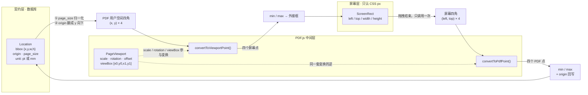

# 那个框，正好偏了一半

> 一个 404 的 worker、三套各说各话的像素、一个被写窄了一格的类型。
> 它们都在做同一件事：把"看起来对"伪装成"真的对"。

上一篇结尾我写的是：

> 下一篇，去 Mock 化。看我们如何把几十兆的图纸塞进 PDF.js 并实现 0.0000px 的坐标映射，以及后端如何接入真实的 DXF 解析沙箱。

写完 D6 回头看，这个预告有三处不准。

**第一，没有几十兆。** demo 里那张 DXF 只有 221 字节，两条实体。真正把内存顶到天花板的，是我为了压测自己合成的 4000 实体图（238KB），以及一张 A1 图纸放大到 400% 之后那个一万九千像素宽的 canvas。

**第二，"塞进 PDF.js"把问题说小了。** PDF.js 把图纸画出来这件事，只花了半天。剩下的时间全在处理"画出来之后，框为什么不在它该在的地方"。

**第三，我以为这是前端的问题，最后有一半是后端的账。**

先摆盘子。

| 维度 | 交付 |
| :--- | :--- |
| 后端 · 真实解析 | `parse_dxf`（白名单图层 / extents / 实体量 / 图签 / 几何采样）、`extract_pdf`（页幅 / 文本块 / 图签 / 乱码率）、`calc_metrics`（7 项硬指标，缺输入不猜数） |
| 后端 · 隔离 | 注册表统一 `asyncio.wait_for(asyncio.to_thread(...))`，超时 180s/120s/60s/10s 四档 |
| 后端 · 引擎切换 | `REVIEW_ENGINE=mock/real/banana`，同一份代码两种引擎各跑完整 HTTP 流程（real 24/24、mock 22/22） |
| 后端 · 数值护栏 | `fact_ref`（`tool#call_id#field`）存在性查表 + 同精度数值比对；`MetricResult` 无 ref 直接拒收 |
| 前端 · 渲染 | PDF 逐页光栅化、50%~400% 缩放、适应宽度、拖拽建批注落库 PDF 坐标、DXF 空态降级 |
| 前端 · 坐标 | `toScreen/toLocation` 两个纯函数；旋转 0/90/180/270 × 缩放 0.5/1/2/4 共 16 组往返误差 **0.0000px** |
| 前端 · 构建 | 初始包 347.39 kB / gzip 91.02 kB；`annotation-canvas` 懒加载 531.90 kB / gzip 131.74 kB（含 PDF.js） |
| 关键数字 | 4000 实体解析 339ms、A1 首屏 2384×1684、dpr 上限 2 / 单边 8192px / 面积 2400 万 px、2% 容差改同精度 |

这一天有两笔"偏了一半"的账。

**前端那笔是像素的。** 批注框整体偏了大约一半——位图按两倍分辨率画，叠加层按一倍坐标铺，红框落在图纸左上角，像有人把批注本撕下来贴错了页。

**后端那笔是语义的。** 一个类型被写窄了一格：Mock 的 `extents` 全是数字，真实解析按契约带了个 `unit: "pt"`。差的不是宽度，是"这个词到底指什么"。它没在前端显形，它在第六个节点之后，把整轮预审判成了 `FAILED`。

两笔账的形状惊人地一致：

> **某个东西有两套定义，而代码只认了其中一套。**

屏幕上有三套单位，报告里也有两种数字：一种是工具算出来的，一种是文案里写出来的。它们必须能被指回同一个点。

先讲五个瞬间：

1. 点下"发起预审"，**SSE 的心跳停了 3 秒**——一个同步库把整个事件循环钉在原地；
2. 4000 个实体解析完，返回值到了 MB 级——**同一份结果，审查要它全，State 要它小**；
3. 六个节点之后，`detect_issues` 崩了——**报错的节点不是出错的节点**；
4. 生产构建成功，产物里却没有 worker——**构建成功和构建正确是两件事**；
5. 一条 `RenderingCancelledException`——旧帧盖住了新帧。

---

## 第一块 · 后端：把真实文件接进来

### 1.1 `async def` 不等于异步

**【现象】**

第一版为了省事，工具函数写成这样：

```python
async def parse_dxf(path: str, ...) -> dict:
    doc = ezdxf.readfile(path)        # 纯 C 扩展 + 文件解析
    ...
    return {"extents": ..., "layers": ..., "entities_summary": ...}
```

单测全绿——因为单测是同步调的，`await parse_dxf(...)` 在这个场景里等价于直接调用。真正的问题在联调时出现：

点下"发起预审"之后，SSE 流的心跳停了 2~3 秒。判活阈值本来就留了余量，所以前端没有误判链路假死，但那 3 秒里，列表接口、详情接口、甚至另一个用户的翻页请求，全部在队列里排队。**不是慢，是整条连接一起不动了。**

**【排查与解决】**

先确认这不是"解析慢不慢"的问题。这个 demo 文件首次解析要 **2.4 秒**——大部分花在 `ezdxf` 的冷导入上。2.4 秒本身可以接受，不可接受的是：**这 2.4 秒里，整个进程不能做别的事。**

复现只要十行：

```python
async def main():
    t0 = time.perf_counter()
    task = asyncio.create_task(ticker())      # 每 50ms 打印一次
    await parse_dxf_bad(path)                 # 内部没有 await
    print("blocked for", time.perf_counter() - t0)
```

`ticker` 的数字在 2 秒里一个都没打印出来。原因很朴素：`ezdxf.readfile` 跑在事件循环所在的那个线程上，而事件循环是单线程的协作式调度——**函数体里没有 `await`，就没有让出点，调度器只能干等。**

修法是把"异步"从函数签名里拿掉，放到唯一的边界上：

```python
# ✅ 工具层保持同步签名：它本来就是同步的，装成 async 只是伪装
def parse_dxf(path: str, ...) -> dict:
    ...

def extract_pdf(path: str, ...) -> dict:
    ...
```

```python
# registry.py：全项目唯一的异步边界
started = time.perf_counter()
limit = float(timeout_s or spec.timeout_s)
try:
    # 同步重活必须离开事件循环：ezdxf / PyMuPDF 会阻塞几秒到几十秒
    data = await asyncio.wait_for(
        asyncio.to_thread(spec.func, **payload), timeout=limit
    )
except (asyncio.TimeoutError, TimeoutError):
    return ToolResult(
        ok=False, tool=name, call_id=cid,
        duration_ms=int((time.perf_counter() - started) * 1000),
        error=f"工具超时({limit:.0f}s)", code="TOOL_TIMEOUT",
    )
except Exception as exc:
    # 工具异常不重试，交上层决定降级还是失败
    return ToolResult(..., error=str(exc), code="TOOL_ERROR")
```

这一层收敛之后，业务侧永远只看到三个字段：`ok`、`code`、`duration_ms`。超时不再是一次没人接住的异常，而是一个结构化的 `TOOL_TIMEOUT`。

同一族还有两个隐性成本，顺手记一下。

**其一，`ezdxf` 的 bbox 精确模式是遍历几何的。** 我最初对每个白名单实体单独算一次包围盒，4000 实体时单次解析从 0.3 秒涨到数秒，而且每个 bbox 对象都常驻内存：

```python
# ❌ 逐实体精确包围盒
for e in entities:
    ext = ezbbox.extents([e], fast=False)

# ✅ 整图只算一次，先 fast=True（控制点包围盒），失败再退精确；
#    单实体 bbox 只给"采样用的少量实体"算（每图层 ≤8 个）
```

**其二，`import fitz` 在 PyMuPDF 1.28 上已经打弃用告警了。** 新名字是 `pymupdf`。按老写法硬写不会立刻坏，它会在某次升级后静默改行为——这类"将来才疼"的警告值得当场处理：

```python
try:      # PyMuPDF ≥1.24 推荐 pymupdf，fitz 是兼容别名（已标记弃用）
    import pymupdf as fitz
except ImportError:
    import fitz
```

**【原理与沉淀】**

`async def` 描述的是"这个函数**可以**被 await"，不是"这个函数**会让别人跑**"。这两件事在 Python 里由同一个关键字表达，于是产生了一个非常普遍的错觉：

> 把同步函数改成 `async def`，它就异步了。

不。真正的让出点只有一个：`await` 到一个**真的会挂起**的东西上。`asyncio.to_thread` 之所以有效，是因为它把函数丢进线程池，然后 `await` 那个 future——事件循环在这一刻确实空出来了，可以去处理心跳、处理别的请求。

所以判据很简单：

> **函数体里没有 `await`，那它就跑在事件循环线程上，无论签名写的是 `def` 还是 `async def`。**

`to_thread` 买到的东西也不是"更快"（线程切换还有开销）。它买到的是**隔离**：把一段不可中断的阻塞，从"所有连接共享的调度器"搬到"这条请求自己的线程"。

这里还有一个必须说清的边界：`to_thread` 挡得住事件循环阻塞，**挡不住内存暴涨**。线程和主进程共享地址空间，一个 50MB 的 DXF 解析起来仍可能把内存顶到 1.5GB 以上。真正的隔离要换进程池——所以工具函数全部保持同步签名，V1.5 换 `ProcessPoolExecutor` 时只需要换执行器，不用重写工具。

---

### 1.2 同一份解析结果，同时要"尽量全"和"必须小"

**【现象】**

拿 4000 实体的合成 DXF 压测，两个数字同时爆了：

- `parse_dxf` 的返回值来到 MB 级——实体列表、每条的图层、句柄、几何采样，全都塞在一个 dict 里；
- 这个 dict 被原样写进 `drawing.parse_meta` 和 `state["parsed"]`，而 prd-06 §3.3 的铁律是：**单次 State 快照 ≤256KB**。

PDF 更狠。2000 条文本块写进 State，直接几 MB。LangGraph 要回放、要落 checkpoint，这个体积不是"有点大"，是"跑不下去"。

**【排查与解决】**

矛盾的本质是：**"解析结果"有两种用途，体积要求完全相反。**

- 给审查用：需要尽量全（实体、文本块），否则漏检；
- 给 State / 快照用：必须小，一条 issue 都要算进 256KB 的预算里。

Mock 阶段永远遇不到这个矛盾——Mock 的"解析结果"本来就是几十个字段的假数据，怎么写都小。一接真解析，它第一天就出现了。

解法是四层硬上限，外加一层"不落 State"：

| 层 | 措施 |
| :--- | :--- |
| 采集 | 只采白名单图层（`WALL/DOOR/WINDOW/COLUMN`），上限 `max_entities=5000`；其它图层只统计数量 |
| 采样 | 几何 bbox 每图层只留 8 个（给问题定位用），PDF 文本块 bbox 只留 40 个 |
| 返回 | 结果带 `stats.truncated` 与 `entities_summary.entities`（全量计数）——**截断必须让人看见** |
| State | 节点入库前 `_trim_parse()` 丢掉 `text_blocks`；`entities_summary` 只保留标量计数，`by_layer` 挪进 `coverage` |

```python
# 采集：到上限就停，但计数继续走
if len(collected) < max_entities:
    collected.append({...})

return {
    "stats": {
        "truncated": total > len(collected),   # 截断是一个事实，不是一个内部细节
        "entities": total,                     # 全量计数，供覆盖率指标使用
    },
    ...
}

doc = None  # noqa: F841 —— 显式解引用，尽早释放 ezdxf 的整棵对象树
```

最后那行 `doc = None` 值得单独说一句。`ezdxf` 只要 `doc` 还活着，整棵 DXF 对象树就在内存里；`bbox` 生成的每个实体包围盒也是独立对象。写 `doc = None` 不是仪式，是**把释放时机从"GC 想起来了"改成"函数退出就还"**。

实测：4000 实体、238KB 的 DXF，`parse_dxf` **339ms** 返回，只采集 100 个白名单实体，`truncated=true`；State 里只留下计数和 8 个采样 bbox。

**【原理与沉淀】**

这一节最值得记的不是"加个上限"，是那条原则：

> **可以少采，但不能假装没少采。**

`truncated` 之所以必须出现在返回值里、必须透出到前端和报告里，是因为"我截断了"和"这张图就这么点东西"在数据上长得一模一样。如果代码不主动区分，读报告的人就只能猜。而这份报告是要拿去给设计师签字确认的。

这和第 1.5 节的护栏是同一条原则的两端：

- 1.2 是"**我没全读到，我要说**"；
- 1.5 是"**我写了数字，我要指回出处**"。

一个是输入侧的诚实，一个是输出侧的诚实。中间那条链路上，只要有一处试图"看起来正常"，整份报告的可信度就没了。

---

### 1.3 有页面、没文字：不能清洗完就当成功

**【现象】**

做乱码兜底时，我故意找了一个字体没嵌 ToUnicode 的 PDF。`page.get_text("blocks")` 拿回来一堆 `\ufffd`、私有区码位（Unicode 类别 `Co`）和控制字符。

清洗之后文本是空的。但**页数和页面尺寸是好的**——于是第一版逻辑很自然地判了"解析成功"。

**【排查与解决】**

这类 PDF 在工程界非常常见，尤其是从 CAD 直接打印出来的图。PyMuPDF 抽文本是按字体编码映射的：字体里没有 ToUnicode CMap，中文对应的码位就没有正确映射，抽出来只能是替换符或私有区字符。

问题不在于"读不出来"，在于**读不出来之后你做了什么**。第一版把它静默清洗掉，后面会连锁出两个更糟的结果：

1. 图签抽取为空 → 图签完整率 0% → 触发高风险卡点，让设计师去确认一个"其实是你没读出来"的问题；
2. 报告里写"未识别到图签"，用户拿着放大的 PDF 反驳你——这是最伤信任的一种错。

修法是把"可疑"变成**可度量的事实**：

```python
text = _CONTROL_RE.sub("", raw)            # 控制字符
text = _REPLACEMENT_RE.sub("", text)       # \ufffd / \uf0b7
suspicious = sum(1 for ch in text if unicodedata.category(ch) in ("Co", "Cn", "Cs"))
ratio = suspicious / len(text) if text else 0.0
```

然后三处落地：

- `entities_summary.garbled_chars` 记进返回值（**可被 `fact_ref` 引用**）；
- 超过 0 个就写进 `warnings`，并在问题清单里出一条 INFO：「图纸文本层质量提示」，明确写"OCR 属 V1.5 能力"；
- 文本层覆盖率指标 `TEXT_LAYER_RATIO`（限值 90%）把"能提取多少页"变成可量化指标，而不是一句"好像没读到字"。

**【原理与沉淀】**

"有页面、没文字"是 PDF 解析里最典型的一种**部分成功**。部分成功比失败难处理，因为它不会抛异常，只会让下游拿到一个空字符串，然后安静地把所有依赖它的指标算成 0。

一般的兜底写法是 `except: pass`，或者"清洗干净就好"。但这里清洗掉的不是噪声，是**证据**。所以正确的动作不是抹掉它，是给它一个名字、一个字段、一条告警、一个指标。

这也解释了为什么 `garbled_chars` 要进"可引用字段"表：一旦它成了一个事实，报告就可以写"本图检出 1,842 个异常码位，文本层覆盖率 0%，图签信息未参与评分"，而不是"未识别到图签"。

**说"我没读到"是可接受的；说"图上没有"是不可接受的。** 这两句话在数据库里可能只差一个字段。

---

### 1.4 类型写窄一格，六个节点之后炸

**【现象】**

接完真解析，第一次跑 real 模式，DXF 和 PDF 两轮都在 `detect_issues` 崩掉：

```text
pydantic ValidationError: DrawingRef.extents.unit
  Input should be a valid number, unable to parse string as a number
  [input_value='pt']
```

看着像是坐标逻辑的问题。但 `detect_issues` 里根本没有坐标运算——它只是从数据库的 `parse_meta` 反序列化出一个 `DrawingRef`。

**【排查与解决】**

往上翻一层就看到了：真实解析返回的 `extents` 长这样：

```python
{"x": 0.0, "y": 0.0, "w": 2384.0, "h": 1684.0, "unit": "pt"}
```

而 D1 时这个字段被声明成：

```python
# ❌ 按 Mock 的形状定的类型
class DrawingRef(BaseModel):
    extents: dict[str, float] | None = None
```

Mock 的 extents 全是数字，所以这个声明在 Mock 阶段毫无代价——`unit` 这个键从来不存在。而 prd-06 §3.2 的契约其实写的是"DXF: `{xmin,ymin,xmax,ymax,unit}`"，**带 unit**。是我在写类型的时候把它收窄了。

修法只有一行，但这句话要写进规范：

```python
# ✅ 按工具真实返回对齐：unit 是事实，不是脏数据
class DrawingRef(BaseModel):
    extents: dict[str, Any] | None = None
```

同时把反序列化点收紧成单点（`_drawing_ref` 一处），出问题时第一时间能定位到"是元数据形态变了"，而不是散在六个节点里各读各的。

**【原理与沉淀】**

这个 bug 的隐蔽之处不在解析，在**位置**：

- 写入发生在 `parse_drawings`（第 3 个节点）；
- 爆炸发生在 `detect_issues`（第 6 个节点）；
- 报错信息只告诉你后者。

如果只看错误节点名，很容易跑去排查坐标裁剪、规则表、问题去重——全都不对。真正该看的是"这个对象是谁写进去的、按什么形状写的"。

所以第一条沉淀是排查顺序上的：

> **报错节点名 ≠ 根源节点名。** 反序列化失败，先往上找"谁写的这份数据"，而不是往下找"这段逻辑错在哪"。

第二条更重要，也是这一整篇的题眼：

> **Mock 只是契约的一种退化形态，不能拿退化形态去定类型。**

退化形态的特征是"少了一些字段，但恰好还能跑"。`dict[str, float]` 对纯数字的 extents 是成立的；`text_blocks` 对 Mock 是存在的；`page_size` 永远等于 `595×842`。每一条在 Mock 下都"没问题"，每一条在真机上都是一个定时炸弹。

判断标准可以很具体：

> 写 State 子结构的类型时，问一句"**这个字段在真实工具返回里，最宽能长成什么样？**"
> 如果回答是"大概就是个数字"，那就去看工具的返回值，而不是看上一轮的数据库。

---

### 1.5 护栏第一次上真机，抓到了我自己

这一节是后端部分的重点。它讲的不只是一个校验器，是**为什么 LLM 算出来的数字必须带出处**。

**【现象】**

数值护栏的第一版，文本比对用的是"±2% 相对容差"。real 模式跑完看事件，`downgraded=0`，我以为很干净。

直到我手动把一条风险文本敲进单测：

```text
绿地率偏差 99.1%，超出限值 100.0
```

护栏放过了。因为 99.1 和 100.0 的相对差只有 0.9%，落在 2% 以内——护栏认为"99.1 只是 100.0 的另一种写法"。

**在百分比类指标上，±2% 容差等于没有护栏。** 数值越靠近 100，可伪造的空间越大：99.1、99.5、100.0 在护栏眼里是同一个数。容差越松，护栏越像一句安慰。

**【排查与解决】**

第一步，把比对规则从"相对容差"改成"**同精度四舍五入相等**"：

```python
decimals = len(token.split(".", 1)[1]) if "." in token else 0
supported = any(
    round(candidate, decimals) == round(value, decimals)
    for candidate, _ref in candidates
)
```

三条判定就把设计意图说清了：

| 文案里的数 | 工具算出的值 | 同精度比对 | 为什么 |
| :--- | :--- | :--- | :--- |
| `3.5` | `3.456` | ✅ 通过 | 展示精度一致，这是正常四舍五入 |
| `99.1` | `100.0` | ❌ 不通过 | 不是同一个数，不能被"差不多"解释 |
| `3.2` | `3.42` | ❌ 不通过 | 这是编的 |

判据变成了一句人话：**你写几位小数，就必须等于工具值按几位小数四舍五入的结果。** 不松不紧，而且可解释。

第二步，这个改动顺手暴露了一个更深的问题：**"偏差 99.1%"这个数字本身，是节点自己算的。**

护栏的规则是"任何数字都要指回一次工具调用"。那这个数就没有出处——它不在任何工具的返回值里，它是节点用两个数做减法算出来的。容差怎么调都救不了它。

所以把偏差**下沉进工具**：

```python
# calc_metrics 每个指标都带 deviation_pct
fields[f"{key}.deviation_pct"] = item["deviation_pct"]
```

注册表把它登记成可引用字段，风险文案只允许引用这个值。于是"报告里的每个数字都来自工具"这条铁律，从"字段层"真正落实到了"文案层"。

第三步，然后就是这一天最反直觉的十分钟。

规则表加完 PDF 支持，再跑 real。事件里出现：

```json
{"label": "issues", "downgraded": 1, "mode": "FULL_SCAN",
 "violations": [{
   "title": "图纸实体数量异常偏少，可能为简图或占位文件（该数值未经工具核对）",
   "fact_ref": "extract_pdf#call_027034c8#entities",
   "reasons": ["FACT_REF_UNKNOWN"]
 }]}
```

我给"实体数量偏少"这条规则引用了 `entities` 字段。但 `extract_pdf` 的返回值里**根本没有** `entities`——PDF 的对应字段叫 `texts`。

**护栏把我自己写的字段名抓了。**

那一瞬间的感觉很怪。不是"糟了，有 bug"，也不是被冒犯——更像一种反直觉的痛快：我盯着那条被压到 50 分的问题看了很久，有点像自己出的考卷，被自己写的评分标准扣了分，而且扣得完全正确。它没有偏袒作者，它甚至不知道谁是作者。它只认一件事：`tool_calls` 里有没有这个字段。

那一刻我才真的相信，这个护栏不是写给自己看的装饰。**它会反驳我。**

**【原理与沉淀】**

这一段要讲透三件事：`fact_ref` 长什么样、为什么必须由工具生成、为什么必须查表。

**第一，`fact_ref` 是三段式。**

```text
calc_metrics#call_8f21#FAR
     │          │       └── 字段名：哪个数
     │          └────────── 调用 id：哪一次调用
     └───────────────────── 工具名：谁算的
```

三段缺一不可。只有工具名，你只知道"这个数字大概是算出来的"；加上调用 id，才能定位到**这一次**运行的**这一次**调用；加上字段名，才能定位到那个具体的标量。

生成它的地方只有一个：

```python
def attach_fact_ref(tool: str, call_id: str, field: str) -> str:
    if not tool or not call_id or not field:
        raise ValueError("fact_ref 三段缺一不可：tool#call_id#field")
    return FACT_REF_SEP.join((tool, call_id, field))
```

引擎和节点**一律不许手写 ref**。原因很实在：让 LLM 或节点去拼 `extract_pdf#call_027034c8#entities`，拼错一个字符就是"假溯源"——护栏查表能过（因为 `call_027034c8` 这次调用确实存在），但它指向的是别的字段。**一个能通过校验的错误引用，比一个明显的错误危险得多。**

**第二，存在性校验必须真的查表。**

```python
def known_fact_refs(tool_calls) -> set[str]:
    """本次运行可用的 ref 全集：只认 ok=True 的调用（失败调用不得支撑数值）。"""
    refs = set()
    for call in tool_calls or []:
        if not call.get("ok"):
            continue
        for field_name in (call.get("fields") or {}):
            refs.add(attach_fact_ref(call["tool"], call["call_id"], field_name))
    return refs
```

两个细节：

- 只认 `ok=True` 的调用。一次超时或报错的工具调用，不能成为任何数字的背书；
- 查的是**字段集合**，不是"工具有没有跑过"。

这就解释了刚才那条 `FACT_REF_UNKNOWN` 为什么必须被抓住：如果护栏只做"有 ref 就过"，那条引用不存在字段的问题会安安静静进报告，读者会以为它被核对过。**一条引用不存在字段的结论，比没有护栏更危险。**

**第三，为什么 LLM 算出的数字必须带 `fact_ref`。**

因为 LLM 最擅长的不是算错，是**算出一个看起来完全合理的数**。它会把 3.456 顺口说成 3.5，把"偏差 12.4%"写成"约 12%"，把规范条文里的 2500㎡ 复述成"约 2500 平方米"。这些数字单看都没问题，问题在于——**它们没有出处，而读者无法分辨。**

护栏的逻辑不是"我不信任模型"，是"**任何进入结论的数字，都必须能被一次真实的工具调用解释**"。它做三件事：

| 层 | 机制 | 失败后的样子 |
| :--- | :--- | :--- |
| 结构层 | `MetricResult` 在 `status=OK` 时强制 `fact_ref` 非空，Pydantic 校验器直接拒收 | 指标根本构造不出来（越早失败越省事） |
| 引用层 | `verify_fact_refs` 查 `tool_calls` 的表，找不到 → 置信度压到 ≤50 + 追加"（该数值未经工具核对）" | 问题还在，但读者一眼能看出它没被核对 |
| 文本层 | `scan_text_numbers` 对自由文本里的数字做同精度比对 | 同上，降级不阻断 |

三层都是"降级而不阻断"。这是刻意的：护栏如果一拦就断，团队第一件事就是把它关掉。让它降级，它才能长期活着。

还有一处误伤值得记。报告"审查依据"章节会原文引用规范条文——"每个防火分区最大允许建筑面积 2500㎡"。第一版护栏把这个 2500 判成了"未溯源数字"。条文原文是 `query_norm` 返回的事实，所以把 `clause_text`（截断 4000 字）也登记进该次调用的可引用字段，文本扫描就不再误伤"引用规范"。

**"工具返回的文本"也是事实来源。** 这一条不写进设计里，护栏就会逼着你把规范引用删掉——那是比漏拦更糟的结果。

最后是模式分级：

```python
scan_text = (engine.name == "real")   # mock：FIELD_ONLY；real：FULL_SCAN
```

Mock 的标题是固定语料，全文扫描只会把演示置信度全打到 50；real 的文案全部由工具值渲染，理应零违规。**同一个护栏，两种引擎两种严格度**——因为它们的"预期"不一样。

收成一句话：

> **护栏不只是校验器，它会反向约束你的文案写法：想写数字，就得先让工具把那个数字算出来。**

这是我认为 LLM 工程里最容易被低估的一点。大家谈幻觉，第一反应是提示词："请只使用提供的数据""不要编造数字"。但提示词是**请求**，护栏是**约束**。请求可以被忽略，约束不能——因为那个数字如果没有 `fact_ref`，它连 `MetricResult` 都构造不出来。

所以真正的防幻觉不是让模型"别编"，是让"编"这件事在数据结构上没有容身之处。

---

## 第二块 · 前端：把真实图纸画出来

### 2.1 构建成功，worker 却不在产物里

**【现象】**

按最直觉的写法配置 PDF.js 的 Worker：

```ts
GlobalWorkerOptions.workerSrc = new URL(
  'pdfjs-dist/build/pdf.worker.min.mjs',
  import.meta.url,
).toString();
```

开发时页面能渲染。生产构建也"成功"，日志干干净净。然后部署上去，浏览器请求：

```text
GET http://host/pdfjs-dist/build/pdf.worker.min.mjs  →  404
```

PDF.js 找不到 worker，退化成主线程的 fake worker。表现是**页面不报错，只是卡住**——A1 图纸 2384×1684，解析在主线程跑，整页 UI 冻结几秒。如果开了严格模式，会直接抛：

```text
Setting up fake worker failed: "Cannot load script at: ..."
```

**【排查与解决】**

先排除"路径写错了"。把产物翻出来：

```bash
$ find dist -name "*worker*"
# （空）
```

**文件根本不在产物里。** 构建日志说成功，产物里没有 worker，这两句话同时为真。

于是换第二种写法，直接指到 node_modules：

```ts
// ❌ 同样不会触发资源复制
new URL('../../node_modules/pdfjs-dist/build/pdf.worker.min.mjs', import.meta.url)
```

还是空。

原因是 Angular 的构建管线（esbuild + application builder）只对一种形态做了特殊处理：

```ts
new Worker(new URL('./worker.ts', import.meta.url))
```

只有这个形态会被识别成"这里需要 emit 一个独立 chunk"。而普通的 `new URL(包名, import.meta.url)` 在它眼里就是一个**构造函数调用**——它不知道这个 URL 将来会被谁 fetch。于是字符串被原样留在产物里，文件永远不会被复制。

正确的组合是"构建期复制 + 运行期按 base 解析"：

```json
// angular.json → build.options.assets
{ "glob": "pdf.worker.min.mjs", "input": "node_modules/pdfjs-dist/build", "output": "pdfjs" },
{ "glob": "*.bcmap", "input": "node_modules/pdfjs-dist/cmaps", "output": "pdfjs/cmaps" },
{ "glob": "**/*", "input": "node_modules/pdfjs-dist/standard_fonts", "output": "pdfjs/standard_fonts" }
```

```ts
// pdf-canvas.ts（模块加载时执行一次）
GlobalWorkerOptions.workerSrc = new URL('pdfjs/pdf.worker.min.mjs', document.baseURI).toString();
```

为什么是 `document.baseURI` 而不是 `location.origin`：

- 它跟随 `<base href>`。应用部署在 `/review/` 下时，`baseURI` 是 `https://host/review/`，拼出来自动是 `/review/pdfjs/...`；
- 写死 `/pdfjs/...` 会指到根目录，子路径部署直接 404；
- 写 CDN 地址则内网离线环境直接不可用。

还有一个容易被忽略的一致性要求：**worker 必须和主线程的 `pdfjs-dist` 同版本**。复制的是同一个 `node_modules` 下的文件，天然对齐；如果手动从 CDN 拉一个 worker，主线程 v6 / worker v5 会在协议层报一堆看不懂的错。

验收口径也因此改了：

> **不看"构建成功"，看"产物里有文件" + "浏览器里那个请求是 200"。**

```bash
find dist -name "*worker*"     # 必须有
```

**【原理与沉淀】**

这个坑真正教的不是 PDF.js，是"**构建工具的资源图不是文件系统的镜像**"。

你用 `import` 引入的东西，bundler 知道要带上；你用字符串拼出来的路径，bundler 默认不知道。`new URL(..., import.meta.url)` 在 Vite 里是一个被特殊支持的语法，但**它是工具约定，不是语言语义**。换一个构建器，它可能仍然"看起来能跑"——因为 dev server 直接读源码目录，什么文件都在。

所以判断标准不能是"本地能跑"，得是：

- 产物里有没有这个文件？
- 换个子路径部署还对不对？
- 断网还能不能加载？

三个问题里，第一个是我当天实际踩到的；后两个是选方案时就得先想清楚的——因为它们的代价不是"多写一行"，是"上线之后才发现"。

---

### 2.2 高 DPI 下有三套像素

这一节是科普，但它也是后面所有坑的地基。**看不透这三套单位，坐标就永远对不上。**

**【现象】**

第一版把 PDF 画到 canvas 后，批注框整体偏了大约一半。

具体是这样：位置按 CSS px 算，但 canvas 的 `width/height` 属性被写成了 `viewport × devicePixelRatio`。在 2 倍屏上，位图是两倍分辨率、叠加层却按一倍坐标铺——红框落在图纸左上角。

把框改成按属性像素定位之后，100% 缩放下对了。然后 400% 看 A1，浏览器直接白屏。

**【排查与解决】**

先说清楚三套单位。

**第一套：PDF pt（用户空间）。** PDF 的页面坐标以 point 为单位，1pt = 1/72 英寸。PDF.js 在 `scale=1` 时把它按 1pt = 1 CSS px 映射，所以 A1 图纸的 `viewBox` 是 `[0, 0, 2384, 1684]`，100% 下画出来就是 2384×1684 CSS px。**这是数据库里存的单位**，也是唯一不会随设备变化的那一套。

**第二套：CSS px（逻辑像素）。** 布局用的单位。给元素写 `width: 320px`，写的就是它。批注框的 `left/top/width/height` 全部必须是这个单位——因为叠加层是普通 DOM，浏览器按 CSS px 排版。

**第三套：backing store px（位图/物理像素）。** `canvas.width/height` 这两个属性，指定的是"这块画布里有多少个像素点"。它和 CSS 尺寸的关系是：

```text
canvas.width  = CSS 宽 × devicePixelRatio
canvas.height = CSS 高 × devicePixelRatio
```

在 2 倍屏上，一块 `595×842` 的 CSS 区域，背后是 `1190×1684` 个真实像素。如果只设 CSS 尺寸不设属性尺寸，浏览器会把位图拉伸，字就糊了；如果只设属性尺寸不设 CSS 尺寸，元素会按位图大小占位，布局直接撑爆。

分层的写法是这样：

```ts
// 1) 坐标层：永远只用 CSS px，与 dpr 无关
const rect = toScreen(location, viewport);

// 2) 渲染层：backing store 独立计算，且受单边/面积双上限约束
const dpr = backingScale(cssWidth, cssHeight);
canvas.width = Math.round(cssWidth * dpr);
canvas.height = Math.round(cssHeight * dpr);
canvas.style.width = `${cssWidth}px`;
canvas.style.height = `${cssHeight}px`;

// 3) 用 transform 把 PDF 坐标映射到 backing store，而不是改 viewport.scale
page.render({ canvas, viewport, transform: dpr !== 1 ? [dpr, 0, 0, dpr, 0, 0] : undefined });
```

第三行那个 `transform` 是关键。`viewport` 是按 CSS px 算出来的（`viewport.width = 2384`），但位图有两倍像素。如果不写 transform，PDF.js 只会往左上角 2384×1684 个像素里画，剩下四分之三是空白——**画面只占左上角 1/4**。`[dpr, 0, 0, dpr, 0, 0]` 把绘制内容整体放大 2 倍，正好铺满 backing store。

然后是 dpr 的上限。这是白屏的根源：

```ts
const MAX_BACKING_DIM = 8192;
const MAX_BACKING_AREA = 24_000_000;

function backingScale(cssWidth: number, cssHeight: number): number {
  const device = Math.min(window.devicePixelRatio || 1, 2);
  const byDim = MAX_BACKING_DIM / Math.max(cssWidth, cssHeight, 1);
  const byArea = Math.sqrt(MAX_BACKING_AREA / Math.max(cssWidth * cssHeight, 1));
  return Math.max(0.25, Math.min(device, byDim, byArea));
}
```

算一下 A1 图纸：

| 场景 | CSS 尺寸 | 裸乘 dpr=2 | 实际采用的 dpr | backing store |
| :--- | :--- | :--- | :--- | :--- |
| A1 @100% | 2384×1684 | 4768×3368 | 2（约 1606 万 px） | 4768×3368，清晰 |
| A1 @200% | 4768×3368 | 9536×6736 | 1.22（撞面积上限） | 约 5826×4116 |
| A1 @400% | 9536×6736 | **19072×13472** | 约 0.61（撞面积上限） | 约 5827×4116 |

400% 那一行就是白屏现场。CSS 尺寸 9536×6736，乘 2 之后宽 19072px——超过 Chrome 的单边上限，内存按 4 字节/像素算接近 1GB。浏览器不是慢，是**分配失败**。

注意 200% 与 400% 两行的 backing store 几乎一样大：它们都撞在 2400 万像素的面积上限上，最终都是约 5827×4116。**同样的像素铺在四倍面积上，所以 400% 看起来比 200% 更糊。** 这不是 bug，是上限在替你保住 canvas 的可用性。

上限策略是单边 8192px、总面积 2400 万像素、devicePixelRatio 最高取 2。超了就降采样：@400% 时 dpr 自动降到约 0.61，画面会略糊，但布局、批注坐标、拖拽命中全部保持正确。

> **宁可降采样，也不能让 canvas 分配失败。**

**【原理与沉淀】**

三套像素的对照表，建议直接背下来：

| 单位 | 谁在用 | 随 dpr 变吗 | 典型错误 | 后果 |
| :--- | :--- | :--- | :--- | :--- |
| PDF pt（用户空间） | 数据库 `bbox`、`page_size` | 不变 | 把屏幕 px 存库 | 换缩放/换设备后全部批注错位 |
| CSS px（逻辑像素） | 布局、批注叠加层、`toScreen` 返回值 | 不变 | 把 dpr 混进坐标换算 | **只在高 DPI 设备上错**，自测发现不了 |
| backing store px | `canvas.width/height` | **变** | 只改属性不写 `transform` | 只画左上角 1/4 |
| — | — | — | 属性无上限地乘 dpr | 分配失败，白屏 |

最关键的一条：

> **dpr 只属于渲染层。一旦它漏进坐标层，错误就只会在别人的设备上出现。**

我自测用的是 dpr=1 的机器，框偏一半那个 bug 我一次都没在自己屏幕上看到。后来是 Playwright 用 `deviceScaleFactor: 2` 起了一遍 Chrome，才复现出来。这也是为什么验收里要专门列一条"dpr=2 下 CSS 595×842 / backing 1190×1684"。

高 DPI 的坑不在"乘 dpr"，在乘完之后**三套坐标没分层**。

---

### 2.3 缩放：CSS transform 很顺滑，但会把边框和文字一起拉糊

**【现象】**

为了省掉重绘成本，我先试了最省事的方案：canvas 只按 100% 渲染一次，缩放时给外层容器加 `transform: scale(2)`。

交互确实跟手——因为什么都没重算。但 200% 下问题一起出现：

- PDF 文字明显发虚，放大倍率越高越糊；
- 批注框的 2px 描边被放大成 4px，序号气泡也被拉大；
- 框的命中区域和视觉位置开始对不上，点选要偏一点才中。

改回"每次缩放都重绘"之后，新问题来了：快速滚轮会连续触发多次 `page.render`，同一个 canvas 上多个任务并发写，出现闪白和错帧——**旧的那一帧后到，盖住了新的**。

**【排查与解决】**

先说为什么放弃 transform。

`transform: scale()` 放大的是**位图**，不是矢量。PDF.js 的清晰度来自"按目标分辨率重新光栅化"——你给它 400% 的 viewport，它就用 4 倍的像素密度重新画一遍。而 transform 只是把已有像素拉大，信息量没变，只是变模糊了。

而且 transform 会连 UI 一起缩放。批注框、序号、文字标签如果都在被 transform 的容器里，边框宽度、字号、命中区域全部跟着变。要让它们不变，就得把叠加层移出 transform 容器单独换算——那还不如直接重绘。

所以选"布局只做平移、位图按缩放重绘、叠加层先行"：

```html
<!-- 外层只负责平移，缩放靠 viewport 重算 -->
<div [style.transform]="'translate(' + pan().x + 'px, ' + pan().y + 'px)'">
```

```ts
private async renderPage(doc: PDFDocumentProxy, pageNo: number, scale: number) {
  const seq = ++this.renderSeq;
  this.cancelRender();

  const page = await doc.getPage(...);
  if (seq !== this.renderSeq) return;                 // 期间又缩放了一次，丢弃

  const viewport = page.getViewport({ scale: Math.max(scale, 1) / 100 });

  // 1) viewport 一算出来就先 emit：叠加层与页面尺寸立即更新
  this.pageReady.emit({ viewport, pageCount: doc.numPages });

  // 2) 再异步重绘位图（backing store 与 dpr 见 2.2，超限会自动降采样）
  const task = page.render({
    canvas, viewport,
    transform: dpr !== 1 ? [dpr, 0, 0, dpr, 0, 0] : undefined,
  });
  this.renderTask = task;
  await task.promise;
  if (seq !== this.renderSeq) return;                 // 后发先至，丢弃
  this.renderTask = null;
  page.cleanup();
}
```

三条纪律，缺一不可：

1. **`pageReady` 先发。** 位图渲染是异步的，但批注框的位置必须立刻跟手。先发布 viewport，叠加层就在新的坐标系里了；位图晚几十毫秒到，用户看到的是"框立刻到位、图纸紧随其后"。
2. **新任务开始前 `cancel()` 旧任务。** 同一个 canvas 的 `RenderTask` 不会自动取消前一个。取消会抛 `RenderingCancelledException`，要按"取消"忽略，不能当错误上报。
3. **用自增序号丢弃过期结果。** `cancel()` 之后 promise 仍可能 resolve，`await` 回来的那一帧可能已经过期。`seq !== this.renderSeq` 这一行，就是"后发先至"的闸门。

```ts
private cancelRender(): void {
  if (this.renderTask) {
    try {
      this.renderTask.cancel();
    } catch {
      // 已结束的渲染任务再取消会抛，忽略
    }
    this.renderTask = null;
  }
}
```

**【原理与沉淀】**

缩放这件事有两条路，各有各的代价：

| 方案 | 成本 | 清晰度 | UI 一致性 |
| :--- | :--- | :--- | :--- |
| CSS transform 缩放 | 极低 | 差（拉大位图） | 差（边框/字号一起变） |
| 按缩放重绘 | 高（A1@200% 约 1600 万 CSS 像素） | 好 | 好（叠加层独立） |

批注系统里只能选后者，因为**框和图纸必须有同一个坐标系**。transform 会把 2px 边框拉成 4px、把命中区域也拉偏，这在"画框"这个交互里是致命的。

重绘的成本靠两件事压住：dpr 上限（2.2）和"只重绘当前页"。体验的一致性靠两条异步纪律：viewport 先发布、结果带序号。**取消不是万能的，取消 + 序号才是。**

---

### 2.4 坐标映射：旋转 90° 时"乘个比例"就全反了

这是本篇前端的重点。前面三节都在为它做铺垫。

**【现象】**

D5 的占位画布用的是百分比：

```ts
// D5：看起来完美
const left = (bbox.x / page_size.w) * 100;
const top = (bbox.y / page_size.h) * 100;
```

在 `rotation=0`、`origin=top-left` 的假设下，它和真实渲染结果一分不差。因为那时候没有真实 PDF，`page_size` 是常量，rotation 永远是 0。

接上真实图纸之后，三种情况同时打脸：

- **扫描件**：页面 rotation=90°，同一个公式把框画到了对角线另一侧；
- **DXF**：`origin=bottom-left`，y 轴相反，框上下镜像；
- **换版本**：图纸从 v1 换到 v2，`page_size` 变了，旧批注整体偏移。

**【排查与解决】**

先把"为什么百分比会错"拆开。它隐含了四个假设：

1. `bbox` 原点在左上，且能直接当成绘制坐标；
2. y 轴向下，加多少就是往下多少；
3. `page.viewBox` 从 `(0,0)` 开始；
4. 当前 `page_size` 等于落库时的 `page_size`。

真实情况是：落库契约用 `top-left`，但 PDF 用户空间的原点在**左下**、y 轴**向上**，交给 `viewport` 之前必须翻一次；`viewport.rotation` 还会再叠加 90/180/270；`viewBox` 可以是任意矩形；图纸换版后尺寸完全可能变。**四个假设，没有一个能被真实图纸保证。**

解法是把双向换算收进两个纯函数，**四角过 `PageViewport`**：

```ts
// core/pdf/coordinates.ts
function viewDims(viewport: PageViewport) {
  const [x0, y0, x1, y1] = viewport.viewBox;
  return { x: x0, y: y0, w: x1 - x0, h: y1 - y0 };
}

/** PDF 坐标 → 屏幕像素（含缩放、旋转、偏移与版本尺寸归一化） */
export function toScreen(location: Location, viewport: PageViewport): ScreenRect {
  const view = viewDims(viewport);
  const page = location.page_size;

  // 落库时的 page_size 可能与当前图纸版本不同：按比例映射，而不是硬套 pt
  const scaleX = page && page.w > 0 ? view.w / page.w : 1;
  const scaleY = page && page.h > 0 ? view.h / page.h : 1;

  const leftRel = location.bbox.x * scaleX;
  const widthRel = location.bbox.w * scaleX;
  const heightRel = location.bbox.h * scaleY;

  // 统一成"自上而下"的 top 偏移，再翻回 PDF 用户空间交给 viewport
  const topRel =
    location.origin === 'bottom-left'
      ? view.h - (location.bbox.y + location.bbox.h) * scaleY
      : location.bbox.y * scaleY;

  const pdfTop = view.y + view.h - topRel;
  const pdfBottom = pdfTop - heightRel;

  // 四个角都过一遍：旋转 90/180/270 时 bbox 不再是轴对齐矩形
  const corners = [
    viewport.convertToViewportPoint(view.x + leftRel, pdfTop),
    viewport.convertToViewportPoint(view.x + leftRel + widthRel, pdfTop),
    viewport.convertToViewportPoint(view.x + leftRel, pdfBottom),
    viewport.convertToViewportPoint(view.x + leftRel + widthRel, pdfBottom),
  ];

  const xs = corners.map((point) => point[0]);
  const ys = corners.map((point) => point[1]);
  const minX = Math.min(...xs);
  const minY = Math.min(...ys);
  return {
    left: minX,
    top: minY,
    width: Math.max(...xs) - minX,
    height: Math.max(...ys) - minY,
  };
}
```

逐段解释，因为每一段都对应一个坑：

**`viewDims`**：`viewBox` 不一定从 0 开始。拿 `x1 - x0` 才是真实宽高，直接读 `viewBox[2]` 会错。

**`scaleX / scaleY`**：批注落库时的 `page_size` 记的是"当时那一版的尺寸"。图纸换版、CAD 导出差异都会让它和现在的 `viewBox` 不一致。按比例映射，旧批注还能落在语义正确的位置上；硬套 595×842 就会整体偏移。

**`origin` 翻转**：`bottom-left` 的 y 轴向上，`top-left` 向下。先把两种 origin 都归一成"自上而下的偏移"，再统一翻回 PDF 用户空间——**这一步是让 DXF 和 PDF 共用一套代码的关键**。

**四角换算**：旋转 90° 之后，bbox 在屏幕上不再是"左上角 + 宽高"的矩形。只换算左上、右下两点，会算出负的宽高。必须四角都过 `convertToViewportPoint`，再取 `min/max` 外接框。这是全篇最容易写错、也最容易被"0° 看起来对"骗过去的一行。

逆变换同样走四角：

```ts
/** 屏幕像素 → 落库坐标（pdf: pt + top-left；dxf: mm + bottom-left） */
export function toLocation(
  rect: ScreenRect,
  viewport: PageViewport,
  options: { pageNo: number; fileType: 'pdf' | 'dxf' },
): Location {
  const view = viewDims(viewport);
  const corners = [
    viewport.convertToPdfPoint(rect.left, rect.top),
    viewport.convertToPdfPoint(rect.left + rect.width, rect.top),
    viewport.convertToPdfPoint(rect.left, rect.top + rect.height),
    viewport.convertToPdfPoint(rect.left + rect.width, rect.top + rect.height),
  ];

  const xs = corners.map((p) => p[0] - view.x);
  const ys = corners.map((p) => p[1] - view.y);
  const minX = Math.min(...xs), maxX = Math.max(...xs);
  const minY = Math.min(...ys), maxY = Math.max(...ys);
  const isDxf = options.fileType === 'dxf';

  return {
    file_type: options.fileType,
    page_no: options.pageNo,
    bbox: {
      x: round1(minX),
      // PDF 存 top-left（y 向下），DXF 存 bottom-left（y 向上）
      y: round1(isDxf ? minY : view.h - maxY),
      w: round1(maxX - minX),
      h: round1(maxY - minY),
    },
    unit: isDxf ? 'mm' : 'pt',
    coord_system: isDxf ? 'dxf_wcs' : 'pdf_user_space',
    origin: isDxf ? 'bottom-left' : 'top-left',
    page_size: { w: round1(view.w), h: round1(view.h) },
    dxf: null,
  };
}
```

调用侧只有两条：

- **渲染方向走 `toScreen`**：批注、草稿、拖拽实时框、悬停浮层，全部用它；
- **落库方向只在拖拽结束时调用一次 `toLocation`**。

中间那些鼠标移动事件，全部在屏幕坐标里做减法——不需要每帧换算，也不需要每帧读数据库。

把双向转换画成流向图：



看懂这张图只需要记住一件事：**中间那条虚线是唯一的真相来源。** 缩放、旋转、偏移、`viewBox` 全都由 `PageViewport` 统一吃掉，两端的函数都只是"准备四个角"和"收一个外接框"。

实测结果：

- 旋转 0/90/180/270 × 缩放 0.5/1/2/4，共 **16 组**，`toLocation → toScreen` 往返误差 **0.0000px**；
- `top-left` 与 `bottom-left` 两种写法结果一致（同一批注用两种 origin 表达，渲染位置相同）；
- 整页框铺满 viewport，边界不差一像素；
- 100% 下拖出的框在 200% 下位置与尺寸严格 2 倍，`left/canvasW`、`top/canvasH`、`width/canvasW` 三个比值完全一致：**0.03775 / 0.05938 / 0.13422**。

这组比值比"看起来对"有说服力得多。它证明的不是"这一帧画对了"，是"**坐标系没有随缩放漂移**"。

**【原理与沉淀】**

五条"为什么"，每一条都能单独出一道面试题：

**一，`bbox` 的语义由 `origin` 决定。** 同一个 `{x, y, w, h}`，在 `top-left` 和 `bottom-left` 下是上下镜像的。PDF 用 `top-left`（y 向下），DXF 用 `bottom-left`（y 向上）。**不理解 origin，就不理解这个矩形。**

**二，PDF 用户空间和 viewport 是两套轴。** PDF 原点在左下、y 向上；viewport 原点在左上、y 向下；`rotation` 再叠一层。所以不能"把 y 加个负号"了事，必须让 `PageViewport` 做变换。

**三，`viewBox` 不一定从 0 开始，也不一定等于落库的 `page_size`。** 前者靠 `viewDims` 处理，后者靠 `scaleX/scaleY` 归一化。少任何一个，换版图纸都会整体偏移。

**四，旋转后 bbox 不再是轴对齐矩形。** 这是四角换算存在的唯一理由。只换两点，90° 下会得到负宽高；负宽高在 DOM 上表现为"框消失"，而不是报错——又是一个"看起来正常"的失败。

**五，落库要的是 PDF 坐标，不是屏幕坐标。** 拖拽拿到的是 CSS px，直接存库的话，换缩放级别、换设备、换窗口大小，所有批注都会错位。屏幕坐标只是一个渲染中间值。

把五条收成一句：

> **屏幕坐标只是渲染结果，数据库里永远是图纸坐标。**

这句话值得再读一遍。它是 D6 前端所有决策的总纲：

- 因为屏幕坐标是结果，所以 `toScreen` 每次渲染都重算，不缓存；
- 因为数据库里是图纸坐标，所以缩放、换设备、换图纸版本都不会把批注带跑；
- 因为两者之间只有两个纯函数，所以"框偏了一半"这种 bug 只有一个地方能修。

D5 那个百分比画布，其实把风险藏在了"看起来对"里。它没有错——它只是假设了一件当时恰好成立的事。

---

### 2.5 三个和版本相关的小坑

**1. v6 的 `PDFDocumentProxy` 没有 `destroy()`。**

照旧文档写 `doc.destroy()`，TypeScript 直接报 `Property 'destroy' does not exist on type 'PDFDocumentProxy'`。销毁权在 `PDFDocumentLoadingTask` 上——也就是 `getDocument()` 的返回值：

```ts
this.destroyRef.onDestroy(() => {
  this.loadSeq += 1;
  this.renderSeq += 1;
  this.cancelRender();
  // v6 起文档没有 destroy()，销毁权属于加载任务：它会一并终止 worker 与网络请求
  void this.loadingTask?.destroy();
  this.loadingTask = null;
});
```

另外配 `page.cleanup()` 释放页面级缓存。**销毁的顺序也有讲究**：先递增序号让在途任务失效，再取消渲染，最后销毁文档。

**2. 中文图纸需要 cmaps / standard_fonts。**

非嵌入字体的 CID 字形依赖 PDF.js 的 cMap 表。不复制这些资源，部分文字渲染为空——**画面不是报错，是"少几个字"**，比报错难查得多。`angular.json` 把 `cmaps/*.bcmap` 与 `standard_fonts/**` 复制到 `/pdfjs/`，`getDocument` 时传：

```ts
const base = document.baseURI;
const task = getDocument({
  url,
  cMapUrl: new URL('pdfjs/cmaps/', base).toString(),
  cMapPacked: true,
  standardFontDataUrl: new URL('pdfjs/standard_fonts/', base).toString(),
});
```

同样用 `baseURI` 拼，子路径部署不会错。

**3. 签名 URL 是短时的，但 PDF 只加载一次。**

`view-url` 签名 10 分钟有效。翻页、缩放都复用同一个 `PDFDocumentProxy`，不会反复请求；只有用户点"重新加载"才重新 `GET /view-url`。这样有效期不会在正常浏览中打扰用户。

代价是失败路径必须做完整：加载失败显示错误卡片 + 后端文案 + 重试按钮。实测注入 500 后，卡片正确显示；解除拦截点"重新加载"，重新取签名 URL 并渲染成功。

短时凭证 + 长时对象，这个组合的关键不是"续期"，是**"失败时给一个明确的动作"**。

---

## 第三块 · 合流：一个数字，从图纸走到报告

前两块看起来是两件事：后端把文件解析成数据，前端把数据画成图。

但把它们的坑排在一起，会发现同一张表：

| 你以为的单位 | 实际是谁的 | 出错后的样子 | 收敛在哪 |
| :--- | :--- | :--- | :--- |
| 屏幕 px | 布局/交互 | 换缩放、换设备就偏 | `toScreen` |
| PDF pt | 数据库契约 | 换图纸版本就偏 | `toLocation` |
| backing store px | 渲染器 | 白屏，或糊 | `backingScale` |
| 工具算出的数 | 报告与清单 | 编造了也看不出来 | `fact_ref` |
| 文案里写的数 | 读者 | 被 2% 容差放过 | 同精度比对 |

五行，五个"两套定义只认了一套"。

第一行到第三行是空间上的：**同一个点有三种写法**。第四行到第五行是语义上的：**同一个数有两种来源**。

三条同构，构成了这一天全部的教训：

**第一，Mock 是真实数据的退化形态。**

- 类型上：`extents` 在 Mock 里全是数字，所以 `dict[str, float]` 成立；
- 体积上：Mock 的解析结果只有几十个字段，所以 State 永远不会超 256KB；
- 坐标系上：Mock 没有 rotation、没有 `viewBox` 偏移、`page_size` 永远等于 `595×842`。

三个"永远"在真机第一天全部失效。所以判断类型、判断上限、判断公式，都不能拿 Mock 当基准——**要拿工具的真实返回、图纸的真实尺寸、PDF 的真实 `viewBox`。**

**第二，同一个数只能有一个出处。**

- 屏幕上那个框的位置，出处是 PDF 用户空间，不是上一帧的 CSS px；
- 报告里那个"偏差 99.1%"，出处是 `calc_metrics` 的 `deviation_pct`，不是节点顺手做的减法；
- 数据库里那个 `95.2`，出处是一次 `ok=True` 的 `extract_pdf` 调用，不是模型的记忆。

一旦允许"两个地方都能产生这个数"，它们迟早会不一致。而不一致的那一天，你没有任何办法判断哪个是对的。

**第三，截断与失败必须可见。**

`truncated`、`garbled_chars`、`downgraded`、`RenderingCancelledException`——四个东西形态完全不同，作用一样：

> **把"我妥协了"变成一条能被别人读到的事实。**

- 截断不标记，报告就会把"只看了 100 个实体"说成"这张图只有 100 个实体"；
- 乱码不说，图签 0% 就会变成一个需要设计师确认的"问题"；
- 护栏不降级，一条引用不存在字段的结论会安静地进报告；
- 取消不忽略，每次快速缩放都会在控制台留下一条假错误。

如果这篇只留一句话，我想是这句：

> **真实数据不是来考你的解析器的，是来考你的契约的。**

解析器只要跑得动就行；契约要在 Mock、真机、换版、换设备、换引擎之后，仍然指向同一个点。

---

## 实战避坑清单

九组，左右两列。左边是真实文件进后端，右边是真实图纸上前端。同一行讲的是同一件事。

| 主题 | 后端 · 真实解析与溯源 | 前端 · 像素与坐标 |
| :--- | :--- | :--- |
| **隔离** | 同步 C 扩展库一律 `def`，由注册表 `asyncio.wait_for(asyncio.to_thread(...))` 兜住；`async def` 里没有 `await` 就是没有让出点 | PDF.js worker 是独立脚本，`workerSrc` 必须能被 `new Worker(url, {type:'module'})`；构建期复制，运行期按 `baseURI` 解析 |
| **体积** | 白名单图层 + 实体上限 + 几何采样 + `_trim_parse` 不落 State；`doc = None` 提前解引用 | backing store 受单边 8192 / 面积 24M 双上限；超限降采样，**不能让 canvas 分配失败** |
| **编码** | 字体缺 ToUnicode 时抽出来是 `\ufffd` 与私有区码位；统计 `garbled_chars` 并指标化，**不能清洗完就当成功** | cmaps / standard_fonts 必须和 worker 一起复制；缺了不是报错，是"少几个字"，更难查 |
| **类型** | State 子结构按"工具真实返回"对齐；`extents` 里的 `unit` 是事实，不是脏数据 | `ScreenRect` 只装 CSS px；`viewport` 已吃掉 scale/rotation/offset，不许再手工乘一次 |
| **单位** | `bbox` 语义由 `origin` 决定：pdf `top-left`、dxf `bottom-left` | 三套像素分层：PDF pt 落库、CSS px 定位、backing store 渲染，**dpr 不进坐标层** |
| **容差** | 禁用 ±2% 相对容差（百分比指标上等于失效），改用同精度四舍五入相等 | 缩放重绘用 `cancel()` + 自增 `seq` 双保险；取消异常按 `RenderingCancelledException` 忽略 |
| **出处** | `fact_ref = tool#call_id#field`，只认 `ok=True` 的调用；引擎不许手写 ref，护栏必须查表 | 拖拽结束只调一次 `toLocation`；渲染方向全走 `toScreen`，中间不缓存屏幕坐标 |
| **可见** | `truncated` / `garbled_chars` / `downgraded` 全部透出到问题清单与报告第 6 节 | viewport 先 `emit` 让叠加层到位，位图后到；加载失败给错误卡片 + 重试，不静默 |
| **验证** | 反向验证：坏 DXF、超时、未注册工具、4000 实体截断，逐条断言；护栏用一条**故意写错的字段**验证它真的会拦 | 反向验证：16 组旋转/缩放往返误差 0.0000px；dpr=2 实测 CSS 与 backing 两套尺寸；`find dist -name "*worker*"` |

这一张表可以缩成三个词：**隔离、单位、出处**。剩下六行都是这三行的推论。

---

## 最后

D6 这一天，我原本以为最难的是"把 PDF 画出来"。

结果是三个"偏了一半"的地方：

- 一个框，因为两套像素，偏了一半；
- 一个类型，因为少了一个 `unit`，在六个节点之后炸掉；
- 一个字段，因为写错了名字，被自己的护栏扣了 32 分。

它们都不崩在主流程上，都能通过"看起来对"的验收，都只在真实数据面前现形。

回头看去，这一天最值钱的三件事，没有一件是功能：

- **护栏抓到了我自己。** 它不认作者，只认 `tool_calls` 里有没有那个字段。这种"被自己的规则反驳"的体验，比任何一次 code review 都更能说明一件事：**校验器的价值，在于它能反驳它的作者。**
- **4000 实体被截断时，`truncated=true` 显式透出。** 没有人会因为你少采了 3900 个实体而报警，但报告里必须写着"我截断了"。**诚实比完整性更难得。**
- **16 组旋转缩放，误差 0.0000px。** 这是"看起来对"第一次被量化成"误差 0"。它证明的不是某一帧画对了，是坐标系没有漂移。

如果这篇只记三行，我希望是这三个词：

|  | 隔离 | 单位 | 出处 |
| :--- | :--- | :--- | :--- |
| **一句话** | 阻塞不能跑在调度器上 | 同一个点只能有一种写法 | 同一个数只能有一个来源 |
| **反面** | `async def` 里直接调同步库 | `bbox.x / page_size.w * 100` | 节点顺手做减法算偏差 |
| **代价** | 心跳停 3 秒，所有连接一起排队 | 旋转 90° 后框落到对角线另一侧 | 编造的数字看起来最合理 |
| **验收** | 心跳在解析期间不中断 | 16 组往返误差 0.0000px | 无 `fact_ref` 的指标构造不出来 |

**隔离、单位、出处。** 三个词，撑起了这一天的全部工程判断。

D6 做完，系统第一次真的"看见"了图纸：后端从 221 字节的 DXF 里读出图层与实体，前端把 2384×1684 的 A1 光栅化到屏幕上，批注框落在它该落的地方，报告里的每个数字都能指回一次工具调用。

下一篇，也是最后一篇。

> 最后一篇，收官之战。我们将用 EXPLAIN 拯救慢查询，聊聊 SQLite 的写锁天花板，并看 Playwright 是如何在自动化录屏中扒出系统最后 3 个缺失 API 的。

真实数据接进来了，接下来轮到真实并发。SQLite 的单写锁在 20 个并发预审面前会发生什么，EXPLAIN 会告诉我们哪些索引是白建的，以及——录屏回放时那 3 个"前端调了、后端没有"的 API，是怎么被一行网络日志揪出来的。

D7 见。
