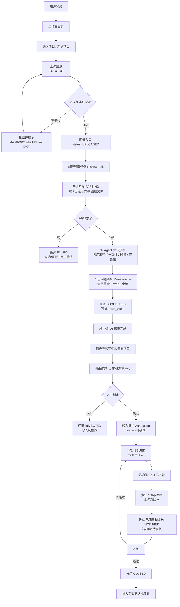
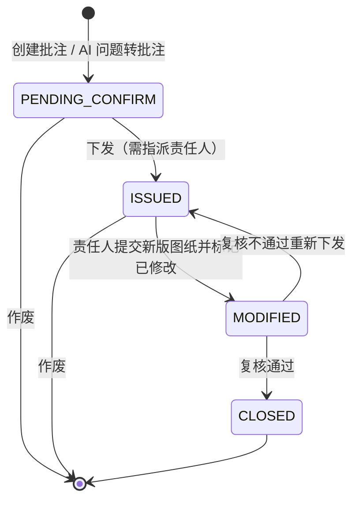
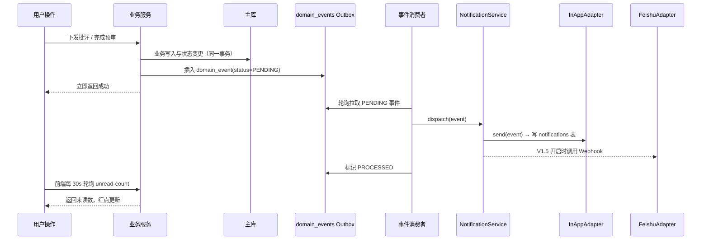
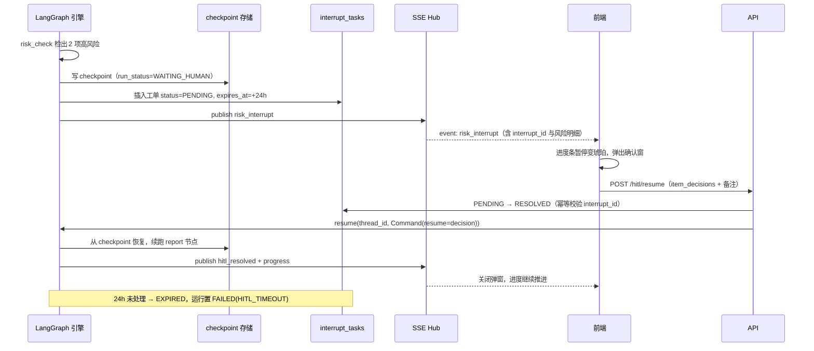
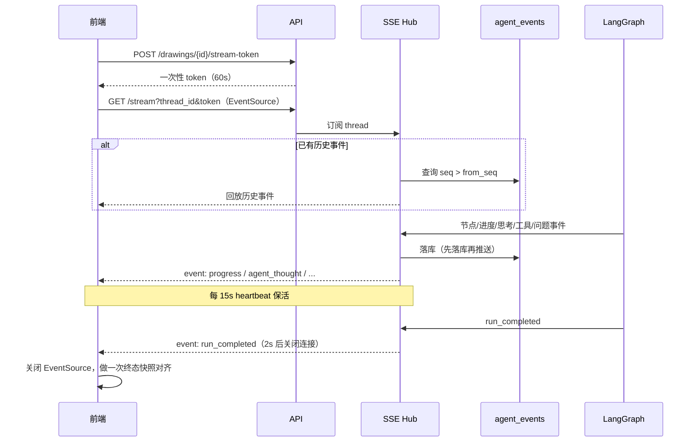
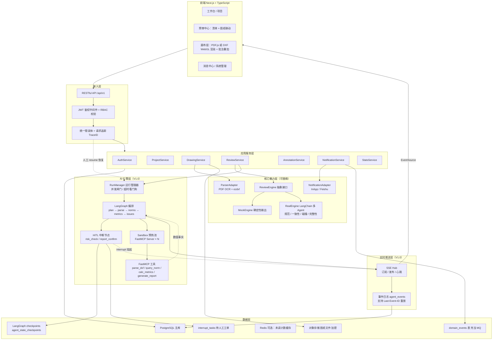
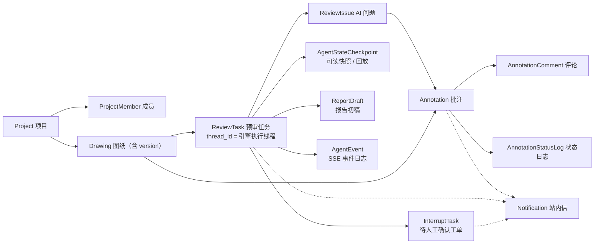

# Arch-Harness 总 PRD
## 建筑 AI 方案预审与图纸资料协同多 Agent 工作台

| 项目 | 内容 |
| :--- | :--- |
| 产品代号 | Arch-Harness |
| **产品版本** | **V1.0（MVP）** —— 本次交付范围 |
| 文档版本 | doc-v2.0（随产品 V1.0 定稿） |
| 文档状态 | 待评审 |
| 上游文档 | `项目大纲PRD.md` V1.3（原始大纲） |
| 目标读者 | 产品、前端、后端、算法、UI/UX、建筑业务专家 |
| 子文档 | `docs/prd/prd-01` ~ `prd-07` |

> **版本约定（统一口径，全文档适用）**
> - **产品版本**只有三档：`V1.0 = MVP`（本次全部交付物）、`V1.5`（增强）、`V2.0`（规模化）。凡写"V1.0 范围"即指本次必做；写"V1.5/V2.0"即指本次不做但接口预留。
> - **文档版本**独立演进（doc-v1.0 / doc-v1.1 / doc-v2.0），仅用于文档修订追溯，不代表功能范围。
> - 子 PRD 中出现的 `（V1.0 新增）` 一律指"本次 MVP 必须实现"，不是"下一版"。

### 版本记录

| 文档版本 | 产品版本 | 变更 | 说明 |
| :--- | :--- | :--- | :--- |
| — | 原大纲 V1.3 | 原始业务文档 | 收敛站内协同，预留飞书接口 |
| doc-v1.0 | — | 重构版 | 批判性吸收原大纲；锁定四条硬边界；补齐坐标契约、Mock 引擎、事件 Outbox、领域对象层级；拆解 6 份子 PRD |
| doc-v1.1 | — | 增量 | 新增 AI 引擎架构（`prd-06`），原 API 契约顺延为 `prd-07`；追加 4 张表与 7 个接口 |
| **doc-v2.0** | **V1.0（MVP）** | **本次定稿** | ① 版本口径统一为 V1.0（MVP），复杂能力下沉 V1.5/V2.0 ② `prd-06` 落为代码级文档 ③ `prd-07` 增补统一模型注册表 + SSE 连接治理 ④ 补数据权限（Service 层）强制要求 ⑤ 收紧 MVP 前端范围并给出裁剪建议 |

---

## 1. 一页摘要

Arch-Harness 是给建筑设计院审图岗位用的 **AI 预审工作台**。用户的动作只有一个：把 PDF / DXF 图纸扔进来，拿到一份"问题清单"，在图纸上逐条确认、批注、指派，最后关掉问题。

MVP 只做这一条链路，做到能用、能演示、能联调。多 Agent、真实解析能力、外部 IM、多角色权限，全部以**接口预留 + 可切换实现**的方式存在于架构里，而不是存在于 V1.0 的交付物里。

**六条硬边界（本 PRD 的最高约束，任何模块不得越过）：**

| # | 边界 | 落地方式 |
| :--- | :--- | :--- |
| B1 | 单一核心用户 | 仅有 `Reviewer` 一种业务角色 + `Admin` 运维角色；后端中间件按 `permission_code` 鉴权，前端菜单按权限动态渲染；数据模型（role/permission/user_roles/project_members）一次建全 |
| B2 | 仅支持 `.pdf` / `.dxf` | 上传前后端双重校验；`.dwg` 命中拒绝规则，返回专门错误码和"转 DXF 指引"引导 |
| B3 | AI 预审允许 Mock | `ReviewEngine` 抽象层；`MockEngine` 与 `RealEngine` 由配置切换；Mock 必须**确定性可复现** |
| B4 | 仅站内信通知 | `NotificationService` + 适配器模式，V1.0 只装 `InAppAdapter`；`FeishuAdapter` 留空实现 + `notification_preferences` 表留字段 |
| B5 | **流程必须能暂停等人**（V1.0） | 引擎在两个节点用 LangGraph `interrupt()` 挂起；状态落 checkpoint；人工决策经 API 恢复。**不允许"AI 一路跑完再让人看结果"** |
| B6 | **执行过程必须流式可见**（V1.0） | 唯一通道为 SSE；前端禁止轮询任务状态；事件落 `agent_events` 支持断线重放 |


---

## 2. 原大纲批判性吸收

> 这一节是本次重构的"账本"。原大纲不是不能看，而是有 12 处会在研发阶段爆掉或自相矛盾（C11、C12 为 V1.0 增补）。

| # | 原大纲的问题 | 严重度 | 重构结论 |
| :--- | :--- | :--- | :--- |
| C1 | **用户策略自相矛盾**：§3 列了"主创建筑师 + 图纸校对专员"两个画像，§5.3 要求"批注指派给项目内成员"，§5.4 要求"分配项目成员（邀请制）"，但同时宣称 MVP 聚焦单一用户。谁来指派给谁？ | 高 | 收敛为一个复合角色 **Reviewer（审图专员／主创，同一账号两种工作状态）**；成员表与指派人字段保留，V1.0 默认"指派给自己"形成自闭环，界面不引导多成员。V1.5 打开多成员时零改表 |
| C2 | **AI Mock 从未被正文承认**：§5.2 要求 OCR、`ezdxf`、多 Agent 并行、Harness 上下文管理，全是重资产；直到 §7 才出现"AI 准确率 ≥85%"，无 Mock 承诺。若照此排期，V1.0 交不出可演示系统 | 高 | 引入 `ReviewEngine` 接口 + `MockEngine`（默认）/ `RealEngine`（配置切换）。Mock 输出**固定 seed 的确定性问题集**，使前后端联调、演示、自动化测试可重复 |
| C3 | **坐标映射完全缺失**：§5.2 说"在图纸上精确定位问题"，§5.3 说"红框批注"，但从未定义 PDF 的 page+bbox、DXF 的世界坐标如何映射到前端画布。这是整个产品最核心的技术契约，缺失即返工 | 极高 | 新增 §10.1 **坐标映射契约**：统一 `location` JSON Schema，一次定义、四处复用（AI 问题、人工批注、消息跳转、导出报告） |
| C4 | **图纸版本无模型**：§4.5 "修改图纸后重新上传复核"，但 `drawings` 无 version 字段，复核后批注归属哪一版图纸无从判断 | 高 | `drawings` 增加 `version` / `parent_drawing_id` / `is_current`；V1.0 不做批注自动迁移，只做"该批注基于旧版本"的版本提示 |
| C5 | **断点续传是过度设计**：§5.2 要求"大文件断点续传"，而同节限制单文件 50MB。为 50MB 做跨会话续传，投入产出比不成立 | 中 | 降级为**分片上传 + 失败重试**：保留 chunk 接口（前端按 5MB 切片、单片失败可重传），不做跨会话/跨设备续传 UI |
| C6 | **"一键导出 PDF/Excel" 依赖未验证能力**：导出排版的准确率受 Mock 数据影响，且渲染引擎选型（reportlab / puppeteer）在 MVP 期属于额外风险 | 中 | 导出降为 **P1**，MVP 必做项是"列表 + 图纸联动视图"；导出接口预留 `POST /review-tasks/{id}/report-tasks`，V1.0 固定返回 `501` |
| C7 | **性能指标不分层**：§6 的"PDF < 1min / DXF < 3min"对 Mock 引擎没有意义，但演示时卡顿就是事故 | 中 | SLO 分两层：Mock 引擎 P95 < 3s（演示流畅是硬指标）；真实引擎沿用原指标。前端首屏与画布加载 < 3s 不变 |
| C8 | **消息没有任何可靠性设计**：§5.3.3 说"业务层发事件 → MQ 异步消费"，MVP 期引入 MQ 是自找麻烦；但纯同步写库又会因事务回滚丢消息 | 中 | MVP 用 **Outbox 表 + 后台轮询消费**（`domain_events`），语义与 MQ 一致，零中间件成本；适配器把 `InAppAdapter` 写库，V1.5 加 `FeishuAdapter` 调 Webhook，业务代码零改动 |
| C9 | **北极星指标不可测**：§7 定义"AI 拦截的有效设计缺陷数量"，在 Mock 阶段无真实缺陷基准 | 低 | 改为可观测代理指标：**"有效确认批注数"**（用户确认为真并关闭的问题数），原指标在真实引擎上线后回归 |
| C10 | **权限"预留"缺乏可验证定义**：§5.4 说 V1 建表、V2 才接 RBAC，但没说什么叫"接上了" | 中 | 定义为三个可验收动作：① 表与种子数据齐备 ② 后端接口按 `permission_code` 校验（403 返回统一错误体）③ 前端菜单/按钮按 `me/permissions` 渲染。V1.0 必须三项全绿，只是角色数量少 |
| **C11** | **原大纲没有任何人工卡点**：§4 的流程是"上传 → Agent 并行 → 出报告"，AI 说容积率超了就直接写进报告，人只能在最后"看结果"。而审图这个行业的本质是**专业判断权在人手里**，AI 只能建议。缺卡点 = 产品不可用 | 极高 | 新增两个强制中断点（风险确认 / 报告确认）+ 校园退回；引擎在中断处真正挂起（LangGraph `interrupt()`），不是"假装暂停"；判为豁免的项必须写进报告可追溯 |
| **C12** | **原大纲只有"进度条"没有"执行过程"**：§5.2 仅要求"报告展示"，用户看不到 AI 在做什么、卡在哪、调了什么工具。审图师对黑盒 AI 的信任度极低，一停 30 秒就会被判定"卡死" | 高 | 引入 SSE 实时流 + 「Agent 思考链路」面板，逐条展示计划/工具/结论/问题；心跳保活 + `Last-Event-ID` 重放；前端禁止轮询 |


---

## 3. 产品背景与定位

### 3.1 背景

设计院在方案与施工图阶段的核心痛点是"错漏碰缺"的发现成本：单专业内部靠人眼扫图，跨专业（建筑/结构/机电）靠开会比对。一个成熟校对员一天有效审图约 2~3 张 A1，疲劳后漏检率陡增；而规范条文（防火分区、疏散距离、净高、门窗开启）查对又是纯体力活。

### 3.2 定位

**不是"更聪明的 CAD"，也不是"审图院的生产系统"**，而是审图岗位的**前置过滤网 + 协同记账本**：

- 前置过滤：AI 先跑一遍，把问题按严重度排序，人只看高价值的 20%；
- 协同记账：每一条问题从"发现 → 下发 → 修改 → 复核 → 关闭"都有状态、有责任人、有时间戳，取代"微信群里发截图，改没改没人知道"。

### 3.3 演进策略

| 版本 | 主题 | 关键交付 |
| :--- | :--- | :--- |
| **V1.0（MVP）** | 跑通闭环 + 过程可见 + 关键处有人把关 | PDF/DXF 上传 → **LangGraph 引擎（Mock）** → **SSE 实时链路 + 思考面板** → 问题清单 → **风险/报告两处人工卡点** → 图纸批注 → 站内信 → 关闭；RBAC 表与鉴权到位 |
| V1.5 | 提触达与自动化 | 真实解析引擎（OCR）接入；**动态重规划 + LLM 自主路由**；**容器化沙箱**与扩展工具；`FeishuAdapter` 上线；多成员协作开启；思考面板全链路渲染 |
| V2.0 | 提规模 | 多角色视图、行级数据权限、跨项目数据看板、原生 DWG（商业组件）、批注跨版本迁移、工具市场 |

---

## 4. 用户画像与痛点

### 4.1 核心用户：审图专员 / 主创（Reviewer）

| 维度 | 描述 |
| :--- | :--- |
| 身份 | 设计院方案主创、专业负责人、专职校对。5~15 年经验，图纸语言是他的母语 |
| 每日动作 | 打开图纸 → 扫问题 → 记问题 → 找设计师沟通 → 复核 → 归档 |
| 工具现状 | CAD + PDF 阅读器 + 微信 + Excel 台账。**四套工具，零数据连通** |
| 技术耐性 | 愿意学专业工具，但**不接受"AI 说这里有问题"而没有可点击的位置**；一次定位失败就失去信任 |
| 核心诉求 | ① 别让我漏 ② 让我一眼看到问题在哪 ③ 别让我重复描述同一个问题 ④ 改没改我能查 |

### 4.2 痛点 → 功能映射

| 痛点 | 现状 | 本产品对应能力 |
| :--- | :--- | :--- |
| 找不全（漏检） | 人眼疲劳，规范靠记 | AI 预审自动出清单，按严重度排序（B3：MVP 为 Mock） |
| 说不清（定位难） | 微信发截图，对方问"哪一页？" | 问题 ↔ 图纸双向联动，点击即高亮（§10.1 坐标契约） |
| 追不到（无状态） | Excel 台账手工维护，常断更 | 4 态流转 + 状态日志 + 站内信触达 |
| 重复问 | 同一问题多轮沟通 | 批注时间线（评论 + 状态变更同流） |
| 复核无依据 | 不知道自己基于哪一版提的意见 | 图纸版本 + "该批注基于旧版本"提示 |

### 4.3 次要用户（V1.0 仅数据模型支持，不做界面引导）

| 角色 | 说明 | V1.0 处理 |
| :--- | :--- | :--- |
| Designer 设计师 | 接收批注、修改图纸、上传新版本 | 有 `project_member.role` 枚举，可被指派；V1.0 默认自己扮演 |
| Admin 管理员 | 用户与项目管理 | 有独立菜单与接口；V1.0 即生效（单账号兼具） |
| Viewer 只读访客 | 外部专业顾问 | 枚举预留，不提供邀请入口 |

---

## 5. MVP 边界（In / Out）

### 5.1 In（必须交付，缺一不可演示）

| 模块 | 必做项 |
| :--- | :--- |
| 认证 | 注册、登录、JWT 刷新、登出、`me` 信息含权限码 |
| 工作台 | 三张统计卡（待审图纸/待处理批注/本周确认问题）、待办列表、最近项目 |
| 项目 | 创建、列表、详情、成员（含自己）绑定 |
| 图纸 | PDF/DXF 上传（分片+校验+失败重试）、版本号、状态机、预览地址下发 |
| 预审 | 创建预审任务、**SSE 实时进度与 Agent 思考链路**、问题清单（6 列）、按严重度/专业筛选、问题 ↔ 图纸联动、误报反馈 |
| **HITL** | **风险中断确认**（确认问题/特殊豁免）、**报告初稿确认**（确认/退回）、**校园退回**、24h 超时处理、断点恢复 |
| 批注 | PDF/DXF 画布上画框/打点/文字、指派、4 态流转、批量流转、时间线、关闭 |
| 消息 | 未读数角标（轮询）、消息列表、点击跳转定位、全部已读、偏好页（只读展示） |
| 管理 | 用户列表、项目成员分配、角色/权限只读视图 |
| 架构 | `ReviewEngine` 双实现、`NotificationService` 适配器、`domain_events` Outbox、坐标契约 |
| **引擎（V1.0）** | **确定性 Mock 引擎（D1 前置，禁裸 random）**、**LangGraph State 全字段**、**Planning 7 子任务拆解**、**沙箱预热池（默认 B 档可降级）+ FastMCP 工具注册表**、**数值护栏（字段级）**、**checkpoint 持久化与恢复** |

### 5.2 Out（明确不做，写进验收的"不作为项"）

| 不做 | 原因 |
| :--- | :--- |
| DWG 原生解析 | 商业组件成本 + 解析复杂度；提供转 DXF 指引 |
| 真实 OCR / 真实 LLM 调用（作为默认链路） | 允许 Mock；真实引擎以 feature flag 存在 |
| 外部 IM（飞书/企微/钉钉）实际推送 | 仅留适配器接口与偏好表 |
| 邮件/短信通知 | 同上，且涉及合规 |
| 报告导出 PDF/Excel（本地下载） | 降 P1；正式文档由系统生成并托管下载 |
| 多角色视图切换、细粒度数据权限（按专业隔离） | 仅表结构与菜单渲染预留 |
| 批注跨版本自动迁移 | 只做版本提示 |
| 3D / BIM 模型查看 | 仅 2D 图纸 |
| 移动端适配 | 桌面优先，最小宽度 1366px |
| 图纸编辑（改图） | 只读渲染 + 叠加批注层 |
| 团队实时协同编辑（多人同时批注的冲突合并） | V1.0 用"最后写入生效 + 乐观锁" |
| **多轮对话式修订报告（Chat 改稿）** | 卡点二是"确认/退回"，不是"边聊边改"；V2.0 再评估 |
| **前端轮询进度** | 明确禁止；SSE 是唯一实时通道 |
| **跨项目/跨图纸的全局 Agent 规划** | 单图纸单运行，避免并发与状态膨胀 |
| **Agent 自主修改图纸** | 只读解析，永不回写 CAD |

### 5.3 版本范围矩阵（V1.0 / V1.5 / V2.0）

> 这一节是**排期争议的裁决依据**。凡本节未列入 V1.0 的能力，一律不进本次排期，只留接口。

| 能力 | V1.0（MVP，本次必做） | V1.5 | V2.0 |
| :--- | :--- | :--- | :--- |
| LangGraph 编排 | ✅ 固定 DAG：`plan → parse → norms → metrics → issues → risk → report → package` | — | — |
| **动态重规划（Replan）** | ⚠️ **仅 1 次、仅 3 个白名单触发条件**（解析空结果 / 工具连续超时 / 缺关键指标），且不新增 `required` 步骤 | ✅ 放开触发条件与次数上限 | ✅ 多轮自治规划 |
| **全自动路由（LLM 自主选工具/跳节点）** | ❌ 不做（路由写死在图里） | ✅ 基于 `tools_manifest` 的自主路由 | ✅ 多图纸/跨专业编排 |
| 沙箱 | ✅ **受限子进程** + 资源限制 + 禁网（dev/prod 同一实现） | ✅ 容器化（gVisor/firejail）、多租户隔离、按租户配额 | ✅ K8s Job 弹性调度 |
| FastMCP 工具 | ✅ **6 个核心工具**：`parse_dxf`、`extract_pdf`、`query_norm`、`calc_metrics`、`generate_report`、`package_assets` | ✅ 追加 `detect_clash`、`render_page`、`ocr_page`、`validate_location` | ✅ 自定义工具市场 |
| 数值护栏（`fact_ref`） | ✅ **V1.0 只做字段透传 + 来源存在性校验**（`FACT_REF_MODE=FIELD_ONLY`） | ✅ 全文正则扫描 + 阻断回退（`FULL_SCAN`） | — |
| **Mock 确定性** | ✅ 同一 `checksum` 输出逐字节一致（禁裸 `random`，见 `prd-06` §12.9） | — | — |
| **沙箱降级档位** | ✅ 默认 B 档（池 1 + 允许同步创建 3~5s）；A 档需 4C8G+ | ✅ 容器化 + 多租户配额 | ✅ K8s 弹性 |
| HITL 卡点 | ✅ **2 个**（风险确认 / 报告确认）+ 校园退回 | ✅ 自定义卡点（用户配置规则） | ✅ 审批流对接 |
| SSE 事件 | ✅ 15 类事件（后端全发） | ✅ 事件订阅过滤、多端同步 | ✅ WebTransport/双向流 |
| SSE 前端渲染 | ✅ **只渲染 5 类**（`run_started`/`plan_created`/`progress`/`agent_thought`/`risk_interrupt`/终态），其余忽略 | ✅ 渲染 `tool_call`/`tool_result`/`node_*` 全链路 | ✅ 链路拓扑图 |
| 真实解析引擎（OCR） | ❌ 留 V1.5（`RealEngine` 骨架） | ✅ PyMuPDF + OCR | ✅ 版面理解模型 |
| 外部 IM | ❌ 仅适配器与偏好表 | ✅ `FeishuAdapter` | ✅ 企微/钉钉 |
| RBAC 多角色视图 | ❌ 表 + 鉴权 + 菜单已通，仅 2 个角色启用 | ✅ 多角色 | ✅ 行级数据权限 |
| DWG 原生 | ❌ 转 DXF 指引 | ✅ 商业组件评估 | ✅ 原生 |

**MVP 前端范围的收紧（回应工作量担忧）**

| 项 | 决策 | 节省 |
| :--- | :--- | :--- |
| 思考链路面板 | 只渲染 6 类事件（见上表），`tool_call/tool_result` 后端照发、前端**只做兜底忽略**，不做工具卡片、不做行内展开 | −2 人日 |
| 报告确认页 | 保留独立页（比弹层更省事），但章节数固定 5 章、不做目录锚点与打印样式 | −1 人日 |
| 校园模式 | 复用报告确认页的壳，仅替换底部按钮文案与校验，不单独造页面 | −1.5 人日 |
| SSE 断线 | 只做"自动重连 + 手动重连按钮"，不做离线队列与事件补播动画 | −1 人日 |

> 结论：`prd-02` 前端从 13 人日压到 **9.5 人日**（明细见 `prd-02` §12）。后端因为要发全量事件，工作量不变。


---

## 6. 核心业务流程

### 6.1 主流程（上传 → 预审 → 批注 → 通知 → 关闭）



> **V1.0 补充**：上图描述"业务闭环"（图纸 → 问题 → 批注 → 关闭）。引擎在 J（预审执行）内部还有两条**必须暂停**的支路：检出高风险时停下等人判断（卡点一），报告初稿完成后停下等人确认（卡点二）。详见 §6.4 与 `prd-06` §8。

### 6.2 批注状态机



> 状态枚举固定 4 值，不新增"已驳回/已挂起"。作废通过软删除 `is_deleted` 实现，不进入状态机，避免污染统计口径。

### 6.3 站内信触达链路



> 说明：站内信仍用轮询（30s，见 `prd-04`）；**预审进度不允许轮询**，必须走 §6.5 的 SSE 通道。两者不要混为一谈。

### 6.4 HITL 中断恢复闭环（V1.0 核心）



两个卡点（不可合并、不可跳过）：

| 卡点 | 触发 | 人工动作 | 恢复后行为 |
| :--- | :--- | :--- | :--- |
| 一 · 风险确认 | 检出容积率 / 防火分区 / 疏散宽度等 `HIGH/CRITICAL` 指标存疑 | 逐项选"确认是图纸问题"或"标记为特殊豁免"（豁免须填依据） | 确认项转批注草稿；豁免项不进清单但写入报告"豁免说明" |
| 二 · 报告确认 | 报告初稿生成完成 | 确认生成正式文档 / 退回修改（≥10 字意见） | 确认 → 打包交付；退回 → 重回问题归纳（最多 2 次） |
| 校园 · 老师评审 | `SCHOOL` 模式报告初稿完成 | 通过 / 退回修改（≥10 字评语） | 退回生成《退回意见书》，学生改图后新起运行 |

### 6.5 SSE 实时链路（V1.0）



**前端展示效果（示例，正是产品要的观感）**

```
正在解析图纸 (10%) → 正在核对规范 (40%) → 发现 3 处问题 (70%)
  → ⏸ 等待设计师确认风险 (暂停) → 已恢复 → 报告生成中 (100%)
```

---

## 7. 系统架构

### 7.1 分层架构



### 7.2 对象层级（研发必须按此理解数据）



**一句话记忆**：Project 装 Drawing，Drawing 跑 ReviewTask，ReviewTask 吐 ReviewIssue，ReviewIssue 被人工采纳后变成 Annotation；Annotation 和 ReviewTask 都会触发 Notification。**只有 Annotation 有状态机，ReviewIssue 不可编辑、不可流转，只能被采纳/驳回。**

**V1.0 追加记忆**：ReviewTask 是引擎的"执行线程"（`thread_id`），它一条线挂四样东西——checkpoint（跑到哪了）、interrupt（等谁处理）、report（初稿）、event（推了什么）。**这四张表只增不删、只追加不改写，是 AI 结论可追溯的全部依据。**

---

## 8. 核心功能模块

### 8.1 工作台（Dashboard）

**目标**：登录后 3 秒内回答三个问题——我今天要处理什么？我手上的图纸到哪一步了？AI 这周帮我拦了什么？

| 区域 | 内容 | 数据来源 |
| :--- | :--- | :--- |
| 顶部欢迎条 | 用户名 + 日期 + "新建项目 / 上传图纸"双按钮 | 会话 |
| 统计卡 ×3 | 待审图纸数、待处理批注数、本周确认问题数（含环比箭头） | `GET /dashboard/overview` |
| 待办中心 | 表格：类型 / 标题 / 所属项目 / 状态 / 截止 / 操作；默认按更新时间倒序，支持"仅看我的" | `GET /dashboard/todos` |
| 最近项目 | 卡片：项目名 / 图纸数 / 未关闭批注数 / 最近更新 | `GET /projects?sort=updated_at` |

**关键交互**：待办行点击直达目标（批注 → 画布并高亮；预审任务 → 清单）。统计卡点击向下钻取为带筛选的列表页。

### 8.2 智能预审中心（核心）

**目标**：把"上传"和"看图找问题"压缩成一次点击。

| 子模块 | 关键设计 |
| :--- | :--- |
| 上传 | 拖拽/点选；格式白名单 `.pdf/.dxf`（拒绝 `.dwg` 并给出专门引导弹窗）；PDF ≤ 100MB、DXF ≤ 50MB；5MB 分片，单片失败独立重试 3 次；上传即校验文件名、MIME、文件魔数三重 |
| 进度与状态 | 图纸状态可视化：上传中 → 已上传 → 解析中 → 预审中 → 已完成/失败；执行过程由 **SSE 实时推送**（11 个阶段 + 思考链路），**禁止轮询**；中断时进度条暂停并变琥珀色 |
| **Agent 思考链路** | 预审页底部面板：计划生成、工具调用（含沙箱与耗时）、结论式思考、问题计数；点击即见"AI 在干什么"，完成后收起为一行摘要 |
| **风险中断确认（卡点一）** | 检出容积率/防火分区/疏散宽度等高风险 → 弹窗逐项选"确认是图纸问题"或"标记为特殊豁免"（豁免须填依据）→ 提交后流程续跑 |
| 问题清单 | 表格列：复选框 / 严重度 / 专业 / 问题标题 / 规则编号 / 置信度 / 操作；按严重度排序，支持专业与状态筛选；行内操作 = 定位、采纳为批注、标记误报 |
| 图纸联动 | 左列表右画布，双向：点行 → 画布翻到对应页并高亮框；点画布框 → 列表滚到该行并选中；联动必须**同页多项可叠加**，不互相清除 |
| **报告初稿确认（卡点二）** | 独立页展示报告 5 章 + 指标表 + 风险处置；勾选"已阅读"后确认生成正式文档，或退回修改（≥10 字意见，最多 2 次） |
| **校园模式** | `SCHOOL` 模式下卡点二替换为老师评审：通过 / 退回修改（≥10 字评语），退回生成《退回意见书》并通知学生 |
| 报告 | 导出为 P1；MVP 保留"生成报告"按钮的禁用态 + 提示文案，接口存在但固定返回 `501` |

### 8.3 批注协同

**目标**：在图纸上说话，且每句话有主人、有状态、有历史。

| 能力 | 规则 |
| :--- | :--- |
| 批注类型 | 矩形框（主）、点标记、文字标注、自由画笔（DXF 才开放）；PDF 与 DXF 均支持前三种 |
| 必填 | 标题（≤60）、严重度、专业、指派责任人（默认自己） |
| 状态流转 | 待确认 → 已下发 → 已修改待复核 → 已关闭；每次流转写 `annotation_status_logs`；`已下发` 必须有 assignee |
| 批量 | 支持勾选多条执行"下发/关闭"，全部成功或全部失败（事务） |
| 时间线 | 评论、状态变更、指派变更、版本上传同流按时间正序，状态变更节点用颜色区分 |
| 版本 | 图纸换版后，旧批注显示 badge"基于 v1"；不自动迁移 |

### 8.4 消息中心

**目标**：只在"需要你动手"时才吵你。

| 能力 | 规则 |
| :--- | :--- |
| 触发事件 | 预审完成、批注下发给我、批注待我复核、批注被关闭（信息级）、被加入项目 |
| 未读角标 | 顶部铃铛显示数字（>99 显示 99+）；30s 轮询 `unread-count`；进入消息中心不自动清零，需显式点击或"全部已读" |
| 列表 | 列：类型图标 / 标题 / 摘要 / 时间 / 已读态；未读左边缘蓝色竖条 |
| 跳转 | 点击消息 → 置为已读 → 按 `biz_type` + `deeplink` 跳转：批注类直达画布并高亮 3 秒；预审类直达清单并高亮该问题 |
| 偏好 | 展示"站内信（已启用）/ 飞书（即将开放，禁用）"两项，为 V1.5 留位 |

### 8.5 系统管理

| 子模块 | V1.0 范围 |
| :--- | :--- |
| 用户管理 | 列表（用户名/邮箱/角色/状态/创建时间）、启用禁用、重置密码、新建用户 |
| 项目管理 | 项目 CRUD、成员列表与添加/移除、项目内角色（Owner/Reviewer/Designer/Viewer） |
| 角色权限 | 只读展示 `Role` × `Permission` 矩阵；编辑入口置灰并提示"V2.0 开放" |

---

## 9. RBAC 预留设计（B1 落地）

### 9.1 模型

标准 RBAC0：`users — user_roles — roles — role_permissions — permissions`。
额外一张 `project_members` 承载**项目级角色**，用于 V1.5 的项目内数据隔离。

### 9.2 角色与权限种子

| Role | code | 权限码 |
| :--- | :--- | :--- |
| 管理员 | `ADMIN` | `*` |
| 审图专员 | `REVIEWER` | `project:read/write`、`drawing:read/upload`、`review:read/execute`、`annotation:read/write/transition`、`notification:read` |
| 设计师（预留） | `DESIGNER` | `project:read`、`drawing:read/upload`、`annotation:read/transition(仅自己)`、`notification:read` |
| 只读（预留） | `VIEWER` | `project:read`、`drawing:read`、`annotation:read`、`notification:read` |

### 9.3 四个必须达成的验收动作

1. **鉴权生效**：`Designer` 调 `POST /annotations/{id}/transition` 且非本人批注 → `403 FORBIDDEN`，错误体统一。
2. **菜单动态**：前端不硬编码菜单，由 `GET /auth/me` 返回的 `permissions[]` 推导；人为删掉某权限码，对应菜单与按钮应消失。
3. **数据模型完备**：为 V1.5 造一个多成员项目，仅改配置不改表结构即可让 Designer 看到"指派给我的批注"。
4. **数据权限生效（易漏，重点检查）**：功能权限 `annotation:transition` 只回答"角色能不能做这类操作"；**"能不能动这一条"必须在 Service 层判断**。硬验收：A 是创建者但不是责任人，A 对 `ISSUED` 批注执行"标记已修改" → 必须 `403`。实现与 8 条单测见 `prd-03` §5.5，接口清单见 `prd-07` §8.2。

> 审查红线：`transition` / `batch-transition` / `PATCH /annotations/{id}` 三个入口，只挂了 `Depends(require(...))` 而没有记录级判断的，一律视为未实现。


---

## 10. 关键技术契约

### 10.1 坐标映射契约（原大纲缺失，本 PRD 补齐）

所有"位置"信息只允许一种结构，**前端渲染、后端存储、消息跳转、导出报告全部复用**：

```json
{
  "file_type": "pdf",
  "page_no": 3,
  "bbox": { "x": 120.5, "y": 340.0, "w": 96.0, "h": 48.0 },
  "unit": "pt",
  "coord_system": "pdf_user_space",
  "origin": "top-left",
  "page_size": { "w": 2384, "h": 1684 },
  "dxf": null
}
```

DXF 类型：

```json
{
  "file_type": "dxf",
  "page_no": 1,
  "bbox": { "x": 5120.0, "y": 8360.0, "w": 2400.0, "h": 1800.0 },
  "unit": "mm",
  "coord_system": "dxf_wcs",
  "origin": "bottom-left",
  "page_size": { "w": 841000, "h": 594000 },
  "dxf": { "layout": "Model", "entities": ["3F8A"], "layers": ["WALL", "DOOR"] }
}
```

**三条硬规则**：
1. **坐标一律存"图纸原始坐标系"**，绝不存屏幕像素。缩放、平移、DPI 变化由前端换算。
2. PDF 用 `unit=pt`、原点左上；DXF 用 `unit=mm`、原点左下（WCS）。跨坐标系换算逻辑收敛到前端唯一工具函数 `toScreen(location, viewport)`。
3. `bbox` 为必填兜底字段；DXF 额外要求 `entities`（实体 handle 列表），以便前端在矢量重绘时精确选中，`bbox` 仅用于缩放定位。

### 10.2 ReviewEngine 抽象（B3 落地）

```python
# app/services/review/engine.py
from abc import ABC, abstractmethod

class ReviewEngine(ABC):
    @abstractmethod
    async def review(self, task: ReviewTaskContext) -> ReviewEngineResult: ...
    # ReviewTaskContext: drawing_id, file_url, file_type, project_id, disciplines, rule_sets
    # ReviewEngineResult: issues: list[IssueDraft], summary: dict, engine: str, cost_ms: int
```

- `MockEngine`：读取 `fixtures/mock_issues/{file_type}.json`，按 `drawing.checksum` 做 seed 取子集，**同一文件永远返回同一批问题**（问题数 8~15，严重度分布 严重 15% / 主要 35% / 一般 40% / 提示 10%），并可注入 `MOCK_FAIL_RATE` 模拟失败。
- `RealEngine`：LangChain 编排 4 个 Agent，接口签名完全一致；V1.0 仅保留骨架与 `NotImplementedError`。
- 切换：`settings.REVIEW_ENGINE=mock|real`，不改任何业务代码。

### 10.3 事件与通知适配器（B4 落地）

```python
class NotificationAdapter(ABC):
    name: str
    @abstractmethod
    async def send(self, event: DomainEvent, targets: list[NotifyTarget]) -> AdapterResult: ...

class InAppAdapter(NotificationAdapter):      # V1.0
    async def send(self, event, targets): ...  # 批量写 notifications 表

class FeishuAdapter(NotificationAdapter):     # V1.5 占位
    async def send(self, event, targets): ...
```

- 事件类型枚举：`REVIEW_COMPLETED`、`ANNOTATION_ASSIGNED`、`ANNOTATION_SUBMITTED`、`ANNOTATION_CLOSED`、`MEMBER_ADDED`。
- 幂等：`domain_events` 以 `event_key`（`{event_type}:{aggregate_id}:{version}`）唯一约束，重复消费直接跳过。
- 失败重试：消费者最多重试 3 次，指数退避；超过后置 `FAILED` 并落日志，不影响主业务。

### 10.4 文件解析契约

| 类型 | 解析产出（供前端与 Agent 共用） | 库/方案 |
| :--- | :--- | :--- |
| PDF | 页数、每页尺寸(pt)、文字块 + bbox、图框识别结果、首页缩略图 | PyMuPDF（`fitz`）；OCR 为 V1.5 |
| DXF | 图纸范围 extents、图框图块、图层清单、关键实体（`WALL/DOOR/WINDOW/COLUMN`）的 handle + bbox、单位 | `ezdxf`；**非全量解析**，只取图框与白名单图层 |

### 10.5 AI 引擎契约（V1.0 新增）

> 完整设计见 `docs/prd/prd-06-ai-engine-architecture.md`，此处只列不可让步的四条。

| # | 契约 | 说明 |
| :--- | :--- | :--- |
| 1 | **State 只存引用** | 图纸字节、base64、大数组不进 State；单次快照 ≤256KB；必须可 JSON 序列化 |
| 2 | **规划必覆盖 7 子任务** | 解析 brief / 提取图纸 / 检索规范 / 指标校验 / 生成问题 / 生成报告 / 打包资料；缺项则自修复一次，再缺走模板兜底并标 `plan_degraded` |
| 3 | **数值禁止 LLM 硬算** | 所有数字必须带 `fact_ref`（工具调用 ID + 字段名）。**V1.0 只做字段透传 + 来源存在性校验**，缺失则压置信度并声明；全文正则扫描与阻断回退放 V1.5（`FACT_REF_MODE=FIELD_ONLY`） |
| 4 | **沙箱必须预热，但允许降级** | 启动即建池；默认 **B 档**（`POOL_SIZE=1` + 允许同步创建），命中 <300ms，未命中 3~5s（由 SSE 进度文案兜底）；4C8G 以上切 A 档（`POOL_SIZE=3`）。解析/计算一律在沙箱，不在 API 进程内跑 |

### 10.6 实时链路契约（V1.0 新增）

| # | 契约 | 说明 |
| :--- | :--- | :--- |
| 1 | **SSE 是唯一实时通道** | 前端不得轮询任务状态；仅允许首屏/终态各取一次快照 |
| 2 | **事件先落库再推送** | 否则断线重放会缺事件；`agent_events` 保留 30 天，心跳不落库 |
| 3 | **seq 单调递增 + Last-Event-ID 重放** | 窗口 30min / 5000 条，溢出先发 `stream_reset` 要求全量刷新 |
| 4 | **鉴权用一次性 token** | `EventSource` 不能带 header；token TTL 60s、单次有效、绑定 user + thread |
| 5 | **中断与恢复幂等** | 以 `interrupt_id` 为幂等键；重复提交返回 409 并携带首次结果 |


---

## 11. 非功能需求

| 类别 | 指标 | 说明 |
| :--- | :--- | :--- |
| 性能 | Mock 预审 P95 < 3s | 演示流畅是硬指标 |
| 性能 | 真实引擎：PDF < 60s、DXF < 180s（单张 A1） | 沿用原大纲 |
| 性能 | 首屏 TTI < 3s；画布首帧 < 3s；切页 < 500ms | 4G 网络、Chrome 最近两版 |
| 性能 | 清单 500 条虚拟滚动，滚动帧率 ≥ 50fps | 问题量大时不卡 |
| 实时性 | 事件产生 → 站内信落库 < 1s；前端红点更新 ≤ 30s（轮询周期） | 原大纲写 1s，前端部分受轮询限制，如实修正 |
| **实时性（V1.0）** | **SSE 首包延迟 P95 < 500ms**（连接建立到首个事件） | 首屏不能"空白 3 秒才动" |
| **实时性（V1.0）** | **SSE 事件端到端延迟 P95 < 300ms**（引擎 publish → 前端收到） | 同进程 pub/sub；多实例走 Redis 后放宽到 500ms |
| **实时性（V1.0）** | 心跳间隔 15s；45s 无事件判定假死并重连 | 代理与移动网络下必须保活 |
| **可靠性（V1.0）** | **断点恢复成功率 ≥ 99.5%**（restore 成功 / restore 尝试） | 达不到即视为 HITL 不可用 |
| **可靠性（V1.0）** | SSE 重放溢出次数 = 0；断线重连后事件零缺失 | 以 `agent_events` 条数比对 |
| **可靠性（V1.0）** | 中断处理超时（>24h）每周 < 3 次 | 超时 = 业务阻塞，需运营介入 |
| **性能（V1.0）** | 沙箱预热池命中率 ≥ 95%；命中时启动开销 < 300ms；**未命中允许同步创建 3~5s（B 档）** | A 档（4C8G+）命中率 ≥95%；B 档（2C4G）看"同步创建占比"，>30% 应扩容 |
| **性能（V1.0）** | Mock 引擎全程 P95 < 8s；**B 档冷启动首轮 ≤ 15s** | 含两次中断的人工等待时间不计入；冷启动必须在 SSE 进度中可见 |
| 容量 | 单项目 ≤ 200 张图纸、单图纸问题 ≤ 2000 条、用户 ≤ 500 | MVP |
| 容量（V1.0） | 同时运行引擎会话 ≤ 10；SSE 并发连接 ≤ 200 | 超出排队，返回明确提示 |
| 安全 | 图纸文件静态加密（AES-256），下载走**短时签名 URL**（≤10 分钟） | 水印留 V1.5 |
| 安全 | 密码 `bcrypt` 存储；JWT access 2h / refresh 7d；越权统一 403 | |
| 安全 | 所有写操作记 `audit_logs`；日志脱敏（不打印图纸内容） | |
| 部署 | 支持私有化单机 Docker Compose（PG + MinIO + App + Web） | 设计院图纸资产敏感 |
| 可用性 | 单实例可用即可，不做多活 | MVP |
| 兼容性 | Chrome / Edge 最近两版，最小 1366×768 | 不做 Safari/Firefox 承诺 |
| 可观测 | 全链路 TraceID；预审任务耗时与失败率埋点 | |
| 数据保留 | 删除项目为软删除，30 天可恢复 | |

---

## 12. 指标与埋点

| 类型 | 指标 | 定义 | 埋点事件 |
| :--- | :--- | :--- | :--- |
| 北极星 | 有效确认批注数 | 周内从 AI 问题采纳并最终 `CLOSED` 的批注数 | `annotation.closed`（带 `source=AI`） |
| 过程 | 周活跃审图专员 WAU | 周内有任一写操作的去重用户 | 各写接口 |
| 过程 | AI 问题采纳率 | 采纳数 / AI 输出总数 | `issue.adopted`、`issue.rejected` |
| 过程 | 误报率 | 驳回数 / AI 输出总数 | `issue.rejected` |
| 过程 | 站内信已读率 | 已读消息数 / 生成消息数 | `notification.read` |
| 过程 | 消息跳转率 | 点击跳转次数 / 已读消息数 | `notification.click` |
| 护栏 | 预审失败率、平均耗时 | 按引擎分桶 | `review.task.finished` |
| **过程（V1.0）** | 思考链路触达率 | 看过思考链路面板的任务 / 总任务 | `review.thought.rendered` |
| **过程（V1.0）** | 风险确认平均处理时长 | 中断创建到 resume 的中位耗时 | `review.hitl.resolved` |
| **过程（V1.0）** | 风险豁免率 | 豁免项 / 风险项总数 | `review.hitl.resolved`（`mix` 字段） |
| **过程（V1.0）** | 报告一次通过率 | 一次确认通过 / 报告总数 | `review.report.confirmed` |
| **护栏（V1.0）** | SSE 断线率、重连成功率、重放溢出数 | 每次运行维度 | `review.stream.*` |
| **护栏（V1.0）** | 数值护栏拦截数 | 被压置信度的未溯源数字条数 | `review.numeric_guard.blocked` |

---

## 13. 风险与应对

| # | 风险 | 概率 | 影响 | 应对 |
| :--- | :--- | :--- | :--- | :--- |
| R1 | AI 误报高导致弃用 | 高 | 高 | 误报一键驳回 + 反馈落库；清单默认按严重度排序；V1.0 明确标注"AI 辅助，需人工确认" |
| R2 | 不支持 DWG 流失用户 | 高 | 中 | 上传处放"3 步转 DXF"图文引导（CAD 另存为 DXF 2018 → 检查图层 → 上传）；V1.5 评估商业组件 |
| R3 | DXF 过大解析超时/内存爆 | 中 | 中 | 限 50MB；`ezdxf` 流式迭代、只读白名单图层；解析进程独立超时 180s |
| R4 | 纯站内信触达率低 | 高 | 中 | MVP 接受此妥协；`FeishuAdapter` 与偏好表必须落地，V1.5 一周内可接；可选降级：每日邮件摘要 |
| R5 | 坐标映射错误导致定位偏移（**最高技术风险**） | 中 | 高 | 契约先行（§10.1）；验收用例必须包含 A0/A1 两种幅面 + 缩放 50%/100%/200% 三档的定位校验 |
| R6 | Mock 数据被误当真实能力对外演示 | 中 | 高 | 界面固定角标"AI 预审（Demo 引擎）"；接口返回 `engine` 字段供前端标识 |
| R7 | 单用户模型下协同闭环"看起来没意义" | 中 | 中 | 讲清定位：MVP 验证的是**状态机与触达链路**，不是多人并发；用同一账号切两个项目演示双角色 |
| R8 | 权限预留做成"假预留"（有表没校验） | 中 | 中 | §9.3 三条验收动作必须进 DoD |
| **R9** | **HITL 中断变成"卡死"**：用户不知道要处理，流程永远停在 78% | 高 | 高 | 三件事必须同时做：① `interrupt_tasks` 同时发站内信 ② 顶部常驻琥珀横幅 + 进页面即弹 ③ 24h 超时自动置失败并提示重发（不允许无声挂起） |
| **R10** | **SSE 在代理/移动网络下被缓冲或断开，前端"卡在 40%"** | 高 | 高 | Nginx `proxy_buffering off` + `X-Accel-Buffering: no`；15s 心跳；`Last-Event-ID` 重放；45s 无事件判假死 |
| **R11** | **大模型硬算数字（容积率、疏散距离）出错且看不出来** | 高 | 极高 | 数值护栏（`fact_ref` 溯源）+ 报告指标表由工具结果直接渲染，LLM 只写解读；命中未溯源数字压置信度并声明 |
| **R12** | **checkpoint 丢失导致无法恢复** | 低 | 高 | LangGraph PostgresSaver 为权威；`agent_state_checkpoints` 存可读快照；恢复失败明确报 `CHECKPOINT_UNAVAILABLE` 并要求重发，**不静默重跑** |
| **R13** | **沙箱冷启动拖慢首轮体验** | 中 | 中 | 启动即建池（N=3）+ 冒烟自检；命中率 < 95% 告警；未命中时前端显示"正在初始化解析环境"而非空白 |

---

## 14. 里程碑（建议 6 周）

| 周 | 目标 | 出口条件 |
| :--- | :--- | :--- |
| W1 | 契约与骨架 | 数据库迁移跑通；OpenAPI 骨架可访问；`location` JSON Schema 定稿；前端路由与布局完成 |
| W2 | 认证 + 工作台 + 项目 | 注册登录闭环；工作台三卡与待办真实取数 |
| W3 | 上传 + 预审（Mock） | PDF/DXF 上传成功；Mock 预审 8~15 条问题；清单可分页筛选 |
| W4 | 图纸联动 + 批注 | 点击定位误差可视验收通过；批注增删改与 4 态流转 |
| **W4.5** | **AI 引擎骨架 + SSE**（V1.0） | 沙箱池就绪、事件流跑通 `curl -N` 可见、思考链路面板能渲染 |
| **W5** | **HITL 双卡点 + 报告确认**（V1.0） | 风险中断→确认→续跑闭环；报告确认/退回；重启后仍可恢复 |
| W5.5 | 消息 + 系统管理 | 未读角标、跳转定位、全部已读；用户与成员管理可用 |
| W6 | 联调硬化 | 全链路演示脚本跑 3 遍无阻断；性能与安全项达标；文档与部署包交付 |

> 增量说明：V1.0 在原有 6 周上增加约 3 人周（引擎 2 周 + SSE/HITL 1 周），可与 W3/W4 并行；不改变 W1、W2、W6 的出口条件。


---

## 15. 子 PRD 索引

| 文档 | 范围 | 主要读者 |
| :--- | :--- | :--- |
| `docs/prd/prd-01-auth-and-dashboard.md` | 登录注册、工作台首页、数据看板口径 | 前端、后端 |
| `docs/prd/prd-02-ai-review-center.md` | 上传、解析进度、预审清单、图纸联动 | 前端、后端、算法 |
| `docs/prd/prd-03-annotation-collaboration.md` | 画布批注、状态流转、时间线、版本 | 前端、后端 |
| `docs/prd/prd-04-notification-center.md` | 未读角标、消息列表、跳转、偏好 | 前端、后端 |
| `docs/prd/prd-05-system-management.md` | 用户管理、成员分配、RBAC 落地 | 后端、前端 |
| `docs/prd/prd-06-ai-engine-architecture.md` | **LangGraph State、Planning、Sandbox+FastMCP、HITL 中断、SSE 事件流** | 后端（AI 工程）、算法、前端 |
| `docs/prd/prd-07-api-contracts.md` | 表结构（含 checkpoint / interrupt / report / event 四表）、枚举、REST + SSE 接口、Pydantic 模型 | 后端、前端 |

---

## 16. 假设与待决事项

### 16.1 本 PRD 自行做出的假设（如不认可请提出）

| # | 假设 | 理由 |
| :--- | :--- | :--- |
| A1 | 单一账号同时拥有 `ADMIN` 与 `REVIEWER` 角色 | 单用户 MVP，避免登录后功能缺失 |
| A2 | 批注指派默认指向自己 | 让状态机与通知链路可跑通，不必等多人 |
| A3 | 前端渲染 PDF 用 PDF.js，DXF 用 Canvas/WebGL 矢量重绘（非转图片） | 转图片无法做精准实体高亮 |
| A4 | 坐标以图纸原始单位存储，前端负责换算 | 与设备、缩放解耦，唯一正确解 |
| A5 | 事件用 Outbox 表 + 轮询替代 MQ | 零中间件成本，语义等价 |
| A6 | 导出报告与外部 IM 均为 P1/禁用态展示 | 守住 MVP 边界 |
| A7 | 深色模式、国际化不在范围 | 非核心价值 |
| **A8** | **引擎与 API 同进程部署（MVP）**，SSE 用进程内 pub/sub | 单实例足够；多实例只需切 `SSE_BACKEND=redis`，接口不变 |
| **A9** | **沙箱 dev 用受限子进程、prod 用容器**，只读根 + 禁网 | 平衡开发效率与安全；两套实现同一 FastMCP 协议 |
| **A10** | **`thread_id = review_task.id`**；新版本图纸（复核）用新 thread | checkpoint 的稳定锚点；复用 thread 会导致状态污染 |
| **A11** | **一次运行最多两次中断**（风险 + 报告），同节点多风险合并为一次 | 防"弹窗轰炸"；这是体验红线 |
| **A12** | **`agent_thought` 只推结论式摘要（≤200 字），不推原始 token 流** | 避免泄露完整思维链、避免刷屏与合规风险 |

### 16.2 待业务确认

1. 规范条文库的**首批规则集**（防火分区、疏散宽度、净高）由谁提供、几条？
2. 图纸保密等级是否需要分密级水印？
3. 是否需要保留"审图报告"作为正式对外交付物的格式要求（涉及 P1 排期）。
4. **（V1.0）风险阈值由谁定**：容积率/防火分区/疏散宽度的"存疑"判定阈值，是绑定规范硬限值，还是允许项目级配置？MVP 建议先绑硬限值 + 报告里说明来源。
5. **（V1.0）校园模式的课程/班级结构**：是否需要"一个老师带多个学生、按班级批量评审"？当前设计是项目内单图纸评审，不含班级批量。
6. **（V1.0）报告是否要对外**：报告确认后生成的正式文档是否作为对外交付物（涉及盖章、密级、编号规则）？

