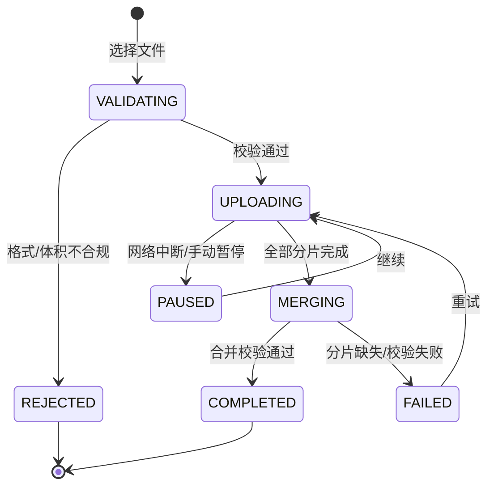

# prd-02 AI 预审中心

| 项 | 内容 |
| :--- | :--- |
| 模块编号 | M02 |
| 优先级 | P0（核心） |
| 对应总 PRD | §8.2、§10.1 坐标契约、§10.5 AI 引擎、§10.6 实时链路 |
| 下游依赖 | `prd-06`（SSE 事件枚举、HITL 语义）、`prd-07`（接口契约） |
| 主要读者 | 前端、后端、算法 |
| 产品版本 | **V1.0（MVP）** |
| 预估工作量 | 前端 **9.5 人日** / 后端 10 人日（明细与裁剪见 §12） |

---

## 1. 模块目标

1. 用户能把 **PDF / DXF** 拖进系统，5 分钟内看到一份带位置的问题清单。
2. 问题与图纸**双向联动**：点清单定位图纸，点图纸上的框定位清单。
3. 每条问题都能被人判定"是真的"或"是误报"，判定结果落库成为采纳率数据。
4. AI 允许 Mock，但**接口契约按真实引擎设计**，V1.5 换实现零改动。
5. **（V1.0）预审执行过程可见**：以 SSE 实时流展示 Agent 执行链路，Agent 遇高风险/报告初稿时**暂停并请求人工确认**，确认后原地续跑。

**不做**：DWG 解析、真实 OCR、报告导出为 PDF/Excel（P1，仅留禁用按钮）、问题跨图纸聚合分析、规则库管理后台。

> V1.0 只加"执行过程可视化 + 两处人工卡点"，**不改变**上传、清单、联动、采纳/驳回的任何既有规则与字段。


---

## 2. 用户故事

| ID | 故事 | 验收要点 |
| :--- | :--- | :--- |
| US-02-1 | 我拖一个 PDF 进来，如果格式不对立刻告诉我，别等我传完 | 前端在 drop 瞬间校验扩展名，`.dwg` 直接弹引导弹窗，不上传 |
| US-02-2 | 上传要能看到进度，断了能续 | 分片进度条 + 单片失败自动重试 3 次 + 手动重试按钮 |
| US-02-3 | 预审要告诉我进展，别转圈等 3 分钟 | 阶段文案（解析中 / Agent 1/4 完成）+ 预估剩余时间 |
| US-02-4 | 点一条问题，图纸要跳到那一页并框出来 | 定位偏移 < 5px（100% 缩放下） |
| US-02-5 | 我要能一次把 10 条问题转成批注 | 批量采纳，全部成功或全部失败 |
| US-02-6 | AI 说错了我要能一键否掉 | 驳回后该问题从默认列表消失，进"已驳回"筛选 |
| US-02-7 | 我想看见 AI 到底在干什么，而不是一个转圈的进度条 | 思考链路面板逐条出现"正在解析图纸 / 正在核对规范 / 发现 3 处问题"，无需刷新页面 |
| US-02-8 | AI 说容积率超了，但这是规划部门批过的，我要能说明并让它继续跑 | 风险确认弹窗里选"特殊豁免"+ 填依据，流程立刻续跑，结论写进报告 |
| US-02-9 | 报告要发出去之前，我要亲自看一眼 | 报告初稿确认页：确认生成正式文档 / 退回修改（必填意见） |
| US-02-10 | （校园）老师认为某个学生设计存疑，要中断并退回 | 老师点"退回修改"，填评语，学生收到通知并看到意见 |

---

## 3. 页面结构与路由

| 路由 | 页面 | 说明 |
| :--- | :--- | :--- |
| `/projects/:projectId/drawings` | 图纸列表 | 项目下所有图纸（含版本、状态、操作） |
| `/projects/:projectId/drawings/upload` | 上传页（也可用抽屉） | 拖拽区 + 队列 |
| `/projects/:projectId/drawings/:drawingId/review` | **预审中心主界面**（左清单右画布） | 本模块核心 |
| `/projects/:projectId/drawings/:drawingId/review/:taskId` | 指定任务的预审结果 | 支持历史任务回看 |
| `/projects/:projectId/drawings/:drawingId/review/:taskId/report` | **报告初稿确认页**（V1.0） | 卡点二的落地页 |
| `/projects/:projectId/drawings/:drawingId/review/:taskId/school` | **老师评审页**（V1.0，仅 `SCHOOL` 模式） | 通过 / 退回修改 |

### 3.1 预审中心主界面布局（V1.0）

```
┌───────────────────────────────────────────────────────────────────────────────┐
│ 面包屑：项目名 / 图纸名 v2 / 预审  [●运行中 70%]  [重新预审] [查看报告初稿]    │
├──────────────────────────┬────────────────────────────────────────────────────┤
│ 筛选区                    │ 画布工具条: [−] 100% [+] [适应宽度] [批注▾]        │
│ 严重度 ▾ 专业 ▾ 状态 ▾    ├────────────────────────────────────────────────────┤
│ 搜索框  [批量: 采纳 驳回] │                                                    │
│──────────────────────────│           PDF / DXF 渲染画布                       │
│ 问题表格（虚拟滚动）      │           + 高亮层 + 批注叠加层                    │
│ ┌──┬──┬──┬────┬────┬───┐ │                                                    │
│ │☐ │严│专│标题│规则│操作│ │                                                    │
│ └──┴──┴──┴────┴────┴───┘ │                                                    │
│                          │                                                    │
│ 分页 / 共 N 条            │ 右下角缩略图导航（多页 PDF 才显示）                │
├──────────────────────────┴────────────────────────────────────────────────────┤
│ ▼ Agent 思考链路（可折叠，默认展开；运行时固定 200px 高，结束后收起为一行）    │
│ 09:20:01 计划已生成：7 个步骤，重点核对疏散与防火分区                          │
│ 09:20:03 正在解析图纸 ▸ parse_dxf（沙箱 #2，1.8s，图层 12 / 实体 4821）        │
│ 09:20:05 正在核对规范：命中 GB50016 5.5.18 等 6 条 ─────────────────────── 70% │
└───────────────────────────────────────────────────────────────────────────────┘
     左栏 480px 可拖拽调宽（360~720px）
```

> 思考链路面板是**施工中（in-progress）的临时视图**，任务完成后自动收起为一行摘要（"耗时 8.4s · 12 个问题 · 2 处高风险已确认"），可手动展开回看。

---

## 4. 文件上传

### 4.1 格式校验规则（三重校验，任一层不过即拒绝）

| 层级 | 规则 | 失败码 |
| :--- | :--- | :--- |
| 前端-扩展名 | `.pdf` / `.dxf`（忽略大小写） | `ERR_EXT_NOT_ALLOWED` |
| 前端-白名单特判 | 命中 `.dwg` → 弹**DWG 引导弹窗**（不走上传统一错误提示） | `ERR_DWG_UNSUPPORTED` |
| 后端-MIME | `application/pdf` / `image/vnd.dxf` / `application/dxf` / `application/octet-stream` | `ERR_MIME_MISMATCH` |
| 后端-魔数 | PDF 前 4 字节 `%PDF`；DXF 前 512 字节含 `SECTION` 且（可选）`AC10` 版本标识 | `ERR_FILE_CORRUPTED` |

**体积限制**

| 类型 | 上限 | 提示 |
| :--- | :--- | :--- |
| PDF | 100 MB | "PDF 文件不能超过 100MB" |
| DXF | 50 MB | "DXF 文件不能超过 50MB，建议在 CAD 中清理无用图层后重试" |

**文件名规则**：≤ 200 字符；仅允许中英文、数字、`-_.() `；非法字符自动替换为 `_` 并在提示中说明（不阻断）。

### 4.2 DWG 引导弹窗（必须实现，是对 R2 风险的对冲）

| 元素 | 内容 |
| :--- | :--- |
| 标题 | 暂不支持 DWG 格式 |
| 正文 | 当前版本仅支持 PDF 与 DXF。DWG 请按以下 3 步转换后上传： |
| 步骤 | 1. 用 AutoCAD 打开图纸 → 另存为 → 选择 `DXF (*.dxf)`，版本选 `2018`<br>2. 如提示"仅导出选定对象"，选"整个图形"<br>3. 回到本页重新上传 `.dxf` 文件 |
| 附注 | 转换后请确认墙体/门窗图层名称未被改动，否则可能影响识别准确率 |
| 按钮 | `我已了解`（次）/ `选择文件`（主，仅接受 .dxf） |

### 4.3 上传流程与分片

1. 用户拖入文件 → 立即校验 → 通过后加入上传队列（支持多文件，**队列串行**执行，避免带宽争抢）。
2. 前端调 `POST /drawings/upload-sessions` 创建会话：返回 `upload_id`、`chunk_size=5MB`、`chunk_total`。
3. 逐片 `PUT /drawings/upload-sessions/{upload_id}/chunks/{index}`；单片失败重试 3 次（间隔 1s/2s/4s）。
4. 全片完成调 `POST /drawings/upload-sessions/{upload_id}/complete`（后端校验分片数量与 MD5 合并）。
5. 返回 `drawing_id`，前端跳转图纸列表并自动创建预审任务（或提示"是否立即预审"，默认自动开始）。

**单文件上传状态机（前端展示用）**



**上传队列项展示**：文件名（省略中间）、`3/20 片 · 15%` 进度条、速度 `2.1 MB/s`、状态文案、右侧操作（暂停 / 继续 / 重试 / 移除）。上传完成项 3 秒后淡出。

> 断点续传降级说明：不做跨会话续传。刷新页面后未完成上传丢失，需重新选择文件（页面离开前用 `beforeunload` 提示）。

### 4.4 图纸列表表格

| 列 | 宽 | 内容 |
| :--- | :--- | :--- |
| 复选框 | 40px | 支持批量删除 |
| 图纸名称 | flex | 文件名去掉扩展名 + 类型标签（`PDF` 红 / `DXF` 蓝）+ 版本号 `v2` |
| 大小 | 96px | `12.3 MB` |
| 版本 | 80px | `v1` / `v2`，hover 显示上传时间与上传人 |
| 状态 | 120px | 见 §5.1 枚举，带状态色点 |
| 问题数 | 100px | `严重 2 / 主要 5 / 一般 8`，未预审显示 `—` |
| 上传时间 | 160px | `YYYY-MM-DD HH:mm` |
| 操作 | 180px | 查看预审 / 重新预审 / 上传新版本 / 下载 / 删除 |

**行操作规则**

- `重新预审`：仅当状态 ∈ `{REVIEW_DONE, REVIEW_FAILED}` 且无进行中任务时可用；点击确认弹窗"将覆盖当前预审结果，是否继续？"
- `上传新版本`：仅 DXF/PDF 同类型；新记录 `version = 旧 version + 1`，旧记录 `is_current=false`；成功后提示"新版本已上传，历史批注仍关联在 v{old}，请确认是否需要重新审图"。
- `删除`：软删除，二次确认，若存在未关闭批注则提示"该图纸有 N 条未关闭批注，删除后一并归档"。

---

## 5. 状态与枚举

### 5.1 图纸状态 `drawing.status`

| 枚举 | 中文 | 可执行操作 |
| :--- | :--- | :--- |
| `UPLOADING` | 上传中 | 暂停 / 取消 |
| `UPLOADED` | 已上传，待预审 | 开始预审 / 删除 |
| `PARSING` | 解析中 | 查看进度 |
| `PARSED` | 解析完成 | — （自动进入预审） |
| `REVIEWING` | 预审中 | 查看进度 |
| `REVIEW_DONE` | 预审完成 | 查看清单 / 重新预审 |
| `PARSE_FAILED` | 解析失败 | 重试 / 删除 |
| `REVIEW_FAILED` | 预审失败 | 重试 / 删除 |
| `ARCHIVED` | 已归档 | 恢复 |

### 5.2 预审任务状态

**两层状态并存（V1.0）**，前端两处都用：

| 层 | 字段 | 用途 |
| :--- | :--- | :--- |
| 业务层 `review_task.status` | `ReviewTaskStatus` | 列表页/图纸状态徽标 |
| 引擎层 `review_task.run_status` | `RunStatus` | 进度条与思考链路面板的状态机 |

`ReviewTaskStatus`：`PENDING` 排队中 / `PARSING` 解析中 / `REVIEWING` 预审中 / `SUCCEEDED` 已完成 / `FAILED` 失败 / `CANCELED` 已取消
`RunStatus`：`PENDING` / `RUNNING` / **`WAITING_HUMAN`（等待人工，V1.0 新增）** / `SUCCEEDED` / `FAILED` / `RETURNED`（校园退回）/ `CANCELED`

**阶段与进度（由 SSE `progress` 事件下发，前端不硬编码文案）**

| stage | stage_text | percent | 对应节点 |
| :--- | :--- | :--- | :--- |
| `LOAD_CONTEXT` | 正在读取项目资料 | 3 | `load_context` |
| `PLANNING` | 正在制定审查计划 | 8 | `plan` |
| `PARSING` | 正在解析图纸 | 20 | `parse_drawings` |
| `RETRIEVING` | 正在核对规范 | 38 | `retrieve_norms` |
| `VALIDATING` | 正在校验指标 | 55 | `validate_metrics` |
| `DETECTING` | 正在归纳问题 | 70 | `detect_issues` |
| `WAITING_RISK` | **等待设计师确认风险** | 78 | `risk_check`（中断） |
| `REPORTING` | 正在生成报告初稿 | 88 | `generate_report` |
| `WAITING_REPORT` | 等待确认报告 | 95 | `report_confirm`（中断） |
| `PACKAGING` | 正在打包资料 | 98 | `package_assets` |
| `DONE` | 预审完成 | 100 | — |

**进度规则（硬性）**

1. 进度**只增不减**；除"退回修改"导致回到 `DETECTING`（此时允许降到 70%，前端需以 1s 过渡动画处理，不可瞬间回跳）。
2. `percent` 由后端下发，前端**不得自造百分比**；允许在两次事件之间做插值动画，但不得超前于最近一次事件 + 5%。
3. Mock 引擎下总耗时 3~8s，事件按真实节点节奏推进，不做"假进度条"。
4. 中断期间（`WAITING_RISK` / `WAITING_REPORT`）进度条**暂停并变色为琥珀色**，文案前缀加"已暂停 · "。

### 5.3 预审执行过程可视化（V1.0 核心新增）

#### 5.3.1 数据通道：SSE，禁止轮询

| 项 | 规格 |
| :--- | :--- |
| 建连 | 进入预审页 → `POST /drawings/{id}/stream-token` → `new EventSource(stream_url)` |
| 断线 | 浏览器自动重连（带 `Last-Event-ID`），退避 1/2/4/8s，最多 5 次；仍失败显示"实时连接已断开 + 重新连接" |
| 终态 | 收到 `run_completed` / `run_failed` / `run_returned` 后关闭连接并做一次终态快照 `GET /review-tasks/{id}`（**仅此一次**，非轮询） |
| 首屏恢复 | 刷新页面：先 `GET /review-tasks/{id}` 拿快照（`last_seq`）→ 再以 `from_seq=last_seq` 建流，保证不丢事件 |
| 禁止 | `setInterval` / `setTimeout` 定时拉任务状态；代码审查见到即打回 |
| 事件枚举 | 见 `prd-06` §9.2（`run_started` / `plan_created` / `progress` / `agent_thought` / `tool_call` / `tool_result` / `issue_found` / `risk_found` / `risk_interrupt` / `hitl_resolved` / `report_ready` / `report_interrupt` / `run_returned` / `run_completed` / `run_failed` / `stream_reset` / `heartbeat`） |

#### 5.3.2 「Agent 思考链路」面板 UI

**位置**：预审主界面底部横向面板（`prd-02` §3.1），高度 200px，可折叠；完成后收起为一行。

**结构**

```
┌ Agent 思考链路 ─────────────────────────────── [运行中 ● 70%] [折叠] ┐
│ ✓ 09:20:01  计划已生成：7 个步骤，重点核对疏散与防火分区              │
│ ✓ 09:20:03  解析图纸 ▸ parse_dxf · 沙箱#2 · 1.8s · 图层 12 / 实体 4821 │
│ ✓ 09:20:05  检索规范 ▸ query_norm · 命中 6 条（GB50016 5.5.18 等）     │
│ ⏳ 09:20:07  正在核对规范…                                  ← 当前行 │
│              └ Agent：本层 3 个安全出口，东侧净宽 1.05m 低于 1.1m      │
└──────────────────────────────────────────────────────────────────────┘
```

**事件 → UI 映射（本表只定义 UX 呈现；事件枚举与 payload 以 `prd-07` §2.1 / `prd-06` §9.4 为准）**

| 事件 | 面板表现（含 V1.0 实现口径） |
| :--- | :--- |
| `run_started` | **V1.0**：面板出现，首行"[引擎] 已启动（mock / 专业审图）"，进度条 0% |
| `plan_created` | **V1.0**：展开"执行计划"子列表（7 步，全部 `pending`），并显示 `rationale` |
| `node_started` | V1.5：对应步骤置 ⏳。V1.0 **不渲染**（由 `progress` 承担阶段切换） |
| `node_finished` | V1.5：对应步骤置 ✓ + 耗时。V1.0 **不渲染** |
| `progress` | **V1.0**：顶部百分比与阶段文案更新（带 300ms 过渡） |
| `agent_thought` | **V1.0**：追加一行缩进文本（灰底 + 左侧竖线），前缀 `Agent：`；每条 ≤200 字，超出省略并"展开" |
| `tool_call` | V1.5：追加一行 `工具名 · 沙箱#N`（转圈）。V1.0 **收到即忽略**（不注册监听） |
| `tool_result` | V1.5：补全 `耗时 / 摘要`，失败显示红色。V1.0 **忽略** |
| `issue_found` | **V1.0**：右侧浮出 +1 计数徽标（"已发现 7 个问题"），**不逐条插入**（避免刷屏） |
| `risk_found` | V1.5：面板顶部黄条"即将请求确认"。V1.0 跳过（紧接着就是 `risk_interrupt`） |
| `risk_interrupt` | **V1.0**：状态切"已暂停"，面板锁定，**自动弹出风险确认窗**（§6.6） |
| `hitl_resolved` | **V1.0**：追加"[人工] 张工 已处理：r1 豁免 / r2 确认问题"，状态恢复"运行中" |
| `report_ready` | **V1.0**：顶部"查看报告初稿"按钮变为可用（高亮） |
| `report_interrupt` | **V1.0**：跳转报告确认页（§6.7） |
| `run_completed` | **V1.0**：全部步骤 ✓，状态"已完成"，面板 3s 后自动收起；清单刷新 |
| `run_failed` | **V1.0**：状态"失败" + `message`，面板保留并给"重试预审"按钮 |
| `run_returned` | **V1.0**：状态"已退回"，显示退回评语入口（校园） |
| `stream_reset` | **V1.0**：清空面板并全量刷新任务快照与清单 |
| `heartbeat` | **V1.0**：仅更新"最后心跳时间"（不渲染） |

> **V1.0 前端实现口径（省工作量）**：只 `addEventListener` 这 8 个——`run_started`、`plan_created`、`progress`、`agent_thought`、`issue_found`、`risk_interrupt`、`report_interrupt`、终态三选一。其余事件**后端照发、前端不注册监听**（浏览器自动丢弃）；V1.5 补监听即可，后端零改动。


**交互细节**

- 新行插入时有 120ms 淡入；自动滚到底，但**用户手动上滚后停止自动滚动**（显示"回到最新"按钮）。
- 面板内容最多保留 300 行（超出丢弃最早的非关键行，`tool_call/result` 成对保留）。
- 折叠后顶部仍显示"运行中 70% · 正在核对规范"一行摘要。
- 完成后折叠态摘要："耗时 8.4s · 12 个问题 · 2 处高风险已确认"。
- `agent_thought` 为**结论式摘要**，后端已脱敏与截断，前端不做二次解析。

**断线态**

| 状态 | 表现 |
| :--- | :--- |
| 重连中 | 顶部"连接中断，正在重连（2/5）…"，进度条置灰不动 |
| 重连失败 | "实时连接已断开" + 重新连接按钮；右侧清单仍可正常浏览（已落库的问题不受影响） |
| 运行已结束但事件没收到 | 重连后立即收到终态事件 → 正常收尾 |


### 5.4 问题严重度 `severity`

`BLOCKER` 严重（违反强条，必须改）/ `MAJOR` 主要（影响使用或成本）/ `MINOR` 一般（可优化）/ `INFO` 提示（建议项）

### 5.5 专业 `discipline`

`ARCH` 建筑 / `STRUCT` 结构 / `MEP` 机电 / `GENERAL` 通用（规范类）

### 5.6 问题分类 `category`

`CODE` 规范校验 / `CONSISTENCY` 一致性（图与说明、平立剖不符）/ `CLASH` 碰撞（管线打架）/ `COMPLETENESS` 完整性（缺标注、缺图签）

### 5.7 问题状态 `review_issue.status`

| 枚举 | 中文 | 说明 |
| :--- | :--- | :--- |
| `PENDING` | 待判定 | 默认状态，参与计数 |
| `ADOPTED` | 已采纳 | 已转为批注，`annotation_id` 非空 |
| `REJECTED` | 已驳回 | 判定为误报，默认列表隐藏 |
| `IGNORED` | 已忽略 | 用户主动忽略（非误报，不计入误报率） |

---

## 6. 预审清单交互

### 6.1 问题表格列定义

| 列 | 宽 | 内容与规则 |
| :--- | :--- | :--- |
| 复选框 | 40px | 表头支持全选当前页；选中后顶部浮出批量操作条 |
| 严重度 | 88px | 色块 + 中文（严重/主要/一般/提示），不可点击筛选（用上方筛选器） |
| 专业 | 80px | 中文标签；`GENERAL` 显示为"通用" |
| 问题标题 | flex | 单行省略，hover 展示完整 `description`；副行显示 `规则编号` 灰色小字 |
| 置信度 | 80px | 百分比 `87%`；< 60% 时显示灰色并带 `?` 提示"该条为 AI 低置信判断，建议人工复核" |
| 状态 | 80px | 待判定 / 已采纳 / 已驳回 / 已忽略 |
| 操作 | 120px | `定位` `采纳` `驳回`（超 3 个收纳进 `...`） |

**排序**：默认 `severity DESC, confidence DESC`；支持点击"严重度"列头切换升降序。
**分页**：默认 50 条/页，虚拟滚动（前端 `react-virtual`）。总数显示 `共 128 条 · 严重 12 主要 38 一般 60 提示 18`。

### 6.2 筛选器

| 筛选 | 类型 | 默认 |
| :--- | :--- | :--- |
| 严重度 | 多选下拉 | 全选 |
| 专业 | 多选下拉 | 全选 |
| 分类 | 多选下拉 | 全选 |
| 状态 | 单选 Tab：待判定 / 已采纳 / 已驳回 / 全部 | 待判定 |
| 关键词 | 搜索框（防抖 300ms，匹配标题与描述） | 空 |

**筛选联动**：筛选变化立即请求 `GET /review-tasks/{id}/issues`（带上筛选参数），并重置分页到第 1 页；当前选中项若被筛掉则清除选中。

### 6.3 联动规则（本模块最关键的交互）

| 触发 | 行为 |
| :--- | :--- |
| 点击行 / 点"定位" | ① 画布翻到 `location.page_no` ② 视图平移到 bbox 居中，缩放至少 100% ③ 高亮框描边 2px 主色，脉冲动画 2 次（约 1.2s） ④ 该行进入选中态（左侧色条 + 背景 `#E6F4FF`） |
| 点击画布上的高亮框 | ① 列表自动滚动到对应行并选中（若被筛选器隐藏，则切到"全部"Tab） ② 浮层卡片显示标题、严重度、置信度、`采纳`/`驳回` 按钮 |
| 画布同页多个框 | 全部渲染，未选中框描边 1px 半透明；选中框加粗。**不允许清除其他框** |
| 关闭联动 | 顶部提供"仅看选中问题"开关，默认关；开启后画布只渲染选中/悬停的那一条 |
| 切页 | 切换分页后，画布保留当前页与缩放；若当前定位项不在新页则取消高亮 |

### 6.4 采纳与驳回

**采纳（单条 / 批量）**

1. 点击 `采纳` → 弹出精简表单抽屉（宽 480px，右侧滑出）：

| 字段 | 必填 | 默认 | 校验 |
| :--- | :--- | :--- | :--- |
| 批注标题 | 是 | 取 `issue.title`（截断 60 字） | ≤ 60 字 |
| 严重度 | 是 | 取 `issue.severity` | 枚举 |
| 专业 | 是 | 取 `issue.discipline` | 枚举 |
| 指派给 | 是 | 当前用户 | 项目成员内 |
| 描述 | 否 | 取 `issue.description` + `suggestion` | ≤ 2000 字 |
| 位置 | 只读 | 由 `issue.location` 带入，展示"第 3 页 / 图框 A-1" | — |

2. 提交 → 事务内：创建 `annotation`（`source=AI`、`status=PENDING_CONFIRM`、`issue_id`）→ 更新 `issue.status=ADOPTED`。
3. 成功后该行状态变 `已采纳`，行末操作变为 `查看批注`（跳转 prd-03 画布并定位该批注）。
4. **批量采纳**：勾选 N 条 → 顶部批量条 → 采纳 → 抽屉表单中"标题/描述"字段置灰并提示"批量采纳将沿用各问题的原始标题与描述"，其余字段统一应用。失败则整批回滚并提示"第 3 条创建失败，已回滚全部"。

**驳回（误报）**

1. 点击 `驳回` → 弹小气泡（Popover），内含 3 个原因单选 + 可选备注：

| 原因码 | 文案 |
| :--- | :--- |
| `FALSE_POSITIVE` | 判断有误，此处没有问题 |
| `NOT_APPLICABLE` | 规范/规则不适用本项目 |
| `DUPLICATE` | 与其他问题重复 |
| `OTHER` | 其他（必须填备注，≤200 字） |

2. 提交 → `issue.status=REJECTED` + 写 `issue_feedbacks` 表。
3. 行淡出并从"待判定"列表移除；Toast "已标记为误报，感谢反馈"；提供"撤销"（5 秒内可反悔，调 `POST /issues/{id}/reject?undo=true`）。

### 6.5 图纸画布

| 能力 | PDF | DXF |
| :--- | :--- | :--- |
| 渲染 | PDF.js `canvas` 逐页渲染 | Canvas 2D 按图层分组矢量重绘（`WALL/DOOR/WINDOW/COLUMN` 优先） |
| 缩放 | 50%~400%，滚轮 + 按钮 | 同 |
| 平移 | 空格拖拽 / 中键拖拽 | 同 |
| 切页 | 页码框 + 上下页 + 缩略图条 | 无多页概念，`page_no` 恒为 1 |
| 图框信息 | 解析出的图签区高亮（虚线） | 同 |
| 高分屏 | `devicePixelRatio` 缩放，避免模糊 | 同 |

**必做细节**：画布右下显示"第 3/12 页 · 100% · 单位 pt"；无问题时画布中央空态"本图纸暂未发现问题"。

### 6.6 风险中断确认（卡点一，V1.0 新增）

**触发**：SSE 收到 `risk_interrupt`（或刷新后 `GET /hitl/pending` 返回 `PENDING`）。
**呈现**：弹窗（Modal，宽 720px，不可点遮罩关闭；`Esc` 需二次确认"确认稍后再处理？流程将保持暂停"）。

#### 6.6.1 弹窗结构

```
┌ 发现 2 项高风险指标，需人工确认 ───────────────────── ⏱ 剩余 23:41:12 ┐
│ ⚠ 流程已暂停。请判断以下指标是"图纸问题"还是"已获豁免"。               │
│ ┌────────────────────────────────────────────────────────────────────┐ │
│ │ 🔴 严重  容积率超出规划条件                          [当前 3.42 / 限值 3.0] │
│ │ 依据：规划条件通知书-第三条                                            │
│ │ 判断理由：按图表面积推算 3.42，超限 14%                                │
│ │ ┌ 处置 ────────────────────────────────────────────────────────────┐ │
│ │ │ ( ) 确认是图纸问题   (•) 标记为特殊豁免                          │ │
│ │ │ 豁免依据 *（≥5 字）[ 已取得规划部门超限批复____________ ]        │ │
│ │ └──────────────────────────────────────────────────────────────────┘ │
│ ├────────────────────────────────────────────────────────────────────┤ │
│ │ 🟠 高  防火分区面积存疑                              [当前 2100 / 限值 2000] │
│ │ 依据：GB50016-2014-5.3.1    未设喷淋时上限 2000㎡                      │
│ │ (•) 确认是图纸问题   ( ) 标记为特殊豁免                               │
│ └────────────────────────────────────────────────────────────────────┘ │
│ 整体备注（可选）[_______________________________________________]       │
│                                   [稍后处理]  [提交并继续执行]          │
└────────────────────────────────────────────────────────────────────────┘
```

#### 6.6.2 字段与校验

| 元素 | 规则 |
| :--- | :--- |
| 风险卡片 | 每项一张：等级色块（`CRITICAL` 红 / `HIGH` 橙）、标题、`当前值 / 限值`、`clause_ref`、`why_suspicious` |
| 处置单选 | **必选**，默认不预选（避免手滑通过）；`CONFIRM_AS_ISSUE` = 确认是图纸问题；`MARK_EXEMPT` = 特殊豁免 |
| 豁免依据 | 选"特殊豁免"时**必填**，5~500 字；未填则该卡片标红、提交按钮禁用 |
| 确认问题的补充 | 选"确认是图纸问题"时可填 0~500 字（会带入批注描述） |
| 整体备注 | 选填 ≤1000 字，进入 `hitl_history` |
| 倒计时 | 显示 `expires_at` 剩余时间（HH:mm:ss），≤1h 变红 |
| 提交按钮 | 所有卡片已选且豁免项已填依据时才可点；提交中禁用并显示"正在恢复流程…" |

#### 6.6.3 提交后

1. `POST /drawings/{id}/hitl/resume`（`interrupt_id` + `item_decisions[]` + `remark`）。
2. 成功：弹窗关闭 → 思考链路面板追加"[人工] … 已处理" → 进度条重新推进 → 续接 SSE 事件。
3. `CONFIRM_AS_ISSUE` 的风险项**自动转为批注草稿**（`source=AI`、`warning=true`、`status=待确认`），出现在清单顶部并带"人工确认"徽标；用户可再走采纳/驳回流程。
4. `MARK_EXEMPT` 的风险项**不生成批注**，但写入报告"豁免说明"章节（谁、何时、依据），可追溯。
5. 失败处理：`409` → 提示"该确认已由 {操作人} 处理"，自动关闭弹窗并刷新；`410` → "该确认已超时，请重新发起预审"；`422` → 保持弹窗并高亮错误字段。

#### 6.6.4 稍后处理与超时

| 场景 | 行为 |
| :--- | :--- |
| 点"稍后处理" | 弹窗关闭，但顶部常驻琥珀色横幅："有 1 项风险待确认，流程已暂停 · [去处理]"，进页面即弹 |
| 离开页面 | 流程保持暂停；`interrupt_tasks` 维持 `PENDING`；站内信已发送 |
| 24h 未处理 | 任务 `EXPIRED`，`run_status=FAILED(reason=HITL_TIMEOUT)`；站内信"预审已超时，请重新发起" |
| 他人已处理 | 打开弹窗时调 `GET /hitl/pending` 返回空 → 不弹窗，页面直接续流 |

### 6.7 报告初稿确认（卡点二，V1.0 新增）

**触发**：SSE 收到 `report_interrupt`（`type=REPORT_CONFIRM`）。
**页面**：`/projects/:pid/drawings/:did/review/:taskId/report`（整页，非弹窗——报告要读完才能确认）。

#### 6.7.1 页面结构

```
┌ 报告初稿 v1（专业审图） ──────────────── ⏱ 剩余 23:12:40  [退回修改] [确认生成] ┐
├──────────────────────────────────────┬─────────────────────────────────────┤
│ 左：报告正文（滚动，max-width 800）   │ 右：确认侧栏 360px                   │
│                                       │ ┌ 摘要 ──────────────────────────┐ │
│ 1. 项目概况                           │ │ 问题 12（严重 2 / 主要 4）      │ │
│ 2. 审查依据（规范清单 6 条）          │ │ 风险 2（确认 1 / 豁免 1）        │ │
│ 3. 主要问题（按严重度，含图纸位置）   │ │ 依据规范 6 条                    │ │
│ 4. 风险项处置说明  ← 含豁免依据       │ └─────────────────────────────────┘ │
│ 5. 结论与建议                         │ ┌ 风险处置 ───────────────────────┐ │
│                                       │ │ r1 容积率 · 豁免 · 张工          │ │
│ [指标表] 容积率 3.42（限值 3.0）      │ │ r2 防火分区 · 确认 · 张工        │ │
│          绿地率 32%                   │ └─────────────────────────────────┘ │
│                                       │ ☐ 我已阅读并确认报告内容             │
│                                       │ [退回修改]  [确认生成正式文档]       │
└──────────────────────────────────────┴─────────────────────────────────────┘
```

#### 6.7.2 交互与校验

| 元素 | 规则 |
| :--- | :--- |
| 正文 | 由 `ReportDraftOut.sections[]` 渲染；指标表数字只读、带 `限值/结论`；每个问题条目可点击 → 跳回画布并定位对应问题 |
| 未读数标记 | 首次进入自动标记 `interrupt_tasks.status=VIEWED`（不阻断） |
| 确认勾选 | "我已阅读并确认报告内容"必勾，否则"确认生成"禁用（防盲点） |
| 确认生成 | `POST /hitl/confirm-report`（`decision=APPROVED`）→ 生成正式文档 → `artifact_url` 可下载 → 页面切"已确认"态 |
| 退回修改 | 弹 Modal 填意见（10~1000 字，快捷标签：`遗漏问题` / `分类不当` / `结论有误` / `需补充依据`）→ `decision=REJECTED` → 流程回到 `detect_issues` |
| 退回后 | 页面提示"已退回，正在重新分析…"，自动返回预审主界面并续流；`plan_revision` +1，最多 2 次 |
| P1 边界 | "导出 PDF/Excel 到本地"按钮仍为禁用态（正式文档由系统生成，托管下载） |

#### 6.7.3 状态文案

| 报告状态 | 页面提示 |
| :--- | :--- |
| `DRAFT` | 初稿生成中（正常不出现，属于瞬时态） |
| `WAITING_CONFIRM` | 顶部"待确认" + 倒计时 |
| `CONFIRMED` | 绿色条"已确认，正式文档已生成" + 下载按钮 |
| `REJECTED` | 黄色条"已退回修改，意见：…" |
| `RETURNED` | 校园模式退回态 |

### 6.8 校园模式：老师退回修改（V1.0 新增）

**入口**：`SCHOOL` 模式的 `report_interrupt`（`type=SCHOOL_REVIEW`）→ 老师评审页 `/school`。
**与专业模式的差异**：卡点二不是"确认生成文档"，而是"通过 / 退回"。

| 元素 | 规则 |
| :--- | :--- |
| 页面 | 左：学生设计摘要（图纸缩略图 + 指标表）；右：AI 问题清单 + 报告初稿 |
| 通过 | 勾选"认可本次评审结论" → `run_status=SUCCEEDED`，生成评审记录 |
| 退回修改 | 必填评语（≥10 字，≤1000 字）+ 快捷标签（`图纸不完整` / `指标超限未说明` / `缺少依据` / `明显错误`） |
| 退回后 | `POST /hitl/return` → `run_status=RETURNED` + `report.status=RETURNED` → 生成《退回意见书》（复用报告模板）→ 学生收到站内信 |
| 学生侧 | 打开意见书 → 上传新版本图纸（`version+1`）→ 重新发起预审（**新 `thread_id`**，旧运行不续跑） |
| 统计口径 | 退回率、平均退回次数单独统计，**不计入** AI 误报率 |

---

## 7. Mock 引擎行为规范（算法侧交付要求）

Mock 不是随便造几条假数据，必须满足以下契约，否则联调与演示不可控：

| 要求 | 规格 |
| :--- | :--- |
| 确定性 | 以 `drawing.checksum` 派生 seed（**推荐 `int(sha256(checksum)[:16],16)`**，跨语言可复现），同一文件永远返回同一批问题 |
| **禁止裸随机** | **不得使用 `random.random()` / `random.choice()` / `randint`**（模块级 random 默认 seed 取系统时间）。必须 `random.Random(seed)` 实例或 `hashlib` 派生；seed **只依赖文件内容**，不掺时间/用户/run_id |
| 数量 | 8~15 条 |
| 严重度分布 | 严重 15% / 主要 35% / 一般 40% / 提示 10%（四舍五入后修正总数） |
| 专业分布 | 建筑 40% / 结构 25% / 机电 25% / 通用 10% |
| 位置合法性 | PDF：`page_no ≤ 实际页数`，`bbox` 落在页面内且不越界；DXF：`bbox` 落在图纸 extents 内 |
| 标题质量 | 必须像人写的，例："3 层疏散楼梯净宽不足 1.1m"、"强电井与给水立管碰撞"、"图签缺少设计阶段标注" |
| 规则编号 | 形如 `GB50016-2014-5.5.18`、`CONSIST-PLAN-ELEV`、`CLASH-MEP-001` |
| 置信度 | 55%~98% 随机但确定 |
| 失败注入 | 环境变量 `MOCK_FAIL_RATE=0.0~1.0`，**用同一 rng 判定**（保证"某次失败"也可复现），命中则任务 `FAILED` 并给出 `error_reason` |
| 标识 | 响应体固定带 `engine: "mock"`，前端在标题旁显示角标 `Demo 引擎` |
| 验收 | 同一 checksum 连跑 20 次，`json.dumps(issues, sort_keys=True)` **逐字节相同**；CI 用 grep 门禁拦截裸 `random.` 调用 |

> **参考实现**：`prd-06` §12.9 给了完整可抄的 `generate_mock_issues()`（含 seed 派生、加权抽样、坐标生成、三条单测），算法侧**直接用它，不要另起一套**。
>
> 为什么这么严：Mock 一旦不确定，前端出现的任何"定位偏了/条数变了"都会被误判成坐标映射 bug 或后端 bug，排查成本极高。**Mock 引擎必须在 D1 阶段先落地**（`prd-06` §11.1）。

**接口契约**（后端内部）

```python
class ReviewEngine(ABC):
    async def review(self, ctx: ReviewTaskContext) -> ReviewEngineResult: ...

@dataclass
class ReviewTaskContext:
    drawing_id: UUID
    project_id: UUID
    file_type: Literal["pdf", "dxf"]
    file_url: str          # 短时签名 URL
    checksum: str          # 用于 mock seed
    page_count: int | None
    extents: dict | None   # DXF 图纸范围

@dataclass
class ReviewEngineResult:
    issues: list[IssueDraft]   # 见 prd-07 §6.10 IssueDraft 模型
    summary: dict              # {"total": 12, "by_severity": {...}}
    engine: Literal["mock", "real"]
    cost_ms: int
```

---

## 8. 依赖接口

| 方法 | 路径 | 说明 |
| :--- | :--- | :--- |
| POST | `/api/v1/drawings/upload-sessions` | 创建上传会话 |
| PUT | `/api/v1/drawings/upload-sessions/{id}/chunks/{index}` | 上传分片 |
| POST | `/api/v1/drawings/upload-sessions/{id}/complete` | 合并完成 |
| GET | `/api/v1/drawings?project_id=` | 图纸列表 |
| GET | `/api/v1/drawings/{id}` | 图纸详情（含版本、状态、问题统计） |
| POST | `/api/v1/drawings/{id}/versions` | 上传新版本 |
| GET | `/api/v1/drawings/{id}/view-url` | 获取短时签名预览地址（≤10 分钟） |
| GET | `/api/v1/drawings/{id}/parse-meta` | 解析元数据（页数、尺寸、图框、DXF extents/图层） |
| POST | `/api/v1/drawings/{id}/review-tasks` | 创建预审任务（返回 `thread_id`） |
| GET | `/api/v1/review-tasks/{id}` | 任务**终态快照**（仅首屏初始化/断线恢复用，**不得轮询**） |
| GET | `/api/v1/review-tasks/{id}/issues` | 问题分页列表（带筛选） |
| GET | `/api/v1/issues/{id}` | 问题详情（含 `location`） |
| POST | `/api/v1/issues/{id}/adopt` | 采纳为批注 |
| POST | `/api/v1/issues/batch-adopt` | 批量采纳 |
| POST | `/api/v1/issues/{id}/reject` | 驳回（含原因） |
| POST | `/api/v1/issues/{id}/ignore` | 忽略 |
| DELETE | `/api/v1/drawings/{id}` | 软删除图纸 |
| **POST** | **`/api/v1/drawings/{id}/stream-token`** | **V1.0**：换取一次性 SSE token（TTL 60s） |
| **GET** | **`/api/v1/drawings/{id}/stream`** | **V1.0**：SSE 事件流（`thread_id` + `token`，支持 `Last-Event-ID`） |
| **GET** | **`/api/v1/drawings/{id}/hitl/pending`** | **V1.0**：当前待处理中断（刷新后恢复弹窗） |
| **POST** | **`/api/v1/drawings/{id}/hitl/resume`** | **V1.0**：风险确认后恢复执行 |
| **POST** | **`/api/v1/drawings/{id}/hitl/confirm-report`** | **V1.0**：报告确认 / 退回修改 |
| **POST** | **`/api/v1/drawings/{id}/hitl/return`** | **V1.0**：校园模式老师退回 |
| **GET** | **`/api/v1/review-tasks/{id}/report-draft`** | **V1.0**：报告初稿内容 |

**进度获取方式（V1.0 硬性要求）**：唯一实时通道是 **SSE**，事件枚举与 payload 见 `prd-06` §9。

| 场景 | 做法 |
| :--- | :--- |
| 页面首次进入 | `GET /review-tasks/{id}` 取快照（含 `last_seq`）→ `stream-token` → 以 `from_seq=last_seq` 建 SSE |
| 运行中 | 只消费 SSE，**禁止任何定时轮询** |
| 断线 | `EventSource` 自动重连 + `Last-Event-ID`；5 次失败后显示手动重连按钮 |
| 终态 | 收到终态事件后关闭流，可再做一次快照对齐（一次性，非轮询） |


---

## 9. 异常场景

| 场景 | 表现 | 兜底 |
| :--- | :--- | :--- |
| 上传 .dwg | DWG 引导弹窗，不上传 | — |
| 上传 .rar/.zip | Toast "当前版本仅支持 PDF 与 DXF" | 提供"选择文件"重选 |
| 文件体积超限 | 拖入瞬间 Toast 提示，不进队列 | — |
| 分片上传单片失败 | 该片自动重试 3 次，仍失败则整项 `FAILED` + `重试`按钮 | 重试仅补传失败分片 |
| 上传中刷新页面 | `beforeunload` 提示"上传尚未完成，离开将丢失进度" | 选择离开即丢弃 |
| 解析失败（文件损坏） | 图纸状态 `PARSE_FAILED`，行内红字"解析失败：文件可能已损坏"，操作列给"重新上传" | 站内信同步通知 |
| 预审超时（真实引擎 > 180s） | 任务 `FAILED`，`error_reason="处理超时，请拆分图纸或联系管理员"` | — |
| 预览 URL 过期 | 401/403 → 自动重新获取一次 `view-url`；二次失败提示"图纸加载失败，请刷新页面" | — |
| 问题位置非法（bbox 越界） | 该条不渲染框，列表行标记"位置异常"，`定位`按钮置灰 | 后端入库前校验，非法则置 `location_valid=false` |
| 批量采纳部分失败 | 整批回滚，Toast 指明失败条目序号 | — |
| 画布渲染超时 | 显示骨架 + "图纸较大，加载中…"，>15s 给出"切换为图片预览"降级按钮 | — |
| **SSE 连接失败（403/401）** | 提示"实时通道鉴权失败"，自动重新取 `stream_token` 重连 1 次；仍失败提示"请刷新页面" | token 过期是最常见原因 |
| **SSE 中途断线** | 顶部"连接中断，正在重连（n/5）…"，进度条置灰；重连后按 `Last-Event-ID` 补齐 | 事件缺口不允许用"猜"补 |
| **SSE 重放溢出** | 收到 `stream_reset` → 清空思考链路 + 全量刷新快照与清单 | Toast "部分过程记录已过期，已刷新" |
| **运行停在 WAITING_HUMAN 但用户关页面** | 再次进入：`GET /hitl/pending` 有值即弹窗；无值则直接续流 | 站内信已发送 |
| **中断超时（>24h）** | 弹窗变"该确认已超时"，运行置 `FAILED(HITL_TIMEOUT)`，提供"重新发起预审" | — |
| **他人已处理当前中断** | 弹窗自动关闭 + Toast "该风险已由 {操作人} 处理，流程已继续" | — |
| **报告确认页直接访问但无初稿** | 空态"暂无报告初稿" + 返回预审页 | — |
| **提交 resume 时网络失败** | 弹窗保持，按钮恢复可点，Toast "提交失败，请重试" | 内容不清空 |

---

## 10. 埋点

| 事件 | 参数 |
| :--- | :--- |
| `drawing.upload.start` / `success` / `fail` | `file_type`, `size_mb`, `error_code` |
| `drawing.dwg.blocked` | — |
| `review.task.created` | `drawing_id`, `engine` |
| `review.task.finished` | `status`, `cost_ms`, `issue_count`, `engine` |
| `review.issue.locate` | `issue_id`, `source=list\|canvas` |
| `review.issue.adopt` / `reject` | `issue_id`, `severity`, `reason_code` |
| `review.batch.adopt` | `count` |
| `review.stream.connected` / `disconnected` / `reconnect_exhausted` | `thread_id`, `last_seq`, `reason` |
| `review.thought.rendered` | `event_type`, `count`（思考链路是否被看到） |
| `review.hitl.shown` | `interrupt_type`, `item_count` |
| `review.hitl.resolved` | `interrupt_type`, `item_count`, `duration_ms`, `mix`（确认/豁免分布） |
| `review.report.confirmed` / `rejected` | `version`, `issue_total`, `reject_reason_tag` |
| `review.school.returned` | `comment_len` |

---

## 11. 验收标准

**上传与校验**

- [ ] 拖入 `.pdf` / `.dxf` 成功进入队列；拖入 `.dwg` 弹引导弹窗且**不发起任何网络请求**
- [ ] 拖入 `.zip` / 无扩展名文件，提示"当前版本仅支持 PDF 与 DXF"
- [ ] PDF > 100MB、DXF > 50MB 在拖入时即被拦截
- [ ] 后端单独调用可拦截伪造扩展名（改名的 .dwg → `.pdf`）返回 `ERR_MIME_MISMATCH` 或 `ERR_FILE_CORRUPTED`
- [ ] 20 分片文件上传中断后点"重试"只补传失败分片（网络面板可验证）
- [ ] 60MB DXF 上传成功率 100%（3 次尝试）

**预审与清单**

- [ ] 上传完成后自动创建预审任务，进度条按 §5.2 阶段文案推进，无卡死
- [ ] Mock 引擎首轮出结果 ≤ 8s，同一文件重复预审返回**完全一致**的问题集合（标题、严重度、坐标逐条相同）
- [ ] 清单表格 7 列齐全，排序默认严重度降序，分页 50 条
- [ ] 筛选"严重度=严重 + 专业=建筑"结果与数据库直查一致
- [ ] 状态 Tab 切到"已驳回"能看到被驳回的条目
- [ ] 批量采纳 10 条：全部生成批注，`issue.status` 全部为 `ADOPTED`，`annotation.issue_id` 全部回填
- [ ] 批量采纳中途注入失败（如第 5 条指派人不存在）→ 全量回滚，批注表新增 0 条

**联动（关键）**

- [ ] 点击第 5 行问题，画布跳到对应页并高亮，**100% 缩放下框偏移 ≤ 5px**
- [ ] 缩放至 50% 与 200% 时，框与图纸内容相对位置不变
- [ ] 同页 3 条问题同时渲染 3 个框，选中其中一个不会清除其他
- [ ] 点击画布上的框，左侧列表滚到对应行并选中
- [ ] 当前问题被筛选器隐藏时，点击画布框能自动切到"全部"Tab 并选中
- [ ] DXF 页面点击框能准确对应到实体位置（用含明显墙体拐角的图纸验证）

**异常**

- [ ] 构造损坏 PDF 上传 → `PARSE_FAILED`，列表红字 + 重新上传可用
- [ ] 设置 `MOCK_FAIL_RATE=1.0` → 任务失败，文案与重试按钮正常
- [ ] 预览地址过期后自动刷新一次，用户无感

**性能**

- [ ] 500 条问题清单滚动流畅（≥50fps）
- [ ] A1 PDF 首帧渲染 < 3s；DXF（20MB）首帧 < 5s
- [ ] 切页 < 500ms

**SSE 实时链路（V1.0）**

- [ ] 进入预审页 500ms 内思考链路面板出现首个事件（`run_started`），无空白期
- [ ] 全流程事件按 §5.3.2 映射渲染：计划 → 工具调用 → 思考 → 问题 → 暂停 → 完成
- [ ] `tool_call` 与 `tool_result` 成对出现且补全耗时；失败时显示红色错误摘要
- [ ] 中途断开网络 10s 再恢复，事件无缺失、无重复（对比服务端 `agent_events` 条数）
- [ ] 浏览器开发者工具网络面板中**不存在**对 `/review-tasks/{id}` 的周期性请求（禁止轮询）
- [ ] 心跳 15s 一次；45s 无事件时前端判定假死并重连
- [ ] 任务完成后 2s 内连接关闭（`EventSource.readyState === 2`）
- [ ] 思考链路折叠/展开、手动上滚后停止自动滚动、超过 300 行截断，均正常

**HITL 风险确认（V1.0）**

- [ ] 构造容积率超限场景：`risk_interrupt` 到达后自动弹出确认窗，进度条变琥珀并显示"已暂停"
- [ ] 未选处置时"提交并继续执行"禁用；选"特殊豁免"未填依据时该卡片标红、按钮禁用
- [ ] 提交成功后弹窗关闭，面板出现"[人工]"行，进度继续推进至 100%
- [ ] "确认是图纸问题"的风险项**自动生成批注**（`source=AI`、状态待确认）并出现在清单顶部
- [ ] "特殊豁免"的风险项**不生成批注**，但报告"豁免说明"章节有其依据与操作人
- [ ] 点"稍后处理"后顶部常驻琥珀横幅，刷新页面仍弹窗（`GET /hitl/pending` 生效）
- [ ] 两个标签页同开，A 提交后 B 再提交 → 409 且提示"已由 A 处理"
- [ ] 把 `expires_at` 改为过去 → 页面显示超时、任务失败、提供重新发起入口

**报告确认与校园模式（V1.0）**

- [ ] `report_interrupt` 到达后进入报告确认页，正文 5 章齐全、指标表带限值与结论
- [ ] 未勾选"我已阅读"时"确认生成"禁用
- [ ] 确认后生成正式文档，`artifact_url` 可下载，页面切"已确认"态
- [ ] 退回修改未填意见时被拦截（≥10 字），提交后返回预审页并自动续流
- [ ] 连续退回 3 次被上限拦截（`plan_revision` 上限 2），提示"已达重试上限"
- [ ] 校园模式：老师退回后 `run_status=RETURNED`，学生收到站内信并能看到《退回意见书》
- [ ] 校园模式退回不计入 AI 误报率统计


---

## 12. 工作量拆解与裁剪建议（V1.0）

> 回应"13 人日是否超标"：**超标**。通过下面 4 项裁剪压到 9.5 人日，且不砍任何"用户能感知的价值"，只砍"工程炫技"。

### 12.1 前端工作量明细（9.5 人日）

| # | 功能 | 人日 | 优先级 | 依赖 |
| :--- | :--- | :--- | :--- | :--- |
| F1 | 上传队列 + 校验 + 分片重试（已有） | 2.0 | P0 | — |
| F2 | 图纸列表（6 列 + 行操作） | 1.0 | P0 | — |
| F3 | 预审主界面骨架（左清单右画布 + 可拖拽分栏） | 1.5 | P0 | — |
| F4 | 问题清单（7 列 + 筛选 + 虚拟滚动 + 批量） | 1.5 | P0 | — |
| F5 | 双向联动（坐标换算 + 高亮 + 自动滚动） | 1.5 | P0 | `prd-07` §4 |
| F6 | **SSE 接入 + 进度条 + 思考链路面板（6 事件）** | **1.0** | P0 | `prd-06` §9 |
| F7 | **风险中断弹窗** | **0.75** | P0 | `prd-07` §5.5.1 |
| F8 | **报告初稿确认页（5 章固定）** | **1.0** | P0 | 同上 |
| F9 | **校园退回（复用 F8 壳）** | **0.25** | P1 | 同上 |
| — | 合计 | **10.5** | | |

扣掉与 `prd-03` 画布共用部分（F3/F5 的坐标层归 prd-03 计入）后，本模块净计 **9.5 人日**。

### 12.2 已执行的裁剪（相对上一版 13 人日）

| 裁剪项 | 原方案 | V1.0 方案 | 节省 | 影响 |
| :--- | :--- | :--- | :--- | :--- |
| 思考链路事件渲染 | 17 类事件全渲染（工具卡片、节点树） | 只渲染 6 类，`tool_call/result` 忽略 | −2.0 | 用户仍能看到"计划→进度→思考→暂停"，只是看不到"调了哪个工具"。**后端照发，V1.5 零改动补齐** |
| 报告确认页 | 目录锚点 + 打印样式 + 章节折叠 | 固定 5 章 + 简单滚动 + 右侧摘要 | −1.0 | 用户仍能读完并确认 |
| 校园模式 | 独立评审页 + 独立布局 | 复用 F8 的壳，替换按钮与校验 | −1.5 | 老师体验一致 |
| SSE 断线 | 离线队列 + 事件补播动画 + 断线骨架屏 | 自动重连（5 次）+ 手动重连按钮 + 置灰 | −1.0 | 断线是低频场景，UI 退化可接受 |

### 12.3 若仍要再压（备选，需产品拍板）

| 选项 | 节省 | 代价 |
| :--- | :--- | :--- |
| 报告确认改为"弹层 + 下载链接"，不做页面 | −0.5 | 长文档在弹层里阅读体验差，**不推荐** |
| 风险确认不做倒计时显示 | −0.25 | 用户不知道 24h 会过期，超时率上升 |
| 思考链路面板 V1.0 不做，直接给进度条 | −1.0 | **退回原大纲的"黑盒 AI"**，HITL 弹窗会显得突兀（用户不知道为什么停）。**强烈不推荐** |

### 12.4 后端工作量（10 人日，不减）

| # | 工作 | 人日 |
| :--- | :--- | :--- |
| B1 | 上传/合并/魔数校验/版本 | 1.5 |
| B2 | 解析适配（PDF/DXF）+ parse_meta | 1.5 |
| B3 | 引擎骨架 + Mock 引擎 + 确定性 seed | 2.0 |
| B4 | SSE Hub + 事件表 + 事件落库 | 1.5 |
| B5 | 两个 HITL 中断 + resume/confirm API + 超时扫描 | 2.0 |
| B6 | 报告初稿生成 + 确认/退回 | 1.0 |
| B7 | 数据权限（Service 层）+ 单测 | 0.5 |

> 后端不减的原因：**事件发全量、接口按最终形态定**，否则 V1.5 要返工。前端可以少渲染，后端不能少发。
