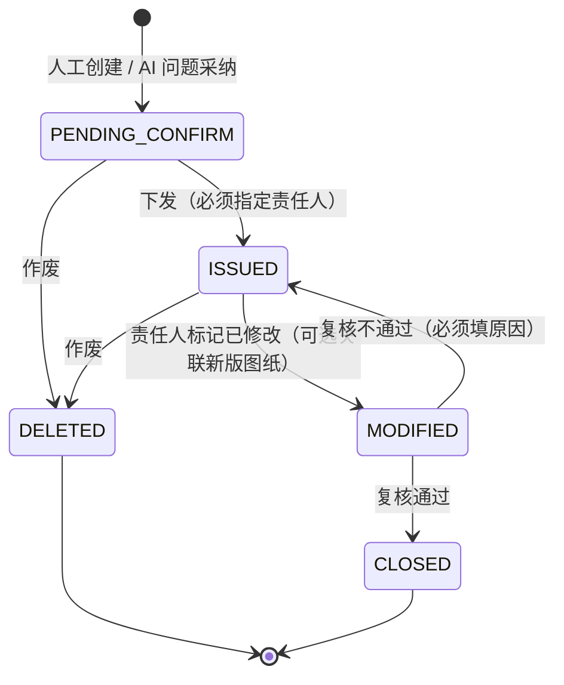

# prd-03 批注与协同

| 项 | 内容 |
| :--- | :--- |
| 模块编号 | M03 |
| 优先级 | P0 |
| 对应总 PRD | §6.2 状态机、§8.3、§10.1 坐标契约 |
| 主要读者 | 前端、后端 |
| 预估工作量 | 前端 8 人日 / 后端 6 人日 |

---

## 1. 模块目标

1. 用户能在图纸上**用鼠标画出问题位置**，并写清问题是什么、由谁改。
2. 每条批注有完整生命周期：待确认 → 已下发 → 已修改待复核 → 已关闭，每次变更留痕。
3. 一个批注 = 一个讨论串（评论 + 状态变更 + 指派变更 + 版本变更，同一条时间线）。
4. 状态变更必须触发站内信（见 prd-04），形成"有人改了 → 有人知道"的闭环。

**不做**：多人同时编辑同一批注的冲突合并（用乐观锁 + 最后写入生效）、批注跨版本自动迁移、图纸上直接改图、语音/视频批注、@ 提及（V1.5）。

---

## 2. 用户故事

| ID | 故事 | 验收要点 |
| :--- | :--- | :--- |
| US-03-1 | 我要在图纸上框出问题位置，不想写"第三跨梁"这种话让对方猜 | 矩形框/点/文字三种工具可用，框可调可删 |
| US-03-2 | 我确认 AI 的问题后，位置上应该已经画好框，我不想重画 | 采纳后批注自带 `location`，画布直接渲染 |
| US-03-3 | 我要把批注发给负责的设计师 | 指派成员 + 下发，状态变"已下发"，对方收到站内信 |
| US-03-4 | 设计师说改完了，我要复核 | 状态转"已修改待复核"，我能看到时间线里谁在什么时候提交 |
| US-03-5 | 我要一次把 20 条小问题关闭 | 批量关闭，全部成功或全部失败 |
| US-03-6 | 我要知道这条意见是基于哪一版图纸提的 | 图纸换版后批注显示 `基于 v1` 徽标 |

---

## 3. 页面结构与路由

| 路由 | 说明 |
| :--- | :--- |
| `/projects/:pid/drawings/:did` | **图纸批注主页**（画布 + 右侧批注面板） |
| `/annotations` | 全量批注列表（跨项目，支持指派给我 / 状态 / 严重度筛选） |
| `/annotations/:id` | 批注详情独立页（可选，主要用于消息跳转兜底） |

### 3.1 主界面布局

```
┌────────────────────────────────────────────────────────────────────────┐
│ 面包屑：项目 / 图纸名 v2   [版本▾]                  [上传新版本] [导出] │
├───────────────────────────────┬────────────────────────────────────────┤
│ 工具条（左侧竖排 48px）       │ 批注面板 380px                         │
│  ▸ 选择/平移                  │ ┌ 标签页: 全部(12) 待确认(3) 已下发(5) ┐│
│  ▸ 矩形框 [R]                 │ │ 筛选: 严重度▾ 专业▾ 指派▾            ││
│  ▸ 点标记 [P]                 │ ├──────────────────────────────────────┤│
│  ▸ 文字   [T]                 │ │ ● #1 严重  3层疏散宽度不足            ││
│  ▸ 自由画笔 [F] (仅 DXF)      │ │   已下发 · 张三 · 2小时前             ││
│  ▸ 撤销 [Ctrl+Z]              │ ├──────────────────────────────────────┤│
│  ─────────────                │ │ ● #2 一般  门窗开启方向与立面不符      ││
│  缩放 − 100% +  适应  [全屏]  │ │   待确认 · 我 · 昨天                  ││
│  第 3/12 页  ‹ ›              │ └──────────────────────────────────────┘│
│                               │                                        │
│        PDF / DXF 画布         │  [新建批注]（工具选中后可拉框创建）     │
└───────────────────────────────┴────────────────────────────────────────┘
```

---

## 4. 画布批注工具

### 4.1 工具与操作

| 工具 | 快捷键 | 交互 | 产出 `shape_type` |
| :--- | :--- | :--- | :--- |
| 选择/平移 | `V` | 点击选中批注；空白处拖拽平移；滚轮缩放 | — |
| 矩形框 | `R` | 按下拖拽 → 松开生成；最小 12×12 屏幕像素（过小则取消） | `RECT` |
| 点标记 | `P` | 单击落点，渲染为 20px 圆点 + 序号 | `POINT` |
| 文字 | `T` | 单击落点 → 就地输入（Enter 提交，Esc 取消，最多 60 字） | `TEXT` |
| 自由画笔 | `F` | 仅 DXF 开放；按下拖拽记录路径点（采样间隔 8px），闭合自动转多边形 | `FREEHAND` |
| 撤销 | `Ctrl+Z` | 撤销本次会话最后一次未提交的绘制（最多 10 步） | — |

**通用规则**

1. 工具选中后光标变为十字，画布进入绘制态，此时点击已有批注**不会**选中它（避免误触）。
2. 拉框完成后立即弹出**创建批注表单**（右侧面板内联展开，非模态弹窗，避免遮挡画布）。
3. `Esc` 取消当前绘制并回到选择工具。
4. 已有批注的选框可拖动调整：8 个控制点，拖动后 `PATCH` 更新 `location.bbox`（仅创建者可改，或 `annotation:write` 权限持有者）。
5. 删除批注需二次确认；已 `CLOSED` 的批注需管理员权限才能删除（软删除）。

### 4.2 批注在画布上的渲染

| 元素 | 规则 |
| :--- | :--- |
| 框 | 描边 2px，严重度色；填充同色 8% 透明度 |
| 序号气泡 | 框左上角外挂 20×20 圆角方块，白字，显示批注在当前列表中的序号（按严重度排序后的位置） |
| 选中态 | 描边 3px + 外发光 `0 0 0 3px rgba(24,144,255,.25)` |
| 悬停 | 浮层卡片（标题、状态、指派人、`查看详情`）；延迟 200ms 出现，移出 300ms 消失 |
| 已关闭 | 描边虚线段 + 40% 透明度；提供"显示已关闭批注"开关，默认**显示** |
| 位置异常 | 若 `location_valid=false`，不渲染框，仅在列表中标记 |

### 4.3 新建批注表单字段

| 字段 | 控件 | 必填 | 默认 | 校验与说明 |
| :--- | :--- | :--- | :--- | :--- |
| 标题 | input | 是 | 空 | 2~60 字；AutoFocus |
| 描述 | textarea | 否 | 空 | ≤ 2000 字，支持换行 |
| 严重度 | 单选按钮组 | 是 | `MINOR` | 严重/主要/一般/提示 |
| 专业 | 下拉 | 是 | 取当前图纸主专业（无则 `GENERAL`） | `ARCH/STRUCT/MEP/GENERAL` |
| 指派给 | 下拉（成员搜索） | 是 | 当前用户 | 仅项目成员；V1.0 默认自己 |
| 截止日期 | date | 否 | 空 | 不可早于今天 |
| 位置 | 只读摘要 | 是 | 由绘制结果带入 | 展示"第 3 页 · 框 96×48pt"或"模型空间 · handle 3F8A" |

**提交行为**：`POST /annotations` → 成功后：画布新增框 + 面板顶部插入卡片 + 面板计数 +1 + Toast "批注已创建"。表单清空但**保持工具选中状态**（方便连续标注）；`Esc` 或点"完成"退出。

---

## 5. 状态流转

### 5.1 状态机（与总 PRD §6.2 一致）



> `DELETED` 不是状态枚举，等价于 `is_deleted=true`。状态枚举仅 4 值：`PENDING_CONFIRM / ISSUED / MODIFIED / CLOSED`。

### 5.2 流转权限矩阵

| 流转 | 谁可以操作 | 附加要求 |
| :--- | :--- | :--- |
| 创建 → 待确认 | 项目成员（`annotation:write`） | — |
| 待确认 → 已下发 | 创建者 或 `ADMIN` | 必填 `assignee_id`；触发 `ANNOTATION_ASSIGNED` 事件 |
| 已下发 → 已修改待复核 | 被指派人（`assignee_id`） | 可上传新版本图纸并关联 `version_drawing_id`；触发 `ANNOTATION_SUBMITTED` 事件 |
| 已修改待复核 → 已关闭 | 创建者 或 `ADMIN` | 可填 `close_remark`；触发 `ANNOTATION_CLOSED` 事件 |
| 已修改待复核 → 已下发 | 创建者 或 `ADMIN` | **必填** `reject_reason`（10~500 字） |
| 任意 → 作废 | 创建者 或 `ADMIN` | 二次确认 |

> 越权操作统一返回 `403 FORBIDDEN`，前端按钮置灰并 tooltip 说明原因（"仅责任人可标记已修改"），不要等点击后才报错。

### 5.3 流转交互

1. 批注卡片底部有主操作按钮，内容随状态与身份变化：

| 角色 \ 状态 | 待确认 | 已下发 | 已修改待复核 | 已关闭 |
| :--- | :--- | :--- | :--- | :--- |
| 创建者 | `下发`（主）/ `编辑` | `作废` | `复核通过`（主）/ `复核不通过` | — |
| 被指派人 | — | `标记已修改`（主） | 等待复核 | — |
| 其他成员 | — | — | — | — |

2. `复核不通过` 必须填写原因，弹 Modal（textarea 10~500 字 + 快捷原因标签"仍不符合规范/修改不彻底/改错位置"）。
3. `标记已修改` 时若存在更新的图纸版本，弹选择框："关联到 v2（新版本）？"选项：`关联 v2` / `仅标记状态`。
4. 每次流转成功后：卡片状态更新、时间线追加一条系统记录、`更新时间`刷新、Toast 提示。

### 5.4 批量流转

- 入口：批注面板顶部勾选框（鼠标移入卡片左侧出现）。
- 批量条：`已选 5 条 | 批量下发 | 批量关闭 | 取消选择`。
- 规则：批量操作**只对待选集合中状态合法的条目生效**，若存在非法条目，弹确认框列出非法项（"其中 2 条处于待确认状态，无法关闭，是否仅处理剩余 3 条？"）→ `仅处理合法项` / `取消`。
- 后端口径：`POST /annotations/batch-transition` 默认**严格模式**（有一条非法则整体 409 并返回非法明细）；前端确认"仅处理合法项"后带 `skip_invalid=true` 重试。两种模式都必须可用。

### 5.5 数据权限校验（Service 层，研发必读，不可遗漏）

> **这是本项目最容易漏的一处。** 第 5.2 节的 `require("annotation:transition")` 只回答"这个角色有没有流转批注的能力"，**不回答"能不能动这一条"**。如果不做本节的数据级判断，任何 `REVIEWER` 都能改别人项目的批注——线上事故级漏洞。

#### 5.5.1 两层校验的分工（必须区分清楚）

| 层 | 手段 | 校验内容 | 漏了会怎样 |
| :--- | :--- | :--- | :--- |
| **功能权限** | FastAPI 依赖 `Depends(require("annotation:transition"))` | 当前用户的角色是否具备该权限码 | 越权调用接口（低危：所有 REVIEWER 都有） |
| **数据权限** | **Service 层显式判断**（本节） | 当前用户与**这条记录**的关系（是否责任人/创建者/项目成员） | **横向越权**：改别人的批注、读别人项目的图纸（高危） |

#### 5.5.2 校验清单（逐条实现，逐条写单测）

| 操作 | 数据级条件 | 违反时返回 | 说明 |
| :--- | :--- | :--- | :--- |
| 查看批注详情 | `user` 是 `annotation.project_id` 的项目成员 | `403 NOT_PROJECT_MEMBER` | 非成员连项目都进不去 |
| 创建批注 | 项目成员 + 图纸属于该项目 | `403` / `422` | 防止把批注挂到别的项目图纸上 |
| 编辑标题/描述/位置 | `creator_id == user.id` 或 `ADMIN` | `403 FORBIDDEN` | **只有创建者能改自己写的内容** |
| **`ISSUE`（下发）** | `creator_id == user.id` 或 `ADMIN` | `403 FORBIDDEN` | 不能替别人下发 |
| **`MARK_MODIFIED`（标记已修改）** | **`assignee_id == user.id`** | `403 FORBIDDEN`（文案："仅责任人可标记已修改"） | **本节最关键的一条** |
| **`CLOSE`（复核通过）** | `creator_id == user.id` 或 `ADMIN` | `403 FORBIDDEN` | 谁提的谁复核，防止责任人自己关自己 |
| **`REJECT_AND_REISSUE`** | 同 `CLOSE` | `403 FORBIDDEN` | |
| **`DELETE`（作废）** | `creator_id == user.id` 或 `ADMIN`；若已 `CLOSED` 则仅 `ADMIN` | `403 FORBIDDEN` | |
| 编辑评论 | `comment.author_id == user.id` 且 5 分钟内 | `403` / `422` | 超时不允许删 |
| 批量流转 | 逐条按上表校验；`skip_invalid=false` 时任一失败整体 409 | `409` + `invalid_items[]` | **必须逐条校验，不能只校验第一条** |
| 指派（`assignee_id`） | 被指派人必须是项目成员 | `422 VALIDATION_ERROR` | 防止指派给外部人 |

#### 5.5.3 实现范式（照抄，别自己发明）

```python
# app/services/annotation_service.py
from app.core.errors import ForbiddenError, ValidationError
from app.models import User, Annotation, AnnotationStatus, TransitionAction

# 动作 → 允许的角色关系；返回 None 表示该用户无权执行
def _ensure_action_allowed(ann: Annotation, user: User, action: TransitionAction) -> None:
    is_creator = ann.creator_id == user.id
    is_assignee = ann.assignee_id == user.id
    is_admin = user.is_admin

    match action:
        case TransitionAction.ISSUE:
            ok = is_creator or is_admin
        case TransitionAction.MARK_MODIFIED:
            ok = is_assignee or is_admin          # ← 责任人专属，ADMIN 兜底
        case TransitionAction.CLOSE | TransitionAction.REJECT_AND_REISSUE:
            ok = is_creator or is_admin
        case TransitionAction.DELETE:
            ok = is_admin if ann.status is AnnotationStatus.CLOSED else (is_creator or is_admin)
        case _:
            ok = False

    if not ok:
        # 文案必须说清"为什么不行"，前端直接展示
        raise ForbiddenError(
            code="FORBIDDEN",
            message=_deny_message(action, is_assignee, is_creator),
            detail={"action": action.value, "assignee_id": str(ann.assignee_id)},
        )


async def transition(ann_id: UUID, req: AnnotationTransitionRequest, user: User, db) -> Annotation:
    # 1) 取记录（带项目成员校验）
    ann = await repo.get_or_404(ann_id, db)
    await assert_project_member(ann.project_id, user, db)      # 数据权限①：项目归属

    # 2) 功能权限由依赖注入已校验（annotation:transition）→ 此处不重复

    # 3) 数据权限②：动作与身份的关系
    _ensure_action_allowed(ann, user, req.action)

    # 4) 乐观锁
    if ann.row_version != req.row_version:
        raise ConflictError(detail={"row_version": ann.row_version})

    # 5) 状态机合法性（与第 5.1 节一致，非法返回 422）
    _ensure_transition_legal(ann.status, req.action)

    # 6) 执行 + 写状态日志 + 发领域事件（同一事务）
    return await repo.apply_transition(ann, req, user, db)


async def batch_transition(ids: list[UUID], req: BatchTransitionRequest, user: User, db):
    anns = await repo.get_many(ids, db)
    invalid: list[dict] = []

    for ann in anns:
        try:
            await assert_project_member(ann.project_id, user, db)
            _ensure_action_allowed(ann, user, req.action)       # ← 逐条校验，不能省
            _ensure_transition_legal(ann.status, req.action)
        except (ForbiddenError, ValidationError) as e:
            invalid.append({"annotation_id": str(ann.id), "reason": e.message})

    if invalid and not req.skip_invalid:
        raise ConflictError(code="BATCH_PARTIAL_INVALID", detail={"invalid_items": invalid})

    ok_ids = [a.id for a in anns if str(a.id) not in {i["annotation_id"] for i in invalid}]
    return await repo.apply_batch(ok_ids, req, user, db)
```

#### 5.5.4 必须有的单测（进 CI，不通过不许合）

| # | 用例 | 期望 |
| :--- | :--- | :--- |
| T1 | A 是创建者，A 对 `ISSUED` 批注执行 `MARK_MODIFIED` | `403`（不是责任人） |
| T2 | B 是责任人，B 执行 `MARK_MODIFIED` | `200` |
| T3 | C 不是项目成员，直接调接口改任意批注 | `403 NOT_PROJECT_MEMBER` |
| T4 | B 是责任人但非创建者，B 执行 `CLOSE` | `403` |
| T5 | ADMIN 对自己的批注执行任意动作 | `200` |
| T6 | 批量 5 条中第 3 条非本人责任 → `skip_invalid=false` | `409` 且批注表零变更 |
| T7 | 同上，改为 `skip_invalid=true` | 4 条成功，1 条保持原状 |
| T8 | 指派给非项目成员 | `422` |

> **代码审查红线**：`transition` / `batch_transition` / `PATCH /annotations/{id}` 三个入口，若代码里找不到 `_ensure_action_allowed`（或等价的显式判断），直接打回。仅靠 `Depends(require(...))` 一律视为未实现。

#### 5.5.5 前端配合（不替代后端）

`allowed_actions` 由后端计算下发（见 §8），前端**只负责渲染按钮**；按钮置灰只是体验，不是安全。任何人手工构造请求都必须被 5.5.3 拦住。


---

## 6. 批注面板与时间线

### 6.1 面板列表卡片

| 元素 | 内容 |
| :--- | :--- |
| 左侧色条 | 严重度色，4px |
| 序号 | 圆圈数字，与画布气泡一致 |
| 标题 | 单行省略，hover 全文 |
| 元信息行 | `状态标签 · 指派人 · 相对时间` |
| 徽标 | `AI`（source=AI）、`基于 v1`（版本落后）、`逾期`（超 due_date 且未关闭） |
| 悬停操作 | `定位`（平移画布）`编辑` `删除` |

**排序**：`severity DESC, updated_at DESC`；**分组**：可按"状态"或"专业"分组折叠（默认不分组）。

### 6.2 时间线条目类型

| 类型 `log_type` | 图标 | 文案模板 | 数据来源 |
| :--- | :--- | :--- | :--- |
| `CREATED` | ＋ | "{用户} 创建了批注" | `annotation_status_logs` |
| `STATUS_CHANGED` | ⇄ | "{用户} 将状态从 {from} 改为 {to}" | 同上 |
| `ASSIGNED` | 👤 | "{用户} 将批注指派给 {target}" | 同上 |
| `COMMENT` | 💬 | "{用户}：{内容}" | `annotation_comments` |
| `VERSION_LINKED` | 📎 | "{用户} 关联到图纸 v2" | `annotation_status_logs` |
| `CLOSED` | ✓ | "{用户} 关闭了批注：{remark}" | 同上 |

- 排序：时间正序（最早在上），最新一条在底部输入框上方。
- 状态变更条目左侧竖线用状态色，形成视觉流向。
- 禁止编辑历史（审计要求）；评论可在 5 分钟内自行删除（软删除，显示"该评论已删除"）。

### 6.3 评论

- 输入框置底，`Enter` 发送 / `Shift+Enter` 换行，≤ 1000 字。
- 已关闭批注：评论框禁用，提示"批注已关闭，如需补充请重新打开"（V1.0 不提供"重新打开"入口，避免状态回退污染统计）。

### 6.4 版本提示

- 若 `annotation.drawing_version < drawing.current_version`，卡片显示黄色徽标 `基于 v1`，hover："该批注创建于 v1，当前图纸为 v2，位置可能已偏移"。
- 点击徽标弹出说明，不做自动迁移。
- 图纸右上角版本下拉：可切到历史版本**只读查看**（批注仍显示，标注"历史版本"）。

---

## 7. 枚举汇总

| 枚举 | 值 |
| :--- | :--- |
| `annotation.status` | `PENDING_CONFIRM` 待确认 / `ISSUED` 已下发 / `MODIFIED` 已修改待复核 / `CLOSED` 已关闭 |
| `annotation.source` | `HUMAN` 人工创建 / `AI` AI 采纳 |
| `shape_type` | `RECT` / `POINT` / `TEXT` / `FREEHAND` |
| `severity` | `BLOCKER` / `MAJOR` / `MINOR` / `INFO` |
| `discipline` | `ARCH` / `STRUCT` / `MEP` / `GENERAL` |
| `log_type` | `CREATED` / `STATUS_CHANGED` / `ASSIGNED` / `COMMENT` / `VERSION_LINKED` / `CLOSED` / `DELETED` |

---

## 8. 数据字段（`annotation` 主体）

| 字段 | 类型 | 说明 |
| :--- | :--- | :--- |
| `id` | uuid | 主键 |
| `project_id` | uuid | 冗余，便于按项目统计 |
| `drawing_id` | uuid | 所属图纸 |
| `drawing_version` | int | 创建时图纸版本号（用于"基于 v1"提示） |
| `issue_id` | uuid? | 来源 AI 问题，人工创建为 null |
| `source` | enum | `HUMAN` / `AI` |
| `shape_type` | enum | 见 §7 |
| `location` | jsonb | 坐标契约，见总 PRD §10.1 |
| `location_valid` | bool | 后端校验坐标是否在图纸范围内 |
| `title` | varchar(60) | 必填 |
| `content` | text? | 描述 |
| `severity` | enum | 必填 |
| `discipline` | enum | 必填 |
| `status` | enum | 必填，默认 `PENDING_CONFIRM` |
| `assignee_id` | uuid? | 下发时必填 |
| `creator_id` | uuid | 创建者 |
| `due_date` | date? | 截止日期 |
| `version_drawing_id` | uuid? | 标记已修改时关联的新版图纸 |
| `close_remark` | text? | 关闭说明 |
| `closed_at` | datetime? | 关闭时间（统计口径） |
| `is_deleted` | bool | 软删除 |
| `created_at` / `updated_at` | datetime | |
| `row_version` | int | 乐观锁，每次更新 +1 |

**API 响应附加字段**：`status_text`（中文）、`severity_text`、`discipline_text`、`assignee_name`、`creator_name`、`comment_count`、`is_stale_version`（bool）、`allowed_actions`（string[]，当前用户在本条批注上可执行的动作，前端据此渲染按钮，避免前端硬编码权限逻辑）。

> `allowed_actions` 是本模块降低前端复杂度与越权风险的关键设计，取值：`ISSUE` / `MARK_MODIFIED` / `CLOSE` / `REJECT_AND_REISSUE` / `EDIT` / `DELETE` / `COMMENT`。

---

## 9. 依赖接口

| 方法 | 路径 | 说明 |
| :--- | :--- | :--- |
| POST | `/api/v1/annotations` | 创建批注 |
| GET | `/api/v1/annotations` | 列表（`project_id`/`drawing_id`/`status`/`severity`/`assignee`/`keyword`） |
| GET | `/api/v1/annotations/{id}` | 详情（含 `allowed_actions` 与时间线分页） |
| PATCH | `/api/v1/annotations/{id}` | 编辑标题/描述/严重度/专业/指派人/位置（必须带 `row_version`） |
| POST | `/api/v1/annotations/{id}/transition` | 单条流转（`action` + `row_version` + 附加字段，见 prd-07 §6.7） |
| POST | `/api/v1/annotations/batch-transition` | 批量流转（`annotation_ids[]` + `action` + `skip_invalid`） |
| DELETE | `/api/v1/annotations/{id}` | 软删除（作废） |
| POST | `/api/v1/annotations/{id}/comments` | 发表评论 |
| GET | `/api/v1/annotations/{id}/timeline` | 时间线（评论 + 日志合并分页） |
| DELETE | `/api/v1/annotations/comments/{comment_id}` | 删除本人评论（5 分钟内） |
| GET | `/api/v1/projects/{id}/members` | 指派人下拉数据源 |

**并发控制**：`PATCH` 与 `transition` 请求体必须带 `row_version`；版本不一致返回 `409 CONFLICT` + 最新数据，前端提示"该批注已被他人修改，已为你刷新"，并刷新卡片内容。

---

## 10. 异常场景

| 场景 | 表现 | 兜底 |
| :--- | :--- | :--- |
| 绘制框过大/过小 | 拉框时实时显示尺寸；< 12px 松开后取消并 Toast "框太小，请重新绘制" | — |
| 框超出图纸范围 | 自动裁剪到页边界内 | 后端二次校验并置 `location_valid` |
| 未填写标题提交 | 标题输入框标红 + "请输入批注标题" | 阻止提交 |
| 下发时未选指派人 | 下拉标红 + "请选择责任人" | 阻止提交 |
| 被指派人已被移出项目 | 下发时校验成员有效性 → "该成员已不在项目中，请重新选择" | — |
| 编辑时他人在改 | 409 → 提示并刷新 | — |
| 批量流转存在非法项 | 409 + `invalid_items[]` → 确认框 → 可仅处理合法项 | 后端 `skip_invalid` |
| 批注位置所在页不存在（图纸换版页数变少） | 列表行标"位置失效"，`定位`置灰，hover 提示"该批注所在页在新版本中不存在" | — |
| 画布加载失败 | 显示"图纸加载失败" + 重试；批注面板仍可查看列表 | — |
| 网络断开时提交 | 请求失败 Toast "保存失败，请检查网络"，保留表单内容 | 提供重试 |

---

## 11. 埋点

| 事件 | 参数 |
| :--- | :--- |
| `annotation.created` | `source`, `shape_type`, `severity` |
| `annotation.transition` | `from`, `to`, `batch_size` |
| `annotation.comment.created` | `annotation_id` |
| `annotation.located` | `source=list\|canvas\|notification` |
| `annotation.closed` | `source`, `days_open`（北极星指标来源） |
| `annotation.conflict` | `api` |

---

## 12. 验收标准

**绘制**

- [ ] 矩形/点/文字三种工具均可创建批注，`Esc` 可取消，`Ctrl+Z` 可撤销未提交的框
- [ ] 12px 以下的小框在松开后被取消并提示
- [ ] 框绘制在任意缩放（50%/100%/200%）下，重新加载后位置与图纸内容对齐，偏差 ≤ 5px
- [ ] DXF 自由画笔可用，其他类型不显示该工具
- [ ] 拖动框的控制点修改位置后刷新页面，位置持久化

**状态机**

- [ ] 4 个状态、6 种合法流转全部可执行且时间线各生成一条记录
- [ ] 待确认 → 已下发 未选指派人时被前端阻止，绕过前端调接口返回 422
- [ ] 复核不通过未填原因时被阻止（前后端双重校验，原因 < 10 字也拦截）
- [ ] `allowed_actions` 与实际按钮一致：把用户从项目移除后重新登录，其对已下发批注不再出现 `标记已修改`
- [ ] 越权操作返回 403，前端按钮已置灰且 tooltip 说明原因
- [ ] 批量关闭 5 条合法 + 1 条非法：默认整体 409 并返回非法明细；选"仅处理合法项"后 5 条关闭，1 条保持原状

**时间线与版本**

- [ ] 评论与状态变更按时间正序合并展示，图标与文案符合 §6.2
- [ ] 5 分钟后无法删除自己的评论
- [ ] 上传 v2 后，v1 上的批注显示 `基于 v1` 徽标，切到历史版本仍能看到批注
- [ ] `标记已修改` 时选择"关联 v2"，时间线出现 `VERSION_LINKED` 记录

**并发**

- [ ] 两个标签页同时编辑同一条批注，后者提交返回 409 并自动刷新

**性能**

- [ ] 单图纸 200 条批注时画布渲染与交互掉帧 ≤ 5%
- [ ] 创建批注接口 P95 < 300ms；时间线首屏 < 500ms
