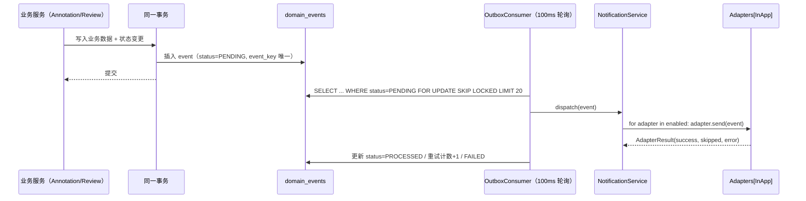

# prd-04 站内消息中心

| 项 | 内容 |
| :--- | :--- |
| 模块编号 | M04 |
| 优先级 | P0 |
| 对应总 PRD | §6.3 触达链路、§8.4、§10.3 事件与适配器 |
| 主要读者 | 前端、后端 |
| 预估工作量 | 前端 4 人日 / 后端 5 人日 |

---

## 1. 模块目标

1. 用户**只在自己需要动手时**被通知，其余一律不吵。
2. 通知一定送达（业务事务成功 ⇒ 消息一定落库），一定不重复（幂等）。
3. 点一条消息，**能直接落到那条批注或那个问题**上，不用自己找。
4. 架构上把"发消息"抽象成事件 + 适配器，V1.5 接飞书时只加一个 Adapter，业务代码零改动。

**不做**：外部 IM 实际推送、邮件/短信、消息免打扰时段、消息撤回、@ 提及、消息搜索（V1.0 只做类型筛选）。

---

## 2. 用户故事

| ID | 故事 | 验收要点 |
| :--- | :--- | :--- |
| US-04-1 | 我不在系统里的时候，别人把批注下发给我，我回来后要能看到 | 登录后角标显示未读数 |
| US-04-2 | 我点一下消息就要到那条批注上 | 跳转后批注被高亮，画布定位到对应页 |
| US-04-3 | 我不想一条条点已读 | 有"全部已读" |
| US-04-4 | 我不想被已关闭的旧消息反复打扰 | 已读消息不再进入未读列表，角标只统计未读 |
| US-04-5 | 我希望以后能收到飞书提醒 | 偏好页能看到"飞书（即将开放）"占位 |

---

## 3. 页面结构与路由

| 位置 | 说明 |
| :--- | :--- |
| 顶栏铃铛 | 全局常驻，未读角标 |
| `/notifications` | 消息中心列表页（顶部 Tab：全部 / 未读 / 系统） |
| `/settings/notifications` | 通知偏好（只读展示 + 飞书禁用占位） |

**铃铛交互**

1. 点击铃铛 → 弹出**最近 5 条**消息浮层（宽 360px，最大高 480px），底部"查看全部"。
2. 浮层标题栏：`通知` + 右侧 `全部已读` 文字按钮（无未读时置灰）。
3. 点击某条消息 → 标记已读 → 收起浮层 → 跳转 `deeplink`。
4. 再次点击铃铛关闭浮层；点击浮层外部关闭；`Esc` 关闭。

---

## 4. 通知类型矩阵（唯一权威定义）

| `type` | 触发时机 | 接收人 | 标题模板 | 摘要模板 | `biz_type` | deeplink |
| :--- | :--- | :--- | :--- | :--- | :--- | :--- |
| `REVIEW_COMPLETED` | 预审任务 `SUCCEEDED` | 任务发起人 | `预审完成：{drawing_name}` | `发现 {total} 个问题，其中严重 {blocker} 个` | `REVIEW_TASK` | `/projects/{pid}/drawings/{did}/review/{taskId}` |
| `REVIEW_FAILED` | 预审任务 `FAILED` | 任务发起人 | `预审失败：{drawing_name}` | `{error_reason}，请重试` | `REVIEW_TASK` | `/projects/{pid}/drawings/{did}/review/{taskId}` |
| `ANNOTATION_ASSIGNED` | 批注 `ISSUED`（指派给我） | 被指派人 | `新批注待处理：{title}` | `{creator_name} 在 {drawing_name} 下发：{severity_text}` | `ANNOTATION` | `/projects/{pid}/drawings/{did}?annotation={aid}&focus=1` |
| `ANNOTATION_SUBMITTED` | 批注 `MODIFIED` | 批注创建者 | `批注待复核：{title}` | `{assignee_name} 已标记修改，请复核` | `ANNOTATION` | 同上 |
| `ANNOTATION_CLOSED` | 批注 `CLOSED` | 创建者 + 指派人（去重，不含操作者本人） | `批注已关闭：{title}` | `{operator_name} 复核通过` | `ANNOTATION` | 同上 |
| `MEMBER_ADDED` | 被加入项目 | 新成员 | `你已加入项目：{project_name}` | `{operator_name} 邀请你参与该项目` | `PROJECT` | `/projects/{pid}` |
| `HITL_PENDING` | **预审进入中断（V1.0）** | 中断处理人（`assignee_id`，为空则项目内审图角色） | `预审已暂停，等你确认：{drawing_name}` | `{n} 项风险待确认，24 小时内有效` | `ANNOTATION`（复用，`biz_id`=interrupt_id） | `/projects/{pid}/drawings/{did}/review/{taskId}?interrupt={iid}` |
| `REPORT_READY` | **报告初稿完成（V1.0）** | 同上 | `报告初稿已生成：{drawing_name}` | `共 {n} 个问题，请确认是否输出正式文档` | `ANNOTATION` | `/projects/{pid}/drawings/{did}/review/{taskId}/report` |
| `SYSTEM` | 管理员广播 / 运维提示 | 指定用户 | 自定 | 自定 | `SYSTEM` | 可空（空则不跳转） |

**不发送通知的场景（重要，防打扰）**

- 自己操作产生的消息（自己下发给自己的批注、自己关闭的批注）→ 跳过。
- **例外（V1.0）**：`HITL_PENDING` 与 `REPORT_READY` **即使操作人是自己也要发**——这两类消息的作用不是"告知别人改了"，而是"提醒你流程正卡着等你"，跳过就等于把流程挂死。
- 批量操作一次生成 N 条消息时，若接收人相同且 `type` 相同 → 合并为 1 条，标题变为 `{n} 条批注待处理`，摘要列举前 2 条标题 + "等 N 条"，deeplink 指向批注列表页（`/annotations?assignee=me&status=ISSUED`）。合并窗口 60 秒。`HITL_PENDING` **不参与合并**（一次运行最多两处中断，无合并必要，且合并会丢失 interrupt_id）。

---

## 5. 未读角标

| 项 | 规则 |
| :--- | :--- |
| 数值 | `COUNT(notifications WHERE user_id=me AND is_read=false AND is_deleted=false)` |
| 展示 | `1~99` 显示数字；`≥100` 显示 `99+`；`0` 时铃铛无角标（显示空心铃铛） |
| 刷新 | 前端 **30s 轮询** `GET /notifications/unread-count`；页面从后台切回前台（`visibilitychange`）立即拉一次 |
| 实时性 | 事件产生 → 落库 < 1s（Outbox 消费者 100ms 轮询）；前端最多延迟 30s（已知妥协，V1.5 换 SSE） |
| 异常 | 轮询失败**不弹错**，静默重试；连续失败 3 次后置为降级状态（不再轮询，直到下次页面切换或手动刷新） |

---

## 6. 消息中心列表页

### 6.1 Tabs

| Tab | 条件 | 角标 |
| :--- | :--- | :--- |
| 全部 | 全部未删除消息 | — |
| 未读 | `is_read=false` | 显示未读数 |
| 系统 | `type=SYSTEM` | — |

### 6.2 列表列定义

| 列 | 宽 | 内容与规则 |
| :--- | :--- | :--- |
| 未读标记 | 8px | 未读时左侧蓝色竖条 `#1890FF`；已读无 |
| 类型图标 | 40px | 预审=紫色文档、批注=蓝色对话、复核=橙色时钟、项目=灰色用户、系统=灰色喇叭 |
| 标题 + 摘要 | flex | 标题单行（已读时常规字重，未读时 600）；摘要灰色 13px 单行省略 |
| 类型 | 100px | 中文：`AI 预审` / `批注` / `系统` |
| 时间 | 140px | 相对时间（`3 分钟前`），hover 绝对时间 |
| 操作 | 80px | 单条 `标记已读`（已读时隐藏） |

- 点击整行 = 标记已读 + 跳转。
- 分页 20 条，滚动到底自动加载（无限滚动）；到底显示"没有更多了"。
- 空态：`全部` Tab 显示"暂无消息"；`未读` Tab 显示"全部已读，干得漂亮"。

### 6.3 顶部操作区

| 按钮 | 行为 |
| :--- | :--- |
| `全部已读` | 二次确认（"将 12 条未读标记为已读？"）→ `POST /notifications/read-all` → 列表全部转为已读，角标清零 |
| `筛选 ▾` | 按类型（预审/批注/系统）与时间范围（近 7 天/近 30 天）筛选 |

---

## 7. 跳转逻辑（deeplink 契约）

```json
{
  "biz_type": "ANNOTATION",
  "biz_id": "a1b2c3d4-...",
  "deeplink": "/projects/p-001/drawings/d-002?annotation=a1b2c3d4&focus=1"
}
```

**前端处理流程**

1. 点击消息 → `POST /notifications/{id}/read`（失败不阻断跳转）。
2. 解析 `deeplink`：**必须以 `/` 开头且不包含 `://`**，否则视为非法，降级为跳 `/notifications`（防开放重定向）。
3. `router.push(deeplink)`。
4. 目标页读取 `focus=1` 与 `annotation` 参数：
   - 画布加载完成后自动定位到该批注并高亮 3 秒（脉冲动画）。
   - 若该批注已被删除/位置失效 → Toast "该批注已不存在或位置失效"，页面正常打开。
   - 若当前用户无该项目权限 → 403 空状态页，提示"你已不在该项目中"。
5. 跳转成功后从 DOM 移除该未读态，角标数 −1（本地乐观更新，失败则下次轮询校正）。

**防坑清单**

- 同一消息重复点击：第二次直接跳转，重复标记已读接口返回 200（幂等）。
- 目标对象已删除：`biz_id` 不存在时接口仍返回消息体（消息不删），前端按上条规则降级。
- 深链在未登录时打开：先登录，登录成功后回到 deeplink。

---

## 8. 通知偏好页

`/settings/notifications`

| 渠道 | 状态 | 说明 | 控件 |
| :--- | :--- | :--- | :--- |
| 站内信 | 已启用 | 顶部红点与消息中心 | 开关（**禁用**，不可关闭，MVP 唯一渠道，tooltip "当前版本必须开启"） |
| 飞书 | 即将开放 | V1.5 支持，绑定后可在飞书接收审批与复核提醒 | 开关（禁用）+ `绑定飞书` 按钮（禁用，点击 Toast "V1.5 开放"） |
| 邮件摘要 | 规划中 | 每日 18:00 汇总未处理批注 | 开关（禁用） |

**事件级订阅**（V1.0 展示但全部只读）：预审完成 / 批注下发 / 批注待复核 / 批注关闭 —— 均为"站内信 ✓"。

> 这一页在 MVP 的价值是**证明架构预留**，不是让用户配置。因此所有控件禁用态必须有明确文案，不能点了没反应。

---

## 9. 事件与适配器架构（后端实现要求）

### 9.1 流程



### 9.2 `domain_events` 字段

| 字段 | 类型 | 说明 |
| :--- | :--- | :--- |
| `id` | uuid | 主键 |
| `event_key` | varchar(200) unique | `{event_type}:{aggregate_id}:{version}`，幂等键 |
| `event_type` | enum | `REVIEW_COMPLETED` 等（见 §4） |
| `aggregate_type` | varchar(40) | `ANNOTATION` / `REVIEW_TASK` / `PROJECT` |
| `aggregate_id` | uuid | 聚合根 ID |
| `project_id` | uuid? | 便于按项目筛查 |
| `actor_id` | uuid? | 操作人（用于"不通知自己"） |
| `payload` | jsonb | 渲染消息所需的全部快照数据（**不依赖后续再查库**） |
| `status` | enum | `PENDING` / `PROCESSING` / `PROCESSED` / `FAILED` |
| `retry_count` | int | 默认 0，上限 3 |
| `next_retry_at` | datetime? | 指数退避：+1s / +4s / +16s |
| `error_message` | text? | 最后失败原因 |
| `created_at` / `processed_at` | datetime | |

### 9.3 适配器接口

```python
class NotificationAdapter(ABC):
    name: str
    enabled: bool

    @abstractmethod
    async def send(
        self, event: DomainEvent, targets: list[NotifyTarget]
    ) -> AdapterResult: ...

@dataclass
class NotifyTarget:
    user_id: UUID
    title: str
    content: str
    type: NotificationType
    biz_type: str
    biz_id: UUID
    deeplink: str | None
    prefs: dict | None      # 读取 notification_preferences 后注入

@dataclass
class AdapterResult:
    success: bool
    delivered: int
    skipped: int
    error: str | None
```

- `InAppAdapter.send`：批量 `INSERT INTO notifications`，按 `(user_id, event_key)` 唯一约束去重。
- `FeishuAdapter`（V1.5 占位）：类存在、`enabled=False`、`send` 抛 `NotImplementedError`，这样 V1.5 只改这一个文件。
- 适配器注册表：`ADAPTERS = [InAppAdapter()]`，由 `settings.NOTIFICATION_ADAPTERS` 控制（默认 `["inapp"]`）。

### 9.4 `notification_preferences` 表（V1.5 预留，V1.0 只读）

| 字段 | 类型 | 说明 |
| :--- | :--- | :--- |
| `id` | uuid | 主键 |
| `user_id` | uuid | 用户 |
| `channel` | enum | `INAPP` / `FEISHU` / `EMAIL` |
| `enabled` | bool | 是否启用该渠道 |
| `target` | varchar(500)? | 飞书 user_id / 群 webhook URL / 邮箱地址（加密存储） |
| `event_types` | jsonb | 订阅的事件类型数组，空数组=订阅全部 |
| `created_at` / `updated_at` | datetime | |

V1.0 初始化：每个用户 1 条 `channel=INAPP, enabled=true`。

---

## 10. 依赖接口

| 方法 | 路径 | 说明 |
| :--- | :--- | :--- |
| GET | `/api/v1/notifications?tab=&type=&page=` | 消息列表 |
| GET | `/api/v1/notifications/unread-count` | 未读数（轻量，仅返回 `{count}`） |
| GET | `/api/v1/notifications/recent?limit=5` | 铃铛浮层用 |
| POST | `/api/v1/notifications/{id}/read` | 单条已读（幂等） |
| POST | `/api/v1/notifications/read-all` | 全部已读 |
| GET | `/api/v1/notifications/preferences` | 偏好读取 |
| PUT | `/api/v1/notifications/preferences` | 偏好更新（V1.0 仅允许改 `event_types`，`channel/INAPP` 不可关） |

---

## 11. 异常场景

| 场景 | 表现 | 兜底 |
| :--- | :--- | :--- |
| 事件消费失败 | 不影响业务主流程；重试 3 次后 `FAILED` 落日志并告警 | 提供管理员重放脚本 |
| 重复事件 | `event_key` 唯一约束拒绝；消费者跳过 | 幂等 |
| 消息已读接口失败 | 前端仍跳转，角标下次轮询校正 | 不做阻塞 |
| deeplink 非法 | 降级跳 `/notifications` | 后端下发前校验格式 |
| 目标批注已删除 | Toast "该批注已不存在" + 页面正常打开 | — |
| 用户无目标项目权限 | 403 页 + "你已不在该项目中" | 消息仍保留（可追溯） |
| 未读数接口超时 | 角标不显示（不显示 0，避免误导），铃铛图标正常 | 静默重试 |
| 一次批量下发 20 条 | 合并为 1 条"20 条批注待处理" | 合并窗口 60s |

---

## 12. 埋点

| 事件 | 参数 |
| :--- | :--- |
| `notification.created` | `type`, `channel` |
| `notification.read` | `type`, `channel_is_inapp` |
| `notification.click` | `type`, `biz_type`, `jump_success` |
| `notification.read_all` | `count` |
| `notification.badge.poll_failed` | `retry` |
| `notification.event.consumed` | `event_type`, `status`, `duration_ms` |

---

## 13. 验收标准

**触达与幂等**

- [ ] 批注下发后 1 秒内 `notifications` 表出现对应记录（用 DB 直查验证）
- [ ] 自己下发给自己的批注**不产生**消息
- [ ] 同一 `event_key` 重复投递只产生 1 条消息
- [ ] 消费者失败 3 次后事件置 `FAILED`，业务主流程不受影响（下单/下发仍成功）
- [ ] 一次性批量下发 20 条给同一人，最终只产生 1 条"20 条批注待处理"

**角标**

- [ ] 未读数与 DB `COUNT` 一致；`100+` 时显示 `99+`
- [ ] 30s 内自动刷新（改库后等待观察）
- [ ] 页面从后台切回前台立即刷新
- [ ] 轮询连续失败不弹错误框

**列表与跳转**

- [ ] 6 列齐全，未读有左侧蓝条且标题加粗
- [ ] 点击消息变已读（角标 −1、蓝条消失）并跳转正确页面
- [ ] 跳转后目标批注被高亮 3 秒，画布翻到正确页（100% 缩放下无偏移）
- [ ] `deeplink` 被篡改为 `https://evil.com` 时降级跳 `/notifications`
- [ ] 目标批注被删除后点击消息，Toast 提示且不白屏
- [ ] 全部已读：二次确认 → 角标清零、列表全部变已读
- [ ] 无限滚动加载到最后一页显示"没有更多了"

**偏好与预留**

- [ ] 偏好页三项渠道展示正确，飞书开关禁用且点击有 Toast
- [ ] 数据库 `notification_preferences` 每个用户有 1 条 `INAPP` 记录
- [ ] `FeishuAdapter` 类存在且被 `settings.NOTIFICATION_ADAPTERS` 控制（代码审查 + 单测验证：切换配置后 `dispatch` 会调用它）

**性能**

- [ ] `unread-count` 接口 P95 < 50ms
- [ ] 消息列表 500 条数据下首屏 < 300ms
