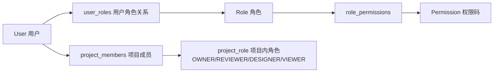

# prd-05 系统管理（用户 / 项目成员 / 权限预留）

| 项 | 内容 |
| :--- | :--- |
| 模块编号 | M05 |
| 优先级 | P1（权限骨架为 P0） |
| 对应总 PRD | §9 RBAC 预留设计 |
| 主要读者 | 后端、前端 |
| 预估工作量 | 前端 4 人日 / 后端 4 人日 |

---

## 1. 模块目标

1. 管理员能**创建用户、分配角色、禁用账号、重置密码**，不依赖直接改数据库。
2. 项目能**加人、减人**，成员有项目内角色，为 V1.5 多角色协作铺好数据。
3. 权限体系"预留"必须**可验证**：表齐、接口校验生效、前端菜单动态渲染，三项全绿。
4. V1.0 界面只暴露必要操作，角色权限矩阵只读——但**数据结构与代码路径必须是最终形态**，V2.0 只放开 UI。

**不做**：权限矩阵在线编辑、数据行级权限（按专业/区域隔离）、SSO/OAuth、组织架构树、审批流、操作审计的可视化查询（只落库）。

---

## 2. 用户故事

| ID | 故事 | 验收要点 |
| :--- | :--- | :--- |
| US-05-1 | 管理员要能新建一个审图专员账号 | 填完表单即可用该账号登录 |
| US-05-2 | 员工离职要禁用账号，但不能删数据 | 禁用后无法登录，历史批注仍可追溯 |
| US-05-3 | 新人入职忘密码，管理员能重置 | 重置后给到临时密码，用户自行修改 |
| US-05-4 | 项目里要把设计师拉进来 | 添加成员并指定项目角色 |
| US-05-5 | 我（管理员）要看清谁能干什么 | 只读的角色-权限矩阵一目了然 |

---

## 3. 页面结构与路由

| 路由 | 页面 | 权限码 |
| :--- | :--- | :--- |
| `/admin/users` | 用户管理 | `system:user:manage` |
| `/admin/roles` | 角色与权限（只读矩阵） | `system:role:read` |
| `/admin/audit` | 审计日志（列表，只读，P1） | `system:audit:read` |
| `/projects/:id/settings/members` | 项目成员管理 | `project:member:manage` |
| `/settings/profile` | 个人资料与改密（所有用户） | — |

侧边栏"系统管理"为一级菜单，子项按权限过滤：用户管理 / 角色权限 / 审计日志。

---

## 4. 权限模型

### 4.1 三层结构



- **全局角色**（`user_roles`）：决定能看到哪些菜单、能调哪些接口。V1.0 只有 `ADMIN` / `REVIEWER` 两个被使用。
- **项目角色**（`project_members.project_role`）：决定在该项目内能做什么。V1.0 只做数据与展示，业务校验以全局权限码为主。
- 鉴权顺序：`JWT 有效性 → 全局权限码（接口级） → 项目成员资格（数据级） → 资源归属（如批注指派人）`。

### 4.2 权限码清单（唯一权威）

| 权限码 | 说明 | ADMIN | REVIEWER | DESIGNER（预留） | VIEWER（预留） |
| :--- | :--- | :-: | :-: | :-: | :-: |
| `project:read` | 查看项目 | ✓ | ✓ | ✓ | ✓ |
| `project:write` | 创建/编辑/归档项目 | ✓ | ✓ | — | — |
| `project:member:manage` | 管理项目成员 | ✓ | ✓ | — | — |
| `drawing:read` | 查看图纸 | ✓ | ✓ | ✓ | ✓ |
| `drawing:upload` | 上传图纸/新版本 | ✓ | ✓ | ✓ | — |
| `drawing:delete` | 删除图纸 | ✓ | ✓ | — | — |
| `review:read` | 查看预审结果 | ✓ | ✓ | ✓ | ✓ |
| `review:execute` | 发起/重跑预审 | ✓ | ✓ | — | — |
| `annotation:read` | 查看批注 | ✓ | ✓ | ✓ | ✓ |
| `annotation:write` | 创建/编辑批注 | ✓ | ✓ | — | — |
| `annotation:transition` | 批注状态流转 | ✓ | ✓ | ✓（仅本人相关） | — |
| `annotation:delete` | 删除批注 | ✓ | ✓ | — | — |
| `notification:read` | 查看站内信 | ✓ | ✓ | ✓ | ✓ |
| `system:user:manage` | 用户管理 | ✓ | — | — | — |
| `system:role:read` | 角色权限查看 | ✓ | — | — | — |
| `system:audit:read` | 审计日志 | ✓ | — | — | — |

> `ADMIN` 在数据库中仍显式绑定以上全部权限码（**不要只靠 `*` 通配**），`*` 仅作为接口层的快速短路判断，这样矩阵页能真实渲染。

### 4.3 接口鉴权实现要求

```python
# 依赖注入方式（FastAPI）
def require(perm: str):
    async def _checker(user: CurrentUser = Depends(get_current_user)):
        if user.is_superuser or perm in user.permissions:
            return user
        raise ForbiddenError(code="FORBIDDEN", message=f"缺少权限：{perm}")
    return _checker

@router.post("/annotations/{aid}/transition", dependencies=[Depends(require("annotation:transition"))])
```

- 数据级校验（如"仅责任人可标记已修改"）在 Service 层实现，返回 `403 FORBIDDEN`，`detail` 说明具体原因。
- 统一错误体：`{"code": "FORBIDDEN", "message": "...", "trace_id": "..."}`。
- **前端不得作为唯一防线**：所有校验后端必须独立实现。

#### 4.3.1 功能权限 ≠ 数据权限（研发重点，勿混为一谈）

| | 功能权限（本节依赖注入） | 数据权限（Service 层） |
| :--- | :--- | :--- |
| 回答的问题 | 这个**角色**能不能做这类操作 | 这个**人**能不能操作**这一条**记录 |
| 实现位置 | `Depends(require("annotation:transition"))` | Service 方法内部的显式 `if` / `match` |
| 校验依据 | `user.permissions`（来自 role → permission） | `record.assignee_id` / `creator_id` / `project_id` 与 `user.id` 的关系 |
| 典型漏法 | 忘了挂依赖 → 所有人可调 | **挂了依赖就以为完事了 → 任何 REVIEWER 都能改别人的批注** |

> **本项目已发生过的判断点**：`prd-03` §5.3 明确"仅责任人可标记已修改"，而这条**没有任何权限码能表达**——`annotation:transition` 是能力，`assignee_id` 是数据。必须写：

```python
# ❌ 错误：只靠依赖注入
@router.post("/annotations/{aid}/transition", dependencies=[Depends(require("annotation:transition"))])
async def transition(aid: UUID, req: ..., user: CurrentUser = Depends(get_current_user), db=...):
    return await service.transition(aid, req, user, db)   # 内部无身份判断 → 横向越权

# ✅ 正确：Service 内必须显式判断（详见 prd-03 §5.5）
async def transition(ann_id, req, user, db):
    ann = await repo.get_or_404(ann_id, db)
    await assert_project_member(ann.project_id, user, db)
    _ensure_action_allowed(ann, user, req.action)   # ← 这一行不能少
    ...
```

**必须做数据级身份校验的接口（全部，逐条实现）**

| 接口 | 数据级条件 |
| :--- | :--- |
| `POST /annotations/{id}/transition` | 按 `action` 区分：下发/关闭=创建者；标记已修改=**责任人** |
| `POST /annotations/batch-transition` | 逐条判断，不得只看第一条 |
| `PATCH /annotations/{id}` | 创建者或 ADMIN |
| `DELETE /annotations/{id}` | 创建者或 ADMIN（已关闭仅 ADMIN） |
| `DELETE /annotations/comments/{cid}` | 评论作者本人 |
| 所有 `GET /annotations*`、`GET /drawings*`、`GET /review-tasks*` | 必须是该项目成员 |
| `POST /projects/{id}/members` | `project:member:manage` + 需为该项目 OWNER 或 ADMIN |

> 完整实现与 8 条单测见 `prd-03` §5.5；本节只做总纲。**代码审查红线：以上接口若只见 `require(...)`、不见记录级判断，一律打回。**


### 4.4 前端菜单动态渲染

`GET /auth/me` 返回 `menus`（已按权限过滤）：

```json
[
  { "key": "project", "title": "项目管理", "path": "/projects", "icon": "folder",
    "permission": "project:read" },
  { "key": "review", "title": "预审中心", "path": "/review", "icon": "scan",
    "permission": "review:read" },
  { "key": "admin", "title": "系统管理", "path": "/admin", "icon": "setting",
    "permission": "system:user:manage",
    "children": [
      { "key": "admin-user", "title": "用户管理", "path": "/admin/users",
        "permission": "system:user:manage" }
    ] }
]
```

- 前端 `usePermission()` Hook 提供 `has(perm)` / `hasAny([...])`，按钮级显隐统一走它。
- 路由守卫：访问无权限路由 → 403 页（不跳首页，避免用户困惑）。

---

## 5. 用户管理

### 5.1 列表

| 列 | 宽 | 内容 |
| :--- | :--- | :--- |
| 用户名 | 160px | 头像（首字母圆形）+ 名称 |
| 邮箱 | flex | — |
| 全局角色 | 160px | 标签组：`管理员` / `审图专员` / `设计师` / `只读` |
| 项目数 | 80px | 参与项目数量，点击弹层列出项目名 |
| 状态 | 90px | `正常`（绿点）/ `已禁用`（灰点） |
| 最后登录 | 160px | `YYYY-MM-DD HH:mm`，从未登录显示 `—` |
| 创建时间 | 160px | — |
| 操作 | 180px | `编辑` `重置密码` `禁用/启用` |

**筛选**：关键词（用户名/邮箱，防抖 300ms）、角色（多选）、状态（正常/禁用）。
**排序**：默认 `created_at desc`；支持按"最后登录"排序。
**分页**：20 条/页，显示总数。

### 5.2 新建用户

| 字段 | 控件 | 必填 | 规则 |
| :--- | :--- | :--- | :--- |
| 用户名 | input | 是 | 2~32 字，唯一 |
| 邮箱 | input | 是 | 格式校验，唯一（小写比对） |
| 初始密码 | input（可生成） | 是 | 8~64，含字母+数字；提供"生成随机密码"按钮 |
| 全局角色 | 多选 | 是 | 至少 1 个；`ADMIN` 选中时给出警告"管理员可管理所有用户与项目" |
| 状态 | 单选 | 是 | 默认 `正常` |

提交 → 创建成功弹窗展示账号与初始密码 + `复制` 按钮（密码仅此一次展示，不再可查）。

### 5.3 编辑用户

- 可改：用户名、邮箱、全局角色、状态。
- 不可改：`id`、创建时间。
- **自我保护**：不能禁用自己、不能移除自己的 `ADMIN` 角色（后端强制，前端置灰并 tooltip "不能修改自己的管理员角色"）。
- 系统中至少保留 1 个启用的 `ADMIN`，最后一个管理员不可禁用（后端校验，返回 422 "系统必须保留至少一名启用的管理员"）。

### 5.4 重置密码

- 点击 → 二次确认（"将重置 {name} 的密码，其当前登录态将失效"）→ 生成新随机密码 → 弹窗展示一次 → 该用户所有 refresh token 失效。
- 落审计日志。

### 5.5 禁用/启用

- 禁用后：无法登录（登录返回 `403 ACCOUNT_DISABLED`，提示"账号已被禁用，请联系管理员"）；已登录的请求在下一次 access 校验时被拒（JWT 中带 `token_version`，禁用时 `token_version+1` 使其失效）。
- 禁用不清除任何业务数据，历史批注、消息全部保留。

### 5.6 个人资料 `/settings/profile`

- 可改：用户名、头像、密码（需输旧密码）。
- 改密后当前会话保留，其他会话失效。

---

## 6. 项目成员管理

路径：`/projects/:id/settings/members`

### 6.1 列表

| 列 | 内容 |
| :--- | :--- |
| 成员 | 头像 + 名称 + 邮箱 |
| 项目角色 | 下拉可改：`负责人 OWNER` / `审图 REVIEWER` / `设计 DESIGNER` / `只读 VIEWER` |
| 加入时间 | `YYYY-MM-DD` |
| 负责批注 | 该成员在该项目下未关闭批注数，点击跳转筛选列表 |
| 操作 | `移出项目` |

### 6.2 添加成员

- 弹窗：搜索已有用户（下拉异步搜索，输入 2 字触发）→ 选择 → 选项目角色（默认 `DESIGNER`）→ 提交。
- 已存在的成员在下拉中置灰并标"已在项目中"。
- 添加成功触发 `MEMBER_ADDED` 事件 → 被加入者收到站内信（"不通知自己"规则不适用于此类型之外的自己操作，即自己加自己不发）。
- 一个项目至少保留 1 个 `OWNER`；移除最后一个 OWNER 时后端 422。

### 6.3 移出成员

- 二次确认，文案需说明影响："{name} 在该项目下有 {n} 条未关闭批注，移出后需重新指派，是否继续？"
- 移出后：该成员的未关闭批注 `assignee_id` 置空并标记 `assignee_missing=true`，在批注列表中显示橙色标记"责任人已离项"，要求创建者重新指派。
- 有未关闭批注时**不强制阻断**（MVP 允许移出，但必须提示并留痕）。

### 6.4 与单用户 MVP 的关系（务必向开发说明）

V1.0 默认只有 1 个成员（项目负责人自己）。**成员功能仍必须完整实现**，因为它同时服务于三件事：
1. 验证 RBAC 的数据层（V1.5 打开即用）；
2. 让"指派批注"有合法的数据源；
3. 让"移出成员导致责任人缺失"这一异常路径可被测试。

---

## 7. 角色与权限页（只读）

`/admin/roles`

- 左侧角色列表：管理员 / 审图专员 / 设计师（预留）/ 只读（预留），显示用户数。
- 右侧矩阵：行 = 权限码（按模块分组：项目 / 图纸 / 预审 / 批注 / 通知 / 系统），列 = 角色，单元格 `✓` / `—`。
- 顶部黄色提示条：`V1.0 仅支持查看，角色权限编辑将在 V2.0 开放`。
- 单元格禁止点击（不是"点了报错"）。
- 分组可折叠，默认全展开。

---

## 8. 审计日志（P1，最小实现）

| 列 | 内容 |
| :--- | :--- |
| 时间 | `YYYY-MM-DD HH:mm:ss` |
| 操作人 | 用户名 |
| 动作 | `USER_CREATE` / `USER_DISABLE` / `USER_ROLE_UPDATE` / `PASSWORD_RESET` / `MEMBER_ADD` / `MEMBER_REMOVE` / `PROJECT_DELETE` / `DRAWING_DELETE` / `ANNOTATION_DELETE` |
| 对象 | `用户 ID / 项目 ID` + 名称快照 |
| IP | 客户端 IP |
| 详情 | JSON 摘要（脱敏，不含密码） |

筛选：时间范围 + 动作类型 + 操作人。仅 `system:audit:read` 可访问。

---

## 9. 依赖接口

| 方法 | 路径 | 权限码 |
| :--- | :--- | :--- |
| GET | `/api/v1/users?keyword=&role=&status=&page=` | `system:user:manage` |
| POST | `/api/v1/users` | `system:user:manage` |
| PATCH | `/api/v1/users/{id}` | `system:user:manage` |
| POST | `/api/v1/users/{id}/reset-password` | `system:user:manage` |
| POST | `/api/v1/users/{id}/status` | `system:user:manage` |
| GET | `/api/v1/roles` | `system:role:read` |
| GET | `/api/v1/permissions` | `system:role:read` |
| GET | `/api/v1/projects/{id}/members` | `project:read` |
| POST | `/api/v1/projects/{id}/members` | `project:member:manage` |
| PATCH | `/api/v1/projects/{id}/members/{userId}` | `project:member:manage` |
| DELETE | `/api/v1/projects/{id}/members/{userId}` | `project:member:manage` |
| GET | `/api/v1/audit-logs?action=&user_id=&start=&end=` | `system:audit:read` |
| PATCH | `/api/v1/users/me/profile` | 已登录 |

---

## 10. 异常场景

| 场景 | 表现 |
| :--- | :--- |
| 邮箱/用户名重复 | 409 + "该邮箱已被注册"（字段级标红） |
| 禁用最后一个管理员 | 422 + "系统必须保留至少一名启用的管理员" |
| 禁用自己 | 按钮置灰 + tooltip "不能禁用当前登录账号"；绕过前端调接口 → 422 |
| 移除最后一个 OWNER | 422 + "项目至少需要一名负责人" |
| 移出有未关闭批注的成员 | 提示影响并可继续，批注标记 `assignee_missing` |
| 无权限访问 `/admin/users` | 403 页（不是跳首页） |
| 重置密码时用户已被禁用 | 仍可重置，但提示"该账号处于禁用状态，重置后仍需启用才能登录" |
| 添加已在项目中的成员 | 下拉置灰；绕过前端调接口 → 409 "该用户已在项目中" |

---

## 11. 埋点

| 事件 | 参数 |
| :--- | :--- |
| `admin.user.created` / `disabled` / `password_reset` | `target_user_id` |
| `admin.role.view` | — |
| `project.member.added` / `removed` | `project_role` |
| `permission.denied` | `path`, `required_perm`（用于发现前端按钮漏配权限） |

---

## 12. 验收标准

**用户管理**

- [ ] 新建用户后可用该账号登录；重复邮箱被 409 拦截
- [ ] 禁用用户后立即无法登录，且已登录会话在 access 过期后失效
- [ ] 不能禁用自己、不能移除自己的 ADMIN 角色（后端 422）
- [ ] 只剩一个启用的管理员时无法禁用它
- [ ] 重置密码后弹窗展示一次，刷新页面无法再查看
- [ ] 用户列表 8 列齐全，筛选与分页正确

**项目成员**

- [ ] 添加/移除成员成功；重复添加返回 409
- [ ] 移除最后一个 OWNER 被 422 拦截
- [ ] 移出有未关闭批注的成员后，该批注显示"责任人已离项"标记
- [ ] 添加成员后对方收到 `MEMBER_ADDED` 站内信

**RBAC 三项硬验收（不可豁免）**

- [ ] **鉴权生效**：以 `DESIGNER` 角色账号（脚本造数据）调用 `POST /annotations/{id}/transition` 操作他人批注 → `403` 且错误体含 `code=FORBIDDEN`
- [ ] **菜单动态**：删掉某用户 `system:user:manage` 权限码后重新登录，"系统管理"菜单消失；直接访问 `/admin/users` 显示 403 页；按钮级：无 `annotation:write` 时"新建批注"按钮不渲染
- [ ] **数据模型完备**：用 SQL 造一个 2 成员项目（REVIEWER + DESIGNER），不改任何表结构即可让 DESIGNER 在 `/annotations?assignee=me` 看到指向自己的批注

**审计**

- [ ] 上述所有管理操作在 `audit_logs` 中各有 1 条记录，含操作人、对象、IP
- [ ] 审计日志中不含明文密码

**性能**

- [ ] 用户列表 1000 条数据下首屏 < 400ms
- [ ] 权限校验中间件对单请求额外开销 < 5ms（命中缓存时）
