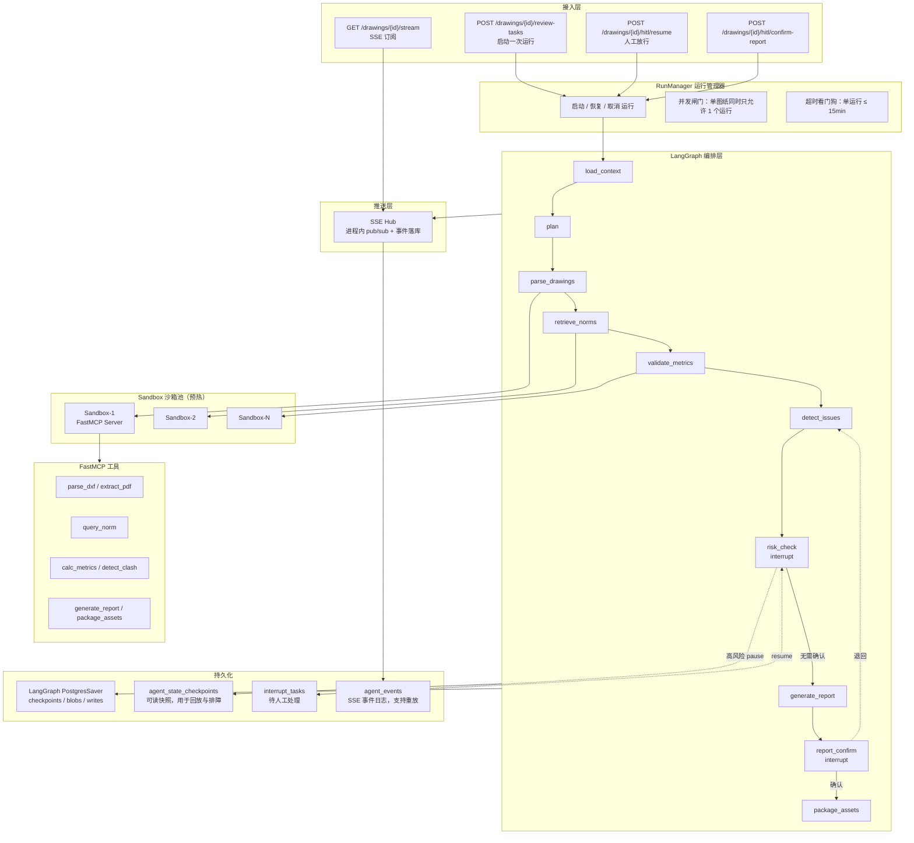
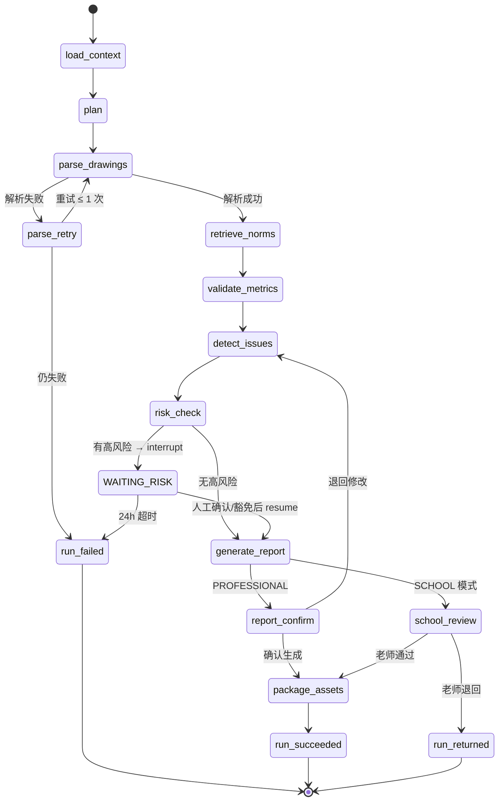
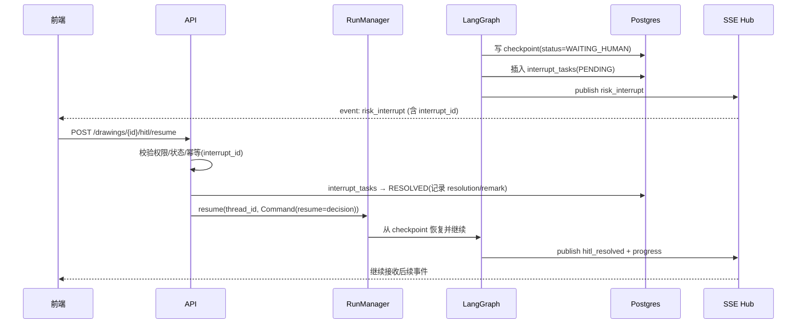
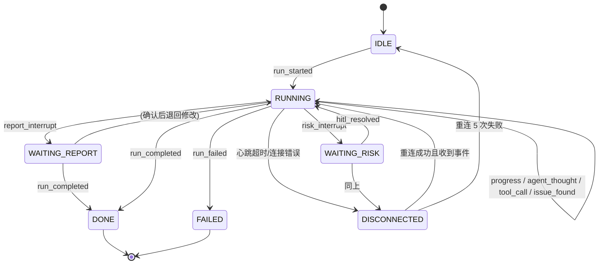

# prd-06 AI Agent 引擎架构（LangGraph / Planning / Sandbox / HITL / SSE）

| 项 | 内容 |
| :--- | :--- |
| 模块编号 | M06 |
| 产品版本 | **V1.0（MVP）** |
| 优先级 | P0 |
| 对应总 PRD | §7.3 运行时架构、§10.5 AI 引擎、§10.6 实时链路 |
| 上游依赖 | `prd-02`（预审中心交互）、`prd-07`（表结构与 HTTP 契约） |
| 主要读者 | 后端（AI 工程）、算法、前端（SSE 消费方） |
| 文档定位 | **引擎层内部设计 + 代码级实现**。§1~§11 讲设计，§12 给可直接落地的模块代码（`state.py` / `graph.py` / `sandbox` / `hitl.py` / `sse/hub.py`） |

> **版本口径（与总 PRD 一致）**：本文所有"V1.0"= 本次 MVP 必做；标注 `# V1.5` 的分支在代码里保持关闭（配置默认 `False`）。具体分工：
> - **V1.0 做**：固定 DAG、6 个沙箱工具、受限子进程沙箱、2 个 HITL 卡点、15 类事件后端全发（前端只渲染 6 类）、数值护栏。
> - **V1.5 做**：动态重规划（`ENABLE_DYNAMIC_REPLAN`）、LLM 自主路由、容器化沙箱、`detect_clash`/`ocr_page` 等扩展工具。
> - **V2.0 做**：多图纸跨专业编排、工具市场。

---

## 1. 引擎层职责边界

| 引擎层负责 | 引擎层不负责 |
| :--- | :--- |
| 编排 LangGraph 图、维护 `ArchReviewState` | 用户/项目/批注的表结构（属 `prd-07`） |
| 调用沙箱工具完成解析、检索、计算 | 权限校验（属应用服务层中间件） |
| 产出问题草稿、风险项、报告初稿 | 把问题落库成 `review_issues`（由 `ReviewService` 负责，引擎只返回草稿） |
| 在指定节点中断、等待人工、恢复执行 | 站内信的渲染与投递（`NotificationService` 通过 `domain_events` 感知状态变化） |
| 向 SSE Hub 发布事件 | 决定前端怎么画（属 `prd-02`） |

**一句话**：引擎是**纯函数式的状态机**——给定 State 与工具，产出新 State；它不认识数据库业务表，只认识 checkpoint 和自己的产物文件。

---

## 2. 运行时架构



**关键约束**

| # | 约束 | 原因 |
| :--- | :--- | :--- |
| 1 | 单图纸同一时刻只允许 1 个运行（Redis/DB 唯一锁 `drawing_id WHERE status=RUNNING`） | 避免两次运行产出重复问题 |
| 2 | 运行进程与 API 进程**可以不同**，但必须共享 Postgres 与事件表 | 便于横向扩容；MVP 允许同进程 |
| 3 | 引擎产出的任何数字必须来自工具，不接受 LLM 直接计算 | 见 §7 数值护栏 |
| 4 | State 中禁止放大对象（文件字节、base64、大数组 >10k 元素），只放引用 | checkpoint 体积与恢复速度 |

---

## 3. LangGraph State

### 3.1 结构定义

```python
from typing import Annotated, Literal, TypedDict
from langgraph.graph.message import add_messages

class ArchReviewState(TypedDict, total=False):
    # ========== 身份与运行控制 ==========
    thread_id: str            # 等于 review_task.id，checkpoint 的主键维度
    run_id: str               # 本次运行 ID（重跑产生新 run_id，thread_id 不变）
    project_id: str
    drawing_id: str
    review_mode: Literal["PROFESSIONAL", "SCHOOL"]   # 专业审图 / 校园教学
    status: RunStatus         # PENDING/RUNNING/WAITING_HUMAN/SUCCEEDED/FAILED/RETURNED/CANCELED
    current_node: str         # 便于断点恢复后排障
    step_seq: int             # 事件序号，与 agent_events.seq 对齐

    # ========== 输入（运行期间只读） ==========
    project_brief: ProjectBrief        # 项目简介：名称/业态/规模/阶段/设计说明
    drawings: list[DrawingRef]         # 图纸引用（id/storage_key/file_type/version/checksum）
    user_prefs: UserPrefs              # 用户偏好：默认专业、严重度阈值、关注的规则集

    # ========== 规划与执行 ==========
    plan: list[PlanStep]               # Planning Node 产物
    plan_revision: int                 # 重规划次数，上限 2
    artifacts: dict[str, ArtifactRef]  # 工具产物引用表：key → {artifact_id, uri, kind, size}
    parsed: list[ParseResult]          # 解析结果（页数/图框/图层/实体摘要）
    norm_hits: list[NormHit]           # 规范检索命中（条文号/摘要/来源/相似度）

    # ========== 业务产物 ==========
    metrics: list[MetricResult]        # 指标计算结果（容积率/绿地率/疏散距离/净高…）
    issues: list[IssueDraft]           # 预审问题清单（草稿，未落库）
    risks: list[RiskItem]              # 高风险项（触发人工确认）
    human_annotations: list[AnnotationRef]  # 人工批注快照（含历史，用于报告合并）
    report_draft: ReportDraft | None   # 报告初稿
    package: PackageRef | None         # 资料包（仅上线字段，V1.0 可为空）

    # ========== HITL ==========
    interrupt: InterruptPayload | None # 当前挂起的中断（null 表示未挂起）
    hitl_history: list[HitlRecord]     # 历史处理记录（谁、何时、选了什么、备注）
    school_action: Literal["APPROVE", "RETURN"] | None  # 校园模式老师动作

    # ========== 异常与预算 ==========
    errors: list[StepError]            # 非致命错误（用于降级与展示）
    budget: Budget                     # 剩余步数/工具调用次数/耗时预算

    # ========== 消息（仅用于需要 LLM 对话的节点） ==========
    messages: Annotated[list, add_messages]
```

### 3.2 关键子结构

| 结构 | 字段 | 说明 |
| :--- | :--- | :--- |
| `ProjectBrief` | `name`, `building_type`, `scale`, `design_stage`, `description`, `key_requirements[]` | 来源：`projects` 表 + 用户上传时填的说明；缺失字段允许为 null，由 Planning 节点决定"信息不足"是否需要人工补充 |
| `DrawingRef` | `drawing_id`, `file_type`, `version`, `checksum`, `storage_key`, `page_count?`, `extents?` | **只放引用**，不放开文件字节 |
| `PlanStep` | `step_id`, `name`, `tool`, `args_hint`, `depends_on[]`, `parallel_group?`, `expected_artifact`, `required` | `tool` 必须是 §6 注册表中的名字，否则规划校验失败 |
| `ParseResult` | `drawing_id`, `page_count`, `pages[{w,h}]`, `title_block`, `layers[]`, `entities_summary`, `units`, `warnings[]` | 详见 `prd-07` `parse_meta` |
| `NormHit` | `norm_code`, `clause_no`, `clause_text`, `score`, `source_url?`, `category` | 检索结果，供 LLM 引用；**不许 LLM 记忆条文** |
| `MetricResult` | `metric_key`, `label`, `value`, `unit`, `limit`, `limit_source`, `pass`, `fact_ref` | `fact_ref` 指向工具调用 ID，见 §7 |
| `RiskItem` | `risk_id`, `title`, `level`（HIGH/CRITICAL）, `metric_key?`, `detected_value`, `threshold`, `clause_ref`, `why_suspicious`, `drawing_id`, `location?` | 触发中断的最小单元 |
| `InterruptPayload` | `interrupt_id`, `type`, `title`, `reason`, `items[]`, `expected_action`, `created_at`, `expires_at` | 恢复时按 `interrupt_id` 匹配 |
| `HitlRecord` | `interrupt_id`, `operator_id`, `resolution`, `remark`, `resolved_at` | 追加型，不覆盖 |
| `ReportDraft` | `report_id`, `version`, `sections[]`, `issue_summary`, `risk_decisions[]`, `generated_at` | 只为初稿，正式文档需人工确认后生成 |
| `Budget` | `max_steps=40`, `max_tool_calls=60`, `max_seconds=900`, `used_*` | 超预算 → `run_failed(reason=BUDGET_EXCEEDED)`，不静默截断 |

### 3.3 三条铁律（写进 Code Review Checklist）

1. **State 必须可 JSON 序列化**：禁止 `datetime`（转 ISO 字符串）、`Path`、ORM 对象、`bytes`。
2. **State 单次快照 ≤ 256 KB**：`issues` 超过 200 条时只保留前 200 条 + `truncated=true` 标记（完整结果在 artifact 中）。
3. **恢复只依赖 checkpoint**：任何节点不得依赖进程内单例、缓存、全局变量；节点函数签名固定为 `(state) -> dict`。

---

## 4. 节点与 DAG

### 4.1 节点清单

| 节点 | 职责 | 调用的工具 | 是否 interrupt |
| :--- | :--- | :--- | :--- |
| `load_context` | 拉取项目 brief、图纸元数据、历史批注 | — | 否 |
| `plan` | 拆解子任务，产出 `plan` | `query_norm`（少量，探规范覆盖度） | 否 |
| `parse_drawings` | 解析所有图纸 | `parse_dxf` / `extract_pdf` / `normalize_units` | 否 |
| `retrieve_norms` | 按 brief + 解析结果检索规范条文 | `query_norm` | 否 |
| `validate_metrics` | 计算并校验硬指标 | `calc_metrics` / `detect_clash` | 否 |
| `detect_issues` | 汇总为问题清单 | —（LLM 归纳 + `validate_location`） | 否 |
| `risk_check` | 识别高风险，需人工确认时中断 | — | **是（卡点一）** |
| `generate_report` | 生成报告初稿 | `generate_report` | 否 |
| `report_confirm` | 等待人工确认报告 | — | **是（卡点二）** |
| `package_assets` | 打包图纸 + 报告 + 问题清单 | `package_assets` | 否 |

### 4.2 DAG



### 4.3 条件边规则

| 源节点 | 条件 | 目标 |
| :--- | :--- | :--- |
| `parse_drawings` | 任一必需图纸解析失败且 `retry < 1` | `parse_retry` |
| `parse_drawings` | 全部失败 | `run_failed`（`reason=PARSE_FAILED`） |
| `parse_drawings` | 部分失败、至少一张成功 | 继续 `retrieve_norms`，`errors` 追加 `PARTIAL_PARSE` |
| `risk_check` | `risks` 中存在 `level ∈ {HIGH, CRITICAL}` | interrupt，状态置 `WAITING_HUMAN` |
| `risk_check` | 无高风险 | `generate_report` |
| `report_confirm` | `resolution=APPROVED` | `package_assets` |
| `report_confirm` | `resolution=REJECTED` | 回到 `detect_issues`（`plan_revision+1`，上限 2 次，超限强制进入报告确认并标注"未经复核"） |
| `school_review` | `APPROVE` | `package_assets` |
| `school_review` | `RETURN` | `run_returned`（发通知给提交者） |

**降级策略（必须有）**：`query_norm` 不可用（向量库挂）→ 用静态条文白名单继续跑，所有 `NormHit.source="FALLBACK"`，问题置信度整体打 0.85 折并在报告里声明"规范检索降级"。

---

## 5. Planning Node

### 5.1 输入 / 输出

**输入**：`project_brief`、`drawings[].file_type`、`review_mode`、`user_prefs`、可用的工具清单（`tools_manifest`，由 FastMCP 注册表注入，**不是硬编码在 prompt 里**）。

**输出 schema**（严格 JSON，`response_format=PlanOutput`）：

```python
class PlanStep(BaseModel):
    step_id: str            # "s1".."s12"
    name: str               # 人类可读名称，会作为 SSE agent_thought 展示
    tool: str               # 必须 ∈ tools_manifest
    args_hint: dict         # 入参提示，不含真实路径（运行时由引擎填充）
    depends_on: list[str]   # 依赖的 step_id
    parallel_group: str | None
    expected_artifact: str  # 产物 key，如 "dxf_parse"
    required: bool = True

class PlanOutput(BaseModel):
    steps: list[PlanStep]           # 6~12 条
    rationale: str                  # ≤300 字，展示在思考链路面板
```

### 5.2 七个规范子任务（缺一不可）

Planning 必须覆盖下列 7 个语义步骤；引擎侧做**静态校验**，缺项则带错误信息让 LLM 重出一次（最多 1 次），再失败就**用模板兜底**并标 `plan_degraded=true`。

| # | 子任务 | 必然映射到的工具 | 产物 key |
| :--- | :--- | :--- | :--- |
| 1 | 解析 brief | 无工具（结构化抽取，LLM 直接做） | `brief_parsed` |
| 2 | 提取图纸信息 | `parse_dxf` / `extract_pdf` | `drawing_parse` |
| 3 | 检索规范 | `query_norm` | `norm_hits` |
| 4 | 指标校验 | `calc_metrics` | `metrics` |
| 5 | 生成问题清单 | `detect_clash` + LLM 归纳 | `issues` |
| 6 | 生成报告初稿 | `generate_report` | `report_draft` |
| 7 | 打包资料 | `package_assets` | `package` |

> 碰撞检查（`detect_clash`）在规范里属于第 5 步的子集，单独成 tool 是因为它依赖几何计算，必须走沙箱。

### 5.3 动态重规划（Replan）

| 触发 | 动作 | 上限 |
| :--- | :--- | :--- |
| `parse_drawings` 返回 `page_count=0` 或 `layers=[]` | 重规划：插入 `normalize_units` + 降级为"仅文本层审查" | 1 次 |
| 工具连续 2 次超时 | 重规划：替换为备选工具（`parse_dxf` → `extract_pdf` 仅当文件可转）或标记该步 `required=false` | 1 次 |
| `risk_check` 发现 `CRITICAL` 且 brief 缺关键信息 | 重规划：在确认项里追加"补充项目指标"人工输入项 | 1 次 |
| 报告被退回 | 不回 Planning，直接在 `detect_issues` 重跑（`plan_revision+1`） | 2 次 |

**禁止**：规划节点不得修改已执行步骤的结果；不得新增 `required=true` 的步骤来"补作业"（防止无限膨胀）。

---

## 6. Sandbox + FastMCP

### 6.1 隔离设计

| 项 | dev | prod |
| :--- | :--- | :--- |
| 隔离手段 | 独立子进程 + `resource` 限制 | 容器（gVisor / firejail），只读根文件系统 |
| 网络 | 禁止出网 | 禁止出网（例外：仅允许访问内部向量库，走白名单） |
| CPU / 内存 | 2 core / 2GB | 同 |
| 单次工具超时 | 60s（`parse_dxf` 180s） | 同 |
| 工作目录 | 每次调用临时目录，调用后清理 | 同 |
| 文件访问 | 仅挂载本次任务的临时目录 | 同 |

**绝对禁止**：把用户上传的 DXF/PDF 直接交给 LLM；沙箱输出必须结构化（JSON），不接受自由文本回传给模型当"数据"。

### 6.2 预热机制（关键，冷启动会毁掉体验）

| 项 | 规格 |
| :--- | :--- |
| 池大小 | `SANDBOX_POOL_SIZE=3`（可按并发调整，默认 ≥ 并发运行数） |
| 预热时机 | 应用启动时**立即**创建 N 个沙箱并完成 FastMCP 握手 + 自检工具（`ping` / `parse_dxf(空文件)` 快速冒烟） |
| 就绪判据 | 握手成功 + 依赖库（ezdxf / pymupdf）导入成功 + 冒烟通过 → 标记 `READY` |
| 冷启动目标 | 池命中时工具调用启动开销 **< 300ms**；未命中时同步创建（3~5s）并计入告警 |
| 健康检查 | 每 30s 一次 `ping`，失败 2 次标记 `UNHEALTHY` 并重建 |
| 崩溃重启 | 进程退出 → 自动补一个（保持池大小），当前任务标记工具失败并走重试 |
| 回收 | 空闲 30min 回收，但保留 ≥1 个；内存超 1.5GB 强制回收重建 |
| 预热事件 | 池状态变化推 `sandbox_status` 事件（仅日志与内部监控，不推前端） |
| 观测指标 | 池命中率、平均排队时长、冷启动次数、崩溃次数 |

**实现要点**：FastMCP server 以 stdio 传输，宿主侧维护 `AsyncExitStack` + 队列取用；一次工具调用 = 取沙箱 → 调用 → 归还，**不销毁**。工具必须无状态（同一沙箱可连续服务不同任务），因此禁止在沙箱内缓存任务数据。

#### 6.2.1 资源受限时的降级档位（MVP 必须支持）

> 前提：`SANDBOX_POOL_SIZE=3` + 容器化在单机 **2C4G** 上跑不动（每个沙箱要加载 ezdxf / PyMuPDF，常驻约 300~500MB）。所以池大小与创建策略必须可配，**默认值按部署规格选档**。

| 档位 | 配置 | 资源占用 | 冷启动 | 适用 |
| :--- | :--- | :--- | :--- | :--- |
| **A · 标准** | `SANDBOX_POOL_SIZE=3`、`SANDBOX_ALLOW_SYNC_CREATE=false` | ≈1.2~1.5GB | 命中 <300ms；池空则排队（5s 超时 → 429/排队提示） | 4C8G 及以上，或有独立解析节点 |
| **B · 精简（MVP 默认）** | `SANDBOX_POOL_SIZE=1`、`SANDBOX_ALLOW_SYNC_CREATE=true` | ≈400MB | 命中 <300ms；**未命中同步创建 3~5s** | 单机 2C4G、演示环境、开发机 |
| **C · 极限** | `SANDBOX_POOL_SIZE=0`（不预热）、`SANDBOX_ALLOW_SYNC_CREATE=true` | ≈0 常驻 | 每次 3~5s | 只在内存告急时临时救火 |

**B 档为什么可接受（不用心虚）**：

1. 前端此时**已经在 SSE 流里**，进度条停在 `PARSING 20%` 并显示"正在初始化解析环境…"（`progress.text` 由后端下发），不是白屏转圈。
2. 每次预审最多 2~3 次工具调用（`parse_dxf` + `query_norm` + `calc_metrics`），第一个承担冷启动，后续复用同一沙箱。
3. Mock 引擎下总耗时目标 3~8s，冷启动 3~5s 会让首轮逼近 8~12s——**验收标准相应放宽为 ≤15s**（见 §11.2），但必须出现在进度事件里，不能静默。

**实现要求（缺一不可）**

| # | 要求 |
| :--- | :--- |
| 1 | `acquire()` 超时后若 `allow_sync_create=true`，**同步创建**一个临时沙箱并用完即弃（不归还池），而不是直接报错 |
| 2 | 同步创建期间**必须推一条 `progress`**（`text="正在初始化解析环境…"`），否则用户会以为卡死 |
| 3 | 池命中率指标要区分"命中 / 同步创建 / 排队超时"三种计数，压测时能看出该不该加资源 |
| 4 | 部署文档必须给出三档配置示例，**默认填 B 档**，A 档写清资源前提 |
| 5 | `SANDBOX_POOL_SIZE=0` 时启动不得报错（跳过预热），健康检查也要跳过 |


### 6.3 FastMCP 工具注册表（唯一权威）

| 工具名 | 入参 | 出参（摘要） | 超时 | 幂等 | 说明 |
| :--- | :--- | :--- | :--- | :--- | :--- |
| `ping` | — | `{ok, version}` | 5s | 是 | 健康检查 |
| `hash_file` | `storage_key` | `{sha256, size}` | 30s | 是 | 校验与 Mock seed 来源 |
| `normalize_units` | `file_type`, `meta` | `{unit, scale, extents}` | 20s | 是 | DXF 单位归一化 |
| `parse_dxf` | `storage_key`, `layers_whitelist[]` | `{extents, layers[], entities[], title_block, warnings[]}` | 180s | 是 | `ezdxf` 只读白名单图层 |
| `extract_pdf` | `storage_key`, `page_range?` | `{page_count, pages[{w,h}], text_blocks[], title_block}` | 120s | 是 | PyMuPDF；OCR 留 V1.5 |
| `render_page` | `storage_key`, `page_no`, `dpi` | `{image_ref}` | 60s | 是 | 缩略图/报告配图 |
| `query_norm` | `query`, `filters{category, discipline}`, `top_k` | `{hits:[{norm_code, clause_no, clause_text, score}]}` | 30s | 是 | 向量检索 + rerank |
| `calc_metrics` | `metric_keys[]`, `inputs{}` | `{results:[{metric_key, value, unit, limit, limit_source, pass, calc_ref}]}` | 30s | 是 | **所有数值计算的唯一出口** |
| `detect_clash` | `entities_a[]`, `entities_b[]`, `tolerance` | `{clashes:[{a, b, bbox, distance}]}` | 120s | 是 | 管线/构件碰撞（几何） |
| `validate_location` | `location`, `page_size` / `extents` | `{valid, clamped_location}` | 10s | 是 | 坐标越界裁剪 |
| `generate_report` | `template`, `payload{}` | `{report_id, artifact_ref, section_count}` | 60s | 否（每次新版本） | 渲染 HTML/PDF 初稿 |
| `package_assets` | `artifact_refs[]`, `name` | `{package_id, artifact_ref, size}` | 90s | 是 | 打包 zip |

**注册方式**

```python
# sandbox/mcp_server.py
from fastmcp import FastMCP
mcp = FastMCP("arch-harness-sandbox")

@mcp.tool()
async def parse_dxf(storage_key: str, layers_whitelist: list[str]) -> dict:
    ...
```

宿主侧只维护 `TOOL_SPECS`（名字 → 入参模型 + 超时 + 幂等），**不维护业务逻辑**；`tools_manifest` 从 MCP `list_tools()` 动态生成并注入 Planning prompt，这样加工具不需要改 prompt。

---

## 7. 数值护栏（防止大模型硬算）

**问题**：LLM 会自信地算错容积率、疏散距离、净高，且错得看不出来。

### 7.1 机制

1. `IssueDraft` / `MetricResult` 中任何含数值的条目必须带 `fact_ref`，形如 `calc_metrics#call_8f21#FAR`（**工具调用 ID + 字段名**），指向一次真实工具调用的具体返回值。
2. 节点出口执行 `numeric_guard` 校验（分级，见 §7.2）。
3. 报告正文中的指标表一律由 `calc_metrics` 结果直接渲染，LLM 只写解读文字，不写数字。**这条 V1.0 就要做到**——它不依赖正则，靠模板渲染即可。

### 7.2 V1.0 与 V1.5 的分工（避免 MVP 过度实现）

| 层级 | V1.0（本次必做） | V1.5 |
| :--- | :--- | :--- |
| `fact_ref` 字段 | ✅ 强制透传：`MetricResult.fact_ref`、`IssueDraft.fact_ref` 必填（含数值时） | — |
| **来源存在性校验** | ✅ `fact_ref` 必须能在本次运行的 `tool_calls` 里找到（查表，O(1)）；找不到 → 该条 `confidence=min(confidence,50)` + 追加"（该数值未经工具核对）" | — |
| 报告指标表 | ✅ 由 `calc_metrics` 结果直接渲染（模板层），LLM 不参与写数 | — |
| **全文正则数值扫描** | ❌ 不做 | ✅ 扫描文本数字 + 单位识别 + 与工具返回值比对；命中未溯源 → **阻断** `generate_report` 并回退 `validate_metrics` |

**为什么这么切**：MVP 的 `calc_metrics` 本身可能是 Mock/半 Mock，做全文正则既费工又容易误伤（"3 层"、"2 处"这类数字会被误判）。V1.0 只保证**结构上每个数值都有出处**，已经能挡住 80% 的编造；等真实引擎上线、指标口径稳定后再上全文校验。

### 7.3 V1.0 实现（照抄）

```python
# app/engine/guard.py
from app.engine.state import Budget

def attach_fact_ref(tool_result: dict, call_id: str, field: str) -> str:
    """工具返回时立刻生成 fact_ref，节点里不允许手写"""
    assert tool_result.get("ok"), "失败的工具调用不得产生 fact_ref"
    return f"{tool_result['tool']}#{call_id}#{field}"


def verify_fact_refs(state, known_refs: set[str]) -> tuple[list[dict], list[dict]]:
    """V1.0 只做存在性校验，不做文本扫描。返回 (降级后的 issues, 违规明细)"""
    issues, violations = [], []
    for it in state.get("issues", []):
        ref = it.get("fact_ref")
        has_number = bool(it.get("_has_numeric"))
        if has_number and (not ref or ref not in known_refs):
            it = {**it,
                  "confidence": min(int(it.get("confidence", 0)), 50),
                  "description": (it.get("description") or "") + "（该数值未经工具核对）"}
            violations.append({"issue": it.get("title"), "fact_ref": ref or ""})
        issues.append(it)
    return issues, violations
```

```python
# 节点里（validate_metrics / detect_issues 出口）
issues, bad = verify_fact_refs(state, state["known_fact_refs"])
await publish_event(state, "numeric_guard", {
    "checked": len(issues), "downgraded": len(bad), "mode": "FIELD_ONLY",   # V1.0
})
return {"issues": issues, "errors": state["errors"] + [
    {"node": "detect_issues", "code": "UNVERIFIED_NUMBER", "message": f"{len(bad)} 条数值未溯源",
     "retryable": False}]}
```

### 7.4 验收用例

| # | 用例 | 期望 |
| :--- | :--- | :--- |
| N1 | `MetricResult.fact_ref` 为空 | 单测失败（Pydantic 校验器拦截） |
| N2 | `fact_ref` 指向不存在的 call_id | 该 issue 置信度 ≤50 且描述带声明 |
| N3 | 注入"容积率约 3.2"诱导，报告指标表 | 数值来自 `calc_metrics`，日志可断言 `fact_ref` 存在 |
| N4 | （V1.5）自由文本里出现未溯源数字 | 阻断 `generate_report` 并回退重算 |


---

## 8. Human-in-the-Loop

### 8.1 中断点设计

用 LangGraph 原生 `interrupt()`（Node 内动态中断，比 `interrupt_before` 更灵活：同一节点可在"需要"时中断、"不需要"时直接返回）。

```python
async def risk_check(state: ArchReviewState) -> dict:
    risks = collect_high_risks(state)
    if not risks:
        return {"risks": [], "current_node": "risk_check"}

    decision = interrupt({                      # ← 挂起，等待 resume 注入
        "type": "RISK_CONFIRM",
        "title": f"发现 {len(risks)} 项高风险指标，需人工确认",
        "items": [r.model_dump() for r in risks],
        "expected_action": ["CONFIRM_AS_ISSUE", "MARK_EXEMPT"],
        "expires_at": (now() + timedelta(hours=24)).isoformat(),
    })

    return apply_risk_decisions(state, risks, decision)
```

| 中断点 | 节点 | 触发条件 | 期望动作 | 前端入口 |
| :--- | :--- | :--- | :--- | :--- |
| 卡点一 `RISK_CONFIRM` | `risk_check` | 存在 `level ∈ {HIGH, CRITICAL}` 的风险项（容积率/防火分区/疏散宽度/绿地率/结构超限） | `CONFIRM_AS_ISSUE`（是图纸问题，转成批注）/ `MARK_EXEMPT`（特殊豁免，附依据） | 风险确认弹窗（`prd-02` §6.6） |
| 卡点二 `REPORT_CONFIRM` | `report_confirm` | 报告初稿生成完成（`PROFESSIONAL` 模式） | `APPROVED` / `REJECTED`（退回修改，必填意见） | 报告确认页（`prd-02` §6.7） |
| 校园卡点 `SCHOOL_REVIEW` | `school_review` | `review_mode=SCHOOL` 且报告初稿完成 | `APPROVE` / `RETURN`（退回学生修改，必填评语） | 老师端评审页（`prd-02` §6.8） |

> 一次运行**最多中断 2 次**（风险 + 报告）。同一节点内检出的多项风险**合并为一次中断**，不允许"一项一条弹窗"，否则设计师会崩。

#### 8.1.1 `interrupt()` vs `interrupt_before`：为什么选前者

LangGraph 提供两种暂停方式，**本项目以 `interrupt()` 为主、`interrupt_before` 为辅**：

| 维度 | `interrupt()`（Node 内动态） | `interrupt_before=["node"]`（编译期静态） |
| :--- | :--- | :--- |
| 暂停条件 | 运行时可判断（无风险则**不发生中断**、直接走完） | 只要进入该节点就**必然暂停** |
| 适用性 | ✅ 卡点一：只有检出高风险才停，无风险要连续跑完 | ⚠️ 卡点二：报告必然要人确认，可以静态停 |
| 恢复值 | `Command(resume=payload)` 直接作为 `interrupt()` 返回值注入节点内 | 恢复后进入节点，需从 `state` 里取人工结果 |
| 前端 payload | 由节点自行构造，字段随业务变化 | 只能拿到进入节点时的 state |

**最终配置**

```python
graph = builder.compile(
    checkpointer=postgres_saver,
    interrupt_before=[],        # 不静态停：risk_check 无风险时必须直接通过
)

# 恢复
await graph.ainvoke(Command(resume={"decisions": [...]}), config={"configurable": {"thread_id": thread_id}})
```

> 之所以不用 `interrupt_before` 硬停 `risk_check`：如果某张图纸没有高风险，静态中断会逼设计师确认一个"没有问题"的弹窗，这是最典型的自伤式设计。
>
> **兼容口子**：`report_confirm` 节点允许通过配置 `INTERRUPT_REPORT_STATIC=true` 改为 `interrupt_before=["report_confirm"]`（用于"所有报告都必须人工过一遍"的强合规场景，例如校园模式）。此时节点通过 `state["hitl_history"][-1]` 读取人工结果。两种模式共用同一套 `interrupt_tasks` 表与 API，前端无感知。


### 8.2 State 持久化

| 层 | 内容 | 说明 |
| :--- | :--- | :--- |
| LangGraph `AsyncPostgresSaver` | `checkpoints` / `checkpoint_blobs` / `checkpoint_writes` | **恢复的唯一权威来源**，`thread_id = review_task.id`，`checkpoint_ns = ""` |
| 自有 `agent_state_checkpoints` | `thread_id`, `run_id`, `checkpoint_id`, `node`, `status`, `state_snapshot`(裁剪版 jsonb), `state_digest`, `created_at` | 用于：① 排障与回放 ② 给前端"上次执行到哪" ③ 校验一致性（`state_digest` 比对） |
| 自有 `interrupt_tasks` | 待人工处理工单 | 驱动前端红点、超时扫描、审计（字段见 `prd-07` §3.21） |

**一致性要求**：每次进入/离开节点写一条 `agent_state_checkpoints`；`state_digest = sha256(规范化 JSON)`。若恢复时 LangGraph checkpoint 与快照 digest 不一致 → 记 `WARN`，以 LangGraph 为准，不阻断。

### 8.3 恢复流程



**恢复语义表**

| 情况 | 行为 |
| :--- | :--- |
| 正常恢复 | `interrupt_tasks.status=RESOLVED`，`resolution` 落库，`hitl_history` 追加，继续执行 |
| 重复提交同一 `interrupt_id` | `409 INTERRUPT_ALREADY_RESOLVED`，返回首次处理结果（幂等） |
| `interrupt_id` 不存在 / 不属于该图纸 | `404 NOT_FOUND` |
| 已超时（>24h） | `410 INTERRUPT_EXPIRED`，任务 `EXPIRED`，运行置 `FAILED(reason=HITL_TIMEOUT)`，需重新发起预审 |
| 运行已被取消 | `409 RUN_NOT_WAITING` |
| 服务重启后恢复 | RunManager 启动扫描 `interrupt_tasks(PENDING)` + `review_tasks(status=WAITING_HUMAN)`，重建可恢复运行；`PENDING` 且未过期的继续等待，不重复中断 |
| 恢复失败（checkpoint 丢失） | `500 CHECKPOINT_UNAVAILABLE`，运行置 `FAILED`，提示"请重新发起预审"（**不静默重跑**，避免重复问题） |

### 8.4 校园模式

| 差异点 | 说明 |
| :--- | :--- |
| 角色 | 提交者 = 学生；评审者 = 老师（`project_members.project_role=REVIEWER`） |
| 卡点一 | 高风险仍中断，但确认人可以是老师或学生（按项目配置 `hitl_assignee`） |
| 卡点二替换为 | `SCHOOL_REVIEW`：老师看报告初稿 + 学生设计，选择 `通过` / `退回修改`（必填评语 ≥10 字） |
| 退回产物 | 生成《退回意见书》（复用报告模板，段落标题改为"问题与建议"），关联到该学生图纸版本，状态 `RETURNED` |
| 学生侧 | 收到站内信 → 打开退回意见 → 上传新版本 → 可重新发起预审（新 `run_id`，`thread_id` 复用会冲突，因此**新版本图纸使用新 thread_id**） |
| 统计 | 老师端看"退回率""平均退回次数"，不计入 AI 误报率 |

---

## 9. SSE 实时推送

### 9.1 协议与接入

| 项 | 规格 |
| :--- | :--- |
| 端点 | `GET /api/v1/drawings/{drawing_id}/stream?thread_id={review_task_id}` |
| Content-Type | `text/event-stream; charset=utf-8` |
| 鉴权 | **EventSource 无法自定义 header** → 先调 `POST /drawings/{id}/stream-token` 换取一次性 `stream_token`（TTL 60s，绑定 user + thread_id），再以 `?token=` 传入 |
| 心跳 | 每 15s 发 `event: heartbeat`（同时兼作代理保活） |
| 事件 ID | `id: {seq}`，全局单调递增（按 thread 维度），支持 `Last-Event-ID` 续传 |
| 重放 | 客户端带 `Last-Event-ID` 重连 → 从 `agent_events` 回放该 seq 之后的事件（窗口 30min / 5000 条，超出则先发 `stream_reset` 让前端全量刷新） |
| 结束 | 终态事件（`run_completed` / `run_failed` / `run_returned`）后 2s 服务端主动关闭 |
| 多实例 | MVP 单实例进程内 pub/sub；多实例需 Redis Pub/Sub（配置 `SSE_BACKEND=redis`），接口不变 |
| 代理 | Nginx 必须 `proxy_buffering off; proxy_read_timeout 3600s; proxy_http_version 1.1;` 并禁用 gzip 对 `text/event-stream` |
| 并发 | 同一用户同一 thread 最多 3 条连接，超出返回 429 |

### 9.2 事件类型与触发时机（**枚举以 `prd-07` §2.1 为准**）

> **权威归属（防漂移，务必遵守）**
> - **事件枚举名与 payload 字段索引 → `prd-07` §2.1**（唯一权威，代码里的 `AgentEventType` 与它逐字对齐）。
> - **payload 完整示例与语义 → 本文 §9.4**。
> - 本表只描述"什么时候发、前端拿它干什么"，**不承担定义职责**；两边不一致时以 `prd-07` §2.1 为准，并回头修本文。

| `event` | 时机 | 前端用途 |
| :--- | :--- | :--- |
| `run_started` | 运行启动 | 初始化进度条（0%）、开启思考面板 |
| `plan_created` | Planning 完成 | 渲染"执行计划"列表（7 步骨架） |
| `node_started` | 进入节点 | 对应步骤高亮 + 文案切换 |
| `node_finished` | 离开节点 | 步骤打勾 + 耗时 |
| `progress` | 细粒度进度 | 更新进度条百分比 |
| `agent_thought` | LLM 产出结论式思考 | 思考链面板追加一行（≤200 字） |
| `tool_call` | 调用沙箱工具 | 展示"调用 parse_dxf（沙箱 #2）" |
| `tool_result` | 工具返回 | 展示摘要（耗时/条数），失败展示错误 |
| `issue_found` | 检出问题 | 清单实时插入（可选：前端先占位） |
| `risk_found` | 检出高风险 | 面板标红，提示"即将请求确认" |
| `risk_interrupt` | 进入卡点一 | 弹窗（含 `interrupt_id`），进度条转"暂停" |
| `hitl_resolved` | 人工处理完成 | 关闭弹窗，恢复"运行中" |
| `report_ready` | 报告初稿完成 | 进度 95%，按钮"查看报告初稿" |
| `report_interrupt` | 进入卡点二 / 校园评审 | 跳转报告确认页或老师评审页 |
| `run_returned` | 校园退回 | 显示退回结果 + 评语入口 |
| `run_completed` | 成功结束 | 100%，刷新问题清单，关闭流 |
| `run_failed` | 失败结束 | 展示 `reason` 与重试按钮 |
| `sandbox_status` | 沙箱池异常 | 仅内部告警，前端忽略（保留字段扩展） |
| `heartbeat` | 保活 | 更新"最后心跳时间"，判断卡死 |
| `stream_idle` | 服务端主动关闭空闲连接（30min 无业务事件） | 显示"实时通道已空闲关闭"，用户可点重连 |
| `stream_reset` | 重放窗口溢出 | 全量刷新任务快照与清单 |

### 9.3 事件信封（所有事件统一）

```json
{
  "seq": 42,
  "thread_id": "review-task-uuid",
  "run_id": "run-uuid",
  "event": "progress",
  "ts": "2024-05-12T09:20:03.120+08:00",
  "data": { }
}
```

SSE 线格式：

```
id: 42
event: progress
data: {"seq":42,"thread_id":"...","run_id":"...","event":"progress","ts":"...","data":{"percent":40,"stage":"AGENT_CODE","text":"正在核对规范"}}

```

### 9.4 各事件 payload

**`run_started`**

```json
{ "percent": 0, "engine": "mock", "review_mode": "PROFESSIONAL", "drawing_id": "d-002" }
```

**`plan_created`**

```json
{
  "percent": 5,
  "rationale": "该图纸为住宅标准层平面，需重点核对疏散与防火分区",
  "steps": [
    {"step_id": "s1", "name": "解析项目简介", "status": "pending"},
    {"step_id": "s2", "name": "提取图纸信息", "status": "pending"},
    {"step_id": "s3", "name": "检索规范条文", "status": "pending"},
    {"step_id": "s4", "name": "指标校验", "status": "pending"},
    {"step_id": "s5", "name": "生成问题清单", "status": "pending"},
    {"step_id": "s6", "name": "生成报告初稿", "status": "pending"},
    {"step_id": "s7", "name": "打包资料", "status": "pending"}
  ]
}
```

**`progress`**

```json
{ "percent": 40, "stage": "AGENT_CODE", "text": "正在核对规范" }
```

**`agent_thought`**（**只推结论，不推原始 token 流**）

```json
{ "node": "detect_issues", "text": "本层共 3 个安全出口，其中东侧出口净宽 1.05m 低于 1.1m 要求", "tokens": 42 }
```

**`tool_call` / `tool_result`**

```json
{ "tool": "parse_dxf", "args_summary": "layers=WALL,DOOR,WINDOW", "sandbox": "sandbox-2", "call_id": "call_8f21" }
```
```json
{ "tool": "parse_dxf", "call_id": "call_8f21", "ok": true, "duration_ms": 1830,
  "result_summary": "图层 12 个，实体 4821 个", "artifact": "dxf_parse" }
```

**`issue_found`**

```json
{ "issue_id": "tmp-1", "severity": "BLOCKER", "discipline": "ARCH",
  "title": "3 层疏散楼梯净宽不足 1.1m", "confidence": 92, "location_valid": true }
```

**`risk_interrupt`**（卡点一，最关键）

```json
{
  "interrupt_id": "it-0001",
  "type": "RISK_CONFIRM",
  "title": "发现 2 项高风险指标，需人工确认",
  "expires_at": "2024-05-13T09:20:00+08:00",
  "items": [
    { "risk_id": "r1", "title": "容积率超出规划条件", "level": "CRITICAL",
      "metric_key": "FAR", "detected_value": 3.42, "threshold": 3.0,
      "clause_ref": "规划条件通知书-第三条", "why_suspicious": "按图表面积推算 3.42，超限 14%" },
    { "risk_id": "r2", "title": "防火分区面积存疑", "level": "HIGH",
      "metric_key": "FIRE_ZONE_AREA", "detected_value": 2100, "threshold": 2000,
      "clause_ref": "GB50016-2014-5.3.1", "why_suspicious": "未设喷淋时上限 2000㎡" }
  ]
}
```

**`hitl_resolved`**

```json
{ "interrupt_id": "it-0001", "resolution": "MARK_EXEMPT", "operator": "张工",
  "item_decisions": [{"risk_id": "r1", "decision": "MARK_EXEMPT", "remark": "已取得规划部门超限批复"}],
  "resumed": true }
```

**`report_ready` / `report_interrupt`**

```json
{ "percent": 95, "report_id": "rp-001", "version": 1, "issue_total": 12 }
```
```json
{ "interrupt_id": "it-0002", "type": "REPORT_CONFIRM", "report_id": "rp-001",
  "title": "报告初稿已生成，请确认是否输出正式文档", "expires_at": "..." }
```

**`run_completed`**

```json
{ "percent": 100, "status": "SUCCEEDED", "issue_total": 12, "duration_ms": 8432,
  "report_id": "rp-001", "thread_id": "..." }
```

**`run_failed`**

```json
{ "status": "FAILED", "reason": "PARSE_FAILED", "message": "DXF 文件缺少 SECTION 段，可能已损坏", "retryable": true }
```

### 9.5 断线与降级

| 场景 | 前端行为 | 服务端行为 |
| :--- | :--- | :--- |
| 网络瞬断 | `EventSource` 自动重连（带 `Last-Event-ID`），退避 1s/2s/4s/8s，最多 5 次 | 从 `agent_events` 回放 |
| 重连超过 5 次 | 停止重连，面板显示"实时连接已断开" + `重新连接` 按钮 | — |
| 事件窗口溢出 | 收到 `stream_reset` → 全量拉一次 `GET /review-tasks/{id}` 与问题清单 | 记录 `replay_overflow` |
| 运行早已结束 | 连接建立后立即收到 `run_completed` | 直接查终态补发 |
| 心跳超时（>45s 无任何事件） | 判定链路假死，主动重连 | — |
| 鉴权过期 | 401 后重新取 `stream_token` 再连 | — |

> **禁止**：前端不得退化为轮询兜底。断线时显示明确状态，由用户手动重连；这是硬要求（避免"看起来在跑其实在轮询"的隐性 bug）。

### 9.6 前端事件 → UI 状态机



### 9.7 展示文案映射（后端下发 `text`，前端不硬编码）

| stage | percent | text |
| :--- | :--- | :--- |
| `LOAD_CONTEXT` | 3 | 正在读取项目资料 |
| `PLANNING` | 8 | 正在制定审查计划 |
| `PARSING` | 20 | 正在解析图纸 |
| `RETRIEVING` | 38 | 正在核对规范 |
| `VALIDATING` | 55 | 正在校验指标 |
| `DETECTING` | 70 | 正在归纳问题 |
| `WAITING_RISK` | 78 | 等待设计师确认风险 |
| `REPORTING` | 88 | 正在生成报告初稿 |
| `WAITING_REPORT` | 95 | 等待确认报告 |
| `PACKAGING` | 98 | 正在打包资料 |
| `DONE` | 100 | 预审完成 |

---

## 10. 可观测与指标

| 指标 | 定义 | 目标 |
| :--- | :--- | :--- |
| `run_duration_ms` | 启动到终态 | Mock P95 < 8s；真实 P95 < 180s |
| `node_duration_ms` | 按节点分桶 | 用于找瓶颈 |
| `tool_call_duration_ms` | 按工具分桶 + 沙箱命中率 | `parse_dxf` P95 < 30s（50MB） |
| `sandbox_pool_hit_rate` | 命中池 / 总调用 | ≥ 95% |
| `sse_first_event_ms` | 连接建立到首个事件 | P95 < 500ms |
| `sse_event_latency_ms` | 事件产生到推送 | P95 < 300ms |
| `sse_reconnect_total` / `sse_replay_overflow` | 断线次数与重放溢出次数 | 溢出 = 0 |
| `hitl_wait_duration_ms` | 中断到恢复 | 业务观测，不设 SLO |
| `hitl_expired_total` | 24h 超时数 | 每周 < 3 |
| `checkpoint_restore_success_rate` | 恢复成功 / 恢复尝试 | ≥ 99.5% |
| `numeric_guard_blocked_total` | 数值护栏拦截次数 | 观测，用于优化 prompt |

---

## 11. 实施顺序与验收

### 11.1 实施顺序（建议 2 周）

| 阶段 | 内容 | 出口 |
| :--- | :--- | :--- |
| **D1** | **① 确定性 Mock 引擎（前置，见 §11.1.1）② State 定义 ③ 骨架图（全节点返回假数据）** | 同一 `checksum` 连跑 20 次，问题集合逐字节一致；流程能跑通并写 checkpoint |
| D2 | PostgresSaver 接入 + 断点续跑验证 | 杀掉进程重启后能 `ainvoke(None)` 续跑 |
| D3-D4 | 沙箱池（默认 B 档）+ FastMCP 4 个核心工具（`parse_dxf`/`extract_pdf`/`query_norm`/`calc_metrics`） | 单沙箱冷启动 3~5s、命中 <300ms；工具单测通过；`ephemeral` 用完即弃 |
| D5-D6 | SSE Hub + 事件表 + 全事件下发 | `curl -N` 能看到完整事件流；心跳不落库 |
| D7-D8 | 两个 interrupt + resume API + 超时扫描 | 中断→处理→恢复闭环，重启后仍可恢复 |
| D9 | 数值护栏（`FACT_REF_MODE=FIELD_ONLY`）+ 沙箱降级路径 | 伪造 `fact_ref` 被降级；`SANDBOX_POOL_SIZE=0` 仍能跑 |
| D10 | 校园模式分叉 | 退回意见书生成 |

#### 11.1.1 为什么 D1 第一件事是"确定性 Mock 引擎"

前端联调、Demo、自动化测试**全部依赖"同一张图纸每次输出完全一样"**。如果 Mock 用了裸 `random`，会出现：

- 前端刚调好"第 3 条问题在 B 区"，刷新一下问题跑到 C 区，定位对不上 → **误判为坐标映射有 bug**，排查半天发现是 Mock 在随机；
- 自动化测试断言"12 条问题"，某次跑出 13 条 → CI 随机红；
- 演示时讲师说"这里应该有一条疏散宽度问题"，屏幕上是别的 → 信任崩塌。

**硬性要求（写进 Code Review Checklist）**

| # | 要求 |
| :--- | :--- |
| 1 | **禁止裸用 `random.random()` / `random.choice()` / `random.randint()`**（模块级 random 的默认 seed 来自系统时间） |
| 2 | 必须用 `rng = random.Random(seed)` 实例，或直接用 `hashlib` 派生（推荐后者，跨语言可复现） |
| 3 | `seed = int(sha256(drawing.checksum)[:16], 16)`，**只依赖文件内容**，不掺时间、不掺用户 ID、不掺 run_id |
| 4 | 输出条数、顺序、标题、严重度、坐标、置信度**全部由该 rng 派生**，中途不得再调 `time()` |
| 5 | 失败注入（`MOCK_FAIL_RATE`）也用同一 rng 判定，不要用 `random.random()` |
| 6 | 单测：同一 checksum 连跑 20 次，`json.dumps(issues, sort_keys=True)` 逐字节相同 |

### 11.2 验收标准

**State 与编排**

- [ ] `ArchReviewState` 可 JSON 序列化（单测：`json.dumps(state)` 不抛错）
- [ ] 单次快照 ≤ 256KB（用 200 条问题 + 12 页 PDF 场景验证）
- [ ] 7 个规范子任务在 `plan` 中全部出现，缺项时触发一次自修复，再缺则模板兜底并标 `plan_degraded`
- [ ] 工具名不在注册表中时规划校验直接失败，不会跑到运行期才报错

**沙箱**

- [ ] **B 档默认**：`SANDBOX_POOL_SIZE=1` + `SANDBOX_ALLOW_SYNC_CREATE=true`，启动 10s 内 1 个沙箱 READY
- [ ] 池命中时工具调用额外开销 < 300ms；未命中走临时沙箱，首轮总耗时 ≤ 15s
- [ ] 同步创建期间 SSE 收到 `progress`（`text="正在初始化解析环境…"`），不出现静默等待
- [ ] `SANDBOX_POOL_SIZE=0` 时启动不报错、健康检查跳过、仍能完成一次预审
- [ ] 杀掉沙箱进程后 30s 内自动补齐；临时沙箱用完即被销毁（进程数回落）
- [ ] 沙箱内 `curl` 外网失败（网络隔离生效）
- [ ] 传入 50MB DXF，`parse_dxf` 不 OOM、超时可控

**确定性 Mock**

- [ ] 同一 `checksum` 连跑 20 次，`json.dumps(issues, sort_keys=True)` 逐字节相同
- [ ] 全局搜索 `random.` 无裸调用（CI grep 门禁），只用 `random.Random(seed)` 或 `hashlib` 派生
- [ ] 更换 run_id / 用户 / 时间，输出不变（seed 只依赖文件内容）

**HITL**

- [ ] 构造容积率超限场景 → 运行停在 `risk_check`，`interrupt_tasks` 有 PENDING 记录，SSE 收到 `risk_interrupt`
- [ ] 调 `resume` 后运行继续，`hitl_history` 有记录，SSE 收到 `hitl_resolved`
- [ ] 同一 `interrupt_id` 重复 resume → 409 且不重复执行
- [ ] 24h 未处理 → 410，运行 `FAILED(HITL_TIMEOUT)`，站内信提醒
- [ ] **服务重启后**（kill 进程再起）仍能 resume 并跑完（checkpoint 恢复验证）
- [ ] 报告确认选"退回修改" → 回到 `detect_issues`，`plan_revision+1`，第二次退回被上限拦截
- [ ] 校园模式：老师退回 → `run_returned` + 退回意见书 + 学生收到通知

**SSE**

- [ ] `curl -N` 连接后 500ms 内收到首个事件
- [ ] 全流程事件顺序符合 §9.2（`run_started` → … → `run_completed`），`seq` 严格递增无空洞
- [ ] 中途拔网线 10s 再恢复，`Last-Event-ID` 重放后事件无缺失、无重复
- [ ] 重放窗口溢出时收到 `stream_reset` 且前端全量刷新成功
- [ ] 15s 内必有 `heartbeat`
- [ ] 前端**无任何** `setInterval` 轮询该任务状态（代码审查 + 网络面板验证）
- [ ] 终态后 2s 内连接关闭，前端 `EventSource.readyState=2`

**数值护栏**

- [ ] `MetricResult.fact_ref` 为空时 Pydantic 校验直接失败
- [ ] `fact_ref` 指向不存在的 call_id → 该 issue 置信度被压到 ≤50 且描述带"（该数值未经工具核对）"
- [ ] 注入"容积率约 3.2"诱导文案，最终报告数值来自 `calc_metrics`（断言 `fact_ref` 存在）
- [ ] `FACT_REF_MODE=FIELD_ONLY` 下不做全文正则（V1.5 才开 `FULL_SCAN`）

---

## 12. 代码级实现（可直接落地）

> 本节是 `prd-06` 的代码附录。前半部分（§1~§11）讲"为什么这么设计"，本节给"照着敲什么"。
> 版本口径：**V1.0 只实现本节代码**；凡标注 `# V1.5` 的分支保持关闭（配置开关默认 `False`），不要提前写。

### 12.1 目录结构（后端）

```
backend/
├── app/
│   ├── api/v1/
│   │   ├── drawings.py          # upload / view-url / review-tasks
│   │   ├── stream.py            # ★ SSE 端点 + stream-token
│   │   ├── hitl.py              # ★ resume / confirm-report / return / pending
│   │   └── reports.py           # report-draft
│   ├── engine/
│   │   ├── state.py             # ★ ArchReviewState + 全部子模型
│   │   ├── graph.py             # ★ 图构建（节点、边、条件边、compile）
│   │   ├── nodes.py             # 10 个节点函数
│   │   ├── routing.py           # 条件边路由函数
│   │   ├── hitl.py              # ★ interrupt / resume / 超时扫描
│   │   ├── events.py            # 事件构造 + 发布（落库再推）
│   │   └── run_manager.py       # 启停、并发闸门、看门狗
│   ├── sandbox/
│   │   ├── pool.py              # ★ 预热池
│   │   ├── client.py            # FastMCP stdio 客户端
│   │   └── mcp_server.py        # ★ 沙箱内 FastMCP Server（6 工具）
│   ├── sse/
│   │   ├── hub.py               # ★ 订阅/发布/心跳/重放
│   │   └── registry.py          # ★ 连接注册表 + reaper
│   ├── services/
│   │   ├── annotation_service.py  # ★ 数据权限在这里
│   │   └── review_service.py      # IssueDraft → review_issues 落库
│   └── models/enums.py
└── tests/
    ├── test_state_serializable.py
    ├── test_hitl_resume.py
    ├── test_sse_replay.py
    └── test_data_permission.py
```

### 12.2 `app/engine/state.py`（完整）

```python
from __future__ import annotations

import hashlib
import json
from typing import Annotated, Literal, TypedDict

from langgraph.graph.message import add_messages
from pydantic import BaseModel, Field

RunStatusT = Literal[
    "PENDING", "RUNNING", "WAITING_HUMAN", "SUCCEEDED", "FAILED", "RETURNED", "CANCELED"
]
StepStatusT = Literal["pending", "running", "done", "failed", "skipped"]


# ============ 输入 ============
class ProjectBrief(BaseModel):
    name: str
    building_type: str | None = None
    scale: str | None = None
    design_stage: Literal["SCHEME", "PRELIMINARY", "CONSTRUCTION"] | None = None
    description: str | None = None
    key_requirements: list[str] = []


class DrawingRef(BaseModel):
    """只放引用，不放字节；storage_key 由沙箱换取签名 URL"""
    drawing_id: str
    file_type: Literal["pdf", "dxf"]
    version: int
    checksum: str
    storage_key: str
    page_count: int | None = None
    extents: dict | None = None          # DXF: {xmin,ymin,xmax,ymax,unit}


class UserPrefs(BaseModel):
    default_disciplines: list[str] = ["ARCH", "STRUCT", "MEP"]
    min_severity: Literal["BLOCKER", "MAJOR", "MINOR", "INFO"] = "MINOR"
    rule_sets: list[str] = ["GB50016"]
    risk_thresholds: dict[str, float] = {}   # 覆盖默认阈值，空则用规范硬限值


# ============ 规划 ============
class PlanStep(BaseModel):
    step_id: str
    name: str
    tool: str | None = None
    args_hint: dict = {}
    depends_on: list[str] = []
    parallel_group: str | None = None
    expected_artifact: str | None = None
    required: bool = True
    status: StepStatusT = "pending"


class PlanOutput(BaseModel):
    steps: list[PlanStep] = Field(min_length=6, max_length=12)
    rationale: str = Field(default="", max_length=300)


# ============ 中间产物 ============
class ArtifactRef(BaseModel):
    artifact_id: str
    kind: Literal["json", "image", "pdf", "zip", "text"]
    uri: str                             # minio key 或 file://
    size: int = 0


class ParsePage(BaseModel):
    w: float
    h: float


class ParseResult(BaseModel):
    drawing_id: str
    page_count: int
    pages: list[ParsePage] = []
    title_block: dict | None = None
    layers: list[str] = []
    entities_summary: dict = {}
    units: str | None = None
    warnings: list[str] = []


class NormHit(BaseModel):
    norm_code: str
    clause_no: str
    clause_text: str
    score: float = 0.0
    category: str | None = None
    source: Literal["VECTOR", "FALLBACK"] = "VECTOR"


class MetricResult(BaseModel):
    metric_key: str                     # FAR / GREEN_RATE / EVAC_WIDTH / FIRE_ZONE_AREA
    label: str
    value: float
    unit: str
    limit: float | None = None
    limit_source: str | None = None     # 规范条文或规划条件出处
    passed: bool = True
    fact_ref: str                       # 必填：calc_metrics#call_xxx


class IssueDraft(BaseModel):
    """引擎输出，不落库；由 ReviewService 转 review_issues"""
    category: Literal["CODE", "CONSISTENCY", "CLASH", "COMPLETENESS"]
    severity: Literal["BLOCKER", "MAJOR", "MINOR", "INFO"]
    discipline: Literal["ARCH", "STRUCT", "MEP", "GENERAL"]
    title: str = Field(max_length=120)
    description: str | None = None
    suggestion: str | None = None
    rule_code: str | None = None
    confidence: int = Field(ge=0, le=100)
    location: dict                      # 见 prd-07 §4 Location
    location_valid: bool = True
    fact_ref: str | None = None         # 含数值的问题必须带


class RiskItem(BaseModel):
    risk_id: str
    title: str
    level: Literal["HIGH", "CRITICAL"]
    metric_key: str | None = None
    detected_value: float | None = None
    threshold: float | None = None
    clause_ref: str | None = None
    why_suspicious: str | None = None
    drawing_id: str | None = None
    location: dict | None = None


# ============ HITL ============
class InterruptPayload(BaseModel):
    interrupt_id: str
    type: Literal["RISK_CONFIRM", "REPORT_CONFIRM", "SCHOOL_REVIEW"]
    title: str
    items: list[dict] = []
    report_id: str | None = None
    expected_action: list[str] = []
    expires_at: str                     # ISO8601


class RiskDecision(BaseModel):
    risk_id: str
    decision: Literal["CONFIRM_AS_ISSUE", "MARK_EXEMPT"]
    remark: str | None = None


class HitlRecord(BaseModel):
    interrupt_id: str
    operator_id: str
    resolution: str
    remark: str | None = None
    item_decisions: list[RiskDecision] = []
    resolved_at: str = ""


# ============ 报告 ============
class ReportSection(BaseModel):
    key: str
    title: str
    body_md: str
    metrics: list[dict] = []
    issue_refs: list[str] = []


class ReportDraft(BaseModel):
    report_id: str
    version: int = 1
    title: str
    sections: list[ReportSection] = []
    summary: dict = {}
    risk_decisions: list[dict] = []
    generated_at: str = ""


# ============ 异常与预算 ============
class StepError(BaseModel):
    node: str
    code: str                           # PARSE_FAILED / TOOL_TIMEOUT / PARTIAL_PARSE
    message: str
    retryable: bool = False


class Budget(BaseModel):
    max_steps: int = 40
    max_tool_calls: int = 60
    max_seconds: int = 900
    used_steps: int = 0
    used_tool_calls: int = 0
    started_ts: float = 0.0

    def exhausted(self, now: float) -> bool:
        return (
            self.used_steps >= self.max_steps
            or self.used_tool_calls >= self.max_tool_calls
            or (now - self.started_ts) > self.max_seconds
        )


# ============ 主 State ============
class ArchReviewState(TypedDict, total=False):
    # 身份
    thread_id: str
    run_id: str
    project_id: str
    drawing_id: str
    review_mode: Literal["PROFESSIONAL", "SCHOOL"]
    status: RunStatusT
    current_node: str
    step_seq: int

    # 输入
    project_brief: dict
    drawings: list[dict]
    user_prefs: dict

    # 规划与执行
    plan: list[dict]
    plan_revision: int
    artifacts: dict[str, dict]
    parsed: list[dict]
    norm_hits: list[dict]

    # 业务产物
    metrics: list[dict]
    issues: list[dict]
    issues_truncated: bool
    risks: list[dict]
    human_annotations: list[dict]
    report_draft: dict | None
    package: dict | None

    # HITL
    interrupt: dict | None
    hitl_history: list[dict]
    school_action: Literal["APPROVE", "RETURN"] | None

    # 异常与预算
    errors: list[dict]
    budget: dict

    # LLM 对话
    messages: Annotated[list, add_messages]


# ---------- 工厂与工具 ----------
MAX_ISSUES_IN_STATE = 200
MAX_SNAPSHOT_BYTES = 256 * 1024


def initial_state(
    *,
    thread_id: str,
    run_id: str,
    project_id: str,
    drawing_id: str,
    brief: ProjectBrief,
    drawings: list[DrawingRef],
    prefs: UserPrefs,
    review_mode: Literal["PROFESSIONAL", "SCHOOL"] = "PROFESSIONAL",
    now_ts: float = 0.0,
) -> ArchReviewState:
    return ArchReviewState(
        thread_id=thread_id,
        run_id=run_id,
        project_id=project_id,
        drawing_id=drawing_id,
        review_mode=review_mode,
        status="PENDING",
        current_node="",
        step_seq=0,
        project_brief=brief.model_dump(),
        drawings=[d.model_dump() for d in drawings],
        user_prefs=prefs.model_dump(),
        plan=[],
        plan_revision=0,
        artifacts={},
        parsed=[],
        norm_hits=[],
        metrics=[],
        issues=[],
        issues_truncated=False,
        risks=[],
        human_annotations=[],
        report_draft=None,
        package=None,
        interrupt=None,
        hitl_history=[],
        school_action=None,
        errors=[],
        budget=Budget(started_ts=now_ts).model_dump(),
        messages=[],
    )


def normalize(state: dict) -> str:
    """规范化 JSON：用于 digest 与体积校验，禁止在节点里随手 json.dumps"""
    return json.dumps(state, ensure_ascii=False, sort_keys=True, separators=(",", ":"), default=str)


def digest(state: dict) -> str:
    return hashlib.sha256(normalize(state).encode("utf-8")).hexdigest()


def trim_for_snapshot(state: dict) -> dict:
    """写 agent_state_checkpoints 前裁剪：去大数组、去 messages"""
    snap = {k: v for k, v in state.items() if k != "messages"}
    issues = snap.get("issues") or []
    if len(issues) > MAX_ISSUES_IN_STATE:
        snap["issues"] = issues[:MAX_ISSUES_IN_STATE]
        snap["issues_truncated"] = True
    blob = normalize(snap)
    if len(blob.encode("utf-8")) > MAX_SNAPSHOT_BYTES:
        # 超限时只保留统计与 ID，避免快照表被撑爆
        snap["issues"] = [
            {k: i.get(k) for k in ("category", "severity", "title", "confidence")}
            for i in issues[:MAX_ISSUES_IN_STATE]
        ]
        snap["norm_hits"] = snap.get("norm_hits", [])[:50]
        snap["issues_truncated"] = True
    return snap
```

**单测（必写）**

```python
# tests/test_state_serializable.py
def test_state_is_json_serializable():
    st = initial_state(thread_id="t1", run_id="r1", project_id="p1", drawing_id="d1",
                       brief=ProjectBrief(name="滨江办公楼"),
                       drawings=[DrawingRef(drawing_id="d1", file_type="pdf", version=1,
                                            checksum="abc", storage_key="k/1.pdf")],
                       prefs=UserPrefs())
    assert isinstance(normalize(st), str)            # 不抛错
    assert len(normalize(st).encode()) < 64 * 1024   # 初始态远小于阈值
    assert len(digest(st)) == 64
```

### 12.3 `app/engine/graph.py`（完整）

```python
from __future__ import annotations

from langgraph.checkpoint.postgres.aio import AsyncPostgresSaver
from langgraph.graph import END, START, StateGraph

from app.core.config import settings
from app.engine import nodes
from app.engine.routing import (
    route_after_parse,
    route_after_report_confirm,
    route_after_risk_check,
    route_after_school,
)
from app.engine.state import ArchReviewState


def build_graph(saver: AsyncPostgresSaver):
    g = StateGraph(ArchReviewState)

    # ---- 节点 ----
    g.add_node("load_context", nodes.load_context)
    g.add_node("plan", nodes.plan)
    g.add_node("parse_drawings", nodes.parse_drawings)
    g.add_node("parse_retry", nodes.parse_retry)
    g.add_node("retrieve_norms", nodes.retrieve_norms)
    g.add_node("validate_metrics", nodes.validate_metrics)
    g.add_node("detect_issues", nodes.detect_issues)
    g.add_node("risk_check", nodes.risk_check)          # 内含 interrupt()
    g.add_node("generate_report", nodes.generate_report)
    g.add_node("report_confirm", nodes.report_confirm)  # 内含 interrupt()
    g.add_node("school_review", nodes.school_review)    # SCHOOL 模式用
    g.add_node("package_assets", nodes.package_assets)
    g.add_node("finalize", nodes.finalize)

    # ---- 主链路 ----
    g.add_edge(START, "load_context")
    g.add_edge("load_context", "plan")
    g.add_edge("plan", "parse_drawings")

    g.add_conditional_edges(
        "parse_drawings",
        route_after_parse,
        {"retry": "parse_retry", "continue": "retrieve_norms", "fail": "finalize"},
    )
    g.add_edge("parse_retry", "parse_drawings")
    g.add_edge("retrieve_norms", "validate_metrics")
    g.add_edge("validate_metrics", "detect_issues")

    # 卡点一：risk_check 内部用 interrupt()，无需静态边
    g.add_conditional_edges(
        "risk_check",
        route_after_risk_check,
        {"report": "generate_report", "fail": "finalize"},
    )

    # 卡点二 / 校园分叉
    g.add_conditional_edges(
        "generate_report",
        lambda s: "school_review" if s.get("review_mode") == "SCHOOL" else "report_confirm",
        {"report_confirm": "report_confirm", "school_review": "school_review"},
    )
    g.add_conditional_edges(
        "report_confirm",
        route_after_report_confirm,
        {"package": "package_assets", "rework": "detect_issues"},
    )
    g.add_conditional_edges(
        "school_review",
        route_after_school,
        {"package": "package_assets", "returned": "finalize"},
    )
    g.add_edge("package_assets", "finalize")
    g.add_edge("finalize", END)

    return g.compile(
        checkpointer=saver,
        # V1.0：不静态中断；risk_check 无风险时必须直接通过
        interrupt_before=[],
    )


# 说明：V1.5 若开启"所有报告必须人工过一遍"，改成
# interrupt_before=["report_confirm"] 即可，节点内改读 state["hitl_history"][-1]。
# 由 settings.INTERRUPT_REPORT_STATIC 控制，两种模式共用同一套表与 API。
```

**Checkpointer 初始化（应用启动时执行一次）**

```python
# app/engine/run_manager.py
from contextlib import AsyncExitStack

from langgraph.checkpoint.postgres.aio import AsyncPostgresSaver

from app.core.config import settings
from app.engine.graph import build_graph


class RunManager:
    def __init__(self) -> None:
        self._stack = AsyncExitStack()
        self._saver: AsyncPostgresSaver | None = None
        self._graph = None

    async def startup(self) -> None:
        self._saver = await self._stack.enter_async_context(
            AsyncPostgresSaver.from_conn_string(settings.DATABASE_URL)
        )
        await self._saver.setup()             # 建 checkpoints / blobs / writes 表（幂等）
        self._graph = build_graph(self._saver)

    async def shutdown(self) -> None:
        await self._stack.aclose()

    @property
    def graph(self):
        assert self._graph is not None, "RunManager 未初始化"
        return self._graph
```

**启动与恢复（同一入口，靠 checkpoint 区分冷启动/续跑）**

```python
async def start_or_resume(run: RunManager, *, thread_id: str, payload: dict | None) -> dict:
    cfg = {"configurable": {"thread_id": thread_id}}
    snapshot = await run.graph.aget_state(cfg)          # 有 checkpoint 就会返回非空 values
    if snapshot.values:                                  # 已有执行痕迹 → 续跑
        return await run.graph.ainvoke(None, cfg)        # None = 从断点继续
    return await run.graph.ainvoke(payload, cfg)         # 全新运行
```

### 12.4 Sandbox + FastMCP

#### 12.4.1 `app/sandbox/mcp_server.py`（沙箱内进程，6 个 V1.0 工具）

```python
"""在沙箱子进程内运行：python -m app.sandbox.mcp_server
约束：
  1) 无状态（同一沙箱连续服务不同任务）
  2) 禁网（容器/子进程层面保证，代码里也不发外网请求）
  3) 只读挂载，仅允许访问本次任务临时目录
"""
from __future__ import annotations

import hashlib
import math
import os
import tempfile
from typing import Any

from fastmcp import FastMCP

mcp = FastMCP("arch-harness-sandbox")


@mcp.tool()
async def ping() -> dict:
    """健康检查：预热池与 registry 用它判断沙箱是否可用"""
    return {"ok": True, "version": "1.0.0"}


@mcp.tool()
async def hash_file(storage_key: str) -> dict:
    """计算 SHA256；Mock 引擎的确定性 seed 来源"""
    path = _materialize(storage_key)
    h = hashlib.sha256()
    with open(path, "rb") as f:
        for chunk in iter(lambda: f.read(1 << 20), b""):
            h.update(chunk)
    return {"sha256": h.hexdigest(), "size": os.path.getsize(path)}


@mcp.tool()
async def parse_dxf(storage_key: str, layers_whitelist: list[str], timeout_s: int = 150) -> dict:
    """只读白名单图层，非全量解析（V1.0 不做实体全遍历）"""
    import ezdxf
    from ezdxf import bbox

    path = _materialize(storage_key)
    doc = ezdxf.readfile(path)
    msp = doc.modelspace()

    wanted = set(layers_whitelist or ["WALL", "DOOR", "WINDOW", "COLUMN"])
    entities, layers = [], set()
    for e in msp:
        layer = getattr(e.dxf, "layer", "")
        layers.add(layer)
        if layer.upper() not in wanted:
            continue
        try:
            ext = bbox.extents([e])
            bb = {"x": ext.extmin.x, "y": ext.extmin.y,
                  "w": ext.size.x, "h": ext.size.y} if ext.has_data else None
        except Exception:
            bb = None
        entities.append({"handle": e.dxf.handle, "type": e.dxftype(),
                         "layer": layer, "bbox": bb})

    ext = bbox.extents(msp)
    return {
        "extents": {"x": ext.extmin.x, "y": ext.extmin.y,
                    "w": ext.size.x, "h": ext.size.y, "unit": doc.header.get("$INSUNITS", 0)},
        "layers": sorted(layers),
        "entities": entities[:5000],          # 硬截断，防 State/响应爆炸
        "title_block": _guess_title_block(entities),
        "warnings": [] if entities else ["未在白名单图层中找到实体"],
    }


@mcp.tool()
async def extract_pdf(storage_key: str, page_range: list[int] | None = None) -> dict:
    """V1.0 只做文本 + 版面，不做 OCR（OCR 留 V1.5）"""
    import fitz

    path = _materialize(storage_key)
    doc = fitz.open(path)
    pages, blocks = [], []
    idxs = range(len(doc)) if not page_range else [i - 1 for i in page_range]
    for i in idxs:
        p = doc[i]
        pages.append({"w": p.rect.width, "h": p.rect.height})
        for b in p.get_text("blocks"):
            x0, y0, x1, y1, text = b[0], b[1], b[2], b[3], b[4]
            blocks.append({"page_no": i + 1, "text": text.strip(),
                           "bbox": {"x": x0, "y": y0, "w": x1 - x0, "h": y1 - y0}})
    return {"page_count": len(doc), "pages": pages,
            "text_blocks": blocks[:2000],
            "title_block": _guess_title_block(blocks)}


@mcp.tool()
async def query_norm(query: str, top_k: int = 8,
                     category: str | None = None, discipline: str | None = None) -> dict:
    """规范检索（内部向量库，走白名单内网地址）"""
    from app.sandbox.norm_index import search      # 本地只读索引
    hits = search(query, top_k=top_k, category=category, discipline=discipline)
    return {"hits": hits}


@mcp.tool()
async def calc_metrics(metric_keys: list[str], inputs: dict[str, Any]) -> dict:
    """★ 所有数值计算的唯一出口。LLM 不许自己算。"""
    results = []
    for key in metric_keys:
        calc = _METRIC_CALCS.get(key)
        if calc is None:
            results.append({"metric_key": key, "error": "UNSUPPORTED_METRIC"})
            continue
        value, unit, limit, source = calc(inputs)
        results.append({
            "metric_key": key, "value": round(value, 3), "unit": unit,
            "limit": limit, "limit_source": source,
            "passed": limit is None or value <= limit,
        })
    return {"results": results}


@mcp.tool()
async def generate_report(template: str, payload: dict) -> dict:
    """渲染 HTML 初稿；正式 PDF 在人工确认后才生成"""
    from app.sandbox.report import render_html
    html = render_html(template, payload)
    aid = hashlib.md5(html.encode()).hexdigest()[:12]
    path = os.path.join(tempfile.gettempdir(), f"report-{aid}.html")
    with open(path, "w", encoding="utf-8") as f:
        f.write(html)
    return {"report_id": aid, "artifact_ref": f"file://{path}", "section_count": len(payload.get("sections", []))}


@mcp.tool()
async def package_assets(artifact_refs: list[str], name: str) -> dict:
    import zipfile
    out = os.path.join(tempfile.gettempdir(), f"{name}.zip")
    with zipfile.ZipFile(out, "w", zipfile.ZIP_DEFLATED) as z:
        for ref in artifact_refs:
            p = ref.removeprefix("file://")
            if os.path.exists(p):
                z.write(p, arcname=os.path.basename(p))
    return {"package_id": hashlib.md5(out.encode()).hexdigest()[:12],
            "artifact_ref": f"file://{out}", "size": os.path.getsize(out)}


# ---------- 指标计算实现（示例，按业务补充） ----------
def _far(inputs: dict):
    gfa, land = inputs["total_floor_area"], inputs["land_area"]
    return gfa / land, "", inputs.get("far_limit", 3.0), inputs.get("far_limit_source", "规划条件通知书")


def _evac_width(inputs: dict):
    return inputs["measured_width"], "m", 1.10, "GB50016-2014-5.5.18"


_METRIC_CALCS = {"FAR": _far, "EVAC_WIDTH": _evac_width}


def _materialize(storage_key: str) -> str:
    """从只读挂载目录取文件；不联网"""
    base = os.environ.get("SANDBOX_INPUT_DIR", "/work/input")
    path = os.path.join(base, storage_key.replace("/", "_"))
    if not os.path.exists(path):
        raise FileNotFoundError(storage_key)
    return path


def _guess_title_block(rows: list[dict]) -> dict | None:
    for r in rows:
        t = str(r.get("text") or "")
        if any(k in t for k in ("工程名称", "图名", "设计阶段", "比例")):
            return {"raw": t[:200]}
    return None


if __name__ == "__main__":
    mcp.run(transport="stdio")
```

> `detect_clash` / `render_page` / `validate_location` / `ocr_page` 属 **V1.5**：接口留空实现（`raise NotImplementedError`），注册表里 `enabled=False`，Planning 的 `tools_manifest` 不会把它们给到模型。

#### 12.4.2 `app/sandbox/pool.py`（预热池）

```python
from __future__ import annotations

import asyncio
import logging
import time
from contextlib import suppress

from fastmcp import Client
from fastmcp.client.transports import StdioTransport

log = logging.getLogger(__name__)


class Sandbox:
    """一个沙箱 = 一个 FastMCP stdio 子进程 + 一个长连接 Client"""

    def __init__(self, name: str) -> None:
        self.name = name
        self.client: Client | None = None
        self.ready = False
        self.last_health = 0.0
        self.inflight = 0

    async def start(self) -> None:
        transport = StdioTransport(
            command="python",
            args=["-m", "app.sandbox.mcp_server"],
            env={"SANDBOX_INPUT_DIR": "/work/input"},
        )
        self.client = Client(transport)
        await self.client.__aenter__()
        res = await self.client.call_tool("ping", {}, timeout=5)
        self.ready = bool(res and res[0].text)
        self.last_health = time.monotonic()
        log.info("sandbox %s ready=%s", self.name, self.ready)

    async def stop(self) -> None:
        if self.client:
            with suppress(Exception):
                await self.client.__aexit__(None, None, None)
        self.ready = False

    async def call(self, tool: str, args: dict, timeout: float) -> dict:
        assert self.client and self.ready
        self.inflight += 1
        try:
            res = await asyncio.wait_for(self.client.call_tool(tool, args), timeout=timeout)
            return res[0].structuredContent or {}
        finally:
            self.inflight -= 1


class SandboxPool:
    def __init__(self, size: int = 1, allow_sync_create: bool = True) -> None:
        # 档位见 §6.2.1：B 档（MVP 默认）= size 1 + 允许同步创建
        self.size = size
        self.allow_sync_create = allow_sync_create
        self._idle: asyncio.Queue[Sandbox] = asyncio.Queue()
        self._all: list[Sandbox] = []
        self._lock = asyncio.Lock()
        self._task: asyncio.Task | None = None
        self._seq = 0
        self.metrics = {"hit": 0, "sync_create": 0, "queue_timeout": 0}

    async def startup(self) -> None:
        """应用启动即预热：N 个沙箱并行拉起 + 冒烟，目标 < 10s 全绿；size=0 时跳过"""
        if self.size <= 0:
            log.info("sandbox pool disabled (SANDBOX_POOL_SIZE=0)")
            return
        self._all = [Sandbox(f"sandbox-{i + 1}") for i in range(self.size)]
        await asyncio.gather(*(s.start() for s in self._all), return_exceptions=True)
        for s in self._all:
            if s.ready:
                await self._idle.put(s)
            else:
                asyncio.create_task(self._rebuild(s))
        self._task = asyncio.create_task(self._health_loop())

    async def shutdown(self) -> None:
        if self._task:
            self._task.cancel()
        await asyncio.gather(*(s.stop() for s in self._all), return_exceptions=True)

    async def acquire(self, timeout: float = 5.0) -> tuple[Sandbox, bool]:
        """返回 (sandbox, ephemeral)。
        ephemeral=True 表示临时创建，用完必须销毁、不归还池（B/C 档的核心逻辑）。
        """
        try:
            s = self._idle.get_nowait() if self.size == 0 else await asyncio.wait_for(
                self._idle.get(), timeout
            )
            self.metrics["hit"] += 1
            return s, False
        except (TimeoutError, asyncio.QueueEmpty):
            self.metrics["queue_timeout"] += 1
            if not self.allow_sync_create:
                log.warning("sandbox pool exhausted, size=%d (sync create disabled)", self.size)
                raise
            # 同步创建临时沙箱：3~5s，前端已有 SSE 进度兜底（调用方须先推 progress）
            self._seq += 1
            s = Sandbox(f"sandbox-ephemeral-{self._seq}")
            await s.start()
            self.metrics["sync_create"] += 1
            log.info("sandbox ephemeral created: %s", s.name)
            return s, True

    async def release(self, s: Sandbox, ephemeral: bool = False) -> None:
        if ephemeral:
            await s.stop()                      # 用完即弃，不占常驻内存
            return
        if s.ready:
            await self._idle.put(s)
        else:
            await self._rebuild(s)

    async def call(self, tool: str, args: dict, timeout: float = 60.0) -> dict:
        s, ephemeral = await self.acquire()
        started = time.monotonic()
        try:
            out = await s.call(tool, args, timeout)
            return {"ok": True, "data": out, "sandbox": s.name, "ephemeral": ephemeral,
                    "duration_ms": int((time.monotonic() - started) * 1000)}
        except Exception as e:                      # 工具失败：不重试，交上层决定
            return {"ok": False, "error": f"{type(e).__name__}: {e}",
                    "sandbox": s.name, "ephemeral": ephemeral,
                    "duration_ms": int((time.monotonic() - started) * 1000)}
        finally:
            await self.release(s, ephemeral)

    async def _rebuild(self, s: Sandbox) -> None:
        async with self._lock:
            with suppress(Exception):
                await s.stop()
            with suppress(Exception):
                await s.start()

    async def _health_loop(self) -> None:
        """每 30s 探活；连续 2 次失败标记不健康并重建。默认 1 个空闲也要保住。"""
        while True:
            await asyncio.sleep(30)
            for s in self._all:
                if s.inflight:
                    continue
                try:
                    await s.call("ping", {}, timeout=5)
                    s.last_health = time.monotonic()
                except Exception:
                    log.warning("sandbox %s unhealthy → rebuild", s.name)
                    s.ready = False
                    asyncio.create_task(self._rebuild(s))
```

**池化调用在节点里的用法（必须带超时、必须计 budget）**

```python
async def _tool_call(state, tool: str, args: dict, timeout: float = 60.0) -> dict:
    budget = Budget(**state["budget"])
    budget.used_tool_calls += 1
    if budget.exhausted(time.monotonic()):
        raise RuntimeError("BUDGET_EXCEEDED")
    res = await pool.call(tool, args, timeout=timeout)
    await publish(state, "tool_call", {"tool": tool, "args_summary": _summarize(args),
                                       "sandbox": res.get("sandbox"), "call_id": _cid()})
    await publish(state, "tool_result", {"tool": tool, "ok": res["ok"],
                                         "duration_ms": res["duration_ms"],
                                         "result_summary": _summarize_result(res)})
    return res
```

### 12.5 `app/engine/hitl.py`（中断、恢复、超时）

```python
from __future__ import annotations

import uuid
from datetime import datetime, timedelta, timezone

from langgraph.types import Command, interrupt

from app.core.errors import ConflictError, GoneError, NotFoundError
from app.engine.state import ArchReviewState, HitlRecord, RiskDecision, RiskItem
from app.repo import interrupt_repo, review_repo
from app.sse.hub import publish_event

RISK_LEVELS_NEEDING_CONFIRM = {"HIGH", "CRITICAL"}
INTERRUPT_TTL = timedelta(hours=24)


# ================= 卡点一 =================
async def risk_check(state: ArchReviewState) -> dict:
    risks = [RiskItem(**r) for r in state.get("risks", [])]
    blocking = [r for r in risks if r.level in RISK_LEVELS_NEEDING_CONFIRM]
    if not blocking:
        return {"current_node": "risk_check", "interrupt": None}

    it_id = str(uuid.uuid4())
    expires = datetime.now(timezone.utc) + INTERRUPT_TTL

    # 中断前先落工单 + 推事件，保证"人一定能看到"
    await interrupt_repo.create(
        id=it_id, thread_id=state["thread_id"], run_id=state["run_id"],
        project_id=state["project_id"], drawing_id=state["drawing_id"],
        type="RISK_CONFIRM", title=f"发现 {len(blocking)} 项高风险指标，需人工确认",
        payload={"items": [r.model_dump() for r in blocking]},
        expires_at=expires,
    )
    await publish_event(state, "risk_interrupt", {
        "interrupt_id": it_id, "type": "RISK_CONFIRM",
        "title": f"发现 {len(blocking)} 项高风险指标，需人工确认",
        "items": [r.model_dump() for r in blocking],
        "expires_at": expires.isoformat(),
    })

    decision = interrupt({                       # ← 真挂起，checkpoint 落盘
        "interrupt_id": it_id,
        "type": "RISK_CONFIRM",
        "items": [r.model_dump() for r in blocking],
    })

    # ===== resume 后从这里继续 =====
    decisions = [RiskDecision(**d) for d in decision["item_decisions"]]
    confirmed, exempt = [], []
    for r in blocking:
        d = next((x for x in decisions if x.risk_id == r.risk_id), None)
        if d is None:
            raise ConflictError(code="HITL_INCOMPLETE", message="存在未决风险项")
        if d.decision == "CONFIRM_AS_ISSUE":
            confirmed.append({"risk": r.model_dump(), "remark": d.remark})
        else:
            if not (d.remark and len(d.remark) >= 5):
                raise ConflictError(code="VALIDATION_ERROR", message="豁免必须填写依据")
            exempt.append({"risk": r.model_dump(), "remark": d.remark})

    issues = list(state.get("issues", []))
    for c in confirmed:                          # 确认的风险 → 问题草稿
        issues.append({
            "category": "CODE", "severity": _risk_to_severity(c["risk"]["level"]),
            "discipline": "GENERAL", "title": c["risk"]["title"],
            "description": c["risk"].get("why_suspicious"),
            "confidence": 90, "location": c["risk"].get("location"),
            "location_valid": bool(c["risk"].get("location")),
            "fact_ref": c["risk"].get("metric_key"),
        })

    return {
        "issues": issues[:200],
        "risks": [],                              # 已处置，清空避免二次中断
        "hitl_history": state.get("hitl_history", []) + [{
            "interrupt_id": it_id, "resolution": "RISK_CONFIRM",
            "item_decisions": [d.model_dump() for d in decisions],
            "remark": decision.get("remark"),
            "resolved_at": datetime.now(timezone.utc).isoformat(),
        }],
        "exempt_risks": exempt,                   # 报告"豁免说明"章节用
        "interrupt": None,
    }


# ================= 卡点二 =================
async def report_confirm(state: ArchReviewState) -> dict:
    it_id = str(uuid.uuid4())
    expires = datetime.now(timezone.utc) + INTERRUPT_TTL
    report = state.get("report_draft") or {}

    await interrupt_repo.create(
        id=it_id, thread_id=state["thread_id"], run_id=state["run_id"],
        project_id=state["project_id"], drawing_id=state["drawing_id"],
        type="REPORT_CONFIRM", title="报告初稿已生成，请确认是否输出正式文档",
        payload={"report_id": report.get("report_id")}, expires_at=expires,
    )
    await publish_event(state, "report_interrupt", {
        "interrupt_id": it_id, "type": "REPORT_CONFIRM",
        "report_id": report.get("report_id"),
        "title": "报告初稿已生成，请确认是否输出正式文档",
        "expires_at": expires.isoformat(),
    })

    decision = interrupt({"interrupt_id": it_id, "type": "REPORT_CONFIRM",
                          "report_id": report.get("report_id")})

    if decision["decision"] == "REJECTED":
        if len(decision.get("remark") or "") < 10:
            raise ConflictError(code="VALIDATION_ERROR", message="退回意见不少于 10 字")
        rev = int(state.get("plan_revision", 0)) + 1
        if rev > 2:
            raise ConflictError(code="REPLAN_LIMIT", message="退回次数已达上限，请直接确认")
        return {"plan_revision": rev, "hitl_history": _append(state, it_id, "REJECTED", decision)}

    return {"hitl_history": _append(state, it_id, "APPROVED", decision)}


# ================= 恢复（API 调用） =================
async def resume(thread_id: str, interrupt_id: str, user, payload: dict) -> dict:
    task = await interrupt_repo.get(interrupt_id)
    if not task:
        raise NotFoundError(code="NOT_FOUND", message="中断任务不存在")
    if task.status == "RESOLVED":
        raise ConflictError(
            code="INTERRUPT_ALREADY_RESOLVED",
            message=f"该中断已由 {task.resolved_by_name} 处理",
            detail={"resolution": task.resolution, "resolved_at": task.resolved_at.isoformat()},
        )
    if task.status == "EXPIRED":
        raise GoneError(code="INTERRUPT_EXPIRED", message="该确认已超过 24 小时有效期，请重新发起预审")
    if task.thread_id != thread_id:
        raise NotFoundError(code="NOT_FOUND", message="中断不属于该任务")

    # 幂等：先改状态再唤起（用条件更新，防并发双写）
    ok = await interrupt_repo.resolve_if_pending(
        interrupt_id, resolved_by=user.id, resolution=payload["resolution"],
        item_decisions=payload.get("item_decisions"), remark=payload.get("remark"),
    )
    if not ok:
        raise ConflictError(code="INTERRUPT_ALREADY_RESOLVED", message="该中断已被处理")

    cfg = {"configurable": {"thread_id": thread_id}}
    result = await run_manager.graph.ainvoke(Command(resume=payload), cfg)
    await publish_event_raw(thread_id, "hitl_resolved", {
        "interrupt_id": interrupt_id, "resolution": payload["resolution"],
        "operator": user.name, "item_decisions": payload.get("item_decisions", []),
        "resumed": True,
    })
    return result


def _append(state, it_id: str, resolution: str, decision: dict) -> list[dict]:
    return state.get("hitl_history", []) + [{
        "interrupt_id": it_id, "resolution": resolution,
        "remark": decision.get("remark"),
        "resolved_at": datetime.now(timezone.utc).isoformat(),
    }]


def _risk_to_severity(level: str) -> str:
    return "BLOCKER" if level == "CRITICAL" else "MAJOR"


# ================= 超时扫描（每 5 分钟） =================
async def timeout_sweeper() -> None:
    while True:
        await asyncio.sleep(300)
        expired = await interrupt_repo.claim_expired(limit=50)   # PENDING → EXPIRED，返回明细
        for it in expired:
            await review_repo.mark_failed(
                it.review_task_id, reason="HITL_TIMEOUT",
                message="人工确认已超时，请重新发起预审",
            )
            await publish_event_raw(it.thread_id, "run_failed", {
                "status": "FAILED", "reason": "HITL_TIMEOUT",
                "message": "人工确认已超时，请重新发起预审", "retryable": True,
            })
            await notify_service.send_hitl_expired(it)          # 站内信
```

**恢复的并发安全（必须按这个写）**

```sql
-- interrupt_repo.resolve_if_pending：靠条件更新保证只有一个成功
UPDATE interrupt_tasks
   SET status = 'RESOLVED', resolved_by = :uid, resolution = :res,
       item_decisions = :decisions, remark = :remark, resolved_at = now()
 WHERE id = :iid AND status IN ('PENDING', 'VIEWED')
RETURNING id;
-- 返回 0 行 → 已被处理或已超时 → 上层抛 409
```

### 12.6 `app/sse/hub.py`（订阅 / 发布 / 心跳 / 重放）

```python
from __future__ import annotations

import asyncio
import json
from collections import defaultdict
from contextlib import suppress
from datetime import datetime, timezone
from typing import AsyncIterator

from app.core import metrics
from app.core.errors import TooManyRequests
from app.repo import agent_event_repo

HEARTBEAT_SEC = 15
WRITE_TIMEOUT_SEC = 10
IDLE_CLOSE_SEC = 30 * 60
TERMINAL_EVENTS = {"run_completed", "run_failed", "run_returned"}
MAX_QUEUE = 500


class Subscription:
    def __init__(self, thread_id: str, user_id: str) -> None:
        self.thread_id = thread_id
        self.user_id = user_id
        self.queue: asyncio.Queue[dict | None] = asyncio.Queue(maxsize=MAX_QUEUE)
        self.last_write_ok = asyncio.get_event_loop().time()
        self.created_at = self.last_write_ok
        self.last_business_event = self.last_write_ok


class SSEHub:
    def __init__(self) -> None:
        self._subs: dict[str, set[Subscription]] = defaultdict(set)
        self._lock = asyncio.Lock()
        self._total = 0
        self.max_connections = 200
        self.max_per_thread = 3

    async def subscribe(self, thread_id: str, user_id: str) -> Subscription:
        async with self._lock:
            if self._total >= self.max_connections:
                raise TooManyRequests(code="STREAM_LIMIT_EXCEEDED",
                                      message="实时连接已满，请稍后重试")
            if len(self._subs[thread_id]) >= self.max_per_thread:
                raise TooManyRequests(code="STREAM_LIMIT_EXCEEDED",
                                      message="该任务已有 3 个实时连接")
            sub = Subscription(thread_id, user_id)
            self._subs[thread_id].add(sub)
            self._total += 1
            return sub

    async def unsubscribe(self, sub: Subscription) -> None:
        async with self._lock:
            self._subs[sub.thread_id].discard(sub)
            self._total -= 1

    async def publish(self, thread_id: str, seq: int, event: str, data: dict) -> None:
        """调用方必须先写 agent_events 再调本方法（先落库再推送）"""
        payload = {
            "seq": seq, "thread_id": thread_id,
            "run_id": data.pop("_run_id", ""), "event": event,
            "ts": datetime.now(timezone.utc).isoformat(), "data": data,
        }
        for sub in list(self._subs.get(thread_id, ())):
            try:
                sub.queue.put_nowait(payload)
            except asyncio.QueueFull:
                # 慢消费者：丢最旧的非终态事件，保终态
                with suppress(asyncio.QueueEmpty):
                    dropped = sub.queue.get_nowait()
                    if dropped and dropped.get("event") in TERMINAL_EVENTS:
                        sub.queue.put_nowait(dropped)     # 终态塞回去
                with suppress(asyncio.QueueFull):
                    sub.queue.put_nowait(payload)
                metrics.inc("sse.slow_consumer")

    async def stream(self, sub: Subscription, from_seq: int = 0) -> AsyncIterator[str]:
        """SSE 生成器：回放 → 实时 → 心跳 → 终态收尾；任何异常都必须走到 finally 摘除"""
        try:
            yield _sse(None, "stream_open", {"thread_id": sub.thread_id})

            # 1) 回放历史
            history = await agent_event_repo.list_since(sub.thread_id, from_seq, limit=5000)
            for ev in history:
                yield _sse(ev.seq, ev.event, _envelope(ev))

            # 2) 实时 + 心跳
            while True:
                try:
                    item = await asyncio.wait_for(sub.queue.get(), timeout=HEARTBEAT_SEC)
                except TimeoutError:
                    idle = asyncio.get_event_loop().time() - sub.last_business_event
                    if idle > IDLE_CLOSE_SEC:
                        yield _sse(None, "stream_idle", {"idle_seconds": int(idle)})
                        return
                    yield _sse(None, "heartbeat", {"ts": datetime.now(timezone.utc).isoformat()})
                    continue

                if item is None:                        # 停机信号
                    yield _sse(None, "stream_reset", {"reason": "server_shutdown"})
                    return

                sub.last_business_event = asyncio.get_event_loop().time()
                yield _sse(item["seq"], item["event"], item)
                if item["event"] in TERMINAL_EVENTS:
                    await asyncio.sleep(2)              # 留 2s 给前端收尾
                    return
        finally:
            await self.unsubscribe(sub)                 # ← 任何路径都必须摘除


def _sse(seq: int | None, event: str, data: dict) -> str:
    head = f"id: {seq}\n" if seq is not None else ""
    return f"{head}event: {event}\ndata: {json.dumps(data, ensure_ascii=False)}\n\n"


def _envelope(ev) -> dict:
    return {"seq": ev.seq, "thread_id": ev.thread_id, "run_id": ev.run_id,
            "event": ev.event, "ts": ev.created_at.isoformat(), "data": ev.data}


hub = SSEHub()
```

**端点（注意 `finally` 与 headers）**

```python
# app/api/v1/stream.py
@router.get("/drawings/{drawing_id}/stream", tags=["stream"], summary="订阅预审事件流（SSE）")
async def stream(
    drawing_id: UUID,
    thread_id: str,
    token: str,
    last_event_id: int | None = Header(default=None, alias="Last-Event-ID"),
    from_seq: int = 0,
    user=Depends(get_current_user),
    db=Depends(get_db),
):
    await verify_stream_token(token, user.id, thread_id)      # 一次性 token，60s
    await assert_project_member_by_drawing(drawing_id, user, db)   # 数据权限

    sub = await hub.subscribe(thread_id, str(user.id))
    return StreamingResponse(
        hub.stream(sub, from_seq=max(from_seq, last_event_id or 0)),
        media_type="text/event-stream",
        headers={
            "Cache-Control": "no-cache",
            "Connection": "keep-alive",
            "X-Accel-Buffering": "no",       # Nginx 不缓冲
        },
    )
```

**发布侧封装（业务代码只调这个）**

```python
# app/engine/events.py
async def publish_event(state, event: str, data: dict) -> None:
    seq = await agent_event_repo.next_seq(state["thread_id"])       # DB 自增或 UPDATE ... RETURNING
    if event != "heartbeat":
        await agent_event_repo.insert(                              # 先落库
            thread_id=state["thread_id"], run_id=state["run_id"],
            seq=seq, event=event, data=data,
        )
    await hub.publish(state["thread_id"], seq, event, {**data, "_run_id": state["run_id"]})
    await review_repo.update_progress(state["thread_id"], seq=seq,
                                      stage=data.get("stage"), percent=data.get("percent"))
```

### 12.7 依赖与配置清单

**`requirements.txt`（V1.0 锁定大版本，避免 LangGraph 破坏性升级）**

```text
fastapi==0.115.*
uvicorn[standard]==0.32.*
pydantic==2.9.*
sqlalchemy==2.0.*
asyncpg==0.30.*
alembic==1.14.*
langgraph==0.2.*
langgraph-checkpoint-postgres==2.0.*
fastmcp==2.0.*
ezdxf==1.3.*
pymupdf==1.24.*
# 认证：PyJWT（python-jose 已停止维护且有 CVE-2024-33663/33664）
PyJWT==2.9.*
# 直接调用 bcrypt，不用 passlib（passlib 1.7.4 与 bcrypt>=4.1 不兼容）
bcrypt==4.2.*
```

**`app/core/config.py`（关键项）**

| 配置 | V1.0 默认 | 说明 |
| :--- | :--- | :--- |
| `DATABASE_URL` | — | LangGraph saver 与业务库同库不同 schema 亦可 |
| `REVIEW_ENGINE` | `mock` | `mock` / `real` |
| `SANDBOX_POOL_SIZE` | `1` | 预热池大小；**MVP 默认 B 档**（单机 2C4G），4C8G 以上改 3（§6.2.1） |
| `SANDBOX_ALLOW_SYNC_CREATE` | `true` | 池空时同步创建临时沙箱（3~5s），用完即弃；关闭则直接排队/报错 |
| `SANDBOX_BACKEND` | `subprocess` | V1.5 改 `docker` |
| `SANDBOX_TOOL_TIMEOUT` | `60` | `parse_dxf` 单独 180 |
| `FACT_REF_MODE` | `FIELD_ONLY` | V1.0 只做字段透传+存在性校验；V1.5 改 `FULL_SCAN`（正则全文） |
| `ENABLE_DYNAMIC_REPLAN` | `false` | **V1.0 关闭**；V1.5 开启 |
| `INTERRUPT_REPORT_STATIC` | `false` | `true` 则用 `interrupt_before` 硬停报告确认 |
| `HITL_TTL_HOURS` | `24` | 中断有效期 |
| `SSE_MAX_CONNECTIONS` | `200` | 全局上限 |
| `SSE_HEARTBEAT_SEC` | `15` | 心跳 |
| `SSE_IDLE_CLOSE_SEC` | `1800` | 空闲回收 |
| `SSE_BACKEND` | `memory` | V1.5 多实例改 `redis` |
| `RUN_TIMEOUT_SEC` | `900` | 单运行看门狗 |
| `MAX_CONCURRENT_RUNS` | `10` | 超出排队 |

### 12.8 本节对应的验收（与 §11.2 合并计数）

- [ ] `state.py` 单测：`normalize()` 不抛错、`digest` 长度 64、初始态 < 64KB
- [ ] `truncate` 单测：构造 500 条 issues → `trim_for_snapshot` 后 ≤256KB 且 `issues_truncated=true`
- [ ] `graph.py` 能在空库 `setup()` 后编译成功，`aget_state` 返回空快照
- [ ] 同一 `thread_id` 二次 `ainvoke(None)` 能从断点续跑（不重跑已完成节点）
- [ ] 沙箱池：启动 10s 内 `ping` 全绿；kill 一个子进程后 30s 内补齐
- [ ] `calc_metrics` 返回必带 `fact_ref` 可追溯的调用记录
- [ ] `risk_check` 无风险时不产生 `interrupt_tasks` 记录（**不允许空中断**）
- [ ] `resume` 并发 5 次只成功 1 次（条件更新验证）
- [ ] SSE `stream()` 生成器在客户端断开后 `finally` 执行，`hub._total` 减 1（用日志断言）
- [ ] 心跳不写 `agent_events`（查表计数验证）

### 12.9 确定性 Mock 引擎（D1 前置，`app/engine/mock_engine.py`）

> 对应 §11.1.1 的六条硬性要求。**这是整个联调链路的地基**——Mock 不确定，前端所有"定位/条数/顺序"的断言都不可信。

```python
from __future__ import annotations

import hashlib
import random
from typing import Literal

from app.engine.state import DrawingRef, IssueDraft, UserPrefs

MOCK_SEVERITY_MIX = [("BLOCKER", 0.15), ("MAJOR", 0.35), ("MINOR", 0.40), ("INFO", 0.10)]
MOCK_DISCIPLINE_MIX = [("ARCH", 0.40), ("STRUCT", 0.25), ("MEP", 0.25), ("GENERAL", 0.10)]

# 固定语料：标题必须像人写的，且与 severity/discipline 匹配
TEMPLATES: dict[str, list[str]] = {
    "BLOCKER": [
        "3 层疏散楼梯净宽不足 1.1m",
        "防火分区面积超过规范限值",
        "消防电梯前室未设防烟设施",
        "地下室安全出口数量不足",
    ],
    "MAJOR": [
        "强电井与给水立管碰撞",
        "卫生间排水立管穿越卧室",
        "屋面排水坡度不足 2%",
        "门窗开启方向与立面图不符",
    ],
    "MINOR": [
        "图签缺少设计阶段标注",
        "轴线编号在 4~5 轴重复",
        "房间名称与装修表不一致",
        "标高标注精度不统一",
    ],
    "INFO": [
        "建议补充典型墙身节点索引",
        "建议统一图层配色",
    ],
}

RULE_CODES = {
    "BLOCKER": ["GB50016-2014-5.5.18", "GB50016-2014-5.3.1"],
    "MAJOR": ["CLASH-MEP-001", "CONSIST-SECTION-ELEV"],
    "MINOR": ["COMPLETE-TITLEBLOCK", "CONSIST-AXIS"],
    "INFO": ["SUGGEST-NODE-INDEX"],
}


def derive_seed(checksum: str) -> int:
    """唯一 seed 来源：文件内容。不掺时间/用户/run_id。"""
    return int(hashlib.sha256(checksum.encode()).hexdigest()[:16], 16)


def _pick_weighted(rng: random.Random, mix: list[tuple[str, float]]) -> str:
    r = rng.random()
    acc = 0.0
    for key, w in mix:
        acc += w
        if r <= acc:
            return key
    return mix[-1][0]


def _make_location(rng: random.Random, drawing: DrawingRef) -> dict:
    """生成合法坐标：PDF 落在页面内，DXF 落在 extents 内"""
    if drawing.file_type == "pdf":
        pw, ph = 2384.0, 1684.0                      # A1 尺寸（真实值可由 parse_meta 覆盖）
        page_no = rng.randint(1, max(1, drawing.page_count or 1))
        w = rng.uniform(80, 300)
        h = rng.uniform(40, 200)
        x = rng.uniform(0, max(1.0, pw - w))
        y = rng.uniform(0, max(1.0, ph - h))
        return {"file_type": "pdf", "page_no": page_no, "bbox": {"x": x, "y": y, "w": w, "h": h},
                "unit": "pt", "coord_system": "pdf_user_space", "origin": "top-left",
                "page_size": {"w": pw, "h": ph}, "dxf": None}

    ext = drawing.extents or {"x": 0, "y": 0, "w": 841000, "h": 594000}
    w = rng.uniform(1000, 8000)
    h = rng.uniform(1000, 6000)
    x = ext["x"] + rng.uniform(0, max(1.0, ext["w"] - w))
    y = ext["y"] + rng.uniform(0, max(1.0, ext["h"] - h))
    return {"file_type": "dxf", "page_no": 1, "bbox": {"x": x, "y": y, "w": w, "h": h},
            "unit": "mm", "coord_system": "dxf_wcs", "origin": "bottom-left",
            "page_size": {"w": ext["w"], "h": ext["h"]},
            "dxf": {"layout": "Model", "entities": [f"{rng.randrange(0x1000, 0xFFFF):X}"],
                    "layers": ["WALL"]}}


def generate_mock_issues(
    *,
    drawing: DrawingRef,
    prefs: UserPrefs,
    fail_rate: float = 0.0,
) -> list[IssueDraft]:
    """同一 drawing.checksum ⇒ 永远同一批问题（条数/顺序/标题/坐标/置信度全一致）"""
    rng = random.Random(derive_seed(drawing.checksum))

    # 失败注入也用同一 rng，保证"某次失败"也是可复现的
    if fail_rate > 0 and rng.random() < fail_rate:
        raise RuntimeError("MOCK_INJECTED_FAILURE")

    total = rng.randint(8, 15)
    issues: list[IssueDraft] = []
    for _ in range(total):
        severity = _pick_weighted(rng, MOCK_SEVERITY_MIX)
        discipline = _pick_weighted(rng, MOCK_DISCIPLINE_MIX)
        title = rng.choice(TEMPLATES[severity])
        rule = rng.choice(RULE_CODES[severity])
        issues.append(IssueDraft(
            category="CODE" if severity == "BLOCKER" else "CONSISTENCY",
            severity=severity,
            discipline=discipline,
            title=title,
            description=f"依据 {rule} 判定，需人工复核。",
            suggestion="按规范调整后重新提交。",
            rule_code=rule,
            confidence=rng.randint(55, 98),
            location=_make_location(rng, drawing),
            location_valid=True,
        ))

    # 排序也由 rng 决定后再稳定排序：保证顺序可复现
    issues.sort(key=lambda i: ({"BLOCKER": 0, "MAJOR": 1, "MINOR": 2, "INFO": 3}[i.severity],
                               -i.confidence))
    return issues
```

**三条"必须"的单测**

```python
# tests/test_mock_determinism.py
import json, subprocess, sys

from app.engine.mock_engine import generate_mock_issues
from app.engine.state import DrawingRef, UserPrefs

D = DrawingRef(drawing_id="d1", file_type="pdf", version=1,
               checksum="9f2c8b1e4d5a6f70", storage_key="k/1.pdf", page_count=12)


def _dump(issues):
    return json.dumps([i.model_dump() for i in issues], sort_keys=True, ensure_ascii=False)


def test_same_checksum_same_output_20_times():
    first = _dump(generate_mock_issues(drawing=D, prefs=UserPrefs()))
    for _ in range(19):
        assert _dump(generate_mock_issues(drawing=D, prefs=UserPrefs())) == first


def test_different_checksum_different_output():
    other = D.model_copy(update={"checksum": "0000000000000000"})
    assert _dump(generate_mock_issues(drawing=other, prefs=UserPrefs())) != \
           _dump(generate_mock_issues(drawing=D, prefs=UserPrefs()))


def test_no_bare_random_usage():
    """CI 门禁：engine/ 下不允许裸 random 调用"""
    out = subprocess.run(
        ["grep", "-rnE", r"\brandom\.(random|choice|randint|shuffle|sample)\(",
         "app/engine/", "--include=*.py"],
        capture_output=True, text=True,
    )
    assert out.stdout.strip() == "", f"发现裸 random 调用：\n{out.stdout}"
```

> **CI 必须挂 `test_no_bare_random_usage`**。这条测试的价值不在技术含量，而在于"半年后有人为了省事加了 `random.choice` 时能当场红"。
