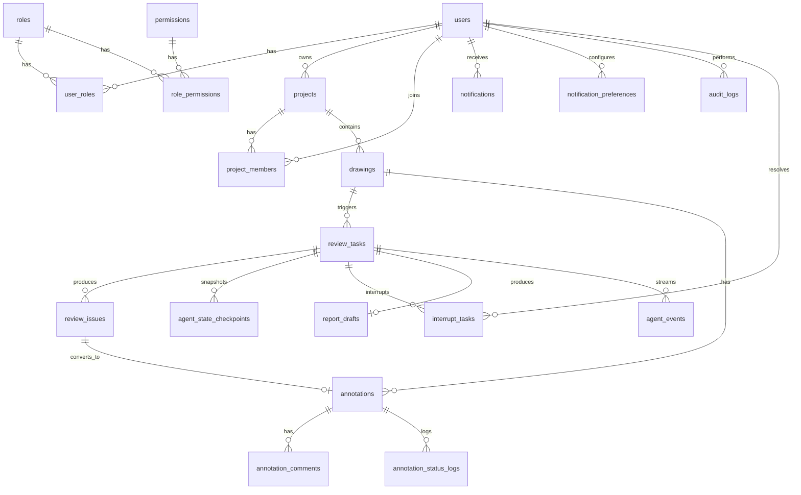
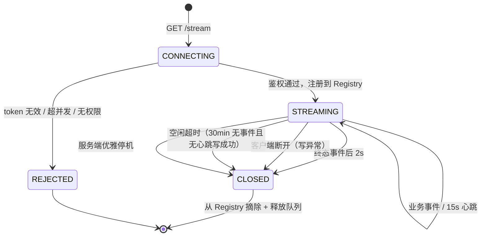

# prd-07 接口与数据模型契约

| 项 | 内容 |
| :--- | :--- |
| 模块编号 | M07 |
| 产品版本 | **V1.0（MVP）** |
| 优先级 | P0（前后端联调前置） |
| 对应总 PRD | §10 关键技术契约、§10.5 AI 引擎、§10.6 实时链路 |
| 上游依赖 | `prd-06`（LangGraph State / HITL 语义 / SSE 事件枚举） |
| 主要读者 | 后端（主）、前端（生成 TS 类型） |
| 技术栈约定 | PostgreSQL 14+ / FastAPI + Pydantic v2 / SQLAlchemy 2.0 / Alembic |

> **本文件是唯一权威契约。** 前端类型由 OpenAPI 自动生成，禁止手写与本文冲突的 interface。字段一律 `snake_case`，时间一律 ISO8601 带时区（UTC 存储，前端本地化展示）。
>
> **本次增量（仍属产品 V1.0 范围）**：
> 1. 新增 4 张表：`agent_state_checkpoints` / `interrupt_tasks` / `report_drafts` / `agent_events`；
> 2. 预审进度由轮询改为 **SSE**，并补齐 **连接治理**（§8.1：心跳、写超时、空闲回收、泄漏扫描、Nginx 配置、6 项压测）；
> 3. 新增 **统一模型注册表**（§6.0）+ 4 个核心结构的字段速查（§6.12）；
> 4. 新增 **数据权限**强制要求（§8.2，配合 `prd-03` §5.5 的代码与单测）；
> 5. 新增 **Swagger/OpenAPI 生成规范**（§11，含 CI 门禁）。
>
> 原有业务接口的入参出参**无破坏性变更**（`review_tasks` 仅追加字段）。


---

## 1. 通用约定

### 1.1 基础规范

| 项 | 约定 |
| :--- | :--- |
| Base URL | `/api/v1` |
| 认证 | `Authorization: Bearer {access_token}` |
| 主键 | `UUID v4`（应用侧生成，便于前端乐观更新） |
| 时间 | `TIMESTAMPTZ`，返回 ISO8601（`2024-05-12T08:30:00+08:00`） |
| 分页 | `page`（默认 1，从 1 开始）+ `page_size`（默认 20，上限 200） |
| 空值 | 未赋值返回 `null`，不用空字符串 |
| 布尔 | `true/false`，不用 0/1 |
| 软删除 | `is_deleted` 字段，默认查询过滤 |
| 流式 | 预审进度唯一通道为 **SSE**（`text/event-stream`），详见 §1.4；禁止前端轮询任务状态 |

### 1.4 SSE 约定（V1.0 新增）

| 项 | 约定 |
| :--- | :--- |
| 端点 | `GET /api/v1/drawings/{drawing_id}/stream?thread_id={review_task_id}&token={stream_token}` |
| 鉴权 | `EventSource` 不能带 header → 先 `POST /drawings/{id}/stream-token` 换一次性 token（TTL 60s，单次有效，绑定 user + thread_id） |
| 报文 | `id: {seq}\n event: {type}\n data: {json}\n\n` |
| 事件信封 | `{seq, thread_id, run_id, event, ts, data}`（枚举与 payload 见 `prd-06` §9） |
| 续传 | 客户端带 `Last-Event-ID` 重连，服务端从 `agent_events` 回放；窗口 30min / 5000 条，溢出先发 `stream_reset` |
| 心跳 | 每 15s `event: heartbeat` |
| 关闭 | 终态事件后 2s 服务端关闭；客户端 `readyState=2` |
| 代理 | Nginx：`proxy_buffering off`、`proxy_read_timeout 3600s`、`proxy_http_version 1.1`、对 `text/event-stream` 禁用 gzip |
| 并发 | 同用户同 thread ≤ 3 条连接，超出 429 `STREAM_LIMIT_EXCEEDED` |

### 1.2 统一响应体

**单个对象**：直接返回资源 JSON（不放 `data` 包壳）。

**分页**：

```json
{
  "items": [],
  "total": 128,
  "page": 1,
  "page_size": 20,
  "pages": 7
}
```

**错误**：

```json
{
  "code": "VALIDATION_ERROR",
  "message": "标题长度不能超过 60 个字符",
  "detail": { "field": "title" },
  "trace_id": "b7c1f0e2-..."
}
```

### 1.3 错误码表

| HTTP | code | 场景 |
| :--- | :--- | :--- |
| 400 | `BAD_REQUEST` | 请求体结构错误 |
| 401 | `UNAUTHORIZED` | 未登录 / token 无效 |
| 401 | `TOKEN_EXPIRED` | access 过期（前端据此触发刷新） |
| 401 | `INVALID_CREDENTIALS` | 邮箱或密码错误 |
| 403 | `FORBIDDEN` | 无权限码 |
| 403 | `ACCOUNT_DISABLED` | 账号被禁用 |
| 403 | `NOT_PROJECT_MEMBER` | 非项目成员 |
| 404 | `NOT_FOUND` | 资源不存在 |
| 409 | `CONFLICT` | 乐观锁冲突（`row_version` 不匹配） |
| 409 | `DUPLICATE_RESOURCE` | 邮箱/用户名重复 |
| 422 | `VALIDATION_ERROR` | 业务校验失败（字段级） |
| 422 | `INVALID_STATE_TRANSITION` | 状态流转非法 |
| 422 | `ERR_EXT_NOT_ALLOWED` | 文件扩展名不允许 |
| 422 | `ERR_DWG_UNSUPPORTED` | 命中 DWG |
| 422 | `ERR_FILE_TOO_LARGE` | 超过体积上限 |
| 422 | `ERR_MIME_MISMATCH` | MIME 与扩展名不符 |
| 422 | `ERR_FILE_CORRUPTED` | 文件损坏/魔数不符 |
| 429 | `RATE_LIMITED` | 登录失败过多等 |
| 409 | `INTERRUPT_ALREADY_RESOLVED` | 同一 `interrupt_id` 重复处理（幂等，响应内含首次处理结果） |
| 409 | `RUN_NOT_WAITING` | 运行当前不在等待人工状态，无法 resume |
| 410 | `INTERRUPT_EXPIRED` | 中断任务已超过 24h 有效期 |
| 429 | `STREAM_LIMIT_EXCEEDED` | 同一 thread 的 SSE 连接数超限 |
| 500 | `CHECKPOINT_UNAVAILABLE` | LangGraph checkpoint 丢失，无法恢复（需重新发起预审） |
| 500 | `INTERNAL_ERROR` | 服务异常 |
| 501 | `NOT_IMPLEMENTED` | P1 预留接口（如报告导出）在 V1.0 被调用 |

---

## 2. 枚举字典（数据库与 API 共用）

```python
# app/models/enums.py
class RoleCode(str, Enum):
    ADMIN = "ADMIN"; REVIEWER = "REVIEWER"; DESIGNER = "DESIGNER"; VIEWER = "VIEWER"

class ProjectRole(str, Enum):
    OWNER = "OWNER"; REVIEWER = "REVIEWER"; DESIGNER = "DESIGNER"; VIEWER = "VIEWER"

class ProjectStatus(str, Enum):
    ACTIVE = "ACTIVE"; ARCHIVED = "ARCHIVED"

class FileType(str, Enum):
    PDF = "pdf"; DXF = "dxf"

class DrawingStatus(str, Enum):
    UPLOADING = "UPLOADING"; UPLOADED = "UPLOADED"; PARSING = "PARSING"; PARSED = "PARSED"
    REVIEWING = "REVIEWING"; REVIEW_DONE = "REVIEW_DONE"
    PARSE_FAILED = "PARSE_FAILED"; REVIEW_FAILED = "REVIEW_FAILED"; ARCHIVED = "ARCHIVED"

class ReviewTaskStatus(str, Enum):
    PENDING = "PENDING"; PARSING = "PARSING"; REVIEWING = "REVIEWING"
    SUCCEEDED = "SUCCEEDED"; FAILED = "FAILED"; CANCELED = "CANCELED"

class ReviewStage(str, Enum):
    """V1.0：阶段由引擎节点驱动，与 SSE progress.stage 一致（见 prd-06 §9.7）"""
    LOAD_CONTEXT = "LOAD_CONTEXT"; PLANNING = "PLANNING"; PARSING = "PARSING"
    RETRIEVING = "RETRIEVING"; VALIDATING = "VALIDATING"; DETECTING = "DETECTING"
    WAITING_RISK = "WAITING_RISK"; REPORTING = "REPORTING"
    WAITING_REPORT = "WAITING_REPORT"; PACKAGING = "PACKAGING"; DONE = "DONE"

class ReviewMode(str, Enum):
    PROFESSIONAL = "PROFESSIONAL"; SCHOOL = "SCHOOL"

class RunStatus(str, Enum):
    """一次引擎运行的状态；与 ReviewTaskStatus 并存，前者面向引擎，后者面向业务列表"""
    PENDING = "PENDING"; RUNNING = "RUNNING"; WAITING_HUMAN = "WAITING_HUMAN"
    SUCCEEDED = "SUCCEEDED"; FAILED = "FAILED"; RETURNED = "RETURNED"; CANCELED = "CANCELED"

class InterruptType(str, Enum):
    RISK_CONFIRM = "RISK_CONFIRM"; REPORT_CONFIRM = "REPORT_CONFIRM"; SCHOOL_REVIEW = "SCHOOL_REVIEW"

class InterruptStatus(str, Enum):
    PENDING = "PENDING"; VIEWED = "VIEWED"; RESOLVED = "RESOLVED"
    EXPIRED = "EXPIRED"; CANCELED = "CANCELED"

class HitlResolution(str, Enum):
    """单个风险项的处置：确认问题 / 特殊豁免"""
    CONFIRM_AS_ISSUE = "CONFIRM_AS_ISSUE"; MARK_EXEMPT = "MARK_EXEMPT"

class ReportDecision(str, Enum):
    APPROVED = "APPROVED"; REJECTED = "REJECTED"

class ReportStatus(str, Enum):
    DRAFT = "DRAFT"; WAITING_CONFIRM = "WAITING_CONFIRM"; CONFIRMED = "CONFIRMED"
    REJECTED = "REJECTED"; RETURNED = "RETURNED"

class AgentEventType(str, Enum):
    """SSE event 枚举，唯一权威定义见表 §2.1"""
    RUN_STARTED = "run_started"; PLAN_CREATED = "plan_created"
    NODE_STARTED = "node_started"; NODE_FINISHED = "node_finished"
    PROGRESS = "progress"; AGENT_THOUGHT = "agent_thought"
    TOOL_CALL = "tool_call"; TOOL_RESULT = "tool_result"
    ISSUE_FOUND = "issue_found"; RISK_FOUND = "risk_found"
    RISK_INTERRUPT = "risk_interrupt"; HITL_RESOLVED = "hitl_resolved"
    REPORT_READY = "report_ready"; REPORT_INTERRUPT = "report_interrupt"
    RUN_RETURNED = "run_returned"; RUN_COMPLETED = "run_completed"
    RUN_FAILED = "run_failed"; STREAM_RESET = "stream_reset"
    SANDBOX_STATUS = "sandbox_status"; HEARTBEAT = "heartbeat"
    STREAM_IDLE = "stream_idle"; STREAM_RESET = "stream_reset"

class Severity(str, Enum):
    BLOCKER = "BLOCKER"; MAJOR = "MAJOR"; MINOR = "MINOR"; INFO = "INFO"

class Discipline(str, Enum):
    ARCH = "ARCH"; STRUCT = "STRUCT"; MEP = "MEP"; GENERAL = "GENERAL"

class IssueCategory(str, Enum):
    CODE = "CODE"; CONSISTENCY = "CONSISTENCY"; CLASH = "CLASH"; COMPLETENESS = "COMPLETENESS"

class IssueStatus(str, Enum):
    PENDING = "PENDING"; ADOPTED = "ADOPTED"; REJECTED = "REJECTED"; IGNORED = "IGNORED"

class RejectReason(str, Enum):
    FALSE_POSITIVE = "FALSE_POSITIVE"; NOT_APPLICABLE = "NOT_APPLICABLE"
    DUPLICATE = "DUPLICATE"; OTHER = "OTHER"

class AnnotationSource(str, Enum):
    HUMAN = "HUMAN"; AI = "AI"

class ShapeType(str, Enum):
    RECT = "RECT"; POINT = "POINT"; TEXT = "TEXT"; FREEHAND = "FREEHAND"

class AnnotationStatus(str, Enum):
    PENDING_CONFIRM = "PENDING_CONFIRM"; ISSUED = "ISSUED"
    MODIFIED = "MODIFIED"; CLOSED = "CLOSED"

class LogType(str, Enum):
    CREATED = "CREATED"; STATUS_CHANGED = "STATUS_CHANGED"; ASSIGNED = "ASSIGNED"
    COMMENT = "COMMENT"; VERSION_LINKED = "VERSION_LINKED"; CLOSED = "CLOSED"; DELETED = "DELETED"

class NotificationType(str, Enum):
    REVIEW_COMPLETED = "REVIEW_COMPLETED"; REVIEW_FAILED = "REVIEW_FAILED"
    ANNOTATION_ASSIGNED = "ANNOTATION_ASSIGNED"; ANNOTATION_SUBMITTED = "ANNOTATION_SUBMITTED"
    ANNOTATION_CLOSED = "ANNOTATION_CLOSED"; MEMBER_ADDED = "MEMBER_ADDED"
    HITL_PENDING = "HITL_PENDING"; REPORT_READY = "REPORT_READY"   # V1.0
    SYSTEM = "SYSTEM"

class NotificationChannel(str, Enum):
    INAPP = "INAPP"; FEISHU = "FEISHU"; EMAIL = "EMAIL"

class EventStatus(str, Enum):
    PENDING = "PENDING"; PROCESSING = "PROCESSING"; PROCESSED = "PROCESSED"; FAILED = "FAILED"
```

**中文映射（后端下发 `*_text` 字段，前端禁止自行映射文案）**

| 枚举 | 映射 |
| :--- | :--- |
| `Severity` | 严重 / 主要 / 一般 / 提示 |
| `Discipline` | 建筑 / 结构 / 机电 / 通用 |
| `AnnotationStatus` | 待确认 / 已下发 / 已修改待复核 / 已关闭 |
| `IssueStatus` | 待判定 / 已采纳 / 已驳回 / 已忽略 |
| `DrawingStatus` | 上传中 / 已上传 / 解析中 / 解析完成 / 预审中 / 预审完成 / 解析失败 / 预审失败 / 已归档 |
| `RunStatus` | 排队中 / 运行中 / 等待人工 / 已成功 / 失败 / 已退回 / 已取消 |
| `InterruptStatus` | 待处理 / 已查看 / 已处理 / 已超时 / 已取消 |
| `HitlResolution` | 确认为问题 / 特殊豁免 |
| `ReportStatus` | 初稿 / 待确认 / 已确认 / 已退回修改 / 校园已退回 |

### 2.1 SSE 事件枚举（唯一权威）

> **契约分工（两边都写清，防止漂移）**
> - **本表 = 事件枚举与 data 字段索引的唯一权威**；代码里的 `AgentEventType` 必须与本表逐字一致（CI 比对，见 §11.2）。
> - **payload 完整示例与语义 = `prd-06` §9.4**；`prd-06` §9.2 只是"何时发/前端干什么"的说明表，不定义枚举。
> - 增删事件时：先改本表 → 再改 `AgentEventType` → 最后补 `prd-06` §9.4 示例。**顺序不能反。**

| `event` | data 关键字段 | 说明 |
| :--- | :--- | :--- |
| `run_started` | `percent`, `engine`, `review_mode`, `drawing_id` | 运行启动 |
| `plan_created` | `percent`, `rationale`, `steps[{step_id,name,status}]` | 规划完成 |
| `node_started` | `node`, `name`, `percent` | 进入节点 |
| `node_finished` | `node`, `ok`, `duration_ms`, `percent` | 离开节点 |
| `progress` | `percent`, `stage`, `text` | 细粒度进度 |
| `agent_thought` | `node`, `text`, `tokens` | 结论式思考（≤200 字） |
| `tool_call` | `tool`, `args_summary`, `sandbox`, `call_id` | 调用沙箱工具 |
| `tool_result` | `tool`, `call_id`, `ok`, `duration_ms`, `result_summary`, `artifact` | 工具返回 |
| `issue_found` | `issue_id`, `severity`, `discipline`, `title`, `confidence` | 检出问题 |
| `risk_found` | `risk_ids[]`, `count` | 检出高风险（未中断） |
| `risk_interrupt` | `interrupt_id`, `type`, `title`, `items[]`, `expires_at` | **卡点一** |
| `hitl_resolved` | `interrupt_id`, `resolution`, `operator`, `item_decisions[]` | 人工已完成 |
| `report_ready` | `report_id`, `version`, `issue_total`, `percent` | 初稿生成 |
| `report_interrupt` | `interrupt_id`, `type`, `report_id`, `title`, `expires_at` | **卡点二 / 校园评审** |
| `run_returned` | `interrupt_id`, `comment`, `report_id` | 校园退回 |
| `run_completed` | `percent`, `status`, `issue_total`, `duration_ms`, `report_id` | 成功终态 |
| `run_failed` | `status`, `reason`, `message`, `retryable` | 失败终态 |
| `stream_reset` | `reason`, `since_seq` | 重放窗口溢出，要求全量刷新 |
| `stream_idle` | `idle_seconds` | 30min 无业务事件，服务端主动关闭（连接治理） |
| `sandbox_status` | `pool_ready`, `pool_size`, `mode` | 仅内部监控，前端忽略 |
| `heartbeat` | `ts` | 15s 保活 |

> payload 的完整示例见 `prd-06` §9.4；本表只做字段索引，避免两处定义漂移。


---

## 3. 数据库表设计

### 3.0 ER 关系



### 3.1 `users`

| 字段 | 类型 | 约束 | 说明 |
| :--- | :--- | :--- | :--- |
| `id` | UUID | PK | |
| `name` | VARCHAR(32) | NOT NULL | 用户名，唯一 |
| `email` | VARCHAR(128) | NOT NULL UNIQUE（lower 索引） | 登录账号 |
| `password_hash` | VARCHAR(128) | NOT NULL | bcrypt |
| `avatar_url` | VARCHAR(512) | NULL | |
| `status` | VARCHAR(16) | NOT NULL DEFAULT 'ACTIVE' | `ACTIVE` / `DISABLED` |
| `token_version` | INT | NOT NULL DEFAULT 0 | 禁用/改密时 +1，使旧 JWT 失效 |
| `last_login_at` | TIMESTAMPTZ | NULL | |
| `last_login_ip` | VARCHAR(64) | NULL | |
| `created_at` / `updated_at` | TIMESTAMPTZ | NOT NULL DEFAULT now() | |

索引：`UNIQUE(name)`、`UNIQUE(lower(email))`。

### 3.2 `roles`

| 字段 | 类型 | 约束 | 说明 |
| :--- | :--- | :--- | :--- |
| `id` | UUID | PK | |
| `code` | VARCHAR(32) | NOT NULL UNIQUE | `ADMIN` / `REVIEWER` / `DESIGNER` / `VIEWER` |
| `name` | VARCHAR(32) | NOT NULL | 中文名 |
| `description` | VARCHAR(200) | NULL | |
| `is_system` | BOOLEAN | DEFAULT FALSE | 系统内置角色，不可删除 |
| `created_at` | TIMESTAMPTZ | | |

### 3.3 `permissions`

| 字段 | 类型 | 约束 | 说明 |
| :--- | :--- | :--- | :--- |
| `id` | UUID | PK | |
| `code` | VARCHAR(64) | NOT NULL UNIQUE | 如 `annotation:write` |
| `name` | VARCHAR(64) | NOT NULL | 中文名 |
| `module` | VARCHAR(32) | NOT NULL | 分组：`project/drawing/review/annotation/notification/system` |
| `description` | VARCHAR(200) | NULL | |

### 3.4 `user_roles`

| 字段 | 类型 | 约束 | 说明 |
| :--- | :--- | :--- | :--- |
| `user_id` | UUID | FK users, NOT NULL | |
| `role_id` | UUID | FK roles, NOT NULL | |
| `created_at` | TIMESTAMPTZ | | |
| — | — | PK(user_id, role_id) | |

### 3.5 `role_permissions`

| 字段 | 类型 | 约束 | 说明 |
| :--- | :--- | :--- | :--- |
| `role_id` | UUID | FK roles | |
| `permission_id` | UUID | FK permissions | |
| — | — | PK(role_id, permission_id) | |

### 3.6 `projects`

| 字段 | 类型 | 约束 | 说明 |
| :--- | :--- | :--- | :--- |
| `id` | UUID | PK | |
| `code` | VARCHAR(32) | NULL UNIQUE | 项目编号，可空 |
| `name` | VARCHAR(128) | NOT NULL | |
| `description` | TEXT | NULL | |
| `building_type` | VARCHAR(32) | NULL | 住宅/办公/医院/学校… |
| `design_stage` | VARCHAR(32) | NULL | 方案/初设/施工图 |
| `status` | VARCHAR(16) | NOT NULL DEFAULT 'ACTIVE' | `ACTIVE` / `ARCHIVED` |
| `owner_id` | UUID | FK users NOT NULL | 负责人 |
| `drawing_count` | INT | DEFAULT 0 | 冗余计数，写时维护 |
| `open_annotation_count` | INT | DEFAULT 0 | 冗余计数（未关闭批注） |
| `is_deleted` | BOOLEAN | DEFAULT FALSE | |
| `created_at` / `updated_at` | TIMESTAMPTZ | | |
| `last_opened_at` | TIMESTAMPTZ | NULL | 最近打开（按用户维度见 `project_members`） |

### 3.7 `project_members`

| 字段 | 类型 | 约束 | 说明 |
| :--- | :--- | :--- | :--- |
| `id` | UUID | PK | |
| `project_id` | UUID | FK projects NOT NULL | |
| `user_id` | UUID | FK users NOT NULL | |
| `project_role` | VARCHAR(16) | NOT NULL DEFAULT 'DESIGNER' | `OWNER/REVIEWER/DESIGNER/VIEWER` |
| `last_opened_at` | TIMESTAMPTZ | NULL | 用于"最近项目"排序（用户维度） |
| `created_at` | TIMESTAMPTZ | | |
| — | — | UNIQUE(project_id, user_id) | |

### 3.8 `upload_sessions`

| 字段 | 类型 | 约束 | 说明 |
| :--- | :--- | :--- | :--- |
| `id` | UUID | PK | `upload_id` |
| `project_id` | UUID | FK projects | |
| `user_id` | UUID | FK users | |
| `file_name` | VARCHAR(200) | NOT NULL | |
| `file_type` | VARCHAR(8) | NOT NULL | `pdf` / `dxf` |
| `total_size` | BIGINT | NOT NULL | 字节 |
| `chunk_size` | INT | NOT NULL DEFAULT 5242880 | 5MB |
| `chunk_total` | INT | NOT NULL | |
| `uploaded_chunks` | INT | DEFAULT 0 | 已收分片数 |
| `md5` | VARCHAR(32) | NULL | 完成后校验 |
| `status` | VARCHAR(16) | NOT NULL DEFAULT 'UPLOADING' | `UPLOADING/MERGING/COMPLETED/FAILED` |
| `expires_at` | TIMESTAMPTZ | NOT NULL | 24h 过期清理 |
| `created_at` | TIMESTAMPTZ | | |

### 3.9 `drawings`

| 字段 | 类型 | 约束 | 说明 |
| :--- | :--- | :--- | :--- |
| `id` | UUID | PK | |
| `project_id` | UUID | FK projects NOT NULL | |
| `name` | VARCHAR(200) | NOT NULL | 去扩展名的展示名 |
| `file_name` | VARCHAR(200) | NOT NULL | 原始文件名 |
| `file_type` | VARCHAR(8) | NOT NULL | `pdf` / `dxf` |
| `file_size` | BIGINT | NOT NULL | |
| `storage_key` | VARCHAR(512) | NOT NULL | 对象存储 key（加密存储） |
| `checksum` | VARCHAR(64) | NOT NULL | SHA256，Mock 引擎 seed 来源 |
| `version` | INT | NOT NULL DEFAULT 1 | 版本号 |
| `parent_drawing_id` | UUID | NULL | 上一版图纸 ID；v1 为 NULL |
| `is_current` | BOOLEAN | DEFAULT TRUE | 同 lineage 中当前版本为 TRUE |
| `status` | VARCHAR(20) | NOT NULL DEFAULT 'UPLOADED' | 见 `DrawingStatus` |
| `page_count` | INT | NULL | PDF 页数；DXF 为 1 |
| `parse_meta` | JSONB | NULL | 解析元数据，见 §6.5 `ParseMeta` |
| `parse_error` | TEXT | NULL | 失败原因 |
| `uploaded_by` | UUID | FK users | |
| `is_deleted` | BOOLEAN | DEFAULT FALSE | |
| `created_at` / `updated_at` | TIMESTAMPTZ | | |

索引：`(project_id, is_current, is_deleted)`、`(checksum)`。

### 3.10 `review_tasks`

| 字段 | 类型 | 约束 | 说明 |
| :--- | :--- | :--- | :--- |
| `id` | UUID | PK | |
| `project_id` | UUID | FK projects | 冗余 |
| `drawing_id` | UUID | FK drawings NOT NULL | |
| `status` | VARCHAR(16) | NOT NULL DEFAULT 'PENDING' | 见 `ReviewTaskStatus` |
| `stage` | VARCHAR(24) | NULL | 见 `ReviewStage` |
| `stage_text` | VARCHAR(64) | NULL | 后端下发的中文阶段文案 |
| `progress` | SMALLINT | DEFAULT 0 | 0~100 |
| `engine` | VARCHAR(16) | NOT NULL DEFAULT 'mock' | `mock` / `real` |
| `issue_total` | INT | DEFAULT 0 | |
| `issue_blocker` | INT | DEFAULT 0 | 冗余统计，供通知与列表 |
| `summary` | JSONB | NULL | `{"by_severity":{...},"by_discipline":{...},"by_category":{...}}` |
| `error_reason` | TEXT | NULL | |
| `cost_ms` | INT | NULL | |
| `created_by` | UUID | FK users | |
| `started_at` / `finished_at` | TIMESTAMPTZ | NULL | |
| `created_at` | TIMESTAMPTZ | | |
| **`thread_id`** | VARCHAR(64) | NOT NULL UNIQUE | LangGraph checkpoint 主键，V1.0 新增；默认 = `review_task.id` |
| **`run_id`** | VARCHAR(64) | NULL | 当前运行实例 ID，重跑会更新 |
| **`run_status`** | VARCHAR(16) | NOT NULL DEFAULT 'PENDING' | 见 `RunStatus`，引擎视角 |
| **`current_node`** | VARCHAR(32) | NULL | 当前 LangGraph 节点，断点排障用 |
| **`review_mode`** | VARCHAR(16) | NOT NULL DEFAULT 'PROFESSIONAL' | `PROFESSIONAL` / `SCHOOL` |
| **`report_id`** | UUID | NULL | 当前报告初稿，FK `report_drafts` |
| **`waiting_interrupt_id`** | UUID | NULL | 正等待的人工中断（null 表示未挂起） |
| **`last_seq`** | BIGINT | NOT NULL DEFAULT 0 | SSE 事件最大 seq，用于重放窗口判断 |

索引：`(drawing_id, created_at DESC)`、`(status)`、`(run_status, waiting_interrupt_id)`、`UNIQUE(thread_id)`。


### 3.11 `review_issues`

| 字段 | 类型 | 约束 | 说明 |
| :--- | :--- | :--- | :--- |
| `id` | UUID | PK | |
| `review_task_id` | UUID | FK review_tasks NOT NULL | |
| `drawing_id` | UUID | FK drawings | 冗余 |
| `project_id` | UUID | FK projects | 冗余 |
| `category` | VARCHAR(16) | NOT NULL | `CODE/CONSISTENCY/CLASH/COMPLETENESS` |
| `severity` | VARCHAR(8) | NOT NULL | `BLOCKER/MAJOR/MINOR/INFO` |
| `discipline` | VARCHAR(8) | NOT NULL | `ARCH/STRUCT/MEP/GENERAL` |
| `title` | VARCHAR(120) | NOT NULL | 问题标题 |
| `description` | TEXT | NULL | 详细描述 |
| `suggestion` | TEXT | NULL | 修改建议 |
| `rule_code` | VARCHAR(64) | NULL | 规则编号，如 `GB50016-2014-5.5.18` |
| `confidence` | SMALLINT | NOT NULL | 0~100 |
| `location` | JSONB | NOT NULL | 坐标契约，见 §4 |
| `location_valid` | BOOLEAN | DEFAULT TRUE | 坐标合法性 |
| `status` | VARCHAR(16) | NOT NULL DEFAULT 'PENDING' | `PENDING/ADOPTED/REJECTED/IGNORED` |
| `annotation_id` | UUID | NULL | 采纳后回填 |
| `created_at` | TIMESTAMPTZ | | |

索引：`(review_task_id, severity, confidence DESC)`、`(drawing_id, status)`。
**约束**：本表只插入不更新（除 `status` / `annotation_id`），保证 AI 结果可审计。

### 3.12 `issue_feedbacks`

| 字段 | 类型 | 约束 | 说明 |
| :--- | :--- | :--- | :--- |
| `id` | UUID | PK | |
| `issue_id` | UUID | FK review_issues | |
| `user_id` | UUID | FK users | |
| `reason` | VARCHAR(24) | NOT NULL | `FALSE_POSITIVE/NOT_APPLICABLE/DUPLICATE/OTHER` |
| `remark` | VARCHAR(500) | NULL | `OTHER` 时必填 |
| `created_at` | TIMESTAMPTZ | | |

### 3.13 `annotations`

| 字段 | 类型 | 约束 | 说明 |
| :--- | :--- | :--- | :--- |
| `id` | UUID | PK | |
| `project_id` | UUID | FK projects NOT NULL | 冗余 |
| `drawing_id` | UUID | FK drawings NOT NULL | |
| `drawing_version` | INT | NOT NULL | 创建时版本号 |
| `issue_id` | UUID | NULL | 来源 AI 问题 |
| `source` | VARCHAR(8) | NOT NULL DEFAULT 'HUMAN' | `HUMAN` / `AI` |
| `shape_type` | VARCHAR(10) | NOT NULL DEFAULT 'RECT' | |
| `location` | JSONB | NOT NULL | 见 §4 |
| `location_valid` | BOOLEAN | DEFAULT TRUE | |
| `title` | VARCHAR(60) | NOT NULL | |
| `content` | TEXT | NULL | ≤2000 |
| `severity` | VARCHAR(8) | NOT NULL | |
| `discipline` | VARCHAR(8) | NOT NULL | |
| `status` | VARCHAR(20) | NOT NULL DEFAULT 'PENDING_CONFIRM' | 见 `AnnotationStatus` |
| `assignee_id` | UUID | NULL | 责任人 |
| `assignee_missing` | BOOLEAN | DEFAULT FALSE | 责任人被移出项目时置 TRUE |
| `creator_id` | UUID | FK users NOT NULL | |
| `due_date` | DATE | NULL | |
| `version_drawing_id` | UUID | NULL | 标记已修改时关联的新版图纸 |
| `close_remark` | TEXT | NULL | |
| `closed_at` | TIMESTAMPTZ | NULL | 统计口径 |
| `comment_count` | INT | DEFAULT 0 | 冗余 |
| `is_deleted` | BOOLEAN | DEFAULT FALSE | 作废 |
| `row_version` | INT | NOT NULL DEFAULT 1 | 乐观锁 |
| `created_at` / `updated_at` | TIMESTAMPTZ | | |

索引：`(drawing_id, status)`、`(assignee_id, status)`、`(project_id, closed_at)`、`(project_id, severity)`。

### 3.14 `annotation_comments`

| 字段 | 类型 | 约束 | 说明 |
| :--- | :--- | :--- | :--- |
| `id` | UUID | PK | |
| `annotation_id` | UUID | FK annotations | |
| `author_id` | UUID | FK users | |
| `content` | TEXT | NOT NULL | ≤1000 |
| `is_deleted` | BOOLEAN | DEFAULT FALSE | 5 分钟内可自删 |
| `created_at` | TIMESTAMPTZ | | |

### 3.15 `annotation_status_logs`

| 字段 | 类型 | 约束 | 说明 |
| :--- | :--- | :--- | :--- |
| `id` | UUID | PK | |
| `annotation_id` | UUID | FK annotations | |
| `log_type` | VARCHAR(20) | NOT NULL | `CREATED/STATUS_CHANGED/ASSIGNED/VERSION_LINKED/CLOSED/DELETED` |
| `from_status` | VARCHAR(20) | NULL | |
| `to_status` | VARCHAR(20) | NULL | |
| `from_assignee_id` | UUID | NULL | |
| `to_assignee_id` | UUID | NULL | |
| `operator_id` | UUID | FK users | |
| `remark` | TEXT | NULL | 复核不通过原因 / 关闭说明 |
| `created_at` | TIMESTAMPTZ | | |

**本表只插入不更新不删除**（审计要求）。

### 3.16 `notifications`

| 字段 | 类型 | 约束 | 说明 |
| :--- | :--- | :--- | :--- |
| `id` | UUID | PK | |
| `user_id` | UUID | FK users NOT NULL | 接收人 |
| `type` | VARCHAR(24) | NOT NULL | 见 `NotificationType` |
| `channel` | VARCHAR(10) | NOT NULL DEFAULT 'INAPP' | |
| `event_key` | VARCHAR(200) | NOT NULL | 幂等键，与 event 对齐 |
| `title` | VARCHAR(200) | NOT NULL | |
| `content` | VARCHAR(1000) | NOT NULL | |
| `biz_type` | VARCHAR(20) | NOT NULL | `ANNOTATION/REVIEW_TASK/PROJECT/SYSTEM` |
| `biz_id` | UUID | NULL | |
| `project_id` | UUID | NULL | |
| `deeplink` | VARCHAR(500) | NULL | 以 `/` 开头的站内路径 |
| `is_read` | BOOLEAN | DEFAULT FALSE | |
| `read_at` | TIMESTAMPTZ | NULL | |
| `is_deleted` | BOOLEAN | DEFAULT FALSE | |
| `created_at` | TIMESTAMPTZ | | |

索引：`UNIQUE(user_id, event_key)`（幂等）、`(user_id, is_read, created_at DESC)`。

### 3.17 `notification_preferences`

| 字段 | 类型 | 约束 | 说明 |
| :--- | :--- | :--- | :--- |
| `id` | UUID | PK | |
| `user_id` | UUID | FK users | |
| `channel` | VARCHAR(10) | NOT NULL | `INAPP/FEISHU/EMAIL` |
| `enabled` | BOOLEAN | DEFAULT TRUE | `INAPP` 强制 TRUE |
| `target` | VARCHAR(500) | NULL | 飞书 user_id / 群 webhook（加密存储） |
| `event_types` | JSONB | DEFAULT '[]' | 空数组=订阅全部 |
| `created_at` / `updated_at` | TIMESTAMPTZ | | |
| — | — | UNIQUE(user_id, channel) | |

### 3.18 `domain_events`

| 字段 | 类型 | 约束 | 说明 |
| :--- | :--- | :--- | :--- |
| `id` | UUID | PK | |
| `event_key` | VARCHAR(200) | NOT NULL UNIQUE | `{type}:{aggregate_id}:{version}` |
| `event_type` | VARCHAR(24) | NOT NULL | |
| `aggregate_type` | VARCHAR(40) | NOT NULL | |
| `aggregate_id` | UUID | NOT NULL | |
| `project_id` | UUID | NULL | |
| `actor_id` | UUID | NULL | 操作人（用于"不通知自己"） |
| `payload` | JSONB | NOT NULL | 渲染消息所需快照 |
| `status` | VARCHAR(16) | NOT NULL DEFAULT 'PENDING' | |
| `retry_count` | SMALLINT | DEFAULT 0 | 上限 3 |
| `next_retry_at` | TIMESTAMPTZ | NULL | |
| `error_message` | TEXT | NULL | |
| `created_at` | TIMESTAMPTZ | | |
| `processed_at` | TIMESTAMPTZ | NULL | |

索引：`(status, next_retry_at)`（消费者拉取）。

### 3.19 `audit_logs`

| 字段 | 类型 | 约束 | 说明 |
| :--- | :--- | :--- | :--- |
| `id` | UUID | PK | |
| `user_id` | UUID | FK users | 操作人 |
| `action` | VARCHAR(40) | NOT NULL | 见 prd-05 §8 |
| `target_type` | VARCHAR(32) | NOT NULL | `USER/PROJECT/DRAWING/ANNOTATION` |
| `target_id` | UUID | NULL | |
| `target_name` | VARCHAR(200) | NULL | 名称快照 |
| `detail` | JSONB | NULL | 脱敏摘要 |
| `ip` | VARCHAR(64) | NULL | |
| `user_agent` | VARCHAR(300) | NULL | |
| `created_at` | TIMESTAMPTZ | | |

索引：`(created_at DESC)`、`(action, created_at)`、`(user_id, created_at)`。

### 3.20 `agent_state_checkpoints`（V1.0 新增）

> 作用：为 LangGraph 断点提供**可读快照**，支持排障、回放、前端展示"执行到哪一步"。
> **恢复的唯一权威来源仍是 LangGraph 自带的 `checkpoints` / `checkpoint_blobs` / `checkpoint_writes` 表**，本表不参与恢复决策，只做审计与展示。

| 字段 | 类型 | 约束 | 说明 |
| :--- | :--- | :--- | :--- |
| `id` | UUID | PK | |
| `thread_id` | VARCHAR(64) | NOT NULL | 对应 `review_tasks.thread_id` |
| `run_id` | VARCHAR(64) | NOT NULL | 本次运行 ID |
| `seq` | BIGINT | NOT NULL | 本次运行内的快照序号，从 1 递增 |
| `node` | VARCHAR(32) | NOT NULL | 产生的节点名（如 `risk_check`） |
| `checkpoint_id` | VARCHAR(64) | NULL | LangGraph 返回的 checkpoint id，用于关联 |
| `run_status` | VARCHAR(16) | NOT NULL | 快照时的 `RunStatus` |
| `state_snapshot` | JSONB | NULL | **裁剪版** State（去 artifact 二进制、issues 截断 200 条），≤256KB |
| `state_digest` | VARCHAR(64) | NOT NULL | `sha256(规范化 JSON(state_snapshot))`，用于一致性校验 |
| `interrupt_id` | UUID | NULL | 若该快照处于中断态，记录对应中断 |
| `created_at` | TIMESTAMPTZ | NOT NULL DEFAULT now() | |

索引：`UNIQUE(thread_id, seq)`、`(thread_id, created_at DESC)`、`(run_id)`。
**只插入不更新**；保留策略：每个 thread 最多保留 200 条，超出按 `seq` 从旧删（归档到对象存储）。

### 3.21 `interrupt_tasks`（V1.0 新增，HITL 工单）

| 字段 | 类型 | 约束 | 说明 |
| :--- | :--- | :--- | :--- |
| `id` | UUID | PK | 即 `interrupt_id` |
| `thread_id` | VARCHAR(64) | NOT NULL | 关联 `review_tasks.thread_id` |
| `run_id` | VARCHAR(64) | NOT NULL | |
| `project_id` | UUID | FK projects NOT NULL | 便于按项目统计 |
| `drawing_id` | UUID | FK drawings NOT NULL | |
| `review_task_id` | UUID | FK review_tasks NOT NULL | |
| `type` | VARCHAR(20) | NOT NULL | `RISK_CONFIRM` / `REPORT_CONFIRM` / `SCHOOL_REVIEW` |
| `status` | VARCHAR(16) | NOT NULL DEFAULT 'PENDING' | 见 `InterruptStatus` |
| `title` | VARCHAR(200) | NOT NULL | 展示标题 |
| `payload` | JSONB | NOT NULL | 中断内容快照：`items[]`（风险项）/ `report_id`（报告确认） |
| `assignee_id` | UUID | NULL | 指定处理人；null = 项目内任一有权限者 |
| `resolved_by` | UUID | NULL | 处理人 |
| `resolution` | VARCHAR(24) | NULL | `CONFIRM_AS_ISSUE` / `MARK_EXEMPT` / `APPROVED` / `REJECTED` / `APPROVE` / `RETURN` |
| `item_decisions` | JSONB | NULL | 逐项决策：`[{risk_id, decision, remark}]` |
| `remark` | TEXT | NULL | 整体备注 / 退回意见（≥10 字，视类型而定） |
| `viewed_at` | TIMESTAMPTZ | NULL | 首次打开时间（`PENDING → VIEWED`） |
| `resolved_at` | TIMESTAMPTZ | NULL | |
| `expires_at` | TIMESTAMPTZ | NOT NULL | 默认 `created_at + 24h` |
| `created_at` | TIMESTAMPTZ | NOT NULL DEFAULT now() | |

索引：`(status, expires_at)`（超时扫描）、`(project_id, status)`、`(assignee_id, status)`、`(review_task_id, created_at DESC)`。
**约束**：同一 `thread_id` 同一时刻只允许 1 条 `status=PENDING` 记录（部分唯一索引）。
**只允许状态更新**，`payload` 不可变（审计要求）。

### 3.22 `report_drafts`（V1.0 新增）

| 字段 | 类型 | 约束 | 说明 |
| :--- | :--- | :--- | :--- |
| `id` | UUID | PK | 即 `report_id` |
| `review_task_id` | UUID | FK review_tasks NOT NULL | |
| `project_id` / `drawing_id` | UUID | NOT NULL | 冗余 |
| `version` | INT | NOT NULL DEFAULT 1 | 退回重生成则 +1 |
| `status` | VARCHAR(20) | NOT NULL DEFAULT 'DRAFT' | 见 `ReportStatus` |
| `title` | VARCHAR(200) | NOT NULL | 报告标题 |
| `summary` | JSONB | NULL | `{issue_total, by_severity{}, risk_decided, risk_exempt}` |
| `sections` | JSONB | NOT NULL | 章节数组：`[{key,title,body_md,metrics[],issue_refs[]}]` |
| `risk_decisions` | JSONB | NULL | 报告里引用的风险处置结论快照 |
| `artifact_ref` | VARCHAR(512) | NULL | 正式文档（PDF/HTML）对象存储 key，确认后才生成 |
| `confirmed_by` | UUID | NULL | |
| `confirmed_at` | TIMESTAMPTZ | NULL | |
| `reject_reason` | TEXT | NULL | 退回意见 |
| `created_at` / `updated_at` | TIMESTAMPTZ | | |

索引：`(review_task_id, version DESC)`、`(status)`。

### 3.23 `agent_events`（V1.0 新增，SSE 事件日志）

> 作用：① 支撑 `Last-Event-ID` 重放 ② 事后回放整条执行链路 ③ 排查"前端卡在 70%"类问题。
> **必须有**：没有事件表，SSE 断线即丢事件，前端会停在错误的进度上。

| 字段 | 类型 | 约束 | 说明 |
| :--- | :--- | :--- | :--- |
| `id` | BIGSERIAL | PK | |
| `thread_id` | VARCHAR(64) | NOT NULL | |
| `run_id` | VARCHAR(64) | NOT NULL | |
| `seq` | BIGINT | NOT NULL | 该 thread 内单调递增 |
| `event` | VARCHAR(32) | NOT NULL | 见 `AgentEventType` |
| `data` | JSONB | NOT NULL | 事件 payload（不含信封字段） |
| `created_at` | TIMESTAMPTZ | NOT NULL DEFAULT now() | |

索引：`UNIQUE(thread_id, seq)`、`(thread_id, seq DESC)`、`(created_at)`。
保留策略：30 天；`heartbeat` 事件**不落库**（只走内存推送）。

---

## 4. `location` JSON Schema（坐标契约，与总 PRD §10.1 一致）

```python
from pydantic import BaseModel, Field
from typing import Literal

class BBox(BaseModel):
    x: float
    y: float
    w: float = Field(gt=0)
    h: float = Field(gt=0)

class PageSize(BaseModel):
    w: float
    h: float

class DxfMeta(BaseModel):
    layout: str = "Model"
    entities: list[str] = []      # 实体 handle，用于精确选中
    layers: list[str] = []        # 涉及的图层名

class Location(BaseModel):
    file_type: Literal["pdf", "dxf"]
    page_no: int = Field(ge=1)
    bbox: BBox
    unit: Literal["pt", "mm"]
    coord_system: Literal["pdf_user_space", "dxf_wcs"]
    origin: Literal["top-left", "bottom-left"]
    page_size: PageSize
    dxf: DxfMeta | None = None
```

**校验规则（后端入库前必做）**

1. `bbox` 必须完全落在 `page_size` 内；越界则裁剪并把 `location_valid=False`。
2. `file_type=dxf` 时 `unit` 必须 `mm`、`origin` 必须 `bottom-left`、`dxf` 非空。
3. `file_type=pdf` 时 `page_no` 必须 ≤ `drawings.page_count`。
4. 前端换算函数唯一入口：

```ts
// web/lib/coords.ts
export function toScreen(loc: Location, viewport: Viewport): ScreenRect
export function toLocation(rect: ScreenRect, viewport: Viewport, meta: ParseMeta): Location
```

---

## 5. REST API 清单

> 权限码列含义见 prd-05 §4.2。所有列表接口支持 `page` / `page_size`。

### 5.1 认证

| 方法 | 路径 | 权限 | 说明 |
| :--- | :--- | :--- | :--- |
| POST | `/auth/register` | 匿名 | 注册并返回 token |
| POST | `/auth/login` | 匿名 | 返回 access + refresh |
| POST | `/auth/refresh` | 匿名（带 refresh） | 换新 access |
| POST | `/auth/logout` | 已登录 | refresh 失效 |
| GET | `/auth/me` | 已登录 | 用户 + 角色 + 权限 + 菜单 |
| PATCH | `/users/me/profile` | 已登录 | 改资料/改密 |

### 5.2 工作台

| 方法 | 路径 | 权限 | 说明 |
| :--- | :--- | :--- | :--- |
| GET | `/dashboard/overview` | `project:read` | 三张统计卡 |
| GET | `/dashboard/todos` | `project:read` | 待办列表（`type` 筛选） |

### 5.3 项目

| 方法 | 路径 | 权限 | 说明 |
| :--- | :--- | :--- | :--- |
| GET | `/projects` | `project:read` | 列表（`sort=recent\|name\|created`、`status`） |
| POST | `/projects` | `project:write` | 创建（自动加本人为 OWNER + 建 INAPP 偏好不需要） |
| GET | `/projects/{id}` | `project:read` | 详情（含统计） |
| PATCH | `/projects/{id}` | `project:write` | 编辑 |
| DELETE | `/projects/{id}` | `project:write` | 软删除 |
| GET | `/projects/{id}/members` | `project:read` | 成员列表 |
| POST | `/projects/{id}/members` | `project:member:manage` | 添加成员 |
| PATCH | `/projects/{id}/members/{user_id}` | `project:member:manage` | 改项目角色 |
| DELETE | `/projects/{id}/members/{user_id}` | `project:member:manage` | 移出 |

### 5.4 图纸与上传

| 方法 | 路径 | 权限 | 说明 |
| :--- | :--- | :--- | :--- |
| POST | `/drawings/upload-sessions` | `drawing:upload` | 创建会话，返回 `upload_id` / `chunk_size` / `chunk_total` |
| PUT | `/drawings/upload-sessions/{upload_id}/chunks/{index}` | `drawing:upload` | 上传分片（`index` 从 0 开始，body 为二进制） |
| POST | `/drawings/upload-sessions/{upload_id}/complete` | `drawing:upload` | 合并并生成 drawing（**返回 422 `ERR_*` 之一**） |
| GET | `/drawings` | `drawing:read` | 列表（`project_id` 必填，`is_current`、`status`） |
| GET | `/drawings/{id}` | `drawing:read` | 详情 |
| POST | `/drawings/{id}/versions` | `drawing:upload` | 上传新版本（multipart，≤50MB 便捷通道） |
| GET | `/drawings/{id}/view-url` | `drawing:read` | 短时签名 URL（10 分钟） |
| GET | `/drawings/{id}/parse-meta` | `drawing:read` | 解析元数据 |
| DELETE | `/drawings/{id}` | `drawing:delete` | 软删除 |

### 5.5 预审与问题

| 方法 | 路径 | 权限 | 说明 |
| :--- | :--- | :--- | :--- |
| POST | `/drawings/{id}/review-tasks` | `review:execute` | 创建预审任务（异步，立即返回 202 + `thread_id`） |
| GET | `/review-tasks/{id}` | `review:read` | 任务**终态快照**（断线重连/首屏初始化用；**不得用于进度轮询**） |
| GET | `/review-tasks/{id}/issues` | `review:read` | 问题列表（`severity`/`discipline`/`category`/`status`/`keyword` 多值） |
| GET | `/issues/{id}` | `review:read` | 问题详情 |
| POST | `/issues/{id}/adopt` | `annotation:write` | 采纳为批注 |
| POST | `/issues/batch-adopt` | `annotation:write` | 批量采纳（事务） |
| POST | `/issues/{id}/reject` | `review:read` | 驳回（`reason`/`remark`） |
| POST | `/issues/{id}/ignore` | `review:read` | 忽略 |
| POST | `/review-tasks/{id}/report-tasks` | `review:read` | **P1 预留**：导出 PDF/Excel 报告；V1.0 固定返回 `501 NOT_IMPLEMENTED`（前端按钮为禁用态） |

### 5.5.1 引擎实时流与 HITL（V1.0 新增）

| 方法 | 路径 | 权限 | 说明 |
| :--- | :--- | :--- | :--- |
| POST | `/drawings/{id}/stream-token` | `review:read` | 换取一次性 SSE token（TTL 60s，绑定 user + thread_id） |
| GET | `/drawings/{id}/stream` | `review:read`（+ token） | **SSE 事件流**，`Content-Type: text/event-stream`；支持 `Last-Event-ID` 续传；替代轮询 |
| GET | `/drawings/{id}/hitl/pending` | `review:read` | 查询当前待处理中断（首屏/刷新后恢复弹窗用） |
| POST | `/drawings/{id}/hitl/resume` | `annotation:write` | 提交风险确认（确认问题 / 特殊豁免）并恢复运行 |
| POST | `/drawings/{id}/hitl/confirm-report` | `annotation:write` | 确认生成正式文档 / 退回修改 |
| POST | `/drawings/{id}/hitl/return` | `annotation:write` | **校园模式**：老师退回学生设计（必填评语） |
| GET | `/review-tasks/{id}/report-draft` | `review:read` | 读取报告初稿（章节、指标、风险处置） |

**`GET /drawings/{id}/stream` 行为**

| 项 | 说明 |
| :--- | :--- |
| Query | `thread_id`（必填）、`token`（必填）、可选 `from_seq`（等价 `Last-Event-ID`） |
| 响应头 | `Content-Type: text/event-stream`、`Cache-Control: no-cache`、`X-Accel-Buffering: no` |
| 首个事件 | 连接后立即补发 `run_started` 或当前快照事件（≤500ms） |
| 已终态 | 直接发终态事件后关闭（不挂起） |
| 不存在/无权限 | 返回 JSON 错误体（非流），`404` / `403` |
| 错误码 | `429 STREAM_LIMIT_EXCEEDED`、`401`（token 过期，前端重新取 token 再连） |


### 5.6 批注

| 方法 | 路径 | 权限 | 说明 |
| :--- | :--- | :--- | :--- |
| POST | `/annotations` | `annotation:write` | 创建 |
| GET | `/annotations` | `annotation:read` | 列表（`project_id`/`drawing_id`/`status`/`severity`/`discipline`/`assignee_id`/`keyword`） |
| GET | `/annotations/{id}` | `annotation:read` | 详情（含 `allowed_actions`） |
| PATCH | `/annotations/{id}` | `annotation:write` | 编辑（必须带 `row_version`） |
| POST | `/annotations/{id}/transition` | `annotation:transition` | 单条流转 |
| POST | `/annotations/batch-transition` | `annotation:transition` | 批量流转（`skip_invalid`） |
| DELETE | `/annotations/{id}` | `annotation:delete` | 作废 |
| POST | `/annotations/{id}/comments` | `annotation:read` | 评论 |
| GET | `/annotations/{id}/timeline` | `annotation:read` | 时间线（`page`） |
| DELETE | `/annotations/comments/{comment_id}` | `annotation:read` | 删本人评论（5 分钟内） |

### 5.7 消息

| 方法 | 路径 | 权限 | 说明 |
| :--- | :--- | :--- | :--- |
| GET | `/notifications` | `notification:read` | 列表（`tab=all\|unread\|system`、`type`） |
| GET | `/notifications/unread-count` | `notification:read` | `{count}` |
| GET | `/notifications/recent` | `notification:read` | 铃铛浮层（`limit` 默认 5） |
| POST | `/notifications/{id}/read` | `notification:read` | 幂等 |
| POST | `/notifications/read-all` | `notification:read` | 全部已读 |
| GET | `/notifications/preferences` | `notification:read` | 偏好 |
| PUT | `/notifications/preferences` | `notification:read` | 更新（V1.0 仅 `event_types`） |

### 5.8 系统管理

| 方法 | 路径 | 权限 | 说明 |
| :--- | :--- | :--- | :--- |
| GET | `/users` | `system:user:manage` | 用户列表 |
| POST | `/users` | `system:user:manage` | 新建 |
| PATCH | `/users/{id}` | `system:user:manage` | 编辑 |
| POST | `/users/{id}/reset-password` | `system:user:manage` | 重置（返回一次明文） |
| POST | `/users/{id}/status` | `system:user:manage` | 启用/禁用 |
| GET | `/roles` | `system:role:read` | 角色列表（含 `user_count`） |
| GET | `/permissions` | `system:role:read` | 权限码列表（按 module 分组） |
| GET | `/audit-logs` | `system:audit:read` | 审计日志 |

---

## 6. Pydantic 模型定义

> **本节是模型的唯一权威定义。** 所有接口的请求体/响应体必须有具名模型，**禁止在路由里用裸 `dict`**（否则 OpenAPI 里是 `additionalProperties: true`，前端生成的类型是 `Record<string, any>`，等于没有契约）。

### 6.0 模型总览（Model Registry）

> 用途：让前后端在写代码前先对齐"这个结构长什么样、谁在用"。**新增模型必须在此登记**，否则视为未定义。

| # | 模型名 | 类别 | 用途 | 被哪些接口引用 | 定义位置 |
| :--- | :--- | :--- | :--- | :--- | :--- |
| 1 | `Page[T]` | 响应包装 | 所有分页列表 | 全部 `GET` 列表接口 | §6.1 |
| 2 | `ErrorBody` | 响应 | 统一错误体 | 所有 4xx/5xx | §6.1 |
| 3 | `RegisterRequest` / `LoginRequest` / `TokenResponse` | 请求/响应 | 认证 | `/auth/*` | §6.2 |
| 4 | `UserMeResponse` | 响应 | 当前用户 + 权限 + 菜单 | `/auth/me` | §6.2 |
| 5 | `UserBrief` | 响应嵌入 | 用户最小信息（作者/指派人/操作人） | 全站嵌入 | §6.2 |
| 6 | `UserOut` / `UserCreateRequest` / `UserUpdateRequest` | 请求/响应 | 用户管理 | `/users*` | §6.2 |
| 7 | `DashboardOverview` / `TodoItem` | 响应 | 工作台 | `/dashboard/*` | §6.3 |
| 8 | `ProjectOut` / `ProjectDetailOut` / `ProjectCreateRequest` | 请求/响应 | 项目 | `/projects*` | §6.4 |
| 9 | `ProjectMemberOut` / `MemberAddRequest` | 请求/响应 | 项目成员 | `/projects/{id}/members` | §6.4 |
| 10 | `UploadSessionCreateRequest` / `UploadSessionOut` / `ChunkUploadResponse` | 请求/响应 | 分片上传 | `/drawings/upload-sessions*` | §6.5 |
| 11 | `DrawingOut` / `ViewUrlResponse` / `ParseMeta` | 响应 | 图纸 | `/drawings*` | §6.5 |
| 12 | `ReviewTaskCreateRequest` / `ReviewTaskOut` / `ReviewTaskSnapshot` | 请求/响应 | 预审任务 | `/drawings/{id}/review-tasks`、`/review-tasks/{id}` | §6.6 |
| 13 | **`IssueOut`** | 响应 | **AI 问题（落库后）** | `/review-tasks/{id}/issues`、`/issues/{id}` | §6.6 |
| 14 | **`IssueDraft`** | 内部模型 | **AI 问题（引擎输出草稿，未落库）** | 引擎 → `ReviewService`（非 HTTP） | §6.10 |
| 15 | `IssueAdoptRequest` / `BatchAdoptRequest` / `BatchAdoptResponse` / `IssueRejectRequest` | 请求/响应 | 问题采纳/驳回 | `/issues/*` | §6.6 |
| 16 | **`AnnotationCreateRequest` / `AnnotationUpdateRequest` / `AnnotationOut`** | 请求/响应 | **批注主体** | `/annotations*` | §6.7 |
| 17 | `AnnotationTransitionRequest` / `BatchTransitionRequest` / `BatchTransitionResponse` | 请求/响应 | 批注状态流转 | `/annotations/*/transition` | §6.7 |
| 18 | `CommentCreateRequest` / `TimelineItem` | 请求/响应 | 评论与时间线 | `/annotations/{id}/comments`、`/timeline` | §6.7 |
| 19 | `NotificationOut` / `UnreadCountResponse` / `ChannelPreference` | 响应 | 站内信 | `/notifications*` | §6.8 |
| 20 | `AuditLogOut` | 响应 | 审计 | `/audit-logs` | §6.9 |
| 21 | `StreamTokenOut` | 响应 | SSE 一次性 token | `/drawings/{id}/stream-token` | §6.11 |
| 22 | `AgentEvent` | 流式响应 | SSE 事件信封 | `/drawings/{id}/stream` | §6.11 |
| 23 | `HitlResumeRequest/RiskItemDecision` / `ConfirmReportRequest` / `SchoolReturnRequest` | 请求 | HITL 三个动作 | `/hitl/*` | §6.11 |
| 24 | `InterruptTaskOut` / `RiskItem` | 响应 | 中断工单 | `/hitl/pending` | §6.11 |
| 25 | `ReportDraftOut` / `ReportSection` | 响应 | 报告初稿 | `/review-tasks/{id}/report-draft` | §6.11 |

**命名规则（强制）**

| 后缀 | 含义 | 例 |
| :--- | :--- | :--- |
| `XxxRequest` | 入参，只含可写字段 | `AnnotationCreateRequest` |
| `XxxOut` | 出参，含 `*_text` 等展示字段 | `AnnotationOut` |
| `XxxBrief` | 嵌入用最小集 | `UserBrief` |
| `XxxDraft` | 引擎内部中间态，**不对外** | `IssueDraft` |
| `XxxResponse` | 非资源型的动作响应 | `HitlResumeResponse` |

### 6.1 基础

```python
from __future__ import annotations
from datetime import datetime, date
from enum import Enum
from typing import Generic, Literal, TypeVar
from uuid import UUID
from pydantic import BaseModel, ConfigDict, EmailStr, Field, field_validator, model_validator

T = TypeVar("T")

class APIModel(BaseModel):
    model_config = ConfigDict(from_attributes=True, populate_by_name=True)

class Page(APIModel, Generic[T]):
    items: list[T]
    total: int
    page: int
    page_size: int
    pages: int

class ErrorBody(APIModel):
    code: str
    message: str
    detail: dict | None = None
    trace_id: str
```

### 6.2 认证与用户

```python
class RegisterRequest(APIModel):
    name: str = Field(min_length=2, max_length=32)
    email: EmailStr
    password: str = Field(min_length=8, max_length=64)

    @field_validator("password")
    @classmethod
    def need_letter_and_digit(cls, v: str) -> str:
        if not (any(c.isalpha() for c in v) and any(c.isdigit() for c in v)):
            raise ValueError("密码必须同时包含字母与数字")
        return v

class LoginRequest(APIModel):
    email: EmailStr
    password: str
    remember_me: bool = True

class TokenResponse(APIModel):
    access_token: str
    refresh_token: str
    token_type: Literal["bearer"] = "bearer"
    expires_in: int = Field(description="access 有效期，秒")

class RefreshRequest(APIModel):
    refresh_token: str

class MenuItem(APIModel):
    key: str
    title: str
    path: str | None = None
    icon: str | None = None
    permission: str | None = None
    children: list["MenuItem"] = []

class UserMeResponse(APIModel):
    id: UUID
    name: str
    email: EmailStr
    avatar_url: str | None = None
    roles: list[str]
    permissions: list[str]
    menus: list[MenuItem]

class UserBrief(APIModel):
    id: UUID
    name: str
    email: EmailStr
    avatar_url: str | None = None

class UserOut(UserBrief):
    status: Literal["ACTIVE", "DISABLED"]
    roles: list[str]
    project_count: int = 0
    last_login_at: datetime | None = None
    created_at: datetime

class UserCreateRequest(APIModel):
    name: str = Field(min_length=2, max_length=32)
    email: EmailStr
    password: str = Field(min_length=8, max_length=64)
    role_codes: list[RoleCode] = Field(min_length=1)
    status: Literal["ACTIVE", "DISABLED"] = "ACTIVE"

class UserUpdateRequest(APIModel):
    name: str | None = Field(default=None, min_length=2, max_length=32)
    email: EmailStr | None = None
    role_codes: list[RoleCode] | None = None
    status: Literal["ACTIVE", "DISABLED"] | None = None

class StatusChangeRequest(APIModel):
    status: Literal["ACTIVE", "DISABLED"]

class ResetPasswordResponse(APIModel):
    user_id: UUID
    new_password: str = Field(description="仅本次返回，不落库明文")
```

### 6.3 工作台

```python
class DashboardOverview(APIModel):
    pending_drawings: int
    pending_drawings_in_review: int
    pending_annotations: int
    pending_annotations_to_review: int
    confirmed_issues_this_week: int
    confirmed_issues_last_week: int
    wow_change: float | None = Field(default=None, description="上周为 0 时返回 null")
    ai_block_rate_this_week: float = 0.0
    pending_hitl: int = 0   # V1.0：等待我确认的风险/报告数

class TodoItem(APIModel):
    id: str
    todo_type: Literal[
        "ANNOTATION_PENDING", "ANNOTATION_ISSUED", "ANNOTATION_TO_REVIEW",
        "REVIEW_RUNNING", "REVIEW_DONE", "HITL_PENDING",
    ]
    title: str
    project_id: UUID
    project_name: str
    status: str
    status_text: str
    biz_type: Literal["ANNOTATION", "REVIEW_TASK", "DRAWING"]
    biz_id: UUID
    deeplink: str
    updated_at: datetime
```

### 6.4 项目

```python
class ProjectCreateRequest(APIModel):
    name: str = Field(min_length=2, max_length=128)
    code: str | None = Field(default=None, max_length=32)
    description: str | None = None
    building_type: str | None = None
    design_stage: Literal["SCHEME", "PRELIMINARY", "CONSTRUCTION"] | None = None

class ProjectUpdateRequest(APIModel):
    name: str | None = None
    description: str | None = None
    building_type: str | None = None
    design_stage: str | None = None
    status: ProjectStatus | None = None

class ProjectMemberOut(APIModel):
    user: UserBrief
    project_role: ProjectRole
    open_annotation_count: int = 0
    joined_at: datetime

class ProjectOut(APIModel):
    id: UUID
    name: str
    code: str | None
    description: str | None
    building_type: str | None
    design_stage: str | None
    status: ProjectStatus
    owner: UserBrief
    drawing_count: int
    open_annotation_count: int
    my_project_role: ProjectRole | None = None
    created_at: datetime
    updated_at: datetime

class ProjectDetailOut(ProjectOut):
    members: list[ProjectMemberOut] = []

class MemberAddRequest(APIModel):
    user_id: UUID
    project_role: ProjectRole = ProjectRole.DESIGNER

class MemberUpdateRequest(APIModel):
    project_role: ProjectRole
```

### 6.5 图纸与上传

```python
class UploadSessionCreateRequest(APIModel):
    project_id: UUID
    file_name: str = Field(max_length=200)
    file_type: Literal["pdf", "dxf"]
    total_size: int = Field(gt=0)
    md5: str | None = Field(default=None, max_length=32)

    @field_validator("total_size")
    @classmethod
    def size_limit(cls, v: int, info):
        ft = info.data.get("file_type")
        limit = 100 * 1024 * 1024 if ft == "pdf" else 50 * 1024 * 1024
        if v > limit:
            raise ValueError("ERR_FILE_TOO_LARGE")
        return v

class UploadSessionOut(APIModel):
    upload_id: UUID
    chunk_size: int
    chunk_total: int
    expires_at: datetime

class ChunkUploadResponse(APIModel):
    upload_id: UUID
    received: int
    chunk_total: int

class UploadCompleteRequest(APIModel):
    md5: str | None = None

class ParseMeta(APIModel):
    page_count: int
    pages: list[PageSize] = []
    title_block: dict | None = None
    extents: dict | None = None
    layers: list[str] = []
    units: str | None = None

class DrawingOut(APIModel):
    id: UUID
    project_id: UUID
    name: str
    file_name: str
    file_type: FileType
    file_size: int
    version: int
    parent_drawing_id: UUID | None
    is_current: bool
    status: DrawingStatus
    status_text: str
    page_count: int | None
    issue_stat: dict | None = None   # {"BLOCKER":2,"MAJOR":5,"MINOR":8,"INFO":1}
    parse_error: str | None = None
    uploaded_by: UserBrief
    created_at: datetime
    updated_at: datetime

class ViewUrlResponse(APIModel):
    url: str = Field(description="短时签名 URL，≤10 分钟有效")
    expires_at: datetime
    file_type: FileType
```

### 6.6 预审与问题

```python
class ReviewTaskCreateRequest(APIModel):
    disciplines: list[Discipline] = [Discipline.ARCH, Discipline.STRUCT, Discipline.MEP]
    rule_sets: list[str] = ["GB50016", "GB50352"]

class ReviewTaskOut(APIModel):
    id: UUID
    drawing_id: UUID
    status: ReviewTaskStatus
    status_text: str
    stage: ReviewStage | None
    stage_text: str | None
    progress: int = Field(ge=0, le=100)
    engine: Literal["mock", "real"]
    issue_total: int
    issue_blocker: int
    summary: dict | None
    error_reason: str | None
    cost_ms: int | None
    created_at: datetime
    finished_at: datetime | None

class IssueOut(APIModel):
    id: UUID
    review_task_id: UUID
    drawing_id: UUID
    category: IssueCategory
    category_text: str
    severity: Severity
    severity_text: str
    discipline: Discipline
    discipline_text: str
    title: str
    description: str | None
    suggestion: str | None
    rule_code: str | None
    confidence: int
    location: Location
    location_valid: bool
    status: IssueStatus
    status_text: str
    annotation_id: UUID | None
    created_at: datetime

class IssueAdoptRequest(APIModel):
    title: str | None = Field(default=None, max_length=60)
    content: str | None = Field(default=None, max_length=2000)
    severity: Severity | None = None
    discipline: Discipline | None = None
    assignee_id: UUID | None = None
    due_date: date | None = None

class BatchAdoptRequest(APIModel):
    issue_ids: list[UUID] = Field(min_length=1, max_length=100)
    # 批量时以下字段统一应用；title/content 为 null 表示沿用各问题原文
    content: str | None = None
    severity: Severity | None = None
    discipline: Discipline | None = None
    assignee_id: UUID | None = None
    due_date: date | None = None

class BatchAdoptResponse(APIModel):
    created: int
    annotations: list[UUID]

class IssueRejectRequest(APIModel):
    reason: RejectReason
    remark: str | None = Field(default=None, max_length=500)

    @field_validator("remark")
    @classmethod
    def other_needs_remark(cls, v, info):
        if info.data.get("reason") == RejectReason.OTHER and not (v and len(v.strip()) >= 2):
            raise ValueError("选择'其他'时必须填写 2 字以上的说明")
        return v
```

### 6.7 批注

```python
class AnnotationCreateRequest(APIModel):
    project_id: UUID
    drawing_id: UUID
    shape_type: ShapeType = ShapeType.RECT
    location: Location
    title: str = Field(min_length=2, max_length=60)
    content: str | None = Field(default=None, max_length=2000)
    severity: Severity = Severity.MINOR
    discipline: Discipline = Discipline.GENERAL
    assignee_id: UUID | None = None
    due_date: date | None = None

class AnnotationUpdateRequest(APIModel):
    row_version: int
    title: str | None = Field(default=None, min_length=2, max_length=60)
    content: str | None = Field(default=None, max_length=2000)
    severity: Severity | None = None
    discipline: Discipline | None = None
    assignee_id: UUID | None = None
    due_date: date | None = None
    location: Location | None = None

class TransitionAction(str, Enum):
    """可提交给 /transition 的动作（会改变状态）"""
    ISSUE = "ISSUE"
    MARK_MODIFIED = "MARK_MODIFIED"
    CLOSE = "CLOSE"
    REJECT_AND_REISSUE = "REJECT_AND_REISSUE"
    DELETE = "DELETE"

class AnnotationAction(str, Enum):
    """allowed_actions 的取值，是 TransitionAction 的超集（含不改状态的编辑类动作）"""
    ISSUE = "ISSUE"
    MARK_MODIFIED = "MARK_MODIFIED"
    CLOSE = "CLOSE"
    REJECT_AND_REISSUE = "REJECT_AND_REISSUE"
    DELETE = "DELETE"
    EDIT = "EDIT"
    COMMENT = "COMMENT"

class AnnotationTransitionRequest(APIModel):
    action: TransitionAction
    row_version: int
    assignee_id: UUID | None = Field(default=None, description="ISSUE 必填")
    version_drawing_id: UUID | None = Field(default=None, description="MARK_MODIFIED 可选")
    close_remark: str | None = Field(default=None, max_length=500)
    reject_reason: str | None = Field(default=None, min_length=10, max_length=500)

    @model_validator(mode="after")
    def check_required(self):
        if self.action == TransitionAction.ISSUE and not self.assignee_id:
            raise ValueError("下发批注必须指定责任人")
        if self.action == TransitionAction.REJECT_AND_REISSUE and not self.reject_reason:
            raise ValueError("复核不通过必须填写原因（≥10 字）")
        return self

class BatchTransitionRequest(APIModel):
    annotation_ids: list[UUID] = Field(min_length=1, max_length=100)
    action: TransitionAction
    skip_invalid: bool = False
    assignee_id: UUID | None = None
    close_remark: str | None = None

class InvalidItem(APIModel):
    annotation_id: UUID
    reason: str

class BatchTransitionResponse(APIModel):
    succeeded: int
    failed: list[InvalidItem] = []

class AnnotationOut(APIModel):
    id: UUID
    project_id: UUID
    drawing_id: UUID
    drawing_version: int
    issue_id: UUID | None
    source: AnnotationSource
    shape_type: ShapeType
    location: Location
    location_valid: bool
    title: str
    content: str | None
    severity: Severity
    severity_text: str
    discipline: Discipline
    discipline_text: str
    status: AnnotationStatus
    status_text: str
    assignee: UserBrief | None
    assignee_missing: bool
    creator: UserBrief
    due_date: date | None
    version_drawing_id: UUID | None
    close_remark: str | None
    closed_at: datetime | None
    comment_count: int
    is_stale_version: bool
    allowed_actions: list[AnnotationAction]
    row_version: int
    created_at: datetime
    updated_at: datetime

class CommentCreateRequest(APIModel):
    content: str = Field(min_length=1, max_length=1000)

class TimelineItem(APIModel):
    id: UUID
    log_type: LogType
    log_type_text: str
    operator: UserBrief
    from_status: AnnotationStatus | None
    to_status: AnnotationStatus | None
    remark: str | None
    content: str | None          # COMMENT 类型的内容
    can_delete: bool = False      # COMMENT 且 5 分钟内
    created_at: datetime
```

### 6.8 消息

```python
class NotificationOut(APIModel):
    id: UUID
    type: NotificationType
    type_text: str
    title: str
    content: str
    biz_type: Literal["ANNOTATION", "REVIEW_TASK", "PROJECT", "SYSTEM"]
    biz_id: UUID | None
    project_id: UUID | None
    deeplink: str | None
    is_read: bool
    read_at: datetime | None
    created_at: datetime

class UnreadCountResponse(APIModel):
    count: int

class ReadAllResponse(APIModel):
    updated: int

class ChannelPreference(APIModel):
    channel: NotificationChannel
    enabled: bool
    available: bool = Field(description="V1.0 仅 INAPP 为 true")
    target_masked: str | None = None
    event_types: list[str] = []

class PreferencesOut(APIModel):
    channels: list[ChannelPreference]

class PreferencesUpdateRequest(APIModel):
    event_types: list[str] | None = Field(default=None, description="V1.0 仅允许改此项")
```

### 6.9 审计

```python
class AuditLogOut(APIModel):
    id: UUID
    user: UserBrief
    action: str
    target_type: str
    target_id: UUID | None
    target_name: str | None
    detail: dict | None
    ip: str | None
    created_at: datetime
```

### 6.10 引擎内部模型（非 HTTP）

```python
class IssueDraft(APIModel):
    """ReviewEngine 输出的单条问题草稿"""
    category: IssueCategory
    severity: Severity
    discipline: Discipline
    title: str = Field(max_length=120)
    description: str | None = None
    suggestion: str | None = None
    rule_code: str | None = None
    confidence: int = Field(ge=0, le=100)
    location: Location
```

### 6.11 引擎 / HITL / SSE 模型（V1.0 新增）

```python
# ---------- SSE 信封 ----------
class AgentEvent(BaseModel):
    seq: int
    thread_id: str
    run_id: str
    event: AgentEventType
    ts: datetime
    data: dict


# ---------- 实时流 token ----------
class StreamTokenOut(APIModel):
    token: str
    expires_at: datetime
    stream_url: str        # 已拼好 query 的相对路径，前端直接给 EventSource


# ---------- HITL 请求 ----------
class RiskItemDecision(APIModel):
    risk_id: str
    decision: HitlResolution
    remark: str | None = Field(default=None, max_length=500)

    @model_validator(mode="after")
    def exempt_needs_remark(self):
        if self.decision == HitlResolution.MARK_EXEMPT and not (self.remark and len(self.remark) >= 5):
            raise ValueError("标记为特殊豁免时必须填写依据（≥5 字）")
        return self

class HitlResumeRequest(APIModel):
    interrupt_id: UUID
    item_decisions: list[RiskItemDecision] = Field(min_length=1)
    remark: str | None = Field(default=None, max_length=1000)

class HitlResumeResponse(APIModel):
    interrupt_id: UUID
    status: InterruptStatus
    run_status: RunStatus
    resumed: bool

class ConfirmReportRequest(APIModel):
    interrupt_id: UUID
    decision: ReportDecision
    remark: str | None = Field(default=None, max_length=1000)

    @model_validator(mode="after")
    def reject_needs_remark(self):
        if self.decision == ReportDecision.REJECTED and not (self.remark and len(self.remark) >= 10):
            raise ValueError("退回修改必须填写意见（≥10 字）")
        return self

class ConfirmReportResponse(APIModel):
    report_id: UUID
    status: ReportStatus
    run_status: RunStatus
    artifact_url: str | None = Field(default=None, description="确认后生成的正式文档短时签名地址")

class SchoolReturnRequest(APIModel):
    interrupt_id: UUID
    comment: str = Field(min_length=10, max_length=1000, description="退回评语")

class SchoolReturnResponse(APIModel):
    report_id: UUID
    status: ReportStatus          # RETURNED
    run_status: RunStatus         # RETURNED
    notify_target: UserBrief


# ---------- HITL 状态读取 ----------
class RiskItem(APIModel):
    risk_id: str
    title: str
    level: Literal["HIGH", "CRITICAL"]
    metric_key: str | None = None
    detected_value: float | None = None
    threshold: float | None = None
    clause_ref: str | None = None
    why_suspicious: str | None = None
    drawing_id: UUID | None = None
    location: Location | None = None

class InterruptTaskOut(APIModel):
    id: UUID                       # interrupt_id
    thread_id: str
    review_task_id: UUID
    drawing_id: UUID
    type: InterruptType
    type_text: str
    status: InterruptStatus
    title: str
    items: list[RiskItem] = []     # RISK_CONFIRM 时有值
    report_id: UUID | None = None  # REPORT_CONFIRM / SCHOOL_REVIEW 时有值
    assignee: UserBrief | None = None
    resolution: str | None = None
    item_decisions: list[RiskItemDecision] = []
    remark: str | None = None
    expires_at: datetime
    remaining_seconds: int
    created_at: datetime


# ---------- 报告初稿 ----------
class ReportSection(APIModel):
    key: str
    title: str
    body_md: str
    metrics: list[dict] = []
    issue_refs: list[UUID] = []

class ReportDraftOut(APIModel):
    id: UUID
    review_task_id: UUID
    drawing_id: UUID
    version: int
    status: ReportStatus
    status_text: str
    title: str
    summary: dict | None
    sections: list[ReportSection]
    risk_decisions: list[dict] = []
    artifact_url: str | None = None
    reject_reason: str | None = None
    confirmed_at: datetime | None = None
    created_at: datetime


# ---------- 任务快照（新增字段） ----------
class ReviewTaskSnapshot(ReviewTaskOut):
    thread_id: str
    run_status: RunStatus
    current_node: str | None = None
    review_mode: ReviewMode = ReviewMode.PROFESSIONAL
    waiting_interrupt_id: UUID | None = None
    report_id: UUID | None = None
    last_seq: int = 0
```

### 6.12 核心结构字段速查（前后端对齐用）

> 代码在上面，但代码不便评审。下面四个结构是**最容易理解错**的，逐字段列清楚。

#### 6.12.1 `AnnotationOut`（批注，全站最高频结构）

| 字段 | 类型 | 可空 | 说明 |
| :--- | :--- | :--- | :--- |
| `id` | UUID | 否 | |
| `project_id` / `drawing_id` | UUID | 否 | 冗余字段，前端不必再查 |
| `drawing_version` | int | 否 | 创建时版本，用于"基于 v1"提示 |
| `issue_id` | UUID | 是 | 来自 AI 问题，人工创建为 null |
| `source` | `HUMAN`/`AI` | 否 | 决定是否显示 `AI` 徽标 |
| `shape_type` | `RECT`/`POINT`/`TEXT`/`FREEHAND` | 否 | 决定画布怎么画 |
| `location` | `Location` | 否 | 见 §4，**唯一坐标结构** |
| `location_valid` | bool | 否 | false 则不渲染框 |
| `title` | string(60) | 否 | |
| `content` | string(2000) | 是 | 描述 |
| `severity` / `severity_text` | enum / string | 否 | 枚举给逻辑，`_text` 给展示 |
| `discipline` / `discipline_text` | enum / string | 否 | |
| `status` / `status_text` | 4 态 / string | 否 | 见 §2 |
| `assignee` | `UserBrief` | 是 | 未下发时为 null |
| `assignee_missing` | bool | 否 | 责任人被移出项目 |
| `creator` | `UserBrief` | 否 | |
| `due_date` | date | 是 | |
| `version_drawing_id` | UUID | 是 | 标记已修改时关联的新版图纸 |
| `close_remark` / `closed_at` | string / datetime | 是 | 关闭说明与时间（统计口径） |
| `comment_count` | int | 否 | 冗余计数，避免列表再查 |
| `is_stale_version` | bool | 否 | 图纸已换版 → 显示"基于 v1" |
| `allowed_actions` | `AnnotationAction[]` | 否 | **后端算好下发的按钮白名单**，前端直接渲染 |
| `row_version` | int | 否 | 乐观锁，PATCH/transition 必须回传 |
| `created_at` / `updated_at` | datetime | 否 | |

> `allowed_actions` 与 `status` 是**两个维度**：`status` 说"这条现在在哪"，`allowed_actions` 说"你（当前登录人）能对它做什么"。前端不要用 status + 角色自己推。

#### 6.12.2 `IssueDraft`（引擎输出的问题草稿，非 HTTP）

| 字段 | 类型 | 必填 | 说明 |
| :--- | :--- | :--- | :--- |
| `category` | `CODE`/`CONSISTENCY`/`CLASH`/`COMPLETENESS` | 是 | 问题来源分类 |
| `severity` | `BLOCKER`/`MAJOR`/`MINOR`/`INFO` | 是 | |
| `discipline` | `ARCH`/`STRUCT`/`MEP`/`GENERAL` | 是 | |
| `title` | string(120) | 是 | 人话，例："3 层疏散楼梯净宽不足 1.1m" |
| `description` | string | 否 | |
| `suggestion` | string | 否 | 修改建议 |
| `rule_code` | string(64) | 否 | 例 `GB50016-2014-5.5.18` |
| `confidence` | int(0~100) | 是 | <60 前端标灰并提示"建议人工复核" |
| `location` | `Location` | 是 | 必须合法（越界由 `validate_location` 裁剪后置 `location_valid=false`） |

**`IssueDraft` → `IssueOut` 的差异（研发最容易搞混）**

| | `IssueDraft` | `IssueOut` |
| :--- | :--- | :--- |
| 谁产出 | 引擎（`ReviewEngine.review`） | 数据库 |
| 有无 `id` | ❌ 无（落库时才生成） | ✅ 有 |
| 有无 `status` | ❌ 无（天然是"待判定"） | ✅ `PENDING/ADOPTED/REJECTED/IGNORED` |
| 有无 `annotation_id` | ❌ 无 | ✅ 采纳后回填 |
| 可否修改 | 引擎产出即不可变 | 只允许改 `status` / `annotation_id` |

> 结论：**引擎永远不写 `review_issues` 表**，它只返回 `list[IssueDraft]`，由 `ReviewService` 负责落库与状态流转。这条边界不划清，后面一定会出现"引擎自己改状态"的脏设计。

#### 6.12.3 `RiskItem`（触发中断的最小单元）

| 字段 | 类型 | 说明 |
| :--- | :--- | :--- |
| `risk_id` | string | 本次运行内唯一，`r1`/`r2` |
| `title` | string | 例"容积率超出规划条件" |
| `level` | `HIGH`/`CRITICAL` | 决定颜色与排序（CRITICAL 红） |
| `metric_key` | string | `FAR` / `FIRE_ZONE_AREA` / `EVAC_WIDTH` |
| `detected_value` / `threshold` | float | 检测值 / 限值，前端显示"3.42 / 3.0" |
| `clause_ref` | string | 依据出处（规划条件、规范条文号） |
| `why_suspicious` | string | **为什么可疑**——这句话决定用户信不信 AI |
| `drawing_id` / `location` | UUID / `Location` | 可空；有值时弹窗里可"定位到图纸" |

#### 6.12.4 `AgentEvent`（SSE 信封）

| 字段 | 类型 | 说明 |
| :--- | :--- | :--- |
| `seq` | int | 该 thread 内单调递增，与 SSE `id:` 一致 |
| `thread_id` | string | = `review_task.id` |
| `run_id` | string | 本次运行 |
| `event` | `AgentEventType` | 见 §2.1 |
| `ts` | datetime | 事件产生时间（不是收到时间） |
| `data` | object | 每种 event 不同，见 `prd-06` §9.4 |

> `data` 故意用 `dict` 而非 `Union[...]`：SSE 是**流式**，用联合类型会让 OpenAPI 生成 `anyOf` 十几支，前端 SWR/TypeScript 体验极差。改为在 `prd-06` §9.4 用文档 + 前端手写 6 个窄类型收敛（V1.0 只需 6 个）。


---

## 7. 关键接口示例

### 7.1 `POST /auth/login`

```http
POST /api/v1/auth/login
Content-Type: application/json

{ "email": "reviewer@arch.com", "password": "Passw0rd123", "remember_me": true }
```

`200`：

```json
{
  "access_token": "eyJhbGciOi...",
  "refresh_token": "rt_7f3a...",
  "token_type": "bearer",
  "expires_in": 7200
}
```

`401`：`{"code":"INVALID_CREDENTIALS","message":"邮箱或密码错误","trace_id":"..."}`
`403`：`{"code":"ACCOUNT_DISABLED","message":"账号已被禁用，请联系管理员","trace_id":"..."}`

### 7.2 `GET /dashboard/todos`

```json
{
  "items": [
    {
      "id": "ANNOTATION:a1b2c3d4-0000-0000-0000-000000000001",
      "todo_type": "ANNOTATION_TO_REVIEW",
      "title": "3 层疏散楼梯净宽不足 1.1m",
      "project_id": "p-0001",
      "project_name": "滨江办公楼",
      "status": "MODIFIED",
      "status_text": "已修改待复核",
      "biz_type": "ANNOTATION",
      "biz_id": "a1b2c3d4-0000-0000-0000-000000000001",
      "deeplink": "/projects/p-0001/drawings/d-0002?annotation=a1b2c3d4-0000-0000-0000-000000000001&focus=1",
      "updated_at": "2024-05-12T09:20:00+08:00"
    }
  ],
  "total": 1, "page": 1, "page_size": 10, "pages": 1
}
```

### 7.3 `POST /drawings/upload-sessions` → 拒绝 DWG

```http
POST /api/v1/drawings/upload-sessions
{ "project_id": "p-0001", "file_name": "总平面.dwg", "file_type": "dxf", "total_size": 10485760 }
```

`422`：

```json
{
  "code": "ERR_EXT_NOT_ALLOWED",
  "message": "当前版本仅支持 PDF 与 DXF 文件",
  "detail": { "file_name": "总平面.dwg" },
  "trace_id": "c0ffee00-..."
}
```

### 7.4 `POST /drawings/{id}/review-tasks` → SSE 订阅（V1.0 改造）

```json
// POST 响应 202
{ "id": "t-0001", "thread_id": "t-0001", "run_status": "PENDING", "review_mode": "PROFESSIONAL",
  "drawing_id": "d-0002", "status": "PENDING", "status_text": "排队中",
  "stage": null, "stage_text": null, "progress": 0, "engine": "mock",
  "issue_total": 0, "issue_blocker": 0, "summary": null, "error_reason": null,
  "cost_ms": null, "last_seq": 0,
  "created_at": "2024-05-12T09:20:00+08:00", "finished_at": null }
```

```http
POST /api/v1/drawings/d-0002/stream-token
{ "thread_id": "t-0001" }
```
```json
{ "token": "st_8f3a...", "expires_at": "2024-05-12T09:21:00+08:00",
  "stream_url": "/api/v1/drawings/d-0002/stream?thread_id=t-0001&token=st_8f3a..." }
```

```http
GET /api/v1/drawings/d-0002/stream?thread_id=t-0001&token=st_8f3a...
Accept: text/event-stream
```

```text
id: 1
event: run_started
data: {"seq":1,"thread_id":"t-0001","run_id":"r-01","event":"run_started","ts":"2024-05-12T09:20:01.010+08:00","data":{"percent":0,"engine":"mock","review_mode":"PROFESSIONAL","drawing_id":"d-0002"}}

id: 2
event: plan_created
data: {"seq":2,...,"data":{"percent":8,"rationale":"住宅标准层，重点核对疏散与防火分区","steps":[{"step_id":"s1","name":"解析项目简介","status":"pending"}]}}

id: 9
event: progress
data: {"seq":9,...,"data":{"percent":40,"stage":"RETRIEVING","text":"正在核对规范"}}

id: 16
event: risk_interrupt
data: {"seq":16,...,"data":{"interrupt_id":"it-0001","type":"RISK_CONFIRM","title":"发现 2 项高风险指标，需人工确认","expires_at":"2024-05-13T09:20:00+08:00","items":[{"risk_id":"r1","title":"容积率超出规划条件","level":"CRITICAL","metric_key":"FAR","detected_value":3.42,"threshold":3.0,"clause_ref":"规划条件通知书-第三条","why_suspicious":"按图表面积推算 3.42，超限 14%"}]}}

: heartbeat

id: 24
event: hitl_resolved
data: {"seq":24,...,"data":{"interrupt_id":"it-0001","resolution":"MARK_EXEMPT","operator":"张工","item_decisions":[{"risk_id":"r1","decision":"MARK_EXEMPT","remark":"已取得规划部门超限批复"}],"resumed":true}}

id: 31
event: report_interrupt
data: {"seq":31,...,"data":{"interrupt_id":"it-0002","type":"REPORT_CONFIRM","report_id":"rp-001","title":"报告初稿已生成，请确认是否输出正式文档","expires_at":"2024-05-13T09:22:00+08:00"}}

id: 38
event: run_completed
data: {"seq":38,...,"data":{"percent":100,"status":"SUCCEEDED","issue_total":12,"duration_ms":8432,"report_id":"rp-001","thread_id":"t-0001"}}
```

```json
// 终态快照（仅断线重连或首屏初始化使用，禁止轮询）
{ "status": "SUCCEEDED", "run_status": "SUCCEEDED", "stage": "DONE", "stage_text": "预审完成",
  "progress": 100, "issue_total": 12, "issue_blocker": 2, "last_seq": 38,
  "summary": { "by_severity": {"BLOCKER":2,"MAJOR":4,"MINOR":5,"INFO":1},
               "by_discipline": {"ARCH":5,"STRUCT":3,"MEP":3,"GENERAL":1},
               "by_category": {"CODE":5,"CONSISTENCY":3,"CLASH":3,"COMPLETENESS":1} },
  "engine": "mock", "cost_ms": 8432, "finished_at": "2024-05-12T09:20:09+08:00" }
```

### 7.4.1 `POST /drawings/{id}/hitl/resume`

```json
{ "interrupt_id": "it-0001",
  "item_decisions": [
    { "risk_id": "r1", "decision": "MARK_EXEMPT", "remark": "已取得规划部门超限批复" },
    { "risk_id": "r2", "decision": "CONFIRM_AS_ISSUE", "remark": null }
  ],
  "remark": "r1 走豁免，r2 转批注下发给李工" }
```

`200`：

```json
{ "interrupt_id": "it-0001", "status": "RESOLVED", "run_status": "RUNNING", "resumed": true }
```

`409`：`{"code":"INTERRUPT_ALREADY_RESOLVED","message":"该中断已由 张工 处理","detail":{"resolution":"MARK_EXEMPT","resolved_at":"..."}}`
`410`：`{"code":"INTERRUPT_EXPIRED","message":"该确认已超过 24 小时有效期，请重新发起预审"}`
`422`：`{"code":"VALIDATION_ERROR","message":"标记为特殊豁免时必须填写依据（≥5 字）","detail":{"field":"item_decisions[0].remark"}}`

### 7.4.2 `POST /drawings/{id}/hitl/confirm-report`

```json
{ "interrupt_id": "it-0002", "decision": "APPROVED", "remark": null }
```

`200`：

```json
{ "report_id": "rp-001", "status": "CONFIRMED", "run_status": "SUCCEEDED",
  "artifact_url": "https://storage/.../report-rp-001.pdf?sig=..." }
```

```json
// 退回修改
{ "interrupt_id": "it-0002", "decision": "REJECTED",
  "remark": "第 3 章遗漏了 2 处防火分区问题，请补充后重新生成" }
```

### 7.4.3 `POST /drawings/{id}/hitl/return`（校园模式）

```json
{ "interrupt_id": "it-0003", "comment": "疏散宽度计算缺少推导过程，标准层平面请补画疏散指示，修改后重新提交" }
```

`200`：

```json
{ "report_id": "rp-001", "status": "RETURNED", "run_status": "RETURNED",
  "notify_target": {"id":"u-0009","name":"王同学","email":"wang@school.edu","avatar_url":null} }
```


### 7.5 `POST /issues/batch-adopt`

```json
{ "issue_ids": ["i-1", "i-2"], "severity": null, "discipline": null,
  "assignee_id": "u-0001", "content": null, "due_date": null }
```

`200`：`{ "created": 2, "annotations": ["a-1", "a-2"] }`
`422`：`{"code":"VALIDATION_ERROR","message":"第 2 条指派人不在项目中","detail":{"index":1}}`（**整批回滚**）

### 7.6 `POST /annotations/{id}/transition`

```json
// 下发
{ "action": "ISSUE", "row_version": 3, "assignee_id": "u-0001" }
```

```json
// 复核不通过
{ "action": "REJECT_AND_REISSUE", "row_version": 5,
  "reject_reason": "仍不符合 GB50016 5.5.18，净宽实测 1.05m" }
```

`200`：返回最新 `AnnotationOut`
`409`：`{"code":"CONFLICT","message":"该批注已被他人修改，请刷新后重试","detail":{"row_version":6}}`
`422`：`{"code":"INVALID_STATE_TRANSITION","message":"当前状态（待确认）不支持标记已修改","detail":{"from":"PENDING_CONFIRM","action":"MARK_MODIFIED"}}`

### 7.7 `GET /annotations/{id}/timeline`

```json
{
  "items": [
    { "id": "l-1", "log_type": "CREATED", "log_type_text": "创建",
      "operator": {"id":"u-1","name":"张工","email":"z@a.com","avatar_url":null},
      "from_status": null, "to_status": "PENDING_CONFIRM", "remark": null,
      "content": null, "can_delete": false, "created_at": "2024-05-11T10:00:00+08:00" },
    { "id": "l-2", "log_type": "COMMENT", "log_type_text": "评论",
      "operator": {"id":"u-2","name":"李工","email":"l@a.com","avatar_url":null},
      "from_status": null, "to_status": null, "remark": null,
      "content": "这里已按规范调整，净宽改到 1.2m", "can_delete": false,
      "created_at": "2024-05-12T09:00:00+08:00" }
  ],
  "total": 2, "page": 1, "page_size": 20, "pages": 1
}
```

### 7.8 `GET /notifications/unread-count`

```json
{ "count": 3 }
```

### 7.9 `GET /notifications/preferences`

```json
{
  "channels": [
    { "channel": "INAPP", "enabled": true, "available": true,
      "target_masked": null, "event_types": [] },
    { "channel": "FEISHU", "enabled": false, "available": false,
      "target_masked": null, "event_types": [] },
    { "channel": "EMAIL", "enabled": false, "available": false,
      "target_masked": null, "event_types": [] }
  ]
}
```

---

## 8. 后端实现要点（避免踩坑）

| # | 要点 | 原因 |
| :--- | :--- | :--- |
| 1 | **采纳问题 + 创建批注 + 更新 issue 状态在同一事务** | 否则出现"问题已采纳但没批注"的脏数据 |
| 2 | **状态流转用 `UPDATE ... WHERE id=? AND row_version=?`**，影响行数为 0 即 409 | 乐观锁，不靠先查后写 |
| 3 | **`domain_events` 与业务写入同事务**，消费者用 `SELECT ... FOR UPDATE SKIP LOCKED` | 保证"业务成功 ⇒ 事件不丢"，且可多实例消费 |
| 4 | **`notifications` 唯一索引 `(user_id, event_key)`** | 消费者重试时不产生重复消息 |
| 5 | **`location` 入库前做边界校验与裁剪** | 前端缩放抖动可能算出越界坐标 |
| 6 | **`allowed_actions` 由后端计算下发** | 前端不重复实现权限逻辑，减少越权与不一致 |
| 7 | **所有列表默认过滤 `is_deleted=false`** | 用 SQLAlchemy 全局 event 或 Repository 层统一 |
| 8 | **`drawings.checksum` 持久化** | Mock 引擎确定性输出依赖它 |
| 9 | **JWT 携带 `token_version`**，校验时与库比对 | 禁用/改密可即时踢下线，无需黑名单 |
| 10 | **上传合并时校验分片数与 MD5** | 防止并发/重复调 complete 造成坏文件 |
| 11 | **`progress` 只允许单调递增** | 避免前端进度条回跳 |
| 12 | **统计接口用物化字段**（`projects.open_annotation_count` 等） | 避免首页聚合查询拖慢 |
| 13 | **`thread_id` 必须落库且唯一**，`= review_task.id`；新版本图纸复用新 thread | checkpoint 的定位锚点，丢失即无法恢复 |
| 14 | **中断与 resume 必须幂等**：以 `interrupt_id` 为幂等键，先查状态再执行 | 前端重复点击、双开窗口都会重复提交 |
| 15 | **`interrupt_tasks` 建部分唯一索引** `(thread_id) WHERE status='PENDING'` | 防止同一运行挂起两个中断 |
| 16 | **SSE 先写 `agent_events` 再推送**（写库成功后 publish） | 否则断线重放会缺事件 |
| 17 | **SSE 心跳与业务事件分离**：心跳不落库、不占 seq | 否则 30min 会灌入 120 条噪声 |
| 18 | **SSE 响应必须 `X-Accel-Buffering: no`** | Nginx 默认缓冲会把流"攒着发"，前端看到卡死 |
| 19 | **上传/预审接口不阻塞 SSE**：SSE 用独立连接池与独立 worker | 长连接会占满同步 worker |
| 20 | **超时扫描用定时任务**（每 5min 扫 `interrupt_tasks` 过期），不在请求链路里判断 | 避免用户"打开页面才发现超时" |
| 21 | **报告中所有数字必须能追溯到 `calc_metrics`**（`fact_ref`） | 防 LLM 硬算；见 prd-06 §7 |
| 22 | **数据权限必须在 Service 层显式判断**，`Depends(require(...))` 只管功能权限 | 见 `prd-03` §5.5、本章 §8.2 |
| 23 | **所有路由的 request/response 必须使用 §6 的具名模型** | 否则 OpenAPI 生成不出可用类型 |

### 8.1 SSE 连接生命周期与资源治理（防连接泄漏）

> 背景：50 个设计师同时开预审页 = 50 条长连接。异步框架下这不算压力（单连接约 20~40 KB），**真正的风险是"连接没被回收"**——客户端断网、笔记本合盖、代理静默断连，服务端却以为还活着，日积月累把内存和文件描述符吃光。

#### 8.1.1 容量基线（先算清楚再上线）

| 项 | 数值 | 说明 |
| :--- | :--- | :--- |
| 单连接内存 | ≈ 20~40 KB（含缓冲区） | 200 连接 ≈ 8 MB，**内存不是瓶颈** |
| 目标并发 | 200 连接 | 超出返回 `429 STREAM_LIMIT_EXCEEDED` |
| 单用户单 thread 上限 | 3 连接 | 多标签页/多设备 |
| 单进程 worker | 建议 `uvicorn --workers 2`，每 worker ≤ 150 连接 | 长连接不吃 CPU，但要留余量给 REST |
| 结论 | **必须用 async（`StreamingResponse` + `asyncio`）**，禁用 sync def / gunicorn sync worker | sync worker 一连接占一个线程 → 50 连接就把线程池打满，REST 全卡死 |

#### 8.1.2 生命周期（每一环都必须有兜底）



| 环节 | 规则 | 触发动作 |
| :--- | :--- | :--- |
| 注册 | `thread_id + user_id + conn_id` 入 Registry（内存 dict + Lock） | 计数 +1，超 200 直接 429 |
| **心跳** | 每 **15s** 发 `event: heartbeat`；**心跳不落库**（见 `prd-06` §9.5） | 写失败 → 视为断开 |
| **写超时** | 单次 `await send()` 加 **10s** 超时（`asyncio.wait_for`） | 超时 → 关闭连接（**关键：不加超时，一个卡死的客户端会永久挂住协程**） |
| **空闲回收** | 连续 **30 min** 无业务事件（纯心跳）→ 主动关闭并发 `event: stream_idle` | 防"页面开着人走了" |
| **终态关闭** | `run_completed/failed/returned` 后 **2s** 关闭 | 前端 `readyState=2` |
| **客户端断开检测** | 依赖写异常（`ClientDisconnect` / `BrokenPipe` / `anyio.ClosedResourceError`） | 立即摘除，**不要等心跳** |
| **队列上限** | 每连接 `asyncio.Queue(maxsize=500)` | 满则丢最旧的非终态事件 + 记 `sse_slow_consumer` 告警 |
| 优雅停机 | `SIGTERM` → 停止接受新连接 → 给所有连接发 `stream_reset` → 关 | 前端自动重连到新实例 |

#### 8.1.3 泄漏扫描（必须有，且要能告警）

```python
# app/sse/registry.py
class StreamRegistry:
    def __init__(self):
        self._conns: dict[str, Connection] = {}
        self._lock = asyncio.Lock()

    async def reaper(self) -> None:          # 每 60s 跑一次
        now = monotonic()
        async with self._lock:
            dead = [
                cid for cid, c in self._conns.items()
                if c.task.done()                              # 协程已结束但没摘除
                or now - c.last_write_ok > 60                 # 60s 没写成功过（正常应 ≤15s）
                or now - c.created_at > 7200                  # 单连接硬上限 2h
            ]
            for cid in dead:
                await self._close(cid, reason="reaper")
        if dead:
            metrics.inc("sse.reaped", len(dead))
```

**必须上报的指标（否则线上出问题只能靠猜）**

| 指标 | 用途 |
| :--- | :--- |
| `sse.connections_active` | 当前连接数（Gauge），持续上升 = 泄漏 |
| `sse.connections_total` / `sse.closed_by_reason{reason}` | 区分正常关闭 / 断开 / 空闲 / 回收 |
| `sse.write_timeout_total` | 写超时次数，>0 说明有僵尸客户端 |
| `sse.reaped_total` | 被扫描回收的连接数，**长期 >0 即有泄漏** |
| `sse.slow_consumer_total` | 队列打满次数（前端渲染卡住/网络差） |
| `sse.replay_total` / `sse.replay_overflow_total` | 重连与溢出 |

#### 8.1.4 Nginx / 网关配置（照抄）

```nginx
location ~ ^/api/v1/drawings/[^/]+/stream$ {
    proxy_pass              http://app;
    proxy_http_version      1.1;
    proxy_set_header        Connection "";
    proxy_buffering         off;          # 必须：否则流被缓冲
    proxy_cache             off;
    proxy_read_timeout      3600s;        # 必须 > 前端最长会话
    proxy_send_timeout      3600s;
    gzip                    off;          # 必须：gzip 会攒数据
    add_header              X-Accel-Buffering no;
    chunked_transfer_encoding on;
}
```

> `proxy_buffering off` 与 `gzip off` 两条任一漏掉，症状都是"前端进度条卡在 40% 几十秒然后突然跳到 100%"——排查时先看这两条。

#### 8.1.5 压测验收（不做就别上线）

| # | 场景 | 通过标准 |
| :--- | :--- | :--- |
| P1 | 200 并发 SSE 连接保持 30 min | 服务内存稳定（波动 < 10%）、`connections_active=200` |
| P2 | 其中 50 条连接客户端强杀（不发 FIN） | 60s 内被 reaper 回收，`connections_active` 回落到 150 |
| P3 | 客户端网络限速 10 KB/s | 触发 `slow_consumer`，连接不阻塞其他连接 |
| P4 | 单连接挂 25 min 无业务事件 | 30 min 空闲回收生效，前端收到 `stream_idle` |
| P5 | 滚动重启（`SIGTERM`） | 所有客户端收到 `stream_reset` 并自动重连成功，无 500 |
| P6 | 201 条连接 | 第 201 条返回 `429 STREAM_LIMIT_EXCEEDED` |

### 8.2 数据权限（Service 层）实现要求

> `Depends(require("annotation:transition"))` 只校验**功能权限**（这个角色能不能做这类操作）。**能不能动这一条记录**必须由 Service 层显式判断，否则任何 `REVIEWER` 都能改别人项目的批注。

| 接口 | 必须有的记录级判断 | 违反返回 |
| :--- | :--- | :--- |
| `POST /annotations/{id}/transition` | `_ensure_action_allowed(ann, user, action)`：下发/关闭/作废 = 创建者或 ADMIN；**标记已修改 = `assignee_id == user.id`** | `403 FORBIDDEN` |
| `POST /annotations/batch-transition` | 逐条调用上条判断，**不得只判第一条** | `409` + `invalid_items[]` |
| `PATCH /annotations/{id}` | 创建者或 ADMIN | `403` |
| `DELETE /annotations/{id}` | 创建者或 ADMIN；已 `CLOSED` 仅 ADMIN | `403` |
| `DELETE /annotations/comments/{cid}` | 评论作者本人 + 5 分钟内 | `403` / `422` |
| 所有 `GET /annotations*`、`GET /drawings*`、`GET /review-tasks*` | `assert_project_member(project_id, user)` | `403 NOT_PROJECT_MEMBER` |
| `POST /projects/{id}/members` | 该项目 OWNER 或 ADMIN | `403` |

**完整代码与 8 条单测见 `prd-03` §5.5；本节只登记"哪些接口必须有"。**

> **代码审查红线**：上述接口若代码里只有 `require(...)` 而没有记录级判断，一律打回重写。这不是"以后补"的事，是上线前必须过的门。

---

## 9. 迁移与种子数据（Alembic）

必须提供 `seed.py`，初始化以下数据（幂等，可重复执行）：

| 数据 | 内容 |
| :--- | :--- |
| 角色 | `ADMIN` / `REVIEWER` / `DESIGNER` / `VIEWER` |
| 权限 | §prd-05 表格中 16 条权限码 |
| 角色-权限绑定 | 按 prd-05 §4.2 矩阵绑定；`ADMIN` 显式绑定全部 |
| 管理员账号 | `admin@arch.local` / 初始密码从环境变量读取（禁止硬编码） |
| 通知偏好 | 每个用户 1 条 `INAPP` 记录（建号时触发） |
| Mock 数据（可选，`SEED_DEMO=1`） | 1 个项目 + 3 张图纸（含 1 个 PDF、1 个 DXF）+ 2 个预审任务 + 12 条问题 + 5 条批注 + 8 条消息 |

---

## 10. 契约验收清单

- [ ] `openapi.json` 可导出，前端可据此生成 TS 类型，无 `any`
- [ ] 所有枚举与 §2 完全一致（用脚本比对代码与本文）
- [ ] `Location` 模型有独立单测：越界裁剪、DXF 单位校验、`page_no` 超界三类用例
- [ ] 错误体结构统一，每个错误码在 §1.3 中有定义
- [ ] 分页接口返回 `items/total/page/page_size/pages` 五字段
- [ ] 乐观锁冲突返回 409 且 `detail.row_version` 为最新值
- [ ] `POST /annotations/batch-transition` 严格模式与 `skip_invalid` 模式均有集成测试
- [ ] `domain_events` 消费者崩溃恢复后不重复发消息（用 `event_key` 幂等测试验证）
- [ ] 数据库迁移可在空库一次性执行成功；`seed.py` 可重复执行不报错
- [ ] 表结构与本文 §3 字段名逐字一致（用 `\d+ table` 输出比对）
- [ ] **SSE**：`curl -N` 5 秒内看到 `run_started`→`progress`→终态事件；`seq` 严格递增无空洞
- [ ] **SSE 重放**：带 `Last-Event-ID: 9` 重连，从 seq 10 开始补发，无重复无缺失
- [ ] **SSE 心跳**：静默期 15s 内必有 `event: heartbeat`，且心跳**不写** `agent_events`
- [ ] **SSE 鉴权**：无 token / token 过期返回 401 JSON（不是空流）；token 第二次使用被拒
- [ ] **SSE 并发**：同 thread 第 4 条连接返回 429
- [ ] **HITL resume**：同一 `interrupt_id` 二次提交返回 409 且携带首次结果
- [ ] **HITL 超时**：把 `expires_at` 改到过去 → 扫描任务置 `EXPIRED`，resume 返回 410
- [ ] **HITL 幂等**：并发 5 个 resume 请求，只有 1 个成功，其余 409
- [ ] **报告确认**：`REJECTED` 未填意见返回 422；`APPROVED` 后 `artifact_url` 可下载
- [ ] **校园退回**：`/hitl/return` 后 run 置 `RETURNED`，提交者收到站内信
- [ ] **迁移**：四张新表可在存量库上增量迁移，旧数据（`review_tasks`）自动回填 `thread_id=id`
- [ ] **迁移**：四张新表可在存量库上增量迁移，旧数据（`review_tasks`）自动回填 `thread_id=id`
- [ ] **数据权限**：`prd-03` §5.5 的 T1~T8 八条单测全部通过（CI 必跑）
- [ ] **SSE 治理**：`prd-07` §8.1.5 的 P1~P6 六项压测全部通过

---

## 11. Swagger / OpenAPI 生成规范

> 目标：**前端不手写接口类型**。后端改模型 → CI 导出 `openapi.json` → 前端重新生成 TS 类型，改错立刻在编译期暴露。

### 11.1 FastAPI 应用配置（照抄）

```python
# app/main.py
from fastapi import FastAPI
from fastapi.openapi.utils import get_openapi

app = FastAPI(
    title="Arch-Harness API",
    version="1.0.0",                       # 与产品版本 V1.0 对齐，不用 doc 版本号
    description="建筑 AI 方案预审与图纸资料协同平台 · V1.0 (MVP)",
    docs_url="/docs",                      # Swagger UI
    redoc_url="/redoc",
    openapi_url="/openapi.json",
    openapi_tags=[
        {"name": "auth",        "description": "认证与当前用户"},
        {"name": "dashboard",   "description": "工作台"},
        {"name": "projects",    "description": "项目与成员"},
        {"name": "drawings",    "description": "图纸与上传"},
        {"name": "review",      "description": "预审任务与问题"},
        {"name": "hitl",        "description": "人工确认（风险 / 报告 / 校园退回）"},
        {"name": "stream",      "description": "SSE 实时事件流"},
        {"name": "annotations", "description": "批注与时间线"},
        {"name": "notifications","description": "站内信"},
        {"name": "admin",       "description": "用户 / 角色 / 审计"},
    ],
)

# JWT 鉴权在 Swagger 里可直接点 Authorize 调试
def custom_openapi():
    if app.openapi_schema:
        return app.openapi_schema
    schema = get_openapi(title=app.title, version=app.version, routes=app.routes)
    schema["components"]["securitySchemes"] = {
        "BearerAuth": {"type": "http", "scheme": "bearer", "bearerFormat": "JWT"}
    }
    schema["security"] = [{"BearerAuth": []}]
    app.openapi_schema = schema
    return schema

app.openapi = custom_openapi
```

**路由书写规范（决定生成的类型质量）**

| 规则 | 正确 | 错误 |
| :--- | :--- | :--- |
| 必须声明 `response_model` | `@router.get("/{id}", response_model=AnnotationOut)` | 直接 `return ann` 不声明 |
| 必须声明 `status_code` | `status_code=202` | 靠默认 200 |
| 必须给 `summary` 与 `tags` | `summary="批注状态流转"` | 无 |
| 必须用具名模型 | `body: AnnotationTransitionRequest` | `body: dict` |
| 必须声明错误响应 | `responses={403: {"model": ErrorBody}}` | 只在代码里 `raise` |
| `operation_id` 稳定 | 默认按函数名生成，**函数名不得随意改** | 改名导致前端方法名变化 |

### 11.2 CI 导出与前端类型生成

```bash
# 后端：导出契约（CI 里跑，产物入库）
python -m scripts.export_openapi > openapi.json

# 前端：生成类型（package.json script）
pnpm dlx openapi-typescript ../backend/openapi.json -o src/types/api.d.ts
```

**CI 门禁（三道，全部必过）**

| # | 检查 | 失败处理 |
| :--- | :--- | :--- |
| 1 | `openapi.json` 与主干一致（重新导出后 `git diff --exit-code`） | 说明改了模型但没提交契约 → 阻断合并 |
| 2 | 生成的前端类型里搜不到 `any` / `additionalProperties: true` | 说明有裸 `dict` 模型 → 阻断 |
| 3 | 所有 `paths.*.*.responses` 都引用了 `#/components/schemas/*` | 说明有内联响应 → 阻断 |

### 11.3 SSE 在 OpenAPI 里怎么表达

OpenAPI 3.1 不支持原生 SSE，**不要硬编成 `application/json`**。约定：

```python
@router.get(
    "/drawings/{drawing_id}/stream",
    tags=["stream"],
    summary="订阅预审执行事件流（SSE）",
    response_class=StreamingResponse,
    responses={
        200: {
            "description": "text/event-stream 流；事件枚举与 payload 见 prd-06 §9",
            "content": {"text/event-stream": {"schema": {"type": "string"}}},
        },
        401: {"model": ErrorBody}, 403: {"model": ErrorBody},
        429: {"model": ErrorBody, "description": "STREAM_LIMIT_EXCEEDED"},
    },
)
```

前端对这唯一一个接口**手写类型**（`src/types/sse.d.ts`，6 个事件），其余全部自动生成——这是唯一允许手写的例外，并要在文件头注释声明原因。

### 11.4 文档一致性检查（防漂移）

| 检查 | 命令/方式 | 频率 |
| :--- | :--- | :--- |
| 枚举与本文 §2 一致 | 脚本比对 `app/models/enums.py` 与本文表格 | CI |
| 表结构与本文 §3 一致 | `pg_dump --schema-only` 与 §3 字段名比对 | 每周 |
| 模型与本文 §6.0 注册表一致 | 注册表里每个模型都能在代码中找到 | 评审时人工 |
